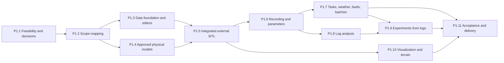

# MirageSITL Phase 1 work plan

English source of truth. [Russian mirror](ru/PHASE1_PLAN.md).

Status: proposed plan, 2026-10-28. It is derived from the approved
[project scope](../PROJECT_SCOPE.md) (audit baseline `5b4a2fc`) and an inventory
of baseline `384e974` and the unmerged branches. It registers TASK-127–TASK-191
in the [roadmap](PROJECT_ROADMAP.md). Registration implements nothing and does
not authorize development: each task starts only under an explicit development
instruction (scope section 4, guardrail 2). The scope approved no dates or
effort estimates, so this plan contains none.

## 1. Purpose and authority

* [PROJECT_SCOPE.md](../PROJECT_SCOPE.md) decides what Phase 1 includes and
  excludes. This plan changes no scope; an amendment needs stakeholder approval
  recorded in the scope document.
* The [roadmap](PROJECT_ROADMAP.md) holds each task's contract: dependencies,
  touched files, interfaces and DoD. The agent workflow in
  [CLAUDE.md](../CLAUDE.md) applies to every task.
* Each task names the scope requirement groups it serves (S01–S19). These IDs
  are unrelated to the roadmap's sprint-batch labels (S00a–S13c) and to the
  Phase 1 batch labels (P1.1a and so on).
* The inventory read the roadmap, specifications and code at `384e974`. The
  statements in section 2 describe what the code contains, not runtime
  acceptance. No tests were run for this plan.

## 2. Where the project stands

### 2.1 Verified building blocks to reuse

Each block below passed its own tests or harness. Most of them are not yet
connected to the running application.

| Area | What exists | Tasks | Used by the running app |
| --- | --- | --- | --- |
| Runtime | ABI v2 shared-memory state ring, 400/800/1200 Hz clocks with overload policies, SPSC sensor and actuator queues with 16 actuator slots, Control Protocol v2, epoch-aware rendering | TASK-007–TASK-015, TASK-085 | Yes |
| Rotor and body physics | BET with NeuralFoil polars, the production bound-rotor ABI, configurable `BetFlightDynamics` (4, 6 and 8 rotors converge to the 4800 Hz reference), arbitrary-frame wrench, RK4 rigid body | TASK-016–TASK-023, TASK-027, TASK-028, TASK-033 | No: tests and scripts only |
| Propulsion kernels | Motor and ESC with current limits, battery sag on a shared bus, coaxial wake reference | TASK-024–TASK-026 | No: test exports only |
| Contact | Compliant Rapier contact; terrain collision chunks with per-tick planes and a pause on missing ground | TASK-029, TASK-065 | No |
| Environment | ISA atmosphere and seeded AR(1) gusts; WGS84 geodesy, with absolute MSL blocked for lack of a geoid grid | TASK-032, TASK-036 | No |
| Sensors | Ideal IMU, barometer, magnetometer and airspeed; rate scheduling; seeded noise, bias walk and latency | TASK-034, TASK-035 | No |
| Native ArduPilot | JSON lockstep codec for 16 and 32 channels; closed-loop harness with live EKF admission; EW regression matrix; all on Linux/WSL with a quad X | TASK-041–TASK-043, TASK-059 | No: Node command-line tools only |
| Browser ArduPilot | WASM build, HAL mailbox, native/browser parity | TASK-044–TASK-047 | Diagnostics page only; not a Phase 1 flight mode |
| Links | MAVLink2 subset (12 messages), RC calibration and override mapping, autopilot state machine, loopback WebSocket/UDP bridge with token and Origin checks, Web Serial | TASK-037–TASK-040, TASK-048 | Partly: Web Serial telemetry only; no bridge client |
| EW and faults | GNSS jamming, position step, coherent drift, magnetic anomaly, motor faults with partial power, fault registry | TASK-052–TASK-058, TASK-124–TASK-126 | Partly: EW flags only; the demo rejects motor-loss |
| Terrain and rendering | Provider policy, 3D Tiles adapter with a local fixture, LOD budgets, WebGL2/WebGPU renderer, FPV camera, WorldCover land cover for Israel | TASK-060–TASK-062, TASK-066, TASK-067, TASK-069 | Partly: terrain only through build-time variables |
| Recording and UI | HUD with source and freshness, instructor console with an acknowledgement ledger, AAR recorder, replay, charts and archives, scenario runner | TASK-074–TASK-079, TASK-081 | Yes, for the demo |
| Evidence tooling | Model-validation report, system matrix and release manifest, GPU harness | TASK-033, TASK-073, TASK-082, TASK-083 | Not applicable |

### 2.2 What the running application does today

* It is one page without navigation. Terrain and other settings come from
  build-time variables and URL parameters.
* The physics Worker always runs the demo dynamics, a collective-thrust toy
  quad (`apps/web/src/physics.worker.ts`). The session rejects `model.load` and
  `weather.set`, and rejects motor-loss faults because the demo has no
  per-motor model.
* The application never connects to the bridge. There is no ArduPilot launch,
  parameter, mission or command UI. Pause stops only the browser Worker clock.
* The recorder writes full-rate 512-byte records into a 32 MiB ring, about
  163 s at 400 Hz, which is deleted on close. Only the radio calibration
  persists across reloads.
* Gravity is a constant 9.80665 m/s², the magnetic field is a constant vector,
  and terrain is render-only and off by default.

### 2.3 Gaps and limits found in the code

* Native SITL has run only on Linux/WSL hosts. The harness refuses Windows, the
  parity helper refuses any non-Linux host, and the ELF checks reject Mach-O
  binaries. Native SITL has never run on macOS.
* The harness flies a 4-motor quad X (`FRAME_CLASS 1`, channels 1–4,
  `--speedup 2`). No multi-motor frame, output-function or scripting-matrix
  configuration exists in the repository.
* The ABI v2 actuator frame and its SPSC slots carry exactly 16 values
  (`MAX_ACTUATORS = 16`), the Phase 1 maximum. The model manifest and BET accept
  32 rotors, and the JSON servo packets carry 16 or 32 channels.
* The bridge closes a session after 5 s without payload, which would drop a
  paused session.
* The MAVLink codec supports 12 message IDs and lacks the parameter-list,
  command, mission, position-target and status messages. `dialect.lock.json`
  lists only 4 IDs.
* No DataFlash parser exists; SITL `.BIN` logs are only copied into captures.
  UAVLogViewer appears only in documents.
* No elevation data is in the repository. FABDEM fetch and build scripts exist,
  but their output is not committed, and WorldCover is land cover, not
  elevation.
* There is no sensor-configuration UI, and the published battery current is
  always 0.

### 2.4 Unmerged, stale and inconsistent items

* Branch `claude/ardupilot-sitl-physics-review-ggf1tb` (9 commits on `27e2a6a`,
  not merged) holds increment 1 of TASK-087–TASK-090. It also has a native SITL
  build script with an opt-in `imu-noise-floor` ArduPilot patch that the user
  approved on 2026-10-26, and a registration "TASK-124 — Effect controls" that
  collides with main's TASK-124. TASK-135 lands the branch, and decision D-10
  covers the patch.
* Branch `analyze_repo_next_task` holds a Mac M4 test procedure and a TASK-073
  acceptance plan. It is not merged; TASK-132 decides what Phase 1 needs from it.
* The TASK-059 native EW reports are a historical snapshot, because TASK-125
  and TASK-126 changed the frozen sources. TASK-171 refreshes them on macOS.
* CLAUDE.md and the README cite `scripts/check-mavlink-capture.mjs` and
  `scripts/check-ew-capture.mjs`, which have never existed in the repository.
  The TASK-047 report `test-results/validation/autopilot-parity.json` is ignored
  by Git and not tracked. TASK-134 corrects these references.
* HANDOVER.md describes TASK-074 work from 2026-10-20.

Status on 2026-10-28: TASK-135 merged the physics-review branch without its
TASK-124 registration. TASK-134 replaced the references to the two missing
scripts with the real audit commands, noted on TASK-047 that its parity report
is not tracked, and retired HANDOVER.md. The `analyze_repo_next_task` branch
stays unmerged: its Mac M4 procedure predates the approved scope and gates on
TASK-073, which is not a Phase 1 gate (item A-11 in
[phase1-acceptance.md](decisions/phase1-acceptance.md)). Its static, native,
unit and browser stages can seed the TASK-127 and TASK-152 checklists.

## 3. Requirement coverage

"Reuse" lists existing work to build on after checking its integration;
"Missing" lists what no task has delivered yet.

| Scope ID | Reuse | Missing | Tasks |
| --- | --- | --- | --- |
| S01 Platform, language, offline | Capability gate, isolation headers, local WASM artifacts | macOS SITL, launcher, installation, offline inventory, Unicode names in stored records | TASK-127, TASK-131, TASK-136, TASK-137, TASK-151, TASK-152, TASK-190 |
| S02 Start, stop, connection, pause | Owned-process harness, bridge, JSON lockstep, live EKF admission, Worker pause | Launch from the UI, diagnostics and restart, manual connection, a pause that reaches ArduPilot, bridge keep-alive | TASK-129, TASK-151–TASK-156 |
| S03 Aircraft editor, motor mapping | Model manifest v1 with up to 32 rotors, vehicle manifest v2 increment (unmerged), frame wrench | Arms and pairs, editor and 3D scheme, output mapping, the 16-motor frame path, motor test | TASK-128, TASK-135, TASK-138, TASK-141, TASK-142, TASK-144, TASK-157 |
| S04 Components, input modes | Motor and ESC configuration schema, UIUC data, bench import (unmerged) | Versioned cards, calculation modes, combination-bound measurements, calibration | TASK-139, TASK-140, TASK-145 |
| S05 Flight aerodynamics | BET with free shaft and axial inflow; coaxial reference (test-only); descent flagged only | Edgewise and descent inflow, vortex ring state, ground effect, coaxial coupling and body drag in production | TASK-144, TASK-145; TASK-096–TASK-101 |
| S06 Battery, propulsion limits | Motor, ESC and battery kernels (test-only) | Production drive and bus, limit monitor, UI and logs | TASK-146; TASK-092 |
| S07 Weather, geography | ISA atmosphere, AR(1) gusts, WGS84 | Weather in sessions, turbulence spectra, discrete gusts, schedules, location choice, geographic gravity and magnetic field, geoid | TASK-148, TASK-166, TASK-167; TASK-093, TASK-106 |
| S08 Sensors tab | Sensor kernels; ownership catalog (unmerged) | Configuration schema and UI, placement and orientation, battery sensing, single ownership in the SITL path | TASK-143, TASK-147; TASK-089 |
| S09 Faults, EKF drift | EW engine and motor faults, acknowledgement ledger, scenario runner, historical native EW evidence | Delivery to external SITL, frozen and missing readings, pilot and ground-station link loss, schedule UI, EKF estimate charts, refreshed evidence | TASK-166, TASK-168–TASK-171 |
| S10 Tasks, initial conditions, speed | RC mapping, lockstep clock policy, scripted demo circuit | Command, mission and guided messages, task library, routes, maneuvers, initial conditions, accelerated runs, speed display | TASK-150, TASK-172–TASK-175 |
| S11 Parameters | Parameter frames in the codec, `.parm` generation in the harness, ArduPilot profile (unmerged) | Full list and read-back, metadata, UI, history, sets, export | TASK-159–TASK-161 |
| S12 Comparison, batches | Fidelity metrics (unmerged), resimulation interface | Result metrics, controlled comparisons, sequential batches | TASK-176, TASK-177 |
| S13 Logging | Recorder Worker, IndexedDB chunks, archives | Full-run recording, signal and rate selection, source limits, size estimates, DataFlash capture | TASK-132, TASK-162–TASK-164 |
| S14 UAVLogViewer | SITL `.BIN` files copied into captures | Viewer integration, DataFlash reader and writer, experiment adapter, comparison and alignment | TASK-130, TASK-178–TASK-181 |
| S15 Experiments from logs | Fidelity metrics and capture schema (unmerged) | Log extraction and completion, re-simulation, fidelity labels | TASK-133, TASK-182–TASK-184 |
| S16 Projects, reproducibility | Checksummed archives, seeded PRNG | Project store, versions, experiment records, Repeat and Create variant | TASK-136, TASK-165 |
| S17 Terrain, visualization | 3D Tiles adapter, LOD budgets, collision chunks, renderer, FPV camera, WorldCover | Runtime terrain selection and coverage, elevation data, geometry-driven aircraft, onboard view, trajectory and telemetry panels | TASK-131, TASK-185, TASK-186 |
| S18 Contact, accidents | Rapier contact and terrain planes | Contact in flight sessions, slopes, accident detection and pause | TASK-133, TASK-149, TASK-187; TASK-094, TASK-095 |
| S19 Acceptance | System matrix and release tools, evidence conventions | Phase 1 matrix, macOS evidence, the 16-motor hour, installation and offline acceptance | TASK-132, TASK-188–TASK-191 |

## 4. Disposition of existing roadmap tasks

TASK-134 recorded these dispositions in the roadmap on 2026-10-28, as a
**Phase 1 disposition** line on each open task and on the DONE tasks named here. A deferred task keeps its ID, contract and evidence and is not a
deletion instruction.

| Existing tasks | Phase 1 disposition | Basis |
| --- | --- | --- |
| TASK-087, TASK-088, TASK-089, TASK-090 | Required. TASK-135 landed increment 1 of each on 2026-10-28; the remaining increments continue. | S03, S04, S08, S15 |
| TASK-091 | Required for real-time 16-motor runs: the review measured an octocopter tick at about 0.70 ms against the 0.4167 ms G3 compute limit at 1200 Hz. | S10, S19 |
| TASK-092 | Required: production motor, ESC and battery bus. | S06 |
| TASK-093 | Required: weather and atmosphere in sessions. | S07 |
| TASK-094 | Required for CG offsets and the full inertia tensor, and as the base of TASK-095. | S03, S18 |
| TASK-095 | Required: compliant contact in flight sessions; the NASA comparison stays deferred. | S18 |
| TASK-096, TASK-097, TASK-098, TASK-099, TASK-100 | Required: body drag, full-range polars, inflow v2, descent regimes and ground effect. Their measured-data comparisons follow decision D-11. | S05 |
| TASK-101 | Required for coaxial pairs; the task also covers rear-rotor and airframe interference. | S05 |
| TASK-106 | Required for turbulence; Dryden spectra are the minimum Phase 1 increment. | S07 |
| TASK-103 | Optional: TASK-145 may use the table mode for measured combinations. | S04 |
| TASK-108 | Partly required: normal gravity, the WMM main field and a hashed geoid grid, delivered by TASK-148. Anomaly fields and vehicle interference are deferred. | S07 |
| TASK-115 | Partly required: placement (lever arm) and orientation, delivered by TASK-147. Temperature, Allan-variance and vibration-rectification terms are deferred. | S08 |
| TASK-102, TASK-104, TASK-105, TASK-107, TASK-114, TASK-116, TASK-117, TASK-118, TASK-119, TASK-123 | Deferred: not required by S01–S19. Load-dependent sag and electrical limits come from TASK-092 and TASK-146; heating, cooling, aging and terrain-induced flow are excluded. | Scope section 2 |
| TASK-109–TASK-113 | Deferred: fixed-wing, VTOL and other aircraft classes are later stages. | Scope section 2 |
| TASK-120, TASK-121, TASK-122 | Deferred: flexible structures and multi-aircraft wakes are excluded, and thermals and microbursts are not among the S07 weather settings. | Scope section 2, S07 |
| TASK-073 | Not a Phase 1 blocker: its gate depends on Windows-measured integrated GPUs and on thermal and FPV views that Phase 1 excludes. Its evidence and harness are preserved, and TASK-132 sets the Phase 1 rendering criteria. | Scope sections 2 and 3 |
| TASK-080 | The automated keyboard and axe checks remain regressions for new UI. The manual screen-reader sign-off is not an S19 item unless decision D-12 adds it. | S19 |
| TASK-082, TASK-083 | Their tooling is reused; Phase 1 acceptance and delivery are TASK-188–TASK-191. Their WASM, HITL and Windows rows are not Phase 1 gates. | S19 |
| TASK-059 | Its DONE evidence is a historical snapshot of the previous EW sources; TASK-171 refreshes it on macOS. | S09 |
| TASK-033, TASK-036 | The failed UIUC and deferred NASA comparisons keep their verdicts. The absolute MSL gate opens only with the TASK-148 geoid grid. | S05, S07 |
| TASK-044–TASK-047 | Browser-hosted ArduPilot is preserved but is not a Phase 1 flight mode and is not expanded. | Scope section 2 |
| TASK-048–TASK-051 | Web Serial and HIL code is preserved. HITL, Simulation-on-Hardware and writes to a real controller are outside Phase 1, and TASK-051 stays deferred. | Scope section 2 |
| TASK-063, TASK-064 | Frozen: the Google tiles proxy and the R2 cache need keys, deployment and new-provider approval. | S17, scope section 2 |
| TASK-068, TASK-070, TASK-071, TASK-072 | Frozen: analog video effects and the thermal camera are backlog. TASK-185 reuses the TASK-067 camera pose without effects. | Scope section 2 |
| Other DONE tasks | Reused after checking their actual integration. Their evidence stays as recorded and is not Phase 1 acceptance. | Scope section 3, step 2 |
| "TASK-124 — Effect controls" on the physics-review branch | Superseded by TASK-166 and not merged under that ID. | Main's TASK-124 |

The version 2 proposals in [V2_PLAN.md](V2_PLAN.md) are background only.
Workstream A, a new log viewer, is replaced by the UAVLogViewer integration of
S14. DrorPlanner (A9) and GovMap (workstream D) are excluded. Workstreams B and
C feed S05 and the aircraft profile.

## 5. Execution plan

### 5.1 Stage order

The stages follow the scope's execution plan (section 3, steps 1–11). The
dependencies in the roadmap enforce the order. Independent tasks in later
stages may start early only when all of their own dependencies are DONE.

### 5.2 Stages and tasks

Each stage lists its exit criterion and its tasks. The roadmap holds the full
contract of each task.

#### Stage P1.1: Feasibility and Decisions

Exit: macOS SITL, the 16-motor path, clock and pause, the log viewer, offline and terrain inventory, and acceptance and fidelity decisions recorded with evidence or exact blockers.

| Task | Title | Scope IDs | Depends on |
| --- | --- | --- | --- |
| TASK-127 | Native ArduPilot SITL on macOS Apple Silicon | S01, S02 | 041, 042 |
| TASK-128 | ArduPilot version and the 16-motor output path | S03, S19 | 041, 127 |
| TASK-129 | External SITL clock ownership, synchronized pause and acceleration | S02, S10 | 041, 043, 127 |
| TASK-130 | UAVLogViewer identity, license and offline-integration feasibility | S14 | 081 |
| TASK-131 | Offline dependency and existing-terrain inventory | S01, S17 | 060, 069 |
| TASK-132 | Phase 1 acceptance parameters: reference hardware, performance and recording | S13, S19 | 014 |
| TASK-133 | Model envelopes, fidelity criteria and the basic contact approximation | S05, S06, S15, S18 | 033 |

#### Stage P1.2: Scope Mapping

Exit: Documentation reconciled with the scope; the TASK-087–TASK-090 increments landed on main.

| Task | Title | Scope IDs | Depends on |
| --- | --- | --- | --- |
| TASK-134 | Reconcile the roadmap, specifications and agent instructions with PROJECT_SCOPE.md | S01–S19 | 084 |
| TASK-135 | Land the physics-review branch increments of TASK-087–TASK-090 | S03, S04, S08, S15 | 124, 125, 126 |

#### Stage P1.3: Data Foundation and Editors

Exit: Versioned projects, profiles up to 16 motors, component cards, calculation modes, output mapping and Sensors settings through the UI.

| Task | Title | Scope IDs | Depends on |
| --- | --- | --- | --- |
| TASK-136 | Local project store with immutable versions | S16, S01 | 076, 081 |
| TASK-137 | Phase 1 application shell and navigation | S01 | 005, 085, 136 |
| TASK-138 | Aircraft profile v1 for multirotors up to eight arms and 16 motors | S03 | 087, 136 |
| TASK-139 | Component cards for motors, propellers, ESCs and batteries | S04 | 090, 136 |
| TASK-140 | Calculation modes and measured component combinations | S04, S15 | 133, 137, 138, 139 |
| TASK-141 | Aircraft editor with a geometry-driven 3D scheme | S03 | 015, 137, 138, 139 |
| TASK-142 | Motor-to-output mapping and frame compatibility check | S03 | 128, 138, 141 |
| TASK-143 | Sensors tab: ideal sensors or specified errors | S08 | 089, 137, 138 |

#### Stage P1.4: Approved Physical Models

Exit: Profile-driven dynamics with propulsion, battery, aerodynamics, sensors, environment and basic contact within declared limits.

| Task | Title | Scope IDs | Depends on |
| --- | --- | --- | --- |
| TASK-144 | Profile-driven multirotor dynamics with up to 16 rotors | S03, S05 | 088, 092, 138 |
| TASK-145 | Measured-mode propulsion calibration | S04, S05 | 140, 144 |
| TASK-146 | Battery and propulsion limits: warnings versus modeled limiting | S06 | 092, 139, 144 |
| TASK-147 | Sensor error configuration in the external-SITL path | S08 | 035, 089, 143 |
| TASK-148 | Location and geographic environment | S07 | 036, 093, 131 |
| TASK-149 | Accident detection and automatic pause | S18 | 095, 144 |

#### Stage P1.5: Integrated External-SITL Session

Exit: Nominal flight of every S19 configuration through the UI on macOS.

| Task | Title | Scope IDs | Depends on |
| --- | --- | --- | --- |
| TASK-150 | MAVLink message set for Phase 1 ground-station functions | S02, S09, S10, S11 | 037 |
| TASK-151 | Local launcher service for macOS | S01, S02 | 040, 127 |
| TASK-152 | macOS installation and first-run prerequisite check | S01, S02 | 131, 151 |
| TASK-153 | Browser physics as the JSON lockstep backend for native ArduPilot | S01, S02, S03 | 043, 129, 144, 150, 151 |
| TASK-154 | Experiment start, stop, readiness and failure handling | S02 | 136, 142, 153 |
| TASK-155 | Manual connection to a running compatible SITL | S02 | 129, 153 |
| TASK-156 | Synchronized pause and resume in integrated sessions | S02 | 129, 149, 153 |
| TASK-157 | Virtual one-motor-at-a-time check | S03 | 141, 142, 154 |
| TASK-158 | Nominal flight acceptance on macOS | S01–S03 | 095, 146, 147, 152, 155, 156, 157 |

#### Stage P1.6: Recording and Parameter Provenance

Exit: Parameter read-back and export and full-run recording with provenance.

| Task | Title | Scope IDs | Depends on |
| --- | --- | --- | --- |
| TASK-159 | ArduPilot parameter service with read-back and metadata | S11 | 150, 153 |
| TASK-160 | Parameters tab: editing, history and parameter sets | S11 | 137, 156, 159 |
| TASK-161 | ArduPilot parameter file export | S11 | 159, 160 |
| TASK-162 | Experiment recorder v2 with full-run streaming and per-signal rates | S13 | 076, 136, 153 |
| TASK-163 | Logging tab with size estimates and storage monitoring | S13 | 132, 137, 162 |
| TASK-164 | ArduPilot DataFlash capture per experiment | S13, S14 | 151, 154, 159 |
| TASK-165 | Experiment lifecycle: Repeat, Create variant, export and import | S16 | 136, 154, 160, 162 |

#### Stage P1.7: Flight Tasks, Weather, Faults and Batches

Exit: Repeatable tasks, weather and fault schedules, EKF drift, run speed, batches and comparisons.

| Task | Title | Scope IDs | Depends on |
| --- | --- | --- | --- |
| TASK-166 | Effect control contract for weather, sensor errors and faults | S07, S08, S09 | 010, 075, 079, 089, 093, 156 |
| TASK-167 | Weather tab with scheduled changes and repeatable gusts | S07 | 106, 137, 148, 166 |
| TASK-168 | Sensor dropout, frozen readings and link-loss effects | S09 | 057, 147, 153, 166 |
| TASK-169 | Faults and interference tab with schedules and outcomes | S09 | 137, 166, 168 |
| TASK-170 | EKF drift scenario with truth-versus-estimate charts | S09 | 055, 150, 162, 169 |
| TASK-171 | Refresh EW and fault regression evidence on macOS native SITL | S09 | 059, 127, 168 |
| TASK-172 | Flight task library with routes and initial conditions | S10 | 150, 153, 165 |
| TASK-173 | Tuning maneuvers with requested-versus-actual response | S10 | 162, 172 |
| TASK-174 | Manual flight with a controller in integrated sessions | S10 | 038, 153 |
| TASK-175 | Real-time and accelerated runs with visible actual speed | S10 | 132, 153, 156 |
| TASK-176 | Sequential user-defined parameter batches | S12 | 158, 161, 165, 172 |
| TASK-177 | Experiment comparison and result metrics | S12 | 140, 146, 165, 173 |

#### Stage P1.8: Log Analysis with UAVLogViewer

Exit: UAVLogViewer integrated with DataFlash and experiment logs and comparisons.

| Task | Title | Scope IDs | Depends on |
| --- | --- | --- | --- |
| TASK-178 | DataFlash reader and writer | S14, S15 | 004 |
| TASK-179 | Bundle the pinned UAVLogViewer for offline use | S14 | 130, 137, 152 |
| TASK-180 | Open MirageSITL experiments in the viewer with context | S14 | 160, 164, 165, 178, 179 |
| TASK-181 | Two-flight and two-interval comparison in the viewer | S14 | 180 |

#### Stage P1.9: Experiments from Logs and Fidelity

Exit: Log-based experiments, re-simulation and fidelity evidence per profile version.

| Task | Title | Scope IDs | Depends on |
| --- | --- | --- | --- |
| TASK-182 | Create an experiment from a real log | S15 | 165, 172, 178 |
| TASK-183 | Re-simulation with changed parameters and comparison with the original flight | S15 | 177, 181, 182 |
| TASK-184 | Fidelity assessment per profile version and regime | S15 | 090, 133, 183 |

#### Stage P1.10: Visualization and Existing Terrain

Exit: Geometry-driven views, terrain sources and contact on real terrain.

| Task | Title | Scope IDs | Depends on |
| --- | --- | --- | --- |
| TASK-185 | Geometry-driven aircraft model, views and telemetry panels | S17 | 067, 141, 153 |
| TASK-186 | Terrain source selection, coverage and missing-terrain pause | S17 | 065, 131, 148, 156 |
| TASK-187 | Contact on sloped real terrain in integrated sessions | S18 | 095, 149, 186 |

#### Stage P1.11: Integrated Acceptance and Local Delivery

Exit: S19 executed on macOS with PASS, FAIL, BLOCKED and NOT_RUN recorded.

| Task | Title | Scope IDs | Depends on |
| --- | --- | --- | --- |
| TASK-188 | Phase 1 acceptance matrix harness | S19 | 132, 134, 158 |
| TASK-189 | Sixteen-motor one-hour simulated-time run with recording | S19 | 091, 162, 175, 188 |
| TASK-190 | macOS delivery: installation, restart, offline operation and recovery | S01, S19 | 152, 179, 188 |
| TASK-191 | Phase 1 acceptance report | S19 | 096, 098, 099, 100, 101, 106, 145, 163, 167, 170, 171, 174, 176, 177, 181, 184, 185, 187, 189, 190 |

### 5.3 Parallel tracks and critical path

* **Autopilot integration:** TASK-127 → TASK-128, TASK-129 and TASK-151 →
  TASK-152 and TASK-153 (which also needs TASK-144 and TASK-150) →
  TASK-154–TASK-157 → TASK-158.
* **Data and UI:** TASK-136 → TASK-137, TASK-138 and TASK-139 →
  TASK-140–TASK-143.
* **Physics:** TASK-135 → TASK-087–TASK-090 → TASK-092–TASK-095 →
  TASK-096–TASK-101 and TASK-106. TASK-091 can start at once and precedes
  TASK-097 and TASK-098. TASK-144–TASK-149 connect the models to profiles,
  limits, sensors, environment and accidents.
* **Analysis:** TASK-130 → TASK-179; TASK-178 and TASK-179 → TASK-180 →
  TASK-181; TASK-178 → TASK-182 → TASK-183 → TASK-184.
* **Decisions:** TASK-132 and TASK-133 run early because the stakeholder owns
  their values. Later acceptance uses them unchanged.

By task count, the longest chain of open tasks to the acceptance report is TASK-087 → TASK-088 → TASK-094 → TASK-095 → TASK-149 → TASK-156 → TASK-160 → TASK-165 → TASK-172 → TASK-173 → TASK-177 → TASK-183 → TASK-184 → TASK-191 (14 tasks; effort was not estimated). In practice TASK-135 comes first, because TASK-087 and TASK-088 continue from the increments it lands. TASK-191 depends directly or transitively on 79 open tasks: 63 of the new tasks and the 16 existing tasks TASK-087–TASK-101 and TASK-106. TASK-135 has no dependents in the graph.

### 5.4 Milestones

| Milestone | Complete when |
| --- | --- |
| M1 Feasibility recorded | TASK-127–TASK-133 are DONE or carry an exact BLOCKED status, and decisions D-01–D-09 are taken or escalated. |
| M2 Foundations | TASK-134, TASK-135, TASK-087–TASK-090 and TASK-136–TASK-143 are DONE. |
| M3 First integrated flight on macOS | TASK-158 passes for every S19 configuration. |
| M4 Tuning workflow | TASK-159–TASK-177 are DONE. |
| M5 Log analysis | TASK-178–TASK-184 are DONE. |
| M6 Phase 1 acceptance | TASK-185–TASK-191 are DONE, and the TASK-191 report records every S19 criterion. |

## 6. Decisions and evidence still required

Scope section 3 lists D-01–D-09. D-10–D-12 arose from this inventory. A
decision belongs to the stakeholder; a task records it with its date and does
not invent a value.

| ID | Decision or evidence | Recorded in | Blocks |
| --- | --- | --- | --- |
| D-01 | ArduPilot version or versions and the complete 16-output path; a firmware limit is escalated, never a reason to reduce scope | TASK-128 | TASK-142 |
| D-02 | Native macOS launch method; any virtual machine or container fallback needs its own decision | TASK-127 | TASK-151 |
| D-03 | Clock ownership, pause without induced failsafe, parameter access while paused, and acceleration | TASK-129 | TASK-153, TASK-155, TASK-156 |
| D-04 | UAVLogViewer identity, version, license, offline bundling and extension approach | TASK-130 | TASK-179 |
| D-05 | Import and export formats for measured data and models, validation rules, and the common default logging frequency | TASK-132, TASK-136, TASK-139, TASK-140 | TASK-163 |
| D-06 | Models, inputs, envelopes, numerical tolerances, fidelity criteria and confidence labels | TASK-133 | TASK-140, TASK-145, TASK-184 |
| D-07 | Basic support and contact approximation, without gear editing | TASK-133 | TASK-187 |
| D-08 | Reference Macs, macOS and Chrome versions, real-time and rendering budgets, recording workloads, and the TASK-073 reconciliation | TASK-132 | TASK-163, TASK-175, TASK-188, TASK-189 |
| D-09 | Available imagery and elevation data and their licenses, including terrain derived with the FABDEM tooling, and offline assets | TASK-131 | TASK-148, TASK-186 |
| D-10 | Whether the 2026-10-26 approval of the opt-in `imu-noise-floor` ArduPilot patch stands under scope guardrail 5 | TASK-135 | MirageSITL ownership of the IMU noise floors in TASK-147 |
| D-11 | Whether Phase 1 integration may rely on implemented effects whose measured-data comparisons in the TASK-097–TASK-101 DoD stay BLOCKED_EXTERNAL, labeled as not validated | TASK-134 | TASK-191 |
| D-12 | Whether the manual accessibility sign-off of TASK-080 is part of Phase 1 acceptance | TASK-134 | TASK-191 |

Decisions taken by the stakeholder on 2026-10-28:

* D-05 (logging frequency part only) and D-08: items A-01 to A-12 in
  [phase1-acceptance.md](decisions/phase1-acceptance.md). The matrix uses X8
  as its paired configuration.
* D-06 and D-07: F-01 to F-09 in
  [phase1-fidelity.md](decisions/phase1-fidelity.md). MirageSITL sets no
  validation limits and gives no fidelity verdicts; the user judges the
  comparisons (scope amendment SA-01).
* D-09: MirageSITL is non-commercial, so the listed datasets are usable for it;
  license questions are not raised with the stakeholder again.
* D-04 (decided by TASK-130): a patch series on the pinned UAVLogViewer commit,
  embedded through an origin-checked message interface; see
  [uavlogviewer.md](decisions/uavlogviewer.md).
* D-10: no `imu-noise-floor` patch for now; Phase 1 uses stock ArduPilot SITL.
* D-11: Phase 1 uses the implemented effects whose measured-data comparisons
  stay BLOCKED_EXTERNAL, labeled as not validated.
* D-12: the manual screen-reader sign-off of TASK-080 is not part of Phase 1
  acceptance; the automated keyboard and axe checks remain.

## 7. Risks

| Risk | Effect | Early check | Response |
| --- | --- | --- | --- |
| Stock ArduCopter or its SITL cannot drive 16 motors on eight coaxial arms | A mandatory configuration is blocked | TASK-128 | Escalate the options (stock scripting-matrix frame, build option, approved patch); never reduce scope |
| The native SITL build or harness fails on macOS on Apple Silicon | No Phase 1 backend | TASK-127 | Record the exact blocker; a virtual machine or container only by decision |
| ArduPilot stops serving MAVLink or trips failsafes while lockstep time is frozen; the bridge drops idle sessions after 5 s | The pause requirement is not met | TASK-129 | Bridge keep-alive; document which parameter access works while paused |
| Sixteen BET rotors exceed the real-time compute budget in a browser Worker | Real-time runs drop steps | TASK-091, TASK-144 | Physics rate per configuration (TASK-132); accelerated runs never simplify the model |
| Browser throttling or tab visibility interrupts hour-long runs | The endurance run fails | TASK-156, TASK-175 | Lockstep pacing in the Worker, an explicit visibility policy, actual speed on screen |
| Full-run recordings exceed the browser storage quota | Recording gaps | TASK-162, TASK-163 | Estimates, warnings before exhaustion, explicit gaps |
| The UAVLogViewer license or online-only dependencies prevent offline bundling | S14 is blocked | TASK-130 | Escalate; no silent replacement viewer |
| Measured data for descent, ground effect, coaxial pairs or real flights is unavailable | Fidelity stays unverified | TASK-133 | S15 labels; decision D-11 |
| The unmerged physics-review branch drifts further from main | Rework and a duplicate task ID | TASK-135 | Closed: TASK-135 landed the branch on 2026-10-28 |
| MirageSITL and ArduPilot both apply a sensor error | Invalid sensor behavior | TASK-089, TASK-147 | Ownership-matrix validation, owner shown in the UI |
| A terrain data license restricts use | Real terrain is limited | TASK-131 | The synthetic pad remains available; decision D-09 |

## 8. Rules for executing Phase 1 tasks

1. Start a task only under an explicit development instruction. Record
   IN_PROGRESS with the owner, baseline SHA, contract and a failing test, as
   [CLAUDE.md](../CLAUDE.md) section 4 requires.
2. Name the task's scope IDs in its evidence. Changing behavior, adding a
   feature or unfreezing deferred work needs recorded stakeholder agreement.
3. Do not modify ArduPilot source or firmware. Configuring stock frames,
   outputs and parameters is allowed; decision D-10 governs the opt-in patch.
4. Phase 1 acceptance evidence comes from the agreed Apple Silicon Macs in
   Chrome. Cloud Linux runs and historical Windows/WSL results never
   substitute for it, although CI keeps running unit and browser tests on Linux.
5. Keep true state separate from sensor and EKF observations, and keep event
   timing, source versions, model versions and recording limits visible.
6. Never weaken a limit, relabel a failure, fabricate a measurement or reuse a
   stale report as current acceptance.
7. Change English sources and their Russian mirrors together and run
   `npm run check:docs`.
