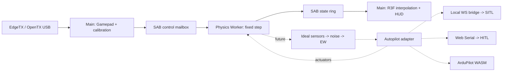

# MirageSITL architecture

English source. [Russian mirror](ru/architecture.md).
The detailed task source is [PROJECT_ROADMAP.md](PROJECT_ROADMAP.md).

## Milestone 01: implemented boundaries

The working vertical slice includes React 19/R3F/WebGL, a module Worker,
constant `dt = 1/400 s`, atomic SAB transport, Gamepad calibration, demo
quadrotor dynamics, visualization, and diagnostics. JSBSim/BET, ArduPilot,
EW, and physical HITL are not implemented. Demonstration aerodynamics are
not validated for pilot training.

400–1200 Hz and 60–120 FPS are target budgets. Fixed dt does not guarantee
execution every 2.5 ms: browser timers, GC, the OS, and background-tab
policies provide no hard real-time guarantee. M4/RTX 4050 performance has
not yet been measured.

## Directory structure

```text
apps/web/
  src/App.tsx                 # HUD, controls, calibration
  src/runtime.ts              # Gamepad/rAF, lifecycle, SAB reads
  src/FlightScene.tsx         # Position/SLERP in R3F useFrame
  src/coordinates.ts          # NED to Three.js
  src/physics.worker.ts       # Physics owner and fixed-step scheduler
  vite.config.ts              # COOP/COEP for dev and preview
packages/
  protocol/src/index.ts       # ABI v1, types, SAB readers/writers
  physics/src/index.ts        # Demo dynamics and bounded scheduler
  input/src/index.ts          # Gamepad and channel calibration
docs/
  PROJECT_ROADMAP.md          # English task source
  SPECS_SHARED_MEMORY.md      # Implemented v1 and target v2
  SPECS_SIMULATION_ENGINES.md # Target physics and EW contracts
  architecture.md
  shared-memory.md
  ru/                        # Russian documentation mirrors
tests/
  *.test.ts                  # ABI, physics, scheduler, input
  browser/simulation.spec.ts # Real Worker/SAB, UI, mock USB
```

The following components are planned; these directories do not yet exist:

| Directory | Responsibility |
| --- | --- |
| `apps/bridge` | Local WS to ArduPilot JSON/UDP and MAVLink |
| `packages/wasm-jsbsim` | Pinned JSBSim/Emscripten with C ABI |
| `packages/wasm-bet` | Rotor/frame wrapper, native reference and WASM |
| `packages/sensors` | IMU/GNSS/magnetometer, noise, bias, timestamps |
| `packages/autopilot` | Direct/external SITL/WASM SITL/HITL adapters |
| `packages/ew` | Scenario observation faults and hazard volumes |
| `packages/terrain` | Streaming visual LOD and independent collision LOD |
| `packages/aar` | Input/actuator/truth/EKF recording and replay |
| `services/tiles-worker` | Cloudflare proxy, quotas, permitted caching |
| `native` | Source/toolchain pins and WASM reference tests |

## Threads and ownership



Worker owns truth, simulation time, and integration. Main owns DOM/WebGL,
Gamepad, and permissions. Physics never reads the scene graph or waits for
rendering. React receives summaries approximately every 150 ms. R3F reads
the latest two states, SLERPs orientation, and linearly interpolates position.
If concurrent publication/reset yields nonadjacent ticks, use the latest
coherent state instead of interpolation.

High-rate data uses SAB; postMessage carries init/lifecycle/error events.
Extensions require separate typed sensor/actuator buffers. The current
physics hot path reuses input/state/scratch with no explicit per-step
allocations. A Worker has its own JS heap, but cannot promise absolute
isolation from GC/OS latency. Preallocate WASM memory and exclude growth,
terrain loading, network I/O, and decoding from fixed-step computation.

## Clocks, overload, and input safety

FixedStepClock tracks performance.now deadlines while passing constant dt
to integration. At most eight steps run per callback before yielding to
lifecycle messages. Nested setTimeout may be clamped to roughly 4 ms;
one callback may therefore perform multiple physical steps.

When catch-up exceeds its budget, whole wall-clock intervals are discarded
and DroppedSteps/Overruns increase. Simulation time increases only for
executed steps. Never substitute a large variable dt. Pause/resume resets
deadlines; reset stops and clears dynamics. Hiding the tab disarms and
pauses. Worker independently rejects input older than 250 ms, nonfinite
values, and disconnected/disarmed controls. Target thrust becomes zero;
modeled rotor response decays with spool lag.

SITL needs a separate sensor/actuator lockstep policy with simulation
timestamps. HITL uses physical time: overload invalidates/stops the session;
fast-forward is not valid for a real FC.

Gamepad API belongs to Window, not a normal Worker. rAF polling incurs
USB/HID/browser/display delay. Measure p50/p95/p99 input age and end-to-end
latency; zero input lag is unattainable. Initial axes
`roll=0,pitch=1,yaw=3,throttle=2` are assumptions, not an EdgeTX standard.
UI configures indices/endpoints/center/inversion with 3.5% deadzone on
centered channels. Calibration currently lasts one session. Source/device/
calibration changes disarm. Disconnect never silently selects another
transmitter. Arming requires throttle <=5%.

## Coordinates and physics backends

Use SI and right-handed NED. Body axes are FRD. Quaternion `(w,x,y,z)`
rotates FRD to NED, and p/q/r are right-hand body rates in rad/s.
Three.js uses `(x,y,z)=(east,-down,-north)`, a rotation without reflection.
Future WGS84/ECEF and origin shifts retain float64 geodesy while GPU
coordinates stay local float32.

The demo is a rate-controlled toy quad with collective thrust, first-order
spool lag, quaternion, gravity, and linear drag. Translation uses
semi-implicit Euler; `down<=0` constrains a flat ground plane. Voltage is
an illustrative throttle-dependent indicator, not electrochemistry. There
are no individual motors, landing-gear contacts, rotor BET, or autorotation.

The target DynamicsBackend provides reset(config),
step(dt, actuatorFrame, atmosphere, contactInput), and
readTruth(preallocatedOutput), refined into the typed stepInto facade in
the engine specification. Autopilot supplies actuators; physics produces
forces and moments.

* JSBSim retains its own equations of motion. Convert ft/slugs and frame
  conventions explicitly at the C ABI boundary.
* BET computes element-relative flow, angle of attack, Re/Mach polar lookup,
  and integrated forces/moments. Autorotation requires aerodynamic torque,
  inertia, flapping, and induced-flow dynamics rather than prescribed RPM.
* Arbitrary frames use `F=sum R_i*F_i` and
  `M=sum(r_i cross R_i*F_i + R_i*M_i)` in body coordinates. ESC, voltage,
  rotor inertia, and coaxial interactions have separate states.
* Rapier/Jolt integration has one rigid-body owner. BET may supply solver
  forces; JSBSim needs consistent contact impulse coupling. Two independent
  integrators for one body are forbidden.

## ArduPilot integration boundaries

Modes are mutually exclusive. Lifecycle:
`disconnected -> initializing -> warming -> ready -> running -> fault`.

1. **External SITL is the first target backend.** Development bridge:
   `ws://localhost:9002`. HTTPS deployment must check mixed-content/Private
   Network Access and use trusted local WSS where necessary. Bind loopback,
   validate Origin/session, and bound message size/rate. JSON/UDP physics
   provides truth/sensor lockstep; MAVLink provides RC/commands/diagnostics.
   RC_CHANNELS_OVERRIDE alone does not integrate external physics.
2. **WASM ArduPilot is a feasibility project.** HAL, scheduler, storage,
   sockets, licenses, clocks, and native parity all need verification.
   Compiling a binary to WASM alone does not establish a working port.
3. **HITL targets Chromium on macOS/Windows.** Require a secure context
   and a user gesture for requestPort. Safari/Firefox are not target HITL
   browsers. MAVLink2 parsing checks CRC/dialect/seq/sysid/compid and signing
   when required. HIL_SENSOR runs at 200–400 Hz; HIL_GPS at 5–10 Hz;
   HIL_ACTUATOR_CONTROLS uses consistent timestamps. Verify message/build/HIL
   support on the exact ArduPilot firmware/board. SITL support does not
   establish hardware HIL capability.

At 8N1, the serial ceiling is baud/10 bytes/s including framing and all
traffic. 115200 may be insufficient; measure headroom and use supported FC
baud rates. Selecting a port does not validate a closed loop.

Warmup means 30 seconds of simulation time in SITL lockstep, without EW,
with coherent IMU/GNSS/mag timestamps. Readiness depends on EKF health,
status, and innovations, not merely a timer. HITL cannot fast-forward
physical FC filters. Neither warmup nor MAVLink is implemented yet.

## EW, terrain, cameras, and AAR

Keep truth unchanged: truth -> ideal sensors -> noise/bias -> EW -> adapter.
Each sensor defines rates, latency, axes, units, and seeded RNG. ABI inertial
acceleration includes gravity; HIL accelerometers need specific force after
subtracting gravity and rotating into body axes.

Bound inverse-square exposure with positive r_min and saturation; cones
include direction/aperture. A receiver model is required: power is not
satellite count. GNSS loss/spoofing changes observations. Coherent drift
integrates position/velocity consistently rather than teleporting truth.
Magnetic errors use sensor axes. Motor faults act on a selected actuator
before force aggregation. EKF/mode behavior depends on firmware, parameters,
and other sensors; do not promise gate bypass or a particular failsafe
without pinned scenario regression evidence.

WebGL2 is the baseline. WebGPU is a separate capability-detected backend
with visual parity tests; the browser chooses Metal/DX12. Bound DPR,
textures, and tile LOD. RTX 4050 has 6 GB shared with browser/framebuffer
needs; M4 uses shared RAM. Terrain decoding must not run in Physics Worker.

Google Photorealistic Tiles requires billing, keys, attribution, and Map
Tiles API compliance. **Persistent Google tile copying into R2 and prefetching
a 10–15 km region are not assumed authorized.** Check licensing/caching
rules first. Cache only permitted content/TTLs or use owned/licensed offline
tiles. Cloudflare proxy hides keys, enforces origin/session/quota, and
respects provider TTLs. COEP requires CORS/CORP for external tiles/WASM.

Analog FPV is postprocessing independent of truth. WorldCover/OSM gives
surface classes, not temperature. Thermal modeling needs emissivity,
weather, solar heating, inertia, attenuation, and calibration data. AO
does not calculate heat. Start with controlled synthetic materials and
a defined GPU budget.

The state ring holds only about 0.64 s for rendering. AAR needs a separate
bounded recorder Worker/IndexedDB with inputs, actuators, truth, sensors,
EKF, seed/config/version/events, and explicit losses. State replay differs
from resimulation; compare native/WASM within declared numerical tolerances.

## Implementation milestones and acceptance

| Milestone | Result | Verification |
| --- | --- | --- |
| 01 — current | Worker/SAB/Gamepad/demo | Unit tests; real-browser Worker, flight/pause/reset, mock USB |
| 02 | WASM physics facade and sensors | Forces/moments, specific force, contact/energy, 400/800/1200 convergence |
| 03 | External SITL lockstep | Arm/takeoff/land, EKF readiness, RC, link loss, pinned ArduPilot |
| 04 | BET/frames/autorotation | Thrust curves, torque balance, energy, spool/battery, measured references |
| 05 | EW and AAR | Seeded replay, truth/observation separation, EKF/mode response |
| 06 | HITL | Physical board/firmware, sustained throughput, jitter/loss/failsafe |
| 07 | Terrain/FPV/thermal/WebGPU | Licensing/attribution, VRAM/LOD, M4/RTX 4050 evidence |
| Feasibility | ArduPilot WASM | External/native SITL parity before enabling the mode |

These capability milestones are not the detailed Phase 0–6 sprint schedule;
the roadmap defines dependencies and execution order.

Measure production on M4 and RTX 4050 with a visible tab after warmup:
frame-time p50/p95/p99, Worker compute/deadline lateness, executed steps/s,
dropped wall time, input age, sensor jitter, GPU memory, and end-to-end
latency. 120 FPS allows 8.33 ms/frame; 60 FPS allows 16.67 ms. A 1200 Hz
physics step has 0.833 ms and needs headroom. Headless cloud smoke does
not establish these performance budgets.
