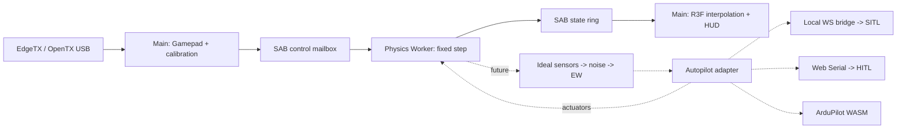

# MirageSITL architecture

English source. [Russian mirror](ru/architecture.md).
The detailed task source is [PROJECT_ROADMAP.md](PROJECT_ROADMAP.md).

## Milestone 01: implemented boundaries

The working vertical slice includes React 19/R3F/WebGL, a module Worker,
constant `dt = 1/400 s`, atomic SAB transport, Gamepad calibration, demo
quadrotor dynamics, visualization, and diagnostics. JSBSim/BET, ArduPilot,
EW, and physical HITL are not implemented. Demonstration aerodynamics are
not validated for pilot training.

400–1200 Hz and 60–120 FPS are target budgets. Fixed dt does not guarantee
execution every 2.5 ms: browser timers, GC, the OS, and background-tab
policies provide no hard real-time guarantee. M4/RTX 4050 performance has
not yet been measured.

## Directory structure

```text
apps/web/
  src/App.tsx                 # HUD, controls, calibration
  src/capabilities.ts         # API checks and implemented mode eligibility
  src/runtime.ts              # Gamepad/rAF, lifecycle, SAB reads
  src/FlightScene.tsx         # Position/SLERP in R3F useFrame
  src/coordinates.ts          # NED to Three.js
  src/physics.worker.ts       # Physics owner and fixed-step scheduler
  vite.config.ts              # COOP/COEP for dev and preview
packages/
  protocol/src/index.ts       # ABI v1, types, SAB readers/writers
  physics/src/index.ts        # Demo dynamics and bounded scheduler
  physics/src/model-manifest.ts # Verified configuration registry
  physics/src/model.schema.json # Strict serialized model schema
  test-support/src/           # Fixture verification and seeded streams
  input/src/index.ts          # Gamepad and channel calibration
docs/
  PROJECT_ROADMAP.md          # English task source
  SPECS_SHARED_MEMORY.md      # Implemented v1 and target v2
  SPECS_SIMULATION_ENGINES.md # Target physics and EW contracts
  architecture.md
  shared-memory.md
  ru/                        # Russian documentation mirrors
tests/
  *.test.ts                  # ABI, physics, scheduler, input
  browser/simulation.spec.ts # Real Worker/SAB, UI, mock USB
```

The following components are planned; these directories do not yet exist:

| Directory | Responsibility |
| --- | --- |
| `apps/bridge` | Local WS to ArduPilot JSON/UDP and MAVLink |
| `packages/wasm-jsbsim` | Pinned JSBSim/Emscripten with C ABI |
| `packages/wasm-bet` | Rotor/frame wrapper, native reference and WASM |
| `packages/sensors` | IMU/GNSS/magnetometer, noise, bias, timestamps |
| `packages/autopilot` | Direct/external SITL/WASM SITL/HITL adapters |
| `packages/ew` | Scenario observation faults and hazard volumes |
| `packages/terrain` | Streaming visual LOD and independent collision LOD |
| `packages/cameras` | Mounted FPV camera, lens distortion, analog video effects |
| `packages/aar` | Input/actuator/truth/EKF recording and replay |
| `services/tiles-worker` | Cloudflare proxy, quotas, permitted caching |
| `native` | Source/toolchain pins and WASM reference tests |

## Threads and ownership



Worker owns truth, simulation time, and integration. Main owns DOM/WebGL,
Gamepad, and permissions. Physics never reads the scene graph or waits for
rendering. React receives summaries approximately every 150 ms. R3F reads
the latest two states, SLERPs orientation, and linearly interpolates position.
If concurrent publication/reset yields nonadjacent ticks, use the latest
coherent state instead of interpolation.

High-rate data uses SAB; postMessage carries init/lifecycle/error events.
Extensions require separate typed sensor/actuator buffers. The current
physics hot path reuses input/state/scratch with no explicit per-step
allocations. A Worker has its own JS heap, but cannot promise absolute
isolation from GC/OS latency. Preallocate WASM memory and exclude growth,
terrain loading, network I/O, and decoding from fixed-step computation.

## Clocks, overload, and input safety

The Worker's `SteppingPolicy` (a `MultiRateClock`) tracks performance.now deadlines while passing constant dt
to integration. At most eight steps run per callback before yielding to
lifecycle messages. Nested setTimeout may be clamped to roughly 4 ms;
one callback may therefore perform multiple physical steps.

When catch-up exceeds its budget, whole wall-clock intervals are discarded
and DroppedSteps/Overruns increase. Simulation time increases only for
executed steps. Never substitute a large variable dt. Pause/resume resets
deadlines; reset stops and clears dynamics. Hiding the tab disarms and
pauses. Worker independently rejects input older than 250 ms, nonfinite
values, and disconnected/disarmed controls. Target thrust becomes zero;
modeled rotor response decays with spool lag.

SITL needs a separate sensor/actuator lockstep policy with simulation
timestamps. HITL uses physical time: overload invalidates/stops the session;
fast-forward is not valid for a real FC.

Gamepad API belongs to Window, not a normal Worker. rAF polling incurs
USB/HID/browser/display delay. Measure p50/p95/p99 input age and end-to-end
latency; zero input lag is unattainable. Initial axes
`roll=0,pitch=1,yaw=3,throttle=2` are assumptions, not an EdgeTX standard.
UI configures indices/endpoints/center/inversion with 3.5% deadzone on
centered channels. Calibration currently lasts one session. Source/device/
calibration changes disarm. Disconnect never silently selects another
transmitter. Arming requires throttle <=5%.

## Coordinates and physics backends

Use SI and right-handed NED. Body axes are FRD. Quaternion `(w,x,y,z)`
rotates FRD to NED, and p/q/r are right-hand body rates in rad/s.
Three.js uses `(x,y,z)=(east,-down,-north)`, a rotation without reflection.
Future WGS84/ECEF and origin shifts retain float64 geodesy while GPU
coordinates stay local float32.

The demo is a rate-controlled toy quad with collective thrust, first-order
spool lag, quaternion, gravity, and linear drag. Translation uses
semi-implicit Euler; `down<=0` constrains a flat ground plane. Voltage is
an illustrative throttle-dependent indicator, not electrochemistry. There
are no individual motors, landing-gear contacts, rotor BET, or autorotation.

The target DynamicsBackend provides reset(config),
step(dt, actuatorFrame, atmosphere, contactInput), and
readTruth(preallocatedOutput), refined into the typed stepInto facade in
the engine specification. Autopilot supplies actuators; physics produces
forces and moments.

* JSBSim retains its own equations of motion. Convert ft/slugs and frame
  conventions explicitly at the C ABI boundary.
* BET computes element-relative flow, angle of attack, Re/Mach polar lookup,
  and integrated forces/moments. Autorotation requires aerodynamic torque,
  inertia, flapping, and induced-flow dynamics rather than prescribed RPM.
* Arbitrary frames use `F=sum R_i*F_i` and
  `M=sum(r_i cross R_i*F_i + R_i*M_i)` in body coordinates. ESC, voltage,
  rotor inertia, and coaxial interactions have separate states.
* Rapier/Jolt integration has one rigid-body owner. BET may supply solver
  forces; JSBSim needs consistent contact impulse coupling. Two independent
  integrators for one body are forbidden.

## ArduPilot integration boundaries

Modes are mutually exclusive. Lifecycle:
`disconnected -> initializing -> warming -> ready -> running -> fault`.

1. **External SITL is the first target backend.** Development bridge:
   `ws://localhost:9002`. HTTPS deployment must check mixed-content/Private
   Network Access and use trusted local WSS where necessary. Bind loopback,
   validate Origin/session, and bound message size/rate. JSON/UDP physics
   provides truth/sensor lockstep; MAVLink provides RC/commands/diagnostics.
   RC_CHANNELS_OVERRIDE alone does not integrate external physics.
2. **WASM ArduPilot is a feasibility project.** HAL, scheduler, storage,
   sockets, licenses, clocks, and native parity all need verification.
   Compiling a binary to WASM alone does not establish a working port.
3. **HITL targets Chromium on macOS/Windows.** Require a secure context
   and a user gesture for requestPort. Safari/Firefox are not target HITL
   browsers. MAVLink2 parsing checks CRC/dialect/seq/sysid/compid and signing
   when required. HIL_SENSOR runs at 200–400 Hz; HIL_GPS at 5–10 Hz;
   HIL_ACTUATOR_CONTROLS uses consistent timestamps. Verify message/build/HIL
   support on the exact ArduPilot firmware/board. SITL support does not
   establish hardware HIL capability.

At 8N1, the serial ceiling is baud/10 bytes/s including framing and all
traffic. 115200 may be insufficient; measure headroom and use supported FC
baud rates. Selecting a port does not validate a closed loop.

Warmup means 30 seconds of simulation time in SITL lockstep, without EW,
with coherent IMU/GNSS/mag timestamps. Readiness depends on EKF health,
status, and innovations, not merely a timer. HITL cannot fast-forward
physical FC filters. Neither warmup nor MAVLink is implemented yet.

## EW, terrain, cameras, and AAR

Keep truth unchanged: truth -> ideal sensors -> noise/bias -> EW -> adapter.
Each sensor defines rates, latency, axes, units, and seeded RNG. ABI inertial
acceleration includes gravity; HIL accelerometers need specific force after
subtracting gravity and rotating into body axes.

Bound inverse-square exposure with positive r_min and saturation; cones
include direction/aperture. A receiver model is required: power is not
satellite count. GNSS loss/spoofing changes observations. Coherent drift
integrates position/velocity consistently rather than teleporting truth.
Magnetic errors use sensor axes. Motor faults act on a selected actuator
before force aggregation. EKF/mode behavior depends on firmware, parameters,
and other sensors; do not promise gate bypass or a particular failsafe
without pinned scenario regression evidence.

WebGL2 is the baseline. WebGPU is a separate capability-detected backend
with visual parity tests; the browser chooses Metal/DX12. Bound DPR,
textures, and tile LOD. RTX 4050 has 6 GB shared with browser/framebuffer
needs; M4 uses shared RAM. Terrain decoding must not run in Physics Worker.

Google Photorealistic Tiles requires billing, keys, attribution, and Map
Tiles API compliance. **Persistent Google tile copying into R2 and prefetching
a 10–15 km region are not assumed authorized.** Check licensing/caching
rules first. Cache only permitted content/TTLs or use owned/licensed offline
tiles. Cloudflare proxy hides keys, enforces origin/session/quota, and
respects provider TTLs. COEP requires CORS/CORP for external tiles/WASM.

Analog FPV is postprocessing independent of truth. WorldCover/OSM gives
surface classes, not temperature. Thermal modeling needs emissivity,
weather, solar heating, inertia, attenuation, and calibration data. AO
does not calculate heat. Start with controlled synthetic materials and
a defined GPU budget.

The state ring holds only about 0.64 s for rendering. AAR needs a separate
bounded recorder Worker/IndexedDB with inputs, actuators, truth, sensors,
EKF, seed/config/version/events, and explicit losses. State replay differs
from resimulation; compare native/WASM within declared numerical tolerances.

## Implementation milestones and acceptance

| Milestone | Result | Verification |
| --- | --- | --- |
| 01 — current | Worker/SAB/Gamepad/demo | Unit tests; real-browser Worker, flight/pause/reset, mock USB |
| 02 | WASM physics facade and sensors | Forces/moments, specific force, contact/energy, 400/800/1200 convergence |
| 03 | External SITL lockstep | Arm/takeoff/land, EKF readiness, RC, link loss, pinned ArduPilot |
| 04 | BET/frames/autorotation | Thrust curves, torque balance, energy, spool/battery, measured references |
| 05 | EW and AAR | Seeded replay, truth/observation separation, EKF/mode response |
| 06 | HITL | Physical board/firmware, sustained throughput, jitter/loss/failsafe |
| 07 | Terrain/FPV/thermal/WebGPU | Licensing/attribution, VRAM/LOD, M4/RTX 4050 evidence |
| Feasibility | ArduPilot WASM | External/native SITL parity before enabling the mode |

These capability milestones are not the detailed Phase 0–6 sprint schedule;
the roadmap defines dependencies and execution order.

Measure production on M4 and RTX 4050 with a visible tab after warmup:
frame-time p50/p95/p99, Worker compute/deadline lateness, executed steps/s,
dropped wall time, input age, sensor jitter, GPU memory, and end-to-end
latency. 120 FPS allows 8.33 ms/frame; 60 FPS allows 16.67 ms. A 1200 Hz
physics step has 0.833 ms and needs headroom. Headless cloud smoke does
not establish these performance budgets.

## Phase 0 contracts: fixtures, capabilities, and models

TASK-004–006 introduce configuration-time boundaries; they do not add a new
physics backend. TASK-007 retains the running ABI v1. The v1 tests pin 32896
bytes, a 64-byte header, 256 states of 128 bytes, and the pilot mailbox at byte
32832. `tests/protocol-golden.test.ts` adds an independent oracle: the
registered, hand-authored fixture `tests/fixtures/abi/v1-layout.json` must
match the header, state, and pilot mailbox v1 byte tables in
SPECS_SHARED_MEMORY.md field by field, and every byte of the 32896-byte buffer
written by StateWriter and ControlWriter (header, two ring slots, untouched
slots, reserved words, and mailbox) must equal an image packed by a local
DataView. The v1 readers are not used, so a symmetric encoder/decoder offset
error cannot pass. TASK-008 adds the v2 layout constants, state and pilot
codecs, header initialization, validation, and v1/v2 negotiation to
packages/protocol. They are verified against `tests/fixtures/protocol/state-v2.hex`,
golden records packed with Python struct from the specification tables
independently of the TypeScript encoder. TASK-009 adds the section 4 bounded
seqlock transport: StateWriterV2/StateReaderV2 with sample_id and head checks
and at most three read attempts, PilotWriterV2/PilotReaderV2, header
diagnostics, and epoch-safe render history (latestPair never pairs frames
across an epoch, model, or tick gap). A real-thread stress test publishes
1e6 frames in Node worker_threads and in a browser module Worker while the
reader checks every field; removing the seqlock re-check makes it report torn
frames. TASK-010 adds Control Protocol v2: `parseControlCommandV2` validates
untrusted commands into normalized copies, `control-v2.schema.json` is the
equivalent JSON Schema 2020-12 contract (an Ajv equivalence test covers more
than 50 cases), and `ControlProcessorV2` implements deduplication, epochs, the
128-command schedule applied before integrating each tick, lifecycle state
rules, and atomic model swaps behind a `ControlTargetV2` interface with a
preallocated outbox. The running application remains on v1 until TASK-085.

### Verified fixture manifests and deterministic streams

`packages/test-support` exports `./fixtures` and `./prng`. The registry at
`tests/fixtures/registry.json` records paths relative to `tests/fixtures/`.
Its three reference payloads are explicitly synthetic: analytical NED
ballistic samples under constant gravity, a demonstration quad configuration,
and the hand-authored ABI v1 byte layout. They provide reproducible software
oracles, not experimental aerodynamic evidence.

`verifyFixture(metadata, bytes)` snapshots both inputs before awaiting SHA-256,
validates strict formatVersion 1 metadata, compares the lowercase 64-character
hash with the exact payload bytes, and returns a deeply frozen manifest.
Whitespace changes require a new hash. Payloads are limited to 16 MiB.
Each quantity has a recognized SI/unit token and matching finite closed bounds;
absolute and relative tolerances must be finite and nonnegative. The unit
vocabulary is `1`, `s`, `us`, `m`, `m/s`, `m/s^2`, `rad`, `rad/s`, `N`, `N*m`,
`kg`, `kg*m^2`, `Pa`, `K`, `V`, `A`, `rev/min`, and `gauss`.

Provenance is a strict discriminated union. Synthetic data requires a derivation;
measured data requires datasetId, license, parseable acquiredAt, and an HTTPS
reference. Relabeling synthetic metadata while retaining derivation is rejected.
Metadata cannot prove a measurement occurred: review its external source before
using it to satisfy a physics validation gate. A digest checks integrity against
a trusted registry entry; it is not authentication of an arbitrary supplied hash.

`SeededRandom(seed, streamId)` accepts uint32 values, including zero. Its version
is `mulberry32-mix32-v1`; reset reproduces the sequence. Initial state is
`mix32(seed ^ mix32(streamId ^ 0x9e3779b9))`, with uint32 arithmetic. mix32 applies
xor shifts 16/15/15 and multiplication constants 0x21f0aaad and 0x735a2d97.
Mulberry32 advances by 0x6d2b79f5. `nextUint32()` returns [0, 2^32−1];
`nextFloat()` divides by 2^32 to produce [0,1). Seed 123 / stream 7 has the frozen
uint32 sequence 1915834569, 2163859737, 2018986825, 2541224312, 3937151044.
Separate instances have independent mutable state; this is neither cryptographic
randomness nor a proof of statistically independent or nonoverlapping streams.
Construction/reset validate outside the step; drawing numbers allocates no
objects. Sensor stream assignment is part of the future sensor/EW contract.

### Browser eligibility before Worker startup

`apps/web/src/capabilities.ts` exposes `CapabilityReport` and injectable
`inspectCapabilities(environment?, timeoutMs?)`. Secure context, cross-origin
isolation, SharedArrayBuffer, Worker, and successful WebGL2 context creation
are all required for the current graphical demo. Missing prerequisites keep
Start disabled, suppress Worker/scene construction, and display an explanation.
READY still requires the actual Worker's initialization acknowledgement.
USB additionally requires Gamepad API availability. Transmitter presence,
channel calibration, and connected status remain separate input checks.

WebGPU adapter probing handles rejection, null, and a one-second timeout while
preserving WebGL2. The temporary WebGL2 probe releases its context. Serial is
probed without requesting permission. API availability is distinct from mode
eligibility: `hitlEligible` and `webgpuEligible` remain false because those
integrations do not exist yet. Chromium browser tests override API availability
and exercise the real supported Worker/renderer; they do not validate hardware.

### Model admission and immutable session IDs

`@mirage/physics/model-manifest` is a separate package export. Its AJV 8.20.0
schema and asynchronous loader stay outside the existing demo Worker import
graph. Serialized `ModelDescriptor`/`RotorGeometry` use readonly JSON arrays;
they are configuration representations of the target engine geometry, not the
future typed-array WASM ABI in SPECS_SIMULATION_ENGINES. `VerifiedModel` holds
`{sha256, manifest}` separately so the manifest never hashes itself.

`model.schema.json` uses JSON Schema draft-07, forbids unknown properties, and
requires schemaVersion 1, units SI, world NED, body FRD, quaternion order wxyz,
positive finite mass, a nine-entry row-major inertia, modelId in [1,2^32−1],
kind demo/bet/jsbsim, rotorCapacity 32, and matching rotorCount/rotors in [0,32].
Inertia must be exactly symmetric and Cholesky positive definite; validation
never repairs a tensor. Rotor IDs and motor channels are unique integers [0,31].
Blades are [1,16], azimuth samples [1,64], and polar IDs uint32.

Rotor validation requires positive radius/chords/shaft inertia/quadrature widths,
nonnegative cutout and bearing friction, spin sign ±1, finite geometry, and a
unit hub-to-body wxyz quaternion within 1e-6 in norm. Radial station, chord,
twist, and width arrays have the same length [1,64]. Stations strictly increase
inside (cutout,radius); widths sum to radius−cutout within 1e-9 m. This checks
structural admissibility, not polar availability or aerodynamic validity.

`ModelRegistry.register(bytes, expectedSha256)` snapshots at most 1 MiB, verifies
raw bytes against a trusted SHA-256, decodes strict UTF-8 JSON, validates and
freezes a snapshot, then admits it to the session registry. An identical ID/hash
returns the same record; a different hash for an existing ID is a collision.
Hash/schema/physics failures leave registry contents unchanged, including when
the caller mutates its original bytes during hashing. `get(modelId)` returns
the verified immutable record. Runtime model switching is introduced in
TASK-010; the current demo is not switched by this registry. Configuration
validation may allocate; none of this work belongs inside the physics step.

## Runtime building blocks (Phase 1–2)


### Multi-rate clocks (TASK-011)

`packages/physics/src/clock.ts` provides `MultiRateClock` for 400/800/1200 Hz.
Integration dt is always exactly `1/hz`; deadlines are `origin + n*1000/hz`
computed from integer step counts, so wakeup jitter never accumulates into
drift. At most `maxCatchUp` (8) steps run per wakeup; excess wall time is
dropped and counted, and `reset(nowMs)` on resume discards any backlog. The
clock owns the epoch's `TickId` (tick 1 is the first integration).
`tickToMicros` computes MAVLink `time_usec = floor(tick*1e6/hz)` exactly
(833/834 us intervals at 1200 Hz), and `isSampleDue`/`sampleIndexAtTick`
schedule IMU/GNSS samples rationally. `DemoDynamics(hz)` integrates with
`dt = 1/hz` and `sim_time = tick/hz`. The v1 Worker still runs at 400 Hz
through `FixedStepClock`, now a 400 Hz `MultiRateClock`.

### Clock modes and overload (TASK-012)

`SteppingPolicy` (`packages/physics/src/clock-policy.ts`) wraps one
`MultiRateClock` and applies the configured mode on every non-blocking
`pump(nowMs, gate, step, report)`. **interactive** paces by wall time and
counts dropped intervals. **sitl-lockstep** advances on simulation time:
a tick runs only when the `StepGate` reports its actuator frame, ticks are
never dropped, at most `maxCatchUp` run per pump, and a missing frame
returns immediately with `waiting`, so pause/dispose messages are never
starved. **hitl-realtime** paces by wall time against a physical flight
controller; catch-up within `maxCatchUp` is normal, but any dropped interval
sets the `hitl-overrun` fault, after which no tick runs until `resetEpoch`.
The preallocated `PumpReport` is overwritten each pump.

### Sensor and actuator SPSC queues (TASK-013)

`spsc-v2.ts` implements the section 5 queues: one 131,136-byte SAB per
direction, one `SpscProducer` and one `SpscConsumer` each. The producer owns
write_counter/full_events, the consumer owns read_counter; counters are
modular uint32 and every shared word uses Atomics. A full queue never
overwrites unread frames: `sitl-would-block` returns `would-block` so
lockstep waits, and `hitl-fault` latches a session fault until
`resetSpscQueue`, which clears counters and advances the queue epoch only
while both endpoints are stopped. Every full condition increments
full_events. The consumer copies a slot to scratch and releases it before
decoding. `SensorFrameCodecV2` and `ActuatorFrameCodecV2` pack the shared
128-byte slot and validate per kind: value counts, f32 range, exact integer
GNSS fix/satellite values, GNSS-only validity bits, zero geo fields outside
GNSS, and normalized actuators in [-1,1]. Real-thread stress tests move 1e6
frames in order in Node worker_threads and in a browser Worker.

### Application on ABI v2 (TASK-085)

The physics Worker is a thin adapter around `PhysicsSessionV2`
(`packages/physics/src/session-v2.ts`), so the Worker logic runs in Node
tests. Main creates the v2 state SAB and both SPSC queues and sends
`init-v2`; the session owns `StateWriterV2`, `PilotReaderV2`, the actuator
consumer, `ControlProcessorV2`, `SteppingPolicy`, and `DemoDynamics(hz)`.
Per tick it reads the pilot mailbox, applies the arm latch, integrates, and
publishes `FlightStateV2` with the ideal specific force
`f_b = R^T(a_n - g_n)` and ISA truth pressure. Arming latches only on an
explicit request at <=5% throttle; a stale epoch, input older than 250 ms,
invalid values, or a changed `device_generation` disarms and blocks rearming
until the request is withdrawn. `GamepadAdapter.generation` changes with
the device identity, so a different transmitter at the same index never
inherits an arm. Main reads lifecycle state from the header runtime flags,
renders with `latestPair` history, and validates Worker events. In
sitl-lockstep a tick waits for the autopilot's actuator frame for exactly
that tick and epoch. Sensor frames are not produced until an I/O Worker
consumes them (TASK-034+).

### Hot-path instrumentation (TASK-014)

`step-metrics.ts` records compute duration (0.1 us bins), wakeup lateness
(0.01 ms bins), and executed steps in preallocated fixed-bin histograms;
quantiles are bin upper bounds capped by the exact maximum and are computed
outside the hot path. `scripts/bench-physics.mjs` drives the real
`PhysicsSessionV2` step and measures V8 young-generation allocation over
windows of N and 2N steps after reaching steady state (repeated warm windows
until one is GC-free), three repeats per size, minimum over GC-free repeats.
It runs V8 with `--single-threaded`: with concurrent compilation, finished
jobs are installed on the main thread mid-window and allocate 0-120 KB at
contention-dependent times, which hosted 2-CPU runners showed as false
positives. The verdict uses the incremental per-step rate
`(bytes_2N - bytes_N - (empty_2N - empty_N))/N`, which cancels fixed
per-window costs; the whole-window bound `min_k (bytes_k - empty_k)/k` and
the fixed cost are reported alongside. `gc` events are attributed by time, and an allocating
control loop must be detected in the same run. The first
measurements found real per-step allocations: variadic `Math.hypot`, and
doubles boxed into HeapNumbers when passed to or returned from non-inlined
calls, which made the result depend on TurboFan inlining. The hot path now
passes time through numeric fields (`nowMs`, `*Now()` methods), returns an
integer wakeup delay, and validates with inline comparisons only
(`(x >>> 0) === x`, `|x| < F32_ROUNDING_LIMIT`). Timer overhead is reported
separately from compute; Node timer pacing is not browser Worker evidence.

### Render interpolation (TASK-015)

`interpolatePoseInto` (`packages/protocol/src/interpolation.ts`) writes a
caller-owned `RenderPoseV2` and never mutates truth. It interpolates only
when `latestPair` returned `'pair'` (adjacent ticks, same epoch and model)
and the step is continuous (at most 100 m per tick, 40 km/s at 400 Hz; a
larger jump is a teleport). Position is linear; attitude uses slerp along the
shortest path (the end quaternion is negated when the dot product is
negative, so q and -q never cause a full turn), with normalized output and a
normalized-lerp branch for nearly equal attitudes. `interpolationAlpha`
derives the fraction from the frame's scheduled wall time and the header
rate, so rendering lags truth by at most one physics step and never waits
for the writer. `FlightScene` maps the pose through
`nedToRenderPositionInto` and the proper-rotation NED-to-render basis.

### Native Rust workspace (TASK-016)

`native/` is a Cargo workspace with the scalar crate `mirage-bet`
(`native/bet`), built natively for tests and to `wasm32-unknown-unknown` for
browsers, with the toolchain pinned in `native/rust-toolchain.toml`. Its
bootstrap kernel is the section 3 element force
`dF = 1/2 rho U^2 c dr (C_L l + C_D d)` with the `U < 1e-6 m/s` cutoff; it is
a scalar element reference kept for ABI regression. The native rotor reference
now derives coefficients from the polar (TASK-019/020). The wasm32 build
installs a global allocator that traps on allocation; checked ABI memory views
are the other narrow unsafe boundary. It has no host imports and exports `memory`,
`bet_abi_version` (= 1), and `bet_bootstrap_element_force`. The release
profile (LTO, one codegen unit, `panic = "abort"`, stripped) produces a
byte-identical artifact across clean target directories.

### WASM artifacts and loader (TASK-017)

`scripts/build-wasm.mjs` builds two variants of `mirage-bet`: `scalar`, the
mandatory baseline, and `simd128` (`-C target-feature=+simd128`), each in
its own target directory, and writes `manifest.json` with schema version,
crate, ABI version read back from the built module, toolchain, and per
artifact file name, SHA-256, size, and target features.
`packages/wasm-bet/src/loader.ts` treats the manifest as unknown input and
validates it exactly. It probes SIMD128 with `WebAssembly.validate` on a
minimal v128 module and loads `simd128` only when the probe succeeds,
otherwise the scalar artifact (`fallback` reports the downgrade). Before
instantiation it checks size and SHA-256 via Web Crypto; after it requires
no imports, the expected exports, and `bet_abi_version` equal to the
loader's ABI. It then grows linear memory to the reservation (default and
maximum 64 MiB), so `memoryStable()` exposes any growth after arming. Every
failure returns `ok: false` with a reason and must block arming. Loading is
asynchronous and belongs to initialization, never to a step.

### BET C ABI and arena binding (TASK-018)

`native/bet/src/abi.rs` implements the section 4 records as safe
field-by-field reads and writes over byte slices; the wasm32 export layer in
`lib.rs` is the only place that turns `u32` pointers into slices, after
checking range, alignment, `__heap_base`, and overlap. `include/bet.h` is the
shared layout source. `packages/wasm-bet/src/arena.ts` encodes the
configuration once, places configuration, input, output, and arena regions
above `__heap_base` inside the reserved memory, and steps through one
preallocated DataView into caller-owned output objects. The production step still returns `AERODYNAMICS_UNAVAILABLE` with NaN
aerodynamic outputs until a versioned polar/config binding connects the kernels.

### Polar lookup (TASK-019)

`native/bet/src/polar.rs` validates a borrowed `(Mach, Re, alpha)` CL/CD
table once and interpolates trilinearly in `(Ma, ln Re, alpha)` without
allocation. Queries outside the table clamp to its boundary and set
`OUTSIDE_POLAR_VALIDITY`; there is no extrapolation. The native `blade::Rotor` uses this lookup (TASK-020); production C ABI
binding remains separate.

### Atmospheric and rotor reference modules (TASK-032, TASK-020–023)

The atmosphere package validates dry-air state and provides ISA troposphere,
Sutherland viscosity, density and sound speed. Wind uses a seeded, fixed-rate
bounded-innovation AR(1), not a claimed measured turbulence model. Native rotor
modules provide normalized quadrature, limited signed axial inflow, free-shaft
RPM dynamics, zero-offset harmonic hinge flapping, and discrete angular momentum
transmission. See SPECS_SIMULATION_ENGINES section 3 for all equations, limits,
input units, and the explicit absence of aeroelastic feedback/validated VRS.

These are reference modules; the UI still runs demo dynamics. No ArduPilot,
JSBSim, measured autogyro model, or production BET engine has been enabled.
`kernel-test-exports` builds separate scalar/SIMD numerical test artifacts;
the production artifact/ABI stays unchanged. Allocation tests cover 1e6 native
kernel steps and million-step WASM dynamics with stable memory. Synthetic
oracles under tests/fixtures/rotors are registered with byte hashes and are not
experimental measurements. `scripts/bench-wind.mjs` records warmed V8 allocation
windows and an allocating positive control under test-results/bench/wind.json.

Verification uses npm lint/typecheck/docs/tests/build/browser plus the pinned
native Cargo check/test and wasm32 target check. `tests/rotor-kernels.test.ts`
builds its own scalar/SIMD harness, including tail counts 1/3/5/63. Cloud
functional/numerical results do not establish M4/RTX frame-time budgets.

### Coaxial reference (TASK-024)

`native/bet/src/coaxial.rs` implements a validated pair configuration and
allocation-free, experimental steady mixing-jet wake. Positive source thrust
produces downstream receiver air velocity; overlap and separation control
interception. Advected momentum, received/bypass kinetic power and mixing loss
are reported separately and conserve the assumed ideal-hover source budget.
They must not be added as extra thrust or motor power. Disabled coupling is
exactly independent; positive spreading gives far-field independence.

Spreading angle is an explicit synthetic parameter. This aligned, one-way model
excludes swirl, VRS, transient transport and receiver feedback. Its JSON oracle
is SHA-256 registered. Native and scalar/SIMD WASM tests verify conservation,
limits and 1e6 allocation-free steps. See the engine specification for formulas,
units and validity. Production BET C ABI and the demo remain unchanged.


## Contact decision and reference integration boundaries (TASK-025–035)

Decision: use Rapier 0.21.0 for the contact reference; retain BLOCKED_DECISION
for production acceptance because its JavaScript getters allocate wrappers.
The sphere/plane experiment owns position, velocity and orientation. Its net
contact impulse is diagnostic, not authorization to integrate the same body
again with RK4. Full airframe landing-gear contacts and allocation-free bindings
remain open. `highRateCertified=false` prevents an acceptance claim.

Native motor/battery/frame/RK4 references and the independent body ABI v1 now
exist. A dedicated WASM instance owns each body arena. The body adapter accepts
an already aggregated body wrench; the full rotor/polar/power feedback backend
is not wired into the Worker. Sensor references accept that truth in place,
with integer schedules and independent seeded noise/latency streams. Their
allocation probe measures warmed Node/V8, not browser hard real time.

JSBSim source/toolchain/license hashes, C++ C ABI, SI/origin-frame adapter and
build prerequisite checks are present. Native smoke succeeds; SDK download
was blocked at storage.googleapis.com. No WASM aircraft artifact, trim parity,
contact exchange or high-rate allocation certification is available yet.
The model validation CLI actually runs scalar/SIMD rigid-body numerical cases
but exits 2 while experimental fidelity prerequisites are absent. See the
implemented sections in [engine specification](SPECS_SIMULATION_ENGINES.md).


Retry decision: reusable Rapier targets/raw vectors remove explicit wrapper
construction; fixed-topology raw stepping preserves single ownership. G1 still
fails in the JS package and in a separately built native f64/profiler-free core.
Retain BLOCKED_DECISION; an allocation-free upstream build or alternative engine
is required. Native JSBSim full trim and coordinate checks now pass, but its
measured allocator gate fails. Optional cold trim and generation-tagged handles
are implemented; WASM SDK access remains denied. Model report v2 includes
hash-checked diagnostic provenance and rejects unsupported reference manifests.
See the retry contracts in SPECS_SIMULATION_ENGINES.md.


Latest retry: opt-in `--patched` native Rapier/JSBSim runs now pass million-step
allocator probes with zero calls/bytes and matching original trajectory checksums.
The original builds still allocate. `node scripts/check-engine-patch-parity.mjs`
checks report/source/patch identities before comparison. Patches preserve storage
rather than changing physics. See the native allocation patch section in the
engine specification for exact scope, commands and limitations. These native
results do not certify the production Rapier JS/WASM binding, a JSBSim WASM build,
contact coupling or physical fidelity. Preserve the SDK and measured-data blockers.


TASK-037/038/039/040/048/052/053/056/057/060 add a pinned MAVLink2 subset,
versioned radio calibration/mode mapping, autopilot lifecycle admission, an
origin/token-checked loopback WS/UDP bridge, gesture-driven Serial transport
with a separate I/O decoding Worker, isolated EW/motor-fault components and a
fail-closed terrain policy. The demo remains the active flight backend; no
SITL/HITL, complete EW composition or live terrain integration is enabled.

Run npm run start -w @mirage/bridge with MIRAGE_BRIDGE_TOKEN supplied locally
(64 hex characters); optional MIRAGE_BRIDGE_ORIGIN, MIRAGE_MAVLINK_PORT and
MIRAGE_PHYSICS_PORT configure origin/UDP endpoints. Never print tokens or add
them to URLs/repository files. This is loopback ws; HTTPS/WSS/PNA needs separate
integration. Use node scripts/bench-links-ew.mjs all 400 (also 800/1200) for
Node allocation evidence, not hardware timing acceptance. Scalar conveniences
may box floating-point values: high-rate composition uses typed-array inputs
and outputs documented in the engine specification.

### WGS84 geodesy and geoid (TASK-036)

`@mirage/sensors/geodesy` converts geodetic, ECEF, and a frozen local NED
frame in float64 through ECEF, so poles and the antimeridian are regular
cases. `@mirage/sensors/geoid` keeps ellipsoidal and MSL heights distinct and
blocks the absolute-MSL accuracy gate until an authoritative geoid grid with
source, license and hash is installed.

### ArduPilot JSON lockstep (TASK-041)

`@mirage/autopilot/external-sitl` turns pinned SIM_JSON servo frames into
exactly one `sitl-lockstep` tick per new frame count and encodes the reply
line without allocation; the bridge validates both directions and replies to
the SITL source port learned on its bound UDP endpoint.

### HIL streaming (TASK-049)

`@mirage/autopilot/hitl` schedules HIL_SENSOR/HIL_GPS on the physics clock,
sets `fields_updated` from the groups actually updated, enforces 30% serial
headroom, and admits HIL_ACTUATOR_CONTROLS with replay and dropout checks into
bounded buffers. No physical flight controller is involved yet.

### HITL capability gate (TASK-050)

`@mirage/autopilot/hitl-capabilities` is the only issuer of HITL READY
verdicts (source evidence, verified profile, live observation), and
`AutopilotSession` refuses `hitl` without one. See
[hardware/hitl-matrix.md](hardware/hitl-matrix.md).

### GNSS position step (TASK-054)

`@mirage/ew/position-step` applies a tick-scheduled NED offset to GPS
observations through the WGS84 tangent frame and the geoid, preserving
velocity; truth is untouched.

### Coherent GNSS drift (TASK-055)

`@mirage/ew/velocity-drift` integrates a speed-capped position/velocity bias on
the physics clock with exact piecewise splitting and explicit recovery
policies, and applies it to GPS observations only.

### EW pipeline composition (TASK-058)

`@mirage/ew/engine` composes jamming, position step, drift, magnetic anomaly
and motor faults behind a bounded fault registry applied at tick boundaries;
`@mirage/sensors/pipeline` runs baseline -> EW -> quantization. The composed
path runs 1e6 steps without triggering GC in Node.

### 3D Tiles streaming adapter (TASK-061)

The chosen loader is NASA-AMMOS `3d-tiles-renderer` 0.5.3 (Apache-2.0).
`@mirage/terrain/tiles-provider` resolves sources through the TASK-060
provider policy: local licensed tilesets load, while live Google tiles are
BLOCKED_EXTERNAL until the authenticated proxy (TASK-063) and provider
credentials exist; API keys never enter the client. `ecefToRenderMatrix`
places ECEF tilesets in the local render frame (x east, y up, z -north) with a
float64 matrix from the WGS84 tangent frame at the origin. `TileFetchTracker`
handles every tile request through the loader's `fetchData` plugin hook,
counts in-flight requests, aborts them on dispose, and classifies failures
(`cors-or-network`, `http`, `aborted`). `@mirage/terrain/tiles-scene` binds
these to the loader, keeps attribution, and disposes every loaded model.
FlightScene loads the layer on demand (separate chunk) only when
`VITE_MIRAGE_TILESET_URL` and `VITE_MIRAGE_TILES_ORIGIN` are set, and shows
attribution and classified failures. The test tileset in
`tests/fixtures/tiles` is own-work CC0 synthetic data.

### Terrain LOD and byte budgets (TASK-062)

`@mirage/terrain/lod-budget` and `@mirage/terrain/resource-cache` bound the
terrain workload with renderer-independent, frame-indexed logic. Byte
estimates are geometry = attribute + index buffer bytes and texture =
width × height × bytes per pixel (× 4/3 with mipmaps). `TerrainResourceCache`
enforces a hard cap of 2 GiB estimated GPU and 512 MiB decoded CPU bytes on
admission: a new tile first evicts tiles not visible in the current frame
(least recently visible, then oldest), and if the visible set leaves no room
the tile is refused, disposed and reported as unmet demand. Each resource is
disposed exactly once (eviction, replacement, refusal or `clear`).
`LodBudget` multiplies the screen-space-error target by 1.5 (16 to 256 px)
on every frame whose demand exceeds a budget, and relaxes it only after 30
consecutive frames whose predicted residency at the finer target
(bytes × 1.5², tile count scaling with screen area) stays below 80% of both
budgets, so hovering does not oscillate. `RequestQueue` bounds queued (by
priority, then age; overflow drops or displaces the lowest) and active
downloads. Same inputs give the same targets: degradation never depends on
wall time. `TilesScene` applies the budget to the loader: its LRU byte cap
is the smaller budget (the loader's single geometry + texture estimate is
charged to both, since three.js keeps decoded arrays beside GPU copies) and
its `errorTarget` follows `LodBudget` every rendered frame.

### Authenticated tiles proxy (TASK-063)

`services/tiles-worker` is a Cloudflare Worker for Google Photorealistic 3D
Tiles. The provider key exists only in the `GOOGLE_MAPS_API_KEY` secret
binding and in the upstream URL; it never appears in responses, client URLs or
log events. `POST /v1/session` issues an HMAC-SHA256 session token bound to an
exactly matched allowed origin with an expiry (default 1 h), rate-limited per
client IP. `GET|HEAD /v1/3dtiles/...` requires an allowed `Origin` and a valid
`X-Mirage-Session`, consumes the per-session quota, and forwards only Google
tile paths (no traversal) with only Google's `session` query parameter; a
client-supplied `key` or any other parameter is rejected. Quotas are
fixed-window counters in the `TileQuota` Durable Object (one object per key,
so updates are serialized across isolates). Responses carry CORS for the
origin, `Cross-Origin-Resource-Policy: cross-origin` (COEP), the policy
attribution in `X-Mirage-Attribution`, and `Cache-Control: no-store` because
the Google live policy has TTL 0; the proxy never caches or prefetches.
Upstream error bodies are never echoed, and text bodies containing the key are
replaced by a 502. Configuration fails closed (missing secret, origin list or
policy, or a non-Google policy). On the client, `requestTilesSession`
validates the session response and `TileFetchTracker`/`TilesScene` send the
session header with every request. Sessions limit and attribute use; they do
not authenticate a person. Tests are local only (fake upstream and Durable
Object storage); `wrangler` is not a repository dependency, and deployment
needs separate authorization.

### Region cache for permitted datasets (TASK-064)

`@mirage/terrain/region-manifest` defines `mirage.region-manifest/1`: dataset
id, `datasetSha256` (SHA-256 of the canonical tile index, lines
`path sha256 bytes` sorted by path), `cacheVersion`, the TASK-060 provider
policy, `cacheable`, a region centre and radius (10 km default, 15 km
maximum), byte caps, and the complete tile index with per-tile SHA-256, size
and centre. `regionDecision` fails closed: Google live tiles, or a policy
without reviewed license evidence, are BLOCKED (missing rights, even with
evidence for Google); a missing dataset hash or empty index is BLOCKED
(missing data); `cacheable: false`, memory-only rights or TTL 0 give NO_CACHE.
A BLOCKED provider serves nothing. `services/tiles-worker/src/r2-cache.ts`
implements `RegionCache` over the R2 binding subset with keys
`<datasetId>/<datasetSha256[0..16]>/v<cacheVersion>/<path>`, so a new
dataset hash or cache version never reads stale objects. A tile is written
only when CACHEABLE, listed, inside the radius (WGS84 tangent-plane distance),
and matching its listed size and SHA-256; a listed tile that fails the hash is
not served. Objects expire after the policy TTL (expired reads delete the
object) and the region byte cap is kept by evicting the oldest uploads.
Concurrent writers can exceed the cap by at most one object each. No bucket
is bound in `wrangler.jsonc`: enabling persistent R2 caching needs explicit
permission. Tests use an in-memory emulator of the R2 binding subset, not
Miniflare.

### Renderer adapter: WebGPU with WebGL2 fallback (TASK-066)

`apps/web/src/render/renderer.ts` creates either backend behind one
capability surface (`render`, `setSize`, `setPixelRatio`, `info.memory`,
`dispose`); scenes use core three materials that both backends translate.
`detectBackends` reports availability with a reason. WebGPU availability is
functional, not just an adapter: the probe requests a device, presents one
cleared canvas frame and waits for completion without device loss; the
browser picks the native API (Metal, D3D12, Vulkan). `createRenderer`
performs the whole WebGPU bring-up (renderer init, rejection of three's
silent WebGL fallback backend, a lit probe scene inside a validation error
scope, and an optional caller probe) on a scratch canvas first, because a
canvas that once returned a `webgpu` context can never return `webgl2`; any
failure yields a WebGL2 renderer with `fallbackReason`. On WebGL2,
`compileWithFallback` draws each distinct material once into a 1×1 render
target (three checks programs lazily) and replaces materials whose shaders
fail with a basic fallback material, recording the shader log.
`dispose(scene)` releases every reachable geometry, material and texture once,
then the renderer, and forces WebGL context loss. `webgpu.ts` is loaded on
demand. The app keeps R3F's default WebGL renderer unless
`?renderer=webgpu|webgl2` is given; the chosen backend and fallback reason
are exposed as `data-render-backend` / `data-render-fallback` on the canvas.

### FPV camera and fisheye lens (TASK-067)

`@mirage/cameras` separates the mounted FPV view from the external camera.
`FpvCamera` composes `q = B · q_bn · q_mount` with B the NED→render basis,
q_bn the body-to-NED attitude ([w, x, y, z]; q and −q equivalent) and
`q_mount = R_y(uptilt) · R_x(roll) · (three camera axes → FRD)`; position is
`B (p_ned + R_bn · offset_frd)`. `update(pose)` reads a read-only pose and
writes only its own three.js camera, without allocation; truth is never
mutated. The lens is Kannala-Brandt (OpenCV fisheye):
θ_d = θ(1 + k1θ² + k2θ⁴ + k3θ⁶ + k4θ⁸), normalized radius r_d = θ_d, with
square pixels, a horizontal field of view across the full width and an
optional principal-point offset. `fisheyeParams` validates monotonicity up to
90°, limits incidence to 80° (a single pinhole source; wider lenses need a
cubemap source, not implemented) and derives the pinhole source camera that
covers the frame. `shaders/fisheye.glsl` remaps output pixels with a fixed
ten-step Newton inverse; `fisheyeSourceUvInto` is its float64 CPU mirror and
`projectRayToUv` the forward model. Model `none` is the identity
pass-through. Resizing keeps the horizontal field of view.
