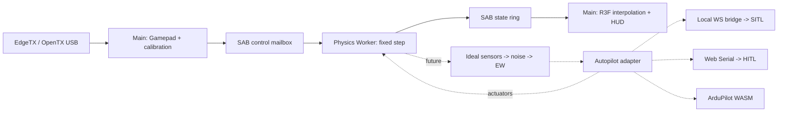

# MirageSITL architecture

English source. [Russian mirror](ru/architecture.md).
The detailed task source is [PROJECT_ROADMAP.md](PROJECT_ROADMAP.md).
Product scope comes from [PROJECT_SCOPE.md](../PROJECT_SCOPE.md), approved on
2026-10-28, and the [Phase 1 plan](PHASE1_PLAN.md) maps it to tasks. Phase 1
runs on macOS on Apple Silicon in Chrome with native ArduPilot SITL as an
external process. The Windows and WSL tooling and results described below are
historical; they are preserved but are not Phase 1 work or acceptance evidence.

TASK-033 now supplies both offline uniform/annular checks and a production-built
bound-rotor WASM backend using configurable synthetic geometry and NeuralFoil
polars (NACA6409 baseline, NACA0012 alternate). `BetRotorEngine` owns validated
polar/rotor arenas; `BetFlightDynamics` composes free shafts, axial inflow,
frame transforms and rigid-body integration. Callers inject it through the
`PhysicsSessionV2` dynamics factory. Model IDs, rotor counts, RPM and validity
flags are published through the existing SAB contract. The default application
Worker still selects DemoDynamics; runtime selection UI and browser autopilot
admission are separate. Model-report schema v8 requires current numerical and
allocation evidence, while retaining measured-fidelity failures independently.

## Implemented boundaries and current baseline

The interactive web application runs on ABI v2 (TASK-085) with React 19/R3F/WebGL2
(and capability-detected WebGPU with WebGL2 fallback, TASK-066), a dedicated
module Worker (`PhysicsSessionV2`), `MultiRateClock` at 400/800/1200 Hz, atomic
SAB seqlock state/pilot transport, sensor/actuator SPSC queues, Gamepad channel
and mode calibration (TASK-038), a source/freshness-aware attitude HUD (TASK-074),
a versioned instructor command ledger (TASK-075), and a separate bounded AAR
recorder/review/archive pipeline (TASK-076–078, TASK-081). The active browser
flight backend remains the demo quadrotor (`DemoDynamics`); demonstration
aerodynamics are not validated for pilot training.

Independent native and WASM simulation/autopilot modules are implemented and
verified outside the demo flight loop:

* **Rust BET, coaxial, propulsion, rigid-body, and landing-gear kernels**
  (TASK-016–028, TASK-032) with scalar/SIMD128 WASM builds and zero-allocation
  arenas. The additive bound ABI connects polars and rotor state to configurable
  flight sessions; the legacy unbound ABI retains `AERODYNAMICS_UNAVAILABLE`.
* **High-rate certified Rapier contact** (TASK-029, TASK-065): direct f64 C ABI
  (`GroundContact`) with 0..8 unsprung wheel bodies, independent strut/tire
  forces, prismatic travel stops, rigid rim constraints, and per-tick terrain
  halfspaces via contact ABI v2.
* **High-rate certified JSBSim WASM and contact backend** (TASK-030, TASK-031,
  TASK-086): pinned JSBSim v1.2.3 WASM build with native WASM exceptions,
  post-step contact impulses, cold SI initial state, native/WASM trajectory
  parity, and six UIUC-derived fixed-pitch propeller tables verified in native
  JSBSim v1.2.3.
* **Native ArduCopter SITL, EKF warmup, and EW harness** (TASK-041–043,
  TASK-059): Linux/WSL owned-process ArduCopter harness driving the Rust WASM
  rigid-body model through a synthetic quad X configuration, `LiveEkfWarmup`
  admission over lockstep JSON IMU and CRC-checked MAVLink telemetry, and
  native GPS/compass/motor-loss EW experiments.
* **Browser ArduCopter WASM bootstrap** (TASK-044, TASK-045): local-only
  verified firmware Worker with pthread startup, CRC-checked MAVLink boot
  diagnostics, and IndexedDB EEPROM persistence.

Genuinely open boundaries: measured rotor/airframe/contact fidelity (TASK-033;
NASA drop fidelity explicitly deferred by the user), GPL redistribution and browser
autopilot READY and accessibility sign-off (TASK-080), live terrain-contact flight-session coupling (TASK-065), and target-device M4/RTX 4050
400–1200 Hz and 60–120 FPS performance verification (TASK-073). Fixed `dt`
does not guarantee execution every step interval: browser timers, GC, the OS,
and background-tab policies provide no hard real-time guarantee.

## Directory structure

```text
apps/web/
  src/App.tsx                 # HUD, controls, calibration
  src/capabilities.ts         # API checks and implemented mode eligibility
  src/runtime.ts              # Gamepad/rAF, lifecycle, SAB reads
  src/FlightScene.tsx         # Position/SLERP in R3F useFrame
  src/coordinates.ts          # NED to Three.js
  src/physics.worker.ts       # Physics owner and fixed-step scheduler
  vite.config.ts              # COOP/COEP for dev and preview
packages/
  protocol/src/index.ts       # ABI v1, types, SAB readers/writers
  physics/src/index.ts        # Demo dynamics and bounded scheduler
  physics/src/model-manifest.ts # Verified configuration registry
  physics/src/model.schema.json # Strict serialized model schema
  test-support/src/           # Fixture verification and seeded streams
  input/src/index.ts          # Gamepad and channel calibration
docs/
  PROJECT_ROADMAP.md          # English task source
  SPECS_SHARED_MEMORY.md      # Implemented v1 and target v2
  SPECS_SIMULATION_ENGINES.md # Target physics and EW contracts
  architecture.md
  shared-memory.md
  ru/                        # Russian documentation mirrors
tests/
  *.test.ts                  # ABI, physics, scheduler, input
  browser/simulation.spec.ts # Real Worker/SAB, UI, mock USB
```

Workspace packages, services, and native crates:

| Directory | Responsibility |
| --- | --- |
| `apps/bridge` | Local WS to ArduPilot JSON/UDP and MAVLink |
| `packages/wasm-jsbsim` | Pinned JSBSim/Emscripten with C ABI |
| `packages/wasm-bet` | Rotor/frame wrapper, native reference and WASM |
| `packages/sensors` | IMU/GNSS/magnetometer, noise, bias, timestamps |
| `packages/autopilot` | Direct/external SITL/WASM SITL/HITL adapters |
| `packages/ew` | Scenario observation faults and hazard volumes |
| `packages/terrain` | Streaming visual LOD and independent collision LOD |
| `packages/cameras` | Mounted FPV camera, lens distortion, analog video effects |
| `packages/thermal` | Surface material classes (WorldCover/OSM) with provenance; not temperatures |
| `packages/aar` | Input/actuator/truth/EKF recording and replay |
| `packages/scenarios` | Declarative training scenarios, tick runner, and trace rubrics |
| `packages/project` | Local project store: immutable versions, project archives (TASK-136) |
| `services/tiles-worker` | Cloudflare proxy, quotas, permitted caching |
| `native` | Source/toolchain pins and WASM reference tests |

## Threads and ownership



Worker owns truth, simulation time, and integration. Main owns DOM/WebGL,
Gamepad, and permissions. Physics never reads the scene graph or waits for
rendering. React receives summaries approximately every 150 ms. R3F reads
the latest two states, SLERPs orientation, and linearly interpolates position.
If concurrent publication/reset yields nonadjacent ticks, use the latest
coherent state instead of interpolation.

High-rate data uses SAB; postMessage carries init/lifecycle/error events.
Extensions require separate typed sensor/actuator buffers. The current
physics hot path reuses input/state/scratch with no explicit per-step
allocations. A Worker has its own JS heap, but cannot promise absolute
isolation from GC/OS latency. Preallocate WASM memory and exclude growth,
terrain loading, network I/O, and decoding from fixed-step computation.

## Clocks, overload, and input safety

The Worker's `SteppingPolicy` (a `MultiRateClock`) tracks performance.now deadlines while passing constant dt
to integration. At most eight steps run per callback before yielding to
lifecycle messages. Nested setTimeout may be clamped to roughly 4 ms;
one callback may therefore perform multiple physical steps.

When catch-up exceeds its budget, whole wall-clock intervals are discarded
and DroppedSteps/Overruns increase. Simulation time increases only for
executed steps. Never substitute a large variable dt. Pause/resume resets
deadlines; reset stops and clears dynamics. Hiding the tab disarms and
pauses. Worker independently rejects input older than 250 ms, nonfinite
values, and disconnected/disarmed controls. Target thrust becomes zero;
modeled rotor response decays with spool lag.

SITL needs a separate sensor/actuator lockstep policy with simulation
timestamps. HITL uses physical time: overload invalidates/stops the session;
fast-forward is not valid for a real FC.

Gamepad API belongs to Window, not a normal Worker. rAF polling incurs
USB/HID/browser/display delay. Measure p50/p95/p99 input age and end-to-end
latency; zero input lag is unattainable. Initial axes
`roll=0,pitch=1,yaw=3,throttle=2` are assumptions, not an EdgeTX standard.
UI configures indices/endpoints/center/inversion with 3.5% deadzone on
centered channels. Calibration currently lasts one session. Source/device/
calibration changes disarm. Disconnect never silently selects another
transmitter. Arming requires throttle <=5%.

## Coordinates and physics backends

Use SI and right-handed NED. Body axes are FRD. Quaternion `(w,x,y,z)`
rotates FRD to NED, and p/q/r are right-hand body rates in rad/s.
Three.js uses `(x,y,z)=(east,-down,-north)`, a rotation without reflection.
Future WGS84/ECEF and origin shifts retain float64 geodesy while GPU
coordinates stay local float32.

The demo is a rate-controlled toy quad with collective thrust, first-order
spool lag, quaternion, gravity, and linear drag. Translation uses
semi-implicit Euler; `down<=0` constrains a flat ground plane. Voltage is
an illustrative throttle-dependent indicator, not electrochemistry. There
are no individual motors, landing-gear contacts, rotor BET, or autorotation.

The target DynamicsBackend provides reset(config),
step(dt, actuatorFrame, atmosphere, contactInput), and
readTruth(preallocatedOutput), refined into the typed stepInto facade in
the engine specification. Autopilot supplies actuators; physics produces
forces and moments.

* JSBSim retains its own equations of motion. Convert ft/slugs and frame
  conventions explicitly at the C ABI boundary.
* BET computes element-relative flow, angle of attack, Re/Mach polar lookup,
  and integrated forces/moments. Autorotation requires aerodynamic torque,
  inertia, flapping, and induced-flow dynamics rather than prescribed RPM.
* Arbitrary frames use `F=sum R_i*F_i` and
  `M=sum(r_i cross R_i*F_i + R_i*M_i)` in body coordinates. ESC, voltage,
  rotor inertia, and coaxial interactions have separate states.
* Rapier/Jolt integration has one rigid-body owner. BET may supply solver
  forces; JSBSim needs consistent contact impulse coupling. Two independent
  integrators for one body are forbidden.

## ArduPilot integration boundaries

Modes are mutually exclusive. Lifecycle:
`disconnected -> initializing -> warming -> ready -> running -> fault`.

1. **External SITL is the first target backend.** Development bridge:
   `ws://localhost:9002`. HTTPS deployment must check mixed-content/Private
   Network Access and use trusted local WSS where necessary. Bind loopback,
   validate Origin/session, and bound message size/rate. JSON/UDP physics
   provides truth/sensor lockstep; MAVLink provides RC/commands/diagnostics.
   RC_CHANNELS_OVERRIDE alone does not integrate external physics.
2. **Local WASM ArduPilot HAL is verified (TASK-045/046).** Admitted firmware,
   EEPROM persistence, sensor/PWM lockstep and phased Worker teardown are tested
   at 400/800/1200 Hz. Native/WASM flight parity and production READY remain
   TASK-047; GPL redistribution retains its decision gate.
3. **Drone firmware for Hybrid SITL and Simulation-on-Hardware is a version 2 proposal (TASK-051).** It is meant to produce an ArduPilot 4.6.3 or newer image that can be loaded on the drone and tested there. Version 1 does not require that image. PX4 and `HIL_SENSOR` / `HIL_ACTUATOR_CONTROLS` are not that proposal.

At 8N1, the serial ceiling is baud/10 bytes/s including framing and all
traffic. 115200 may be insufficient; measure headroom and use supported FC
baud rates. Selecting a port does not validate a closed loop.

Warmup means 30 seconds of simulation time in SITL lockstep, without EW,
with coherent IMU/GNSS/mag timestamps. Readiness depends on EKF health,
status, and innovations, not merely a timer. HITL cannot fast-forward
physical FC filters. MAVLink2 framing (TASK-037), `EkfMonitor`/`EkfWarmup`,
and native `LiveEkfWarmup` admission against the pinned ArduCopter SITL
harness (TASK-042, TASK-043) are implemented. TASK-074 overlays those
diagnostics on the Pilot HUD from decoded USB serial frames and does not admit
browser READY. Browser autopilot READY session wiring remains open. Drone firmware for Hybrid SITL and Simulation-on-Hardware is the version 2 proposal TASK-051.

## EW, terrain, cameras, and AAR

Keep truth unchanged: truth -> ideal sensors -> noise/bias -> EW -> adapter.
Each sensor defines rates, latency, axes, units, and seeded RNG. ABI inertial
acceleration includes gravity; HIL accelerometers need specific force after
subtracting gravity and rotating into body axes.

Bound inverse-square exposure with positive r_min and saturation; cones
include direction/aperture. A receiver model is required: power is not
satellite count. GNSS loss/spoofing changes observations. Coherent drift
integrates position/velocity consistently rather than teleporting truth.
Magnetic errors use sensor axes. Motor faults act on a selected actuator
before force aggregation. EKF/mode behavior depends on firmware, parameters,
and other sensors; do not promise gate bypass or a particular failsafe
without pinned scenario regression evidence.

WebGL2 is the baseline. WebGPU is a separate capability-detected backend
with visual parity tests; the browser chooses Metal/DX12. Bound DPR,
textures, and tile LOD. RTX 4050 has 6 GB shared with browser/framebuffer
needs; M4 uses shared RAM. Terrain decoding must not run in Physics Worker.

Google Photorealistic Tiles requires billing, keys, attribution, and Map
Tiles API compliance. **Persistent Google tile copying into R2 and prefetching
a 10–15 km region are not assumed authorized.** Check licensing/caching
rules first. Cache only permitted content/TTLs or use owned/licensed offline
tiles. Cloudflare proxy hides keys, enforces origin/session/quota, and
respects provider TTLs. COEP requires CORS/CORP for external tiles/WASM.

Analog FPV is postprocessing independent of truth. WorldCover/OSM gives
surface classes, not temperature. Thermal modeling needs emissivity,
weather, solar heating, inertia, attenuation, and calibration data. AO
does not calculate heat. Start with controlled synthetic materials and
a defined GPU budget.

The state ring holds only about 0.64 s for rendering. AAR needs a separate
bounded recorder Worker/IndexedDB with inputs, actuators, truth, sensors,
EKF, seed/config/version/events, and explicit losses. State replay differs
from resimulation; compare native/WASM within declared numerical tolerances.

## Implementation milestones and acceptance

| Milestone | Result | Verification |
| --- | --- | --- |
| 01 | Worker/SAB/Gamepad/demo | Unit tests; real-browser Worker, flight/pause/reset, mock USB |
| 02 | WASM physics facade and sensors | Forces/moments, specific force, contact/energy, 400/800/1200 convergence |
| 03 | External SITL lockstep | Arm/takeoff/land, EKF readiness, RC, link loss, pinned ArduPilot |
| 04 | BET/frames/autorotation | Thrust curves, torque balance, energy, spool/battery, measured references |
| 05 | EW and AAR | Seeded replay, truth/observation separation, EKF/mode response |
| 06 | HITL | Physical board/firmware, sustained throughput, jitter/loss/failsafe |
| 07 | Terrain/FPV/thermal/WebGPU | Licensing/attribution, VRAM/LOD, M4/RTX 4050 evidence |
| Feasibility | ArduPilot WASM | External/native SITL parity before enabling the mode |

These capability milestones are not the detailed Phase 0–6 sprint schedule;
the roadmap defines dependencies and execution order.

Measure production on M4 and RTX 4050 with a visible tab after warmup:
frame-time p50/p95/p99, Worker compute/deadline lateness, executed steps/s,
dropped wall time, input age, sensor jitter, GPU memory, and end-to-end
latency. 120 FPS allows 8.33 ms/frame on a panel that can present it. For 60 FPS the user accepted a median of 16.680 ms and a p99 of 17.665 ms on 2026-10-21, including a 59.88 Hz panel. The flight image must fill the active display: the M4 run used a 2560×1440 mode, while the MacBook Air panel is natively 2560×1664. A 1200 Hz
physics step has 0.833 ms and needs headroom. Headless cloud smoke does
not establish these performance budgets.

## Physics fidelity program (TASK-087–TASK-123)

Registered in the [roadmap](PROJECT_ROADMAP.md) as Phases 7–13 on 2026-10-26;
the roadmap records each task's status. TASK-087 has started: vehicle manifest
v2 validation, migration and derived values (`vehicle.schema.json`,
`vehicle-manifest.ts`), the ArduPilot profile generator (`ardupilot-profile.ts`)
and an optional `model.load` port in `PhysicsSessionV2`. TASK-090 has
started: time-domain and Welch frequency-response metrics with a CIFER-style
cost (`fidelity-metrics.ts`), bench CSV import (`bench-import.ts`) and
`scripts/check-fidelity.mjs`; scoring measured data remains open. TASK-089 has
started: a pinned-source ArduPilot SITL catalog
(`tests/fixtures/sitl/ardupilot-catalog.json`), a 25-source error-ownership
matrix with evidenced delivery paths, and a neutralizing parameter profile
(`error-ownership.ts`). TASK-088 has started: bound-rotor and rigid-body step
interfaces v2 (`bound_v2.rs`, `body_abi_v2.rs`, `rotor-v2.ts`, `body-v2.ts`)
with fail-closed fields for later tasks; neutral records run the v1 steps
bitwise. The rest of this section is not implemented yet. The program keeps the current
ownership model: MirageSITL is ArduPilot's external flight-dynamics model.
Native runs exchange JSON state lines with `--model JSON` (TASK-041). The
browser build fills ArduPilot's `sitl_fdm` through the HAL mailbox (TASK-046),
and ArduPilot's internal aircraft never advances. ArduPilot's `SIM_Multicopter`
and `SIM_Plane` are therefore not modified, and the native firmware stays
unmodified ([V2_PLAN.md](V2_PLAN.md), B1) except for the opt-in TASK-089
`imu-noise-floor` patch, which adds `SIM_ACC_FLOOR` and `SIM_GYR_FLOOR` so the
fixed IMU noise floors can be switched off.

| Layer | Location | Role in the program |
| --- | --- | --- |
| Physics kernels | `native/bet`, `native/contact` | All new physics models |
| Kernel interfaces | `bound.rs`, `bet_bound.h`, `body_abi.rs` | One versioned v2 extension (TASK-088) |
| Vehicle adapter | `bet-dynamics.ts`, `session-v2.ts` | Per-tick composition of the kernels |
| Vehicle data | `model.schema.json` (v1) and `vehicle.schema.json` (v2) | New vehicle parameters (TASK-087) |
| Runtime environment | Control Protocol v2 | Weather, events and per-effect on/off and intensity controls (TASK-166) at tick boundaries |
| Autopilot boundary | JSON state line, HAL mailbox, MAVLink injection | Sensor-error ownership (TASK-089) |
| ArduPilot configuration | Generated parameter profile | Neutralize the ArduPilot errors MirageSITL owns |

Fidelity is selected per vehicle as a tier. Tier A (rotor lookup tables,
TASK-103) serves faster-than-real-time regression. Tier B (optimized BET with
inflow v2, the electromechanical drive and compliant contact) serves real-time
training and HIL. Tier C (blade-by-blade rotors, dynamic stall, flexible modes,
wakes) runs offline in lockstep and may be slower than real time. TASK-090
certifies Tier A against Tiers B and C so fast regression stays trustworthy.

The tick budget is `1/(f·S)` for physics rate `f` and speedup `S`, and G3 limits
compute p99 to half of `dt`. The review measurement (BET quad tick about 0.35 ms
in browser WASM; octocopter about 0.70 ms, above the 0.4167 ms G3 limit at
1200 Hz) makes the TASK-091 kernel speed-up the first performance dependency of
every later fidelity task. Lockstep tolerates slow physics because ArduPilot
waits for each frame, so real time is required only for interactive and HIL
runs. Lower-rate updates (turbulence coefficients, wakes, GNSS visibility) use
integer-phase, tick-indexed schedulers, so results do not depend on host speed.
Each vehicle's physics stays single-threaded; work outside the step (GNSS
line-of-sight, turbulence-box generation, recording) moves to other Workers.

## Local project store (TASK-136)

`packages/project` keeps projects, component cards, aircraft profiles and
experiments in the browser's IndexedDB, with no account or cloud service
(S16, S01). Each edit appends an immutable version addressed by the SHA-256 of
its canonical JSON (RFC 8785). A version names the exact versions it depends
on, so editing a profile or a card never changes the inputs of an earlier
experiment. A project archive (`.mirageproj`) carries every version of one
project with a hash for each record. Import rejects tampered, oversized and
diverged archives and reports missing dependencies.

IndexedDB was chosen over the Origin Private File System because one
transaction can check an item's head and append its next version; the file
system suits the large recordings of TASK-162. The data belong to the page's
origin, so the launcher (TASK-151) must serve the application from one fixed
origin. Files managed by the launcher remain the documented alternative. The
contract is in [SPECS_SIMULATION_ENGINES.md](SPECS_SIMULATION_ENGINES.md),
section "Local project store and project archive v1 (TASK-136)". The
application does not use the store yet: TASK-137 adds the shell and its
project context.

## Phase 0 contracts: fixtures, capabilities, and models

TASK-004–006 introduce configuration-time boundaries; they do not add a new
physics backend. TASK-007 retains the running ABI v1. The v1 tests pin 32896
bytes, a 64-byte header, 256 states of 128 bytes, and the pilot mailbox at byte
32832. `tests/protocol-golden.test.ts` adds an independent oracle: the
registered, hand-authored fixture `tests/fixtures/abi/v1-layout.json` must
match the header, state, and pilot mailbox v1 byte tables in
SPECS_SHARED_MEMORY.md field by field, and every byte of the 32896-byte buffer
written by StateWriter and ControlWriter (header, two ring slots, untouched
slots, reserved words, and mailbox) must equal an image packed by a local
DataView. The v1 readers are not used, so a symmetric encoder/decoder offset
error cannot pass. TASK-008 adds the v2 layout constants, state and pilot
codecs, header initialization, validation, and v1/v2 negotiation to
packages/protocol. They are verified against `tests/fixtures/protocol/state-v2.hex`,
golden records packed with Python struct from the specification tables
independently of the TypeScript encoder. TASK-009 adds the section 4 bounded
seqlock transport: StateWriterV2/StateReaderV2 with sample_id and head checks
and at most three read attempts, PilotWriterV2/PilotReaderV2, header
diagnostics, and epoch-safe render history (latestPair never pairs frames
across an epoch, model, or tick gap). A real-thread stress test publishes
1e6 frames in Node worker_threads and in a browser module Worker while the
reader checks every field; removing the seqlock re-check makes it report torn
frames. TASK-010 adds Control Protocol v2: `parseControlCommandV2` validates
untrusted commands into normalized copies, `control-v2.schema.json` is the
equivalent JSON Schema 2020-12 contract (an Ajv equivalence test covers more
than 50 cases), and `ControlProcessorV2` implements deduplication, epochs, the
128-command schedule applied before integrating each tick, lifecycle state
rules, and atomic model swaps behind a `ControlTargetV2` interface with a
preallocated outbox. TASK-085 migrates the running application to ABI v2
while retaining ABI v1 for regression tests.

### Verified fixture manifests and deterministic streams

`packages/test-support` exports `./fixtures` and `./prng`. The registry at
`tests/fixtures/registry.json` records paths relative to `tests/fixtures/`.
Its three reference payloads are explicitly synthetic: analytical NED
ballistic samples under constant gravity, a demonstration quad configuration,
and the hand-authored ABI v1 byte layout. They provide reproducible software
oracles, not experimental aerodynamic evidence.

`verifyFixture(metadata, bytes)` snapshots both inputs before awaiting SHA-256,
validates strict formatVersion 1 metadata, compares the lowercase 64-character
hash with the exact payload bytes, and returns a deeply frozen manifest.
Whitespace changes require a new hash. Payloads are limited to 16 MiB.
Each quantity has a recognized SI/unit token and matching finite closed bounds;
absolute and relative tolerances must be finite and nonnegative. The unit
vocabulary is `1`, `s`, `us`, `m`, `m/s`, `m/s^2`, `rad`, `rad/s`, `N`, `N*m`,
`kg`, `kg*m^2`, `Pa`, `K`, `V`, `A`, `rev/min`, and `gauss`.

Provenance is a strict discriminated union. Synthetic data requires a derivation;
measured data requires datasetId, license, parseable acquiredAt, and an HTTPS
referenceUrl. Relabeling synthetic metadata while retaining derivation is rejected.
Metadata cannot prove a measurement occurred: review its external source before
using it to satisfy a physics validation gate. A digest checks integrity against
a trusted registry entry; it is not authentication of an arbitrary supplied hash.

`SeededRandom(seed, streamId)` accepts uint32 values, including zero. Its version
is `mulberry32-mix32-v1`; reset reproduces the sequence. Initial state is
`mix32(seed ^ mix32(streamId ^ 0x9e3779b9))`, with uint32 arithmetic. mix32 applies
xor shifts 16/15/15 and multiplication constants 0x21f0aaad and 0x735a2d97.
Mulberry32 advances by 0x6d2b79f5. `nextUint32()` returns [0, 2^32−1];
`nextFloat()` divides by 2^32 to produce [0,1). Seed 123 / stream 7 has the frozen
uint32 sequence 1915834569, 2163859737, 2018986825, 2541224312, 3937151044.
Separate instances have independent mutable state; this is neither cryptographic
randomness nor a proof of statistically independent or nonoverlapping streams.
Construction/reset validate outside the step; drawing numbers allocates no
objects. Sensor and EW stream assignment is defined in the sensor and EW
contracts (TASK-035, TASK-052–058).

### Browser eligibility before Worker startup

`apps/web/src/capabilities.ts` exposes `CapabilityReport` and injectable
`inspectCapabilities(environment?, timeoutMs?)`. Secure context, cross-origin
isolation, SharedArrayBuffer, Worker, and successful WebGL2 context creation
are all required for the current graphical demo. Missing prerequisites keep
Start disabled, suppress Worker/scene construction, and display an explanation.
READY still requires the actual Worker's initialization acknowledgement.
USB additionally requires Gamepad API availability. Transmitter presence,
channel calibration, and connected status remain separate input checks.

WebGPU adapter probing handles rejection, null, and a one-second timeout while
preserving WebGL2. The temporary WebGL2 probe releases its context. Serial is
probed without requesting permission. API availability is distinct from mode
eligibility: `hitlEligible` and `webgpuEligible` remain gated separately from
raw API presence. Chromium browser tests override API availability
and exercise the real supported Worker/renderer; they do not validate hardware.

### Model admission and immutable session IDs

`@mirage/physics/model-manifest` is a separate package export. Its AJV 8.20.0
schema and asynchronous loader stay outside the existing demo Worker import
graph. Serialized `ModelDescriptor`/`RotorGeometry` use readonly JSON arrays;
they are configuration representations of the target engine geometry, not the
typed-array WASM ABI in SPECS_SIMULATION_ENGINES. `VerifiedModel` holds
`{sha256, manifest}` separately so the manifest never hashes itself.

`model.schema.json` uses JSON Schema draft-07, forbids unknown properties, and
requires schemaVersion 1, units SI, world NED, body FRD, quaternion order wxyz,
positive finite mass, a nine-entry row-major inertia, modelId in [1,2^32−1],
kind demo/bet/jsbsim, rotorCapacity 32, and matching rotorCount/rotors in [0,32].
Inertia must be exactly symmetric and Cholesky positive definite; validation
never repairs a tensor. Rotor IDs and motor channels are unique integers [0,31].
Blades are [1,16], azimuth samples [1,64], and polar IDs uint32.

Rotor validation requires positive radius/chords/shaft inertia/quadrature widths,
nonnegative cutout and bearing friction, spin sign ±1, finite geometry, and a
unit hub-to-body wxyz quaternion within 1e-6 in norm. Radial station, chord,
twist, and width arrays have the same length [1,64]. Stations strictly increase
inside (cutout,radius); widths sum to radius−cutout within 1e-9 m. This checks
structural admissibility, not polar availability or aerodynamic validity.

`ModelRegistry.register(bytes, expectedSha256)` snapshots at most 1 MiB, verifies
raw bytes against a trusted SHA-256, decodes strict UTF-8 JSON, validates and
freezes a snapshot, then admits it to the session registry. An identical ID/hash
returns the same record; a different hash for an existing ID is a collision.
Hash/schema/physics failures leave registry contents unchanged, including when
the caller mutates its original bytes during hashing. `get(modelId)` returns
the verified immutable record. `ControlProcessorV2` (TASK-010) coordinates
atomic epoch-scoped model swaps; the active demo session rejects unsupported
model switches. Configuration validation may allocate; none of this work
belongs inside the physics step.

## Runtime building blocks (Phase 1–2)


### Multi-rate clocks (TASK-011)

`packages/physics/src/clock.ts` provides `MultiRateClock` for 400/800/1200 Hz.
Integration dt is always exactly `1/hz`; deadlines are `origin + n*1000/hz`
computed from integer step counts, so wakeup jitter never accumulates into
drift. At most `maxCatchUp` (8) steps run per wakeup; excess wall time is
dropped and counted, and `reset(nowMs)` on resume discards any backlog. The
clock owns the epoch's `TickId` (tick 1 is the first integration).
`tickToMicros` computes MAVLink `time_usec = floor(tick*1e6/hz)` exactly
(833/834 us intervals at 1200 Hz), and `isSampleDue`/`sampleIndexAtTick`
schedule IMU/GNSS samples rationally. `DemoDynamics(hz)` integrates with
`dt = 1/hz` and `sim_time = tick/hz`. `PhysicsSessionV2` runs at 400, 800, or
1200 Hz; `FixedStepClock` wraps a 400 Hz `MultiRateClock` for v1 compatibility.

### Clock modes and overload (TASK-012)

`SteppingPolicy` (`packages/physics/src/clock-policy.ts`) wraps one
`MultiRateClock` and applies the configured mode on every non-blocking
`pump(nowMs, gate, step, report)`. **interactive** paces by wall time and
counts dropped intervals. **sitl-lockstep** advances on simulation time:
a tick runs only when the `StepGate` reports its actuator frame, ticks are
never dropped, at most `maxCatchUp` run per pump, and a missing frame
returns immediately with `waiting`, so pause/dispose messages are never
starved. **hitl-realtime** paces by wall time against a physical flight
controller; catch-up within `maxCatchUp` is normal, but any dropped interval
sets the `hitl-overrun` fault, after which no tick runs until `resetEpoch`.
The preallocated `PumpReport` is overwritten each pump.

### Sensor and actuator SPSC queues (TASK-013)

`spsc-v2.ts` implements the section 5 queues: one 131,136-byte SAB per
direction, one `SpscProducer` and one `SpscConsumer` each. The producer owns
write_counter/full_events, the consumer owns read_counter; counters are
modular uint32 and every shared word uses Atomics. A full queue never
overwrites unread frames: `sitl-would-block` returns `would-block` so
lockstep waits, and `hitl-fault` latches a session fault until
`resetSpscQueue`, which clears counters and advances the queue epoch only
while both endpoints are stopped. Every full condition increments
full_events. The consumer copies a slot to scratch and releases it before
decoding. `SensorFrameCodecV2` and `ActuatorFrameCodecV2` pack the shared
128-byte slot and validate per kind: value counts, f32 range, exact integer
GNSS fix/satellite values, GNSS-only validity bits, zero geo fields outside
GNSS, and normalized actuators in [-1,1]. Real-thread stress tests move 1e6
frames in order in Node worker_threads and in a browser Worker.

### Application on ABI v2 (TASK-085)

The physics Worker is a thin adapter around `PhysicsSessionV2`
(`packages/physics/src/session-v2.ts`), so the Worker logic runs in Node
tests. Main creates the v2 state SAB and both SPSC queues and sends
`init-v2`; the session owns `StateWriterV2`, `PilotReaderV2`, the actuator
consumer, `ControlProcessorV2`, `SteppingPolicy`, and `DemoDynamics(hz)`.
Per tick it reads the pilot mailbox, applies the arm latch, integrates, and
publishes `FlightStateV2` with the ideal specific force
`f_b = R^T(a_n - g_n)` and ISA truth pressure. Arming latches only on an
explicit request at <=5% throttle; a stale epoch, input older than 250 ms,
invalid values, or a changed `device_generation` disarms and blocks rearming
until the request is withdrawn. `GamepadAdapter.generation` changes with
the device identity, so a different transmitter at the same index never
inherits an arm. Main reads lifecycle state from the header runtime flags,
renders with `latestPair` history, and validates Worker events. In
sitl-lockstep a tick waits for the autopilot's actuator frame for exactly
that tick and epoch. Sensor pipelines (TASK-034, TASK-035, TASK-058) and I/O
transport modules exist as separate packages; the interactive demo session
does not attach a live autopilot consumer.

### Hot-path instrumentation (TASK-014)

`step-metrics.ts` records compute duration (0.1 us bins), wakeup lateness
(0.01 ms bins), and executed steps in preallocated fixed-bin histograms;
quantiles are bin upper bounds capped by the exact maximum and are computed
outside the hot path. `scripts/bench-physics.mjs` drives the real
`PhysicsSessionV2` step and measures V8 young-generation allocation over
windows of N and 2N steps after reaching steady state (repeated warm windows
until one is GC-free), three repeats per size, minimum over GC-free repeats.
It runs V8 with `--single-threaded`: with concurrent compilation, finished
jobs are installed on the main thread mid-window and allocate 0-120 KB at
contention-dependent times, which hosted 2-CPU runners showed as false
positives. The verdict uses the incremental per-step rate
`(bytes_2N - bytes_N - (empty_2N - empty_N))/N`, which cancels fixed
per-window costs; the whole-window bound `min_k (bytes_k - empty_k)/k` and
the fixed cost are reported alongside. `gc` events are attributed by time, and an allocating
control loop must be detected in the same run. The first
measurements found real per-step allocations: variadic `Math.hypot`, and
doubles boxed into HeapNumbers when passed to or returned from non-inlined
calls, which made the result depend on TurboFan inlining. The hot path now
passes time through numeric fields (`nowMs`, `*Now()` methods), returns an
integer wakeup delay, and validates with inline comparisons only
(`(x >>> 0) === x`, `|x| < F32_ROUNDING_LIMIT`). Timer overhead is reported
separately from compute; Node timer pacing is not browser Worker evidence. On
Windows Node, the `bench-physics` realtime run executed 516.7 Hz (target 800)
and 519.6 Hz (target 1200) with drops: ~16 ms timer wakeups × 8-step catch-up
cap. Compute is ~1 us/step; the browser Worker 800 Hz regression passed.

### Render interpolation (TASK-015)

`interpolatePoseInto` (`packages/protocol/src/interpolation.ts`) writes a
caller-owned `RenderPoseV2` and never mutates truth. It interpolates only
when `latestPair` returned `'pair'` (adjacent ticks, same epoch and model)
and the step is continuous (at most 100 m per tick, 40 km/s at 400 Hz; a
larger jump is a teleport). Position is linear; attitude uses slerp along the
shortest path (the end quaternion is negated when the dot product is
negative, so q and -q never cause a full turn), with normalized output and a
normalized-lerp branch for nearly equal attitudes. `interpolationAlpha`
derives the fraction from the frame's scheduled wall time and the header
rate, so rendering lags truth by at most one physics step and never waits
for the writer. `FlightScene` maps the pose through
`nedToRenderPositionInto` and the proper-rotation NED-to-render basis.

### Native Rust workspace (TASK-016)

`native/` is a Cargo workspace with the scalar crate `mirage-bet`
(`native/bet`), built natively for tests and to `wasm32-unknown-unknown` for
browsers, with the toolchain pinned in `native/rust-toolchain.toml`. Its
bootstrap kernel is the section 3 element force
`dF = 1/2 rho U^2 c dr (C_L l + C_D d)` with the `U < 1e-6 m/s` cutoff; it is
a scalar element reference kept for ABI regression. The native rotor reference
now derives coefficients from the polar (TASK-019/020). The wasm32 build
installs a global allocator that traps on allocation; checked ABI memory views
are the other narrow unsafe boundary. It has no host imports and exports `memory`,
`bet_abi_version` (= 1), and `bet_bootstrap_element_force`. The release
profile (LTO, one codegen unit, `panic = "abort"`, stripped) produces a
byte-identical artifact across clean target directories.

### WASM artifacts and loader (TASK-017)

`scripts/build-wasm.mjs` builds two variants of `mirage-bet`: `scalar`, the
mandatory baseline, and `simd128` (`-C target-feature=+simd128`), each in
its own target directory, and writes `manifest.json` with schema version,
crate, ABI version read back from the built module, toolchain, and per
artifact file name, SHA-256, size, and target features.
`packages/wasm-bet/src/loader.ts` treats the manifest as unknown input and
validates it exactly. It probes SIMD128 with `WebAssembly.validate` on a
minimal v128 module and loads `simd128` only when the probe succeeds,
otherwise the scalar artifact (`fallback` reports the downgrade). Before
instantiation it checks size and SHA-256 via Web Crypto; after it requires
no imports, the expected exports, and `bet_abi_version` equal to the
loader's ABI. It then grows linear memory to the reservation (default and
maximum 64 MiB), so `memoryStable()` exposes any growth after arming. Every
failure returns `ok: false` with a reason and must block arming. Loading is
asynchronous and belongs to initialization, never to a step.

### BET C ABI and arena binding (TASK-018)

`native/bet/src/abi.rs` implements the section 4 records as safe
field-by-field reads and writes over byte slices; the wasm32 export layer in
`lib.rs` is the only place that turns `u32` pointers into slices, after
checking range, alignment, `__heap_base`, and overlap. `include/bet.h` is the
shared layout source. `packages/wasm-bet/src/arena.ts` encodes the
configuration once, places configuration, input, output, and arena regions
above `__heap_base` inside the reserved memory, and steps through one
preallocated DataView into caller-owned output objects. The production step still returns `AERODYNAMICS_UNAVAILABLE` with NaN
aerodynamic outputs until a versioned polar/config binding connects the kernels.

### Polar lookup (TASK-019)

`native/bet/src/polar.rs` validates a borrowed `(Mach, Re, alpha)` CL/CD
table once and interpolates trilinearly in `(Ma, ln Re, alpha)` without
allocation. Queries outside the table clamp to its boundary and set
`OUTSIDE_POLAR_VALIDITY`; there is no extrapolation. The native `blade::Rotor` uses this lookup (TASK-020); production C ABI
binding remains separate.

### Atmospheric and rotor reference modules (TASK-032, TASK-020–023)

The atmosphere package validates dry-air state and provides ISA troposphere,
Sutherland viscosity, density and sound speed. Wind uses a seeded, fixed-rate
bounded-innovation AR(1), not a claimed measured turbulence model. Native rotor
modules provide normalized quadrature, limited signed axial inflow, free-shaft
RPM dynamics, zero-offset harmonic hinge flapping, and discrete angular momentum
transmission. See SPECS_SIMULATION_ENGINES section 3 for all equations, limits,
input units, and the explicit absence of aeroelastic feedback/validated VRS.

These are reference modules; the UI still runs demo dynamics. No browser
ArduPilot session, browser JSBSim session, measured autogyro model, or
production BET engine has been enabled in the UI.
`kernel-test-exports` builds separate scalar/SIMD numerical test artifacts;
the production artifact/ABI stays unchanged. Allocation tests cover 1e6 native
kernel steps and million-step WASM dynamics with stable memory. Synthetic
oracles under tests/fixtures/rotors are registered with byte hashes and are not
experimental measurements. `scripts/bench-wind.mjs` records warmed V8 allocation
windows and an allocating positive control under test-results/bench/wind.json.

Verification uses npm lint/typecheck/docs/tests/build/browser plus the pinned
native Cargo check/test and wasm32 target check. `tests/rotor-kernels.test.ts`
builds its own scalar/SIMD harness, including tail counts 1/3/5/63. Cloud
functional/numerical results do not establish M4/RTX frame-time budgets.

### Coaxial reference (TASK-024)

`native/bet/src/coaxial.rs` implements a validated pair configuration and
allocation-free, experimental steady mixing-jet wake. Positive source thrust
produces downstream receiver air velocity; overlap and separation control
interception. Advected momentum, received/bypass kinetic power and mixing loss
are reported separately and conserve the assumed ideal-hover source budget.
They must not be added as extra thrust or motor power. Disabled coupling is
exactly independent; positive spreading gives far-field independence.

Spreading angle is an explicit synthetic parameter. This aligned, one-way model
excludes swirl, VRS, transient transport and receiver feedback. Its JSON oracle
is SHA-256 registered. Native and scalar/SIMD WASM tests verify conservation,
limits and 1e6 allocation-free steps. See the engine specification for formulas,
units and validity. Production BET C ABI and the demo remain unchanged.


## Contact, propulsion, and JSBSim backends (TASK-025–035, TASK-086)

### Rapier contact implementation (TASK-029)

`GroundContact.initialize` verifies the generated manifest and bytes for the
direct f64 Rapier 0.21.0 C ABI (`node scripts/build-contact.mjs`);
each session owns a fixed 16 MiB WASM world with 0..8 unsprung wheel bodies,
independent strut/tire forces, prismatic travel stops and rigid rim constraints.
One Rapier solver advances all bodies; its net contact impulse is diagnostic and
must never be used to integrate the same body a second time with RK4. A complete
angular contact impulse accompanies the linear impulse because multiple contacts
cannot be represented by a single lever arm. The detailed ABI and limitations
are in the engine spec.

The storage-only patch retains the joint-selection candidate buffer across ticks.
Cold initialization exercises repeated contact at all three rates;
an armed allocator counter permanently faults the session on any allocation.
The adapter has no provider wrappers or per-step typed-array views.
`scripts/check-contact-binding.mjs` runs nine million native steps and compares
native/WASM captures for 0/3/8 wheels at 400/800/1200 Hz. The separate WASM G1
test runs nine million steps. Browser Worker and Node GC checks cover their
actual runtime paths; these are numerical/allocation evidence, not target-device
real-time performance acceptance.

The user explicitly deferred NASA measured fidelity on 2026-10-18. Archived
NASA sources and the failed sphere comparison remain intact through
`LegacyGroundContact`, used only by that historical diagnostic. The completed
TASK-029 scope is a numerically verified configurable contact model, not a
calibrated aircraft or reconstructed NASA rig. Rolling/braking is a passive
kinematic approximation; wheel spin, anti-skid, steering and arbitrary terrain
topology remain separate capabilities. No demo/autopilot readiness gate changes.

### Compliant gear source decision (TASK-029)

Use complementary sources rather than importing another full simulation engine:

* **Physical decomposition:** Norman S. Currey, *Aircraft Landing Gear Design:
  Principles and Practices* (1988), chapters 5–6, especially sections 5.7, 5.11
  and 6.3–6.9. The supplied `AircraftLandingGearDesignPrinciplesPractices.md`
  has SHA-256 bb8275e99f3a8962ab01d3102b2fa8fbfe29e9502209fca6e422c74046e9f6b4.
  It explains gas storage, hydraulic dissipation and separate tire deformation.
  OCR omits equations and corrupts some numbers; do not reconstruct missing
  formulas from OCR guesses or treat illustrative aircraft values as calibration.
  The copyrighted book stays local and is explicitly ignored by Git.
* **Measured acceptance:** the already archived NASA TM X-3561 remains the
  independent drop-rig reference. Its upper/hub masses, simulated lift and
  hydraulic/pneumatic/tire terms describe a coupled system. A single spring or
  an arbitrary pair of coefficients is not a reconstruction of that experiment.
* **Aircraft implementation reference:** [JSBSim v1.2.3 FGLGear.cpp](https://github.com/JSBSim-Team/jsbsim/blob/570e8115a102df8f877b11e0e59b964ea483e3c0/src/models/FGLGear.cpp)
  and its header define separate compression/rebound damping, unit conversions,
  outward ground reactions and body lever moments. Retain these conventions;
  its default lumped spring/damper is not a separate tire/unsprung-mass model.
  Local cpp/header SHA-256: 402ed31fdae58951c6e8d10cc408a2236f239f1e0111d711aad3ed9786d74f48 /
  3f3f053c76e10ff8f25c5fe0b068f76f01735fd02eace05ff1272b7fe0b611d0.
* **Tire design reference:** [Chrono tire models](https://api.chrono.projectchrono.org/wheeled_tire.html)
  support explicit nonlinear vertical load curves and distinguish normal contact
  from rolling/slip dynamics. The [9.0.0 Fiala implementation](https://github.com/projectchrono/chrono/blob/9.0.0/src/chrono_vehicle/wheeled_vehicle/tire/ChFialaTire.cpp)
  also prevents tensile ground reactions. Use the bounded curve concept now;
  importing the complete engine or assuming its road-vehicle parameters describe
  aircraft tires is not justified. FEA tires add complexity without acceptance
  data or a measured 400–1200 Hz budget for this application.
* **Integration references only:** [ArduPilot SIM_Aircraft.cpp](https://github.com/ArduPilot/ardupilot/blob/master/libraries/SITL/SIM_Aircraft.cpp)
  constrains ground height/acceleration and selected motion modes. Those rules
  are useful for SITL expectations, not a force/stroke oracle. Local file SHA-256:
  28755ff6f5cb5c391a99ed782bab57695f71c41c502805cf326a4f5f8466c29a.
  [Gazebo WheelSlip](https://gazebosim.org/api/sim/8/classgz_1_1sim_1_1systems_1_1WheelSlip.html)
  controls tangential slip compliance using wheel speed and normal load; it does
  not provide an oleo strut or a vertical drop model. Revisit it for wheel-spin,
  braking and lateral slip after vertical compliance is validated.

The resulting increment is independently written Rust force/energy evaluation
in `native/bet/src/landing_gear.rs`; no external runtime dependency or copied
upstream implementation is introduced. Gas/linear struts and tire curves are
separate components. Strut stroke, tire deflection and terrain penetration must
be distinct state variables supplied by the owning solver. A ground-wrench helper
rotates NED forces into body FRD and applies the lever moment without integrating
state. Rapier remains the chosen rigid-body integration owner; the demo and its
readiness gates remain unchanged. The scalar/SIMD test exports do not add a
production landing-gear ABI.

### Propulsion, rigid-body, and sensor reference modules (TASK-025–028, TASK-034–035)

Native motor/battery/frame/RK4 references and the independent body ABI v1 exist
in `native/bet` and `@mirage/wasm-bet`. A dedicated WASM instance owns each body
arena. The body adapter accepts an already aggregated body wrench; the full
rotor/polar/power feedback backend is not wired into the browser flight Worker.
Sensor references (`@mirage/sensors`) accept truth in place, with integer
schedules and independent seeded noise/latency streams. Their allocation probe
(`scripts/bench-sensors.mjs`) measures warmed Node/V8, not browser hard real
time.

### JSBSim WASM, contact backend, and UIUC propeller tables (TASK-030, TASK-031, TASK-086)

`packages/wasm-jsbsim` pins JSBSim v1.2.3 source/license hashes and Emscripten
4.0.15, providing a C++ C ABI and SI/origin-frame adapter. `node scripts/build-jsbsim.mjs`
builds the baseline WASM artifact verified in Chromium Worker smoke at
400/800/1200 Hz (`node scripts/check-jsbsim-artifact.mjs`), while
`node scripts/build-jsbsim.mjs --contact` builds the high-rate certified
contact artifact with native WASM exceptions (`-fwasm-exceptions`). A first
real-adapter probe exposed 75 GC events per million steps with JavaScript
exception trampolines despite zero C++ counters; native WASM exception handling
removes that allocation path. The compiled runtime must support WASM exceptions;
the legacy JS-exception build remains separate and is not admitted as high-rate
certified.

The contact backend supports independently versioned contact impulses after the
JSBSim step, cold explicit SI initial state, and current mass/inertia queries.
JSBSim remains the sole integrator. A contact impulse changes velocity without
advancing pose/time; derivative-history jumps preserve the upstream multistep
integrator. Duplicate applications and external impulses during built-in active
gear contact are rejected. An external constraint stage must not run another
airframe integrator. The adapter claims dedicated memory, reuses ground-friction
storage reserved for at most 64 gear entries, and validates owned frames,
caller buffers, and heap stability before publishing truth.

`node scripts/check-engine-patch-parity.mjs` verifies that the opt-in
`--patched` storage-preservation patches in native Rapier and JSBSim produce
zero allocator calls/bytes over one million steps while matching original
trajectory checksums. `node scripts/check-jsbsim-backend.mjs --native` and
`node --experimental-transform-types scripts/check-jsbsim-backend.mjs` verify
same-source native/WASM trim, control-step, and contact trajectories within
predeclared numerical budgets using local, unbundled `c172x` XML, and
`node scripts/bench-jsbsim.mjs` measures the JS adapter separately. Stationary-ground
tests verify upward specific force under local gravity. These results do not
license aircraft redistribution or establish measured fidelity, target-device
timing, full weather/model selection, or autopilot/flight-session readiness.
See the implemented sections in [engine specification](SPECS_SIMULATION_ENGINES.md).

`data/jsbsim/generate_uiuc_propellers.py` (TASK-086) generates six JSBSim
fixed-pitch propeller definitions (`C_THRUST`/`C_POWER` versus `J = V/(nD)`)
and `data/jsbsim/engine/uiuc-propellers.manifest.json` from the hash-verified
UIUC Propeller Database (APC Thin Electric 10x5, 10x7, 11x7, 12x6, 14x10, and
DA4002 9x6.75). `node scripts/check-jsbsim-propellers.mjs` loads all six tables
through native JSBSim v1.2.3 `FGFDMExec::LoadModel` and verifies static,
mid-curve advancing, and interpolated thrust/power at 18/18 points within 1% of
measured `CT`/`CP`. Because JSBSim v1.2.3 leaves `FGPropeller::Ixx` unassigned
when `<ixx>` is omitted, a complete flight model must supply rotating inertia;
UIUC redistribution licensing, Vol 4 true versus nominal diameters, and
RPM/engine coupling remain separate.

### MAVLink2, bridge, serial I/O, EW, and terrain policy boundaries

TASK-037/038/039/040/048/052/053/056/057/058/060 provide a pinned MAVLink2
subset, versioned radio calibration/mode mapping, autopilot lifecycle admission,
an origin/token-checked loopback WS/UDP bridge, gesture-driven Serial transport
with a separate I/O decoding Worker, isolated and composed EW/motor-fault
modules, and a fail-closed terrain policy. The browser UI continues to run the
demo flight backend; browser SITL/HITL session wiring and live Google terrain
integration are not enabled.

Run `npm run start -w @mirage/bridge` with `MIRAGE_BRIDGE_TOKEN` supplied locally
(64 hex characters); optional `MIRAGE_BRIDGE_ORIGIN`, `MIRAGE_MAVLINK_PORT` and
`MIRAGE_PHYSICS_PORT` configure origin/UDP endpoints. Never print tokens or add
them to URLs/repository files. This is loopback ws; HTTPS/WSS/PNA needs separate
integration. Use `node scripts/bench-links-ew.mjs all 400` (also 800/1200) for
Node allocation evidence, not hardware timing acceptance. Scalar conveniences
may box floating-point values: high-rate composition uses typed-array inputs
and outputs documented in the engine specification.

### WGS84 geodesy and geoid (TASK-036)

`@mirage/sensors/geodesy` converts geodetic, ECEF, and a frozen local NED
frame in float64 through ECEF, so poles and the antimeridian are regular
cases. `@mirage/sensors/geoid` keeps ellipsoidal and MSL heights distinct and
blocks the absolute-MSL accuracy gate until an authoritative geoid grid with
source, license and hash is installed.

### ArduPilot JSON lockstep (TASK-041)

`@mirage/autopilot/external-sitl` turns pinned SIM_JSON servo frames into
exactly one `sitl-lockstep` tick per new frame count and encodes the reply
line without allocation; the bridge validates both directions and replies to
the SITL source port learned on its bound UDP endpoint.

### HIL streaming (TASK-049)

`@mirage/autopilot/hitl` schedules HIL_SENSOR/HIL_GPS on the physics clock,
sets `fields_updated` from the groups actually updated, enforces 30% serial
headroom, and admits HIL_ACTUATOR_CONTROLS with replay and dropout checks into
bounded buffers. No physical flight controller is involved yet.

### HITL capability gate (TASK-050)

`@mirage/autopilot/hitl-capabilities` is the only issuer of HITL READY
verdicts (source evidence, verified profile, live observation), and
`AutopilotSession` refuses `hitl` without one. See
[hardware/hitl-matrix.md](hardware/hitl-matrix.md).

### GNSS position step (TASK-054)

`@mirage/ew/position-step` applies a tick-scheduled NED offset to GPS
observations through the WGS84 tangent frame and the geoid, preserving
velocity; truth is untouched.

### Coherent GNSS drift (TASK-055)

`@mirage/ew/velocity-drift` integrates a speed-capped position/velocity bias on
the physics clock with exact piecewise splitting and explicit recovery
policies, and applies it to GPS observations only.

### EW pipeline composition (TASK-058)

`@mirage/ew/engine` composes jamming, position step, drift, magnetic anomaly
and motor faults behind a bounded fault registry applied at tick boundaries;
`@mirage/sensors/pipeline` runs baseline -> EW -> quantization. The composed
path runs 1e6 steps without triggering GC in Node.

### 3D Tiles streaming adapter (TASK-061)

The chosen loader is NASA-AMMOS `3d-tiles-renderer` 0.5.3 (Apache-2.0).
`@mirage/terrain/tiles-provider` resolves sources through the TASK-060
provider policy: local licensed tilesets load, while live Google tiles are
BLOCKED_EXTERNAL until the authenticated proxy (TASK-063) and provider
credentials exist; API keys never enter the client. `ecefToRenderMatrix`
places ECEF tilesets in the local render frame (x east, y up, z -north) with a
float64 matrix from the WGS84 tangent frame at the origin. `TileFetchTracker`
handles every tile request through the loader's `fetchData` plugin hook,
counts in-flight requests, aborts them on dispose, and classifies failures
(`cors-or-network`, `http`, `aborted`). `@mirage/terrain/tiles-scene` binds
these to the loader, keeps attribution, and disposes every loaded model.
FlightScene loads the layer on demand (separate chunk) only when
`VITE_MIRAGE_TILESET_URL` and `VITE_MIRAGE_TILES_ORIGIN` are set, and shows
attribution and classified failures. The test tileset in
`tests/fixtures/tiles` is own-work CC0 synthetic data.

### Terrain LOD and byte budgets (TASK-062)

`@mirage/terrain/lod-budget` and `@mirage/terrain/resource-cache` bound the
terrain workload with renderer-independent, frame-indexed logic. Byte
estimates are geometry = attribute + index buffer bytes and texture =
width × height × bytes per pixel (× 4/3 with mipmaps). `TerrainResourceCache`
enforces a hard cap of 2 GiB estimated GPU and 512 MiB decoded CPU bytes on
admission: a new tile first evicts tiles not visible in the current frame
(least recently visible, then oldest), and if the visible set leaves no room
the tile is refused, disposed and reported as unmet demand. Each resource is
disposed exactly once (eviction, replacement, refusal or `clear`).
`LodBudget` multiplies the screen-space-error target by 1.5 (16 to 256 px)
on every frame whose demand exceeds a budget, and relaxes it only after 30
consecutive frames whose predicted residency at the finer target
(bytes × 1.5², tile count scaling with screen area) stays below 80% of both
budgets, so hovering does not oscillate. `RequestQueue` bounds queued (by
priority, then age; overflow drops or displaces the lowest) and active
downloads. Same inputs give the same targets: degradation never depends on
wall time. `TilesScene` applies the budget to the loader: its LRU byte cap
is the smaller budget (the loader's single geometry + texture estimate is
charged to both, since three.js keeps decoded arrays beside GPU copies) and
its `errorTarget` follows `LodBudget` every rendered frame.

### Authenticated tiles proxy (TASK-063)

`services/tiles-worker` is a Cloudflare Worker for Google Photorealistic 3D
Tiles. The provider key exists only in the `GOOGLE_MAPS_API_KEY` secret
binding and in the upstream URL; it never appears in responses, client URLs or
log events. `POST /v1/session` issues an HMAC-SHA256 session token bound to an
exactly matched allowed origin with an expiry (default 1 h), rate-limited per
client IP. `GET|HEAD /v1/3dtiles/...` requires an allowed `Origin` and a valid
`X-Mirage-Session`, consumes the per-session quota, and forwards only Google
tile paths (no traversal) with only Google's `session` query parameter; a
client-supplied `key` or any other parameter is rejected. Quotas are
fixed-window counters in the `TileQuota` Durable Object (one object per key,
so updates are serialized across isolates). Responses carry CORS for the
origin, `Cross-Origin-Resource-Policy: cross-origin` (COEP), the policy
attribution in `X-Mirage-Attribution`, and `Cache-Control: no-store` because
the Google live policy has TTL 0; the proxy never caches or prefetches.
Upstream error bodies are never echoed, and text bodies containing the key are
replaced by a 502. Configuration fails closed (missing secret, origin list or
policy, or a non-Google policy). On the client, `requestTilesSession`
validates the session response and `TileFetchTracker`/`TilesScene` send the
session header with every request. Sessions limit and attribute use; they do
not authenticate a person. Tests are local only (fake upstream and Durable
Object storage); `wrangler` is not a repository dependency, and deployment
needs separate authorization.

### Region cache for permitted datasets (TASK-064)

`@mirage/terrain/region-manifest` defines `mirage.region-manifest/1`: dataset
id, `datasetSha256` (SHA-256 of the canonical tile index, lines
`path sha256 bytes` sorted by path), `cacheVersion`, the TASK-060 provider
policy, `cacheable`, a region centre and radius (10 km default, 15 km
maximum), byte caps, and the complete tile index with per-tile SHA-256, size
and centre. `regionDecision` fails closed: Google live tiles, or a policy
without reviewed license evidence, are BLOCKED (missing rights, even with
evidence for Google); a missing dataset hash or empty index is BLOCKED
(missing data); `cacheable: false`, memory-only rights or TTL 0 give NO_CACHE.
A BLOCKED provider serves nothing. `services/tiles-worker/src/r2-cache.ts`
implements `RegionCache` over the R2 binding subset with keys
`<datasetId>/<datasetSha256[0..16]>/v<cacheVersion>/<path>`, so a new
dataset hash or cache version never reads stale objects. A tile is written
only when CACHEABLE, listed, inside the radius (WGS84 tangent-plane distance),
and matching its listed size and SHA-256; a listed tile that fails the hash is
not served. Objects expire after the policy TTL (expired reads delete the
object) and the region byte cap is kept by evicting the oldest uploads.
Concurrent writers can exceed the cap by at most one object each. No bucket
is bound in `wrangler.jsonc`: enabling persistent R2 caching needs explicit
permission. Tests use an in-memory emulator of the R2 binding subset, not
Miniflare.

### Generated terrain and buildings (TASK-073)

`scripts/geodata/` builds the G3 ground from public data, configured by
`config/geodata.json` (source bounding box, default Israel
`34.2,29.4,35.9,33.4`; area of operation, default 32.20065261195932 N,
34.87163838506722 E, radius 1000 m). `setup-wsl.sh` installs the toolchain in
WSL user space without `sudo` (micromamba with GDAL, PROJ, PostgreSQL/PostGIS
and the Python packages, the .NET 8 SDK with `pg2b3dm`, the EGM2008 grid) and
records an explicit package lock.

* `fetch_fabdem.py` reads the FABDEM V1-2 10-degree archives through HTTP byte
  ranges and extracts only the 1-degree tiles inside the box, with retries.
* `build_terrain.py` mosaics FABDEM (EGM2008 orthometric), converts it to WGS84
  ellipsoidal heights (`EPSG:4326+3855` to `EPSG:4979`) and verifies the
  conversion on identical pixels around the area centre: the median applied
  difference must equal the EGM2008 undulation there (within 0.5 m, and the
  undulation must lie in 15-25 m), otherwise the build stops, because a
  missing grid makes PROJ fall back silently and buildings would float about
  19 m. It records the ground height at the area centre as the render origin
  (`areaOrigin`), then cuts quantized-mesh-1.0 tiles (EPSG:4326 TMS,
  octvertexnormals) with Delatin triangulation in a process pool: zoom 13 over
  the box and zoom 15 inside the area. Triangles are oriented counter-clockwise
  seen from above (Delatin's image space reverses the winding).
* `build_buildings.py` downloads Overture buildings with the `overturemaps`
  CLI, indexes them as FlatGeobuf, extrudes each footprint to a PolyhedralSurface
  Z whose base is the lowest geoid-corrected ground height under its vertices
  (Overture `height`, else `num_floors` x 3 m, else 6 m), loads the solids into
  a private PostGIS cluster on a Unix socket and runs `pg2b3dm`, which writes a
  3D Tiles 1.1 implicit-tiling tileset.

The viewer loads each terrain source as its own `TilesScene` sharing one
origin: `VITE_MIRAGE_TERRAIN_URL` (quantized-mesh `layer.json`, through
`QuantizedMeshPlugin`) and `VITE_MIRAGE_TILESET_URL` (3D Tiles, through
`ImplicitTilingPlugin`). With real terrain the flat demo ground is hidden, the
sky, haze and light are set for daylight and the far plane is 30 km; terrain
tiles get a matte earth tone. The dev/preview server serves the generated data
from `MIRAGE_GEODATA_DIR` at `/geodata/` to loopback clients only; the data stay
outside the repository. Results on 2026-10-22: 9 FABDEM tiles, 19,214 terrain
tiles (160 MB), geoid check 19.395 m applied against an EGM2008 undulation of
19.396 m at the area, area ground 62.649 m ellipsoidal; 2,871,993 buildings in
7,200 tiles (3.5 GB). Only 9,516 buildings carry a height and 26,770 a floor
count; the rest use the 6 m default. FABDEM is CC BY-NC-SA 4.0 (non-commercial).

The ground is coloured by a surface-material raster (P4), display only: a class
is not a temperature. `extract_osm.py` reads the operator's Geofabrik extract
with GDAL's OSM driver and keeps buildings and highways that intersect the
area plus a 200 m margin. `build_material_map.py` rasterises a 1 m grid
(2000 x 2000 for the 1 km radius) in a local transverse Mercator projection
centred on the area origin, with the class legend and precedence of
`packages/thermal/src/material-map.ts` (`config/material-classes.json`):
building roof, then road buffered to half its legend width, then ESA WorldCover
10 m v200, then synthetic ground. It writes `materials.bin` (uint8 class
index, rows north to south), `materials.json` (schema
`mirage.material-raster/1`: origin, extent, class table, counts) and a
`data-manifest.json` (`mirage.thermal-data/1`) with the WorldCover tile and
OSM extract hashes, licences and attributions. `check_material_map.mjs`
cross-checks the raster against the TypeScript `MaterialMap` on the same
inputs at 5,000 seeded pixel centres; the pass criterion, fixed before the
first run, is at least 97% agreement with every disagreement within 1.5 px of
a class boundary. In the app `VITE_MIRAGE_MATERIALS_URL` (set by
`check-gpu-perf.mjs --geodata` when `materials/materials.json` exists) loads
`apps/web/src/render/material-drape.ts` before the terrain: the class raster
and a 256-entry palette become textures and an `onBeforeCompile` patch on each
quantized-mesh tile material picks the colour by world position (render
`x` east, `z` minus north); outside the raster the plain ground colour stays.
A load failure is reported on the attribution line and leaves the plain
ground. Results on 2026-10-22: 1,188 OSM buildings and 1,428 roads extracted
(804 roads drawn inside the raster), no synthetic pixels, `materials.bin`
SHA-256 `f143c7fe7714b974bfa69e725223af9585801accb002c9ae3fe297f68fd811ff`;
the cross-check passed with 99.98% agreement (one mismatch, at a class edge).
WorldCover is CC BY 4.0 and OpenStreetMap ODbL 1.0; both attributions are shown.

The G3 thermal camera (P5) is `BOSON_640_50DEG` in
`packages/thermal/src/thermal-camera.ts`: an `approximated` instrument profile
(a third calibration kind besides `synthetic` and `measured`) with public
FLIR Boson 640 data sheet values (640 x 512, 8-14 um, NETD 50 mK, 60 Hz) and the
selected 8.7 mm, 50 degree horizontal lens (40.916 degree vertical). Like a
synthetic profile it never claims instrument parity. The image chain is:

* `AreaThermal` (`area-thermal.ts`) integrates the TASK-070 `ThermalField` for
  every class of the material raster in five orientations (up, east, north,
  west, south walls) with the solar ephemeris and clear-sky forcing, after a
  24 h spin-up from air temperature, and then once per sensor second. The
  emissivities are the section 9.1 values of `docs/needed_for_task073.md`
  (vegetation 0.97, asphalt 0.93, bare soil 0.92, concrete and built-up 0.92,
  water 0.95, galvanised roofs 0.28, tiles 0.91, gravel 0.96 instead of the
  table's implausible 0.28, ice 0.97 instead of its snow 0.80), each with its
  source; heat capacity, absorptance and conductance come from a documented
  TASK-070 proxy class. Assumed weather: air 30 C, wind 3 m/s, cloud 0.1, deep
  layer 25 C; default instant 2026-07-15 07:00 UTC (`?thermalUtc=` with a zone
  overrides it).
* `apps/web/src/render/thermal-gbuffer.ts` renders the scene from a
  perspective camera boresighted with the FPV mount at the sensor resolution.
  Each fragment reads its class from the material raster (synthetic ground
  outside it), weights the five orientation temperatures by its flat face
  normal from screen-space derivatives (buildings have no normals) and writes
  temperature, emissivity and distance; cleared texels are sky, shown at the
  Swinbank sky temperature. The display span is the surface temperature range
  plus 2 K (a simple AGC).
* `fpn.ts` generates a seeded fixed pattern (offset sigma 0.15 K per pixel,
  0.25 K per column, 0.08 K per row; drift gain 0.04 K/K per pixel, 0.03 K/K per
  column) and a focal-plane warm-up of 8 K with a 600 s time constant, all
  assumed values. `ThermalSensorChain` runs the TASK-072 `ThermalNuc` on that
  pattern at 60 Hz of wall time (shutter at power-on and every 180 s, closed 6
  frames, averaged 8, opening 4), skipping and counting frames when rendering
  falls behind (at most 4 per rendered frame). Because the scene adds linearly,
  the shader adds the residual (o - bias) and gain x drift to the rendered
  temperature, which equals the NUC output; the display holds its last image
  while the shutter is closed. The chain costs about 0.9 ms per frame in Node
  for 640 x 512 pixels.

`?view=thermal` presents the thermal image (pillarboxed) for inspection; the
captures keep the chase view. The G3 probe reports the profile, shutter state,
NUC cycles and skipped sensor frames, and a shader failure now stays recorded
(it fires once, at compile). Vegetation and open water evaporate (TASK-070
latent flux, see the engine spec): with the assumed 60% humidity, tree canopy
stays within about 3 K of air temperature at midday and reads darker than
pavement, as in the FLIR sample. Known limits: one air temperature and
humidity all day; no cast shadows, soil moisture or dew. The image is a plausible synthetic scene, not a measured
Boson image.

Anti-aliasing (2026-10-22, after operator review of the screenshots). Parked
frames showed no dithering or film grain in the chase or thermal image
(temporal change 0.00 and 0.19 grey levels; the 50 mK NETD is below one level);
the visible "grain" was spatial aliasing that crawls in motion. Three causes
were removed. Thermal: each Boson pixel point-sampled the scene (staircase
edges, thin roads breaking into dashes); the G-buffer is now rendered at 3 x 3
the sensor resolution and the pass averages the radiance of the 9 subsamples,
as a microbolometer integrates over its pixel. Material colours: nearest
lookups of the 1 m class raster shimmered at a distance; the drape now samples
a precomputed RGBA colour texture with mipmaps and 8x anisotropy (the thermal
G-buffer keeps the exact class texture, where classes must not blend). FPV:
the scene render behind the fisheye is 4x multisampled and the fisheye and
analog stages sample bilinearly. The analog interference is intentional; at
the operator's request its default noise amplitude was halved
(`DEFAULT_VIDEO_NOISE`: 0.01 + 0.04 x throttle instead of 0.02 + 0.08 x
throttle; tearing scales with it), which halved the parked FPV frame-to-frame
noise from 7.07 to 3.53 grey levels.
On the RTX 4050 the median GPU time per frame rose from 5.4 ms to 6.8 ms
(WebGPU smoke, PresentMon `GPUBusy`). Remaining stair steps on class
boundaries are the 10 m WorldCover data resolution.

### G3 passes on WebGPU (TASK-073 P6)

The G3 passes run on both backends. `g3-common.ts` holds the probe, the FPV
lens and `ThermalSceneState` (sensor clock and NUC, heat balance, display
span, material raster), shared by `g3-passes.ts` (WebGL2) and
`g3-passes-webgpu.ts`, which is loaded only for `WebGPURenderer`. The WebGPU
passes are TSL node materials: `FisheyeNodeMaterial`, `AnalogNodeMaterial`
(same lowbias32 hash; its per-pixel noise is keyed to a pixel origin that
differs between backends, so noise statistics, not bytes, match WebGL2),
`ThermalGBufferNode` and `ThermalCameraNodePass`, drawn with `QuadMesh` into
`RenderTarget`s. The material drape uses a colour node (`material-drape-node.ts`)
because WebGPU ignores `onBeforeCompile`. Differences handled explicitly:
readback rows are padded to 256 bytes; screen y points down, so the G-buffer
turns its derivative face normal towards the camera; float textures are read
with `textureLoad`; `int(select(...))` needs a named integer variable to
emit an `i32`. Shader and validation errors arrive asynchronously, so the
probe counts uncaptured device errors. Two runtime faults were fixed: resizing
a `RenderTarget` in place left bind groups on the destroyed texture (targets
are recreated and rebound), and a resize during `renderer.init()` left the
multisample buffer at the canvas's initial 300 x 150 (the size is re-applied
after init; 0 of 10 starts failed afterwards, 3 of 8 before).
`tests/browser/webgpu-passes.spec.ts` checks fisheye, analog, thermal (all
palettes, fixed pattern and sky, 2 x 2 supersampling) and the G-buffer on both
backends against the CPU mirrors; run it with `MIRAGE_BROWSER_GPU=hardware` to
use the machine's GPU (on SwiftShader without a WebGPU adapter the WebGPU cases
are skipped with the reason).

### Renderer adapter: WebGPU with WebGL2 fallback (TASK-066)

`apps/web/src/render/renderer.ts` creates either backend behind one
capability surface (`render`, `setSize`, `setPixelRatio`, `info.memory`,
`dispose`); scenes use core three materials that both backends translate.
`detectBackends` reports availability with a reason. WebGPU availability is
functional, not just an adapter: the probe requests a device, presents one
cleared canvas frame and waits for completion without device loss; the
browser picks the native API (Metal, D3D12, Vulkan). `createRenderer`
performs the whole WebGPU bring-up (renderer init, rejection of three's
silent WebGL fallback backend, a lit probe scene inside a validation error
scope, and an optional caller probe) on a scratch canvas first, because a
canvas that once returned a `webgpu` context can never return `webgl2`; any
failure yields a WebGL2 renderer with `fallbackReason`. On WebGL2,
`compileWithFallback` draws each distinct material once into a 1×1 render
target (three checks programs lazily) and replaces materials whose shaders
fail with a basic fallback material, recording the shader log.
`dispose(scene)` releases every reachable geometry, material and texture once,
then the renderer, and forces WebGL context loss. `webgpu.ts` is loaded on
demand. The app keeps R3F's default WebGL renderer unless
`?renderer=webgpu|webgl2` is given; the chosen backend and fallback reason
are exposed as `data-render-backend` / `data-render-fallback` on the canvas.

### FPV camera and fisheye lens (TASK-067)

`@mirage/cameras` separates the mounted FPV view from the external camera.
`FpvCamera` composes `q = B · q_bn · q_mount` with B the NED→render basis,
q_bn the body-to-NED attitude ([w, x, y, z]; q and −q equivalent) and
`q_mount = R_y(uptilt) · R_x(roll) · (three camera axes → FRD)`; position is
`B (p_ned + R_bn · offset_frd)`. `update(pose)` reads a read-only pose and
writes only its own three.js camera, without allocation; truth is never
mutated. The lens is Kannala-Brandt (OpenCV fisheye):
θ_d = θ(1 + k1θ² + k2θ⁴ + k3θ⁶ + k4θ⁸), normalized radius r_d = θ_d, with
square pixels, a horizontal field of view across the full width and an
optional principal-point offset. `fisheyeParams` validates monotonicity up to
90°, limits incidence to 80° (a single pinhole source; wider lenses need a
cubemap source, not implemented) and derives the pinhole source camera that
covers the frame. `shaders/fisheye.glsl` remaps output pixels with a fixed
ten-step Newton inverse; `fisheyeSourceUvInto` is its float64 CPU mirror and
`projectRayToUv` the forward model. Model `none` is the identity
pass-through. Resizing keeps the horizontal field of view.

### Analog FPV interference and rolling-shutter jelly (TASK-068)

`AnalogVideo` (`@mirage/cameras/analog`) drives `shaders/analog.glsl`
(GLSL ES 3.00, WebGL2): additive per-pixel noise, scanlines
`1 − I(0.5 + 0.5 cos 2πv·lines)`, per-line tearing, and rolling-shutter jelly.
Line i of video frame k is exposed at `t_k + i · lineTime` and shifted by
`jellyAmplitude · throttle · sin(2π f_vib t + φ)` with
`f_vib = f_min + throttle (f_max − f_min)`. Uniforms change only at video-frame
boundaries (`k = floor(t · frameRate)`), so throttle is sampled once per video
frame and the image does not depend on the render rate. The visual RNG is the
stateless lowbias32 hash `seed ⊕ hash(k)`, independent of throttle, call count
and every sensor/EW stream; the shader hashes pixel coordinates with the same
integer hash, so equal seed, frame and throttle give identical bytes on one
backend (no cross-GPU equality is claimed). Throttle is read, never written;
nothing touches truth. All pixel work is on the GPU; `updateFrom` is
allocation-free. Numeric uniforms are `ScalarUniform` class instances
initialised to a double: object literals `{ value }` share one isolate-wide
hidden class that becomes tagged once any code stores a non-number (such as a
texture) in it, after which every double store allocates.

### WorldCover/OSM material map (TASK-069)

`@mirage/thermal/data-manifest` lists every material dataset
(`mirage.thermal-data/1`) with provider, version, license, attribution,
SHA-256 of the local file, CRS (EPSG:4326) and bounds. Provider rules are
enforced: ESA WorldCover requires CC-BY-4.0 and "ESA WorldCover project" in the
attribution, OpenStreetMap requires ODbL-1.0 and "OpenStreetMap contributors",
and only the `synthetic` provider (CC0-1.0) may, and must, be marked
synthetic. The module has no network code. `planWorldCoverTiles` lists the
3°×3° tiles (named by their south-west corner, e.g. N45E006) a region needs
and refuses plans above 4 tiles, so a region plan cannot grow into a bulk
download. `@mirage/thermal/material-map` composes OSM buildings (roof by
`roof:material`) over OSM roads (within half the nominal width per `highway`
value) over WorldCover pixels (pixel-is-area, row 0 at the north edge,
1/12000° pixels) over a synthetic default. No-data and points outside every
layer return `synthetic-ground` with `synthetic: true`. Samples carry material
id, source, dataset id and WorldCover code only: a land class is not a
temperature, and the legend parser rejects extra fields such as a
temperature. Every layer must be registered in the manifest, rasters must
match their manifest bounds, and `attributions()` lists the datasets that
actually contributed samples. GeoTIFF decoding and checks against real
licensed tiles placed locally are not yet implemented.


## Thermal, HUD, instructor console, and AAR (TASK-070–072, TASK-074–081)

Thermal energy, LWIR WebGL2 materials and offset-only shutter calibration are independent library modules. They do not run in the flight physics Worker or automatically turn land classes into measured temperatures. The application still flies demo dynamics. The pilot attitude overlay reads snapshots at the existing approximately 150 ms React reporting cadence. NED quaternion attitude uses normalized Hamilton wxyz, positive right bank and positive nose-up; the artificial horizon rotates by negative roll and shifts down with positive pitch. Existing speed/altitude readouts continue to use NED truth with an explicit demo label.

`EkfMonitor` and `EkfWarmup` provide independent diagnostics/admission contracts, with upstream wire fixtures. No timer, truth flag or Serial connection makes a live autopilot READY. While native ArduCopter SITL flight (TASK-042) and native `LiveEkfWarmup` admission (TASK-043) are verified, browser autopilot session wiring (TASK-080) retains its integration gate. TASK-074 copies accepted system/component 1/1 serial frames into the Main HUD snapshot: unknown, stale, and fresh are distinct, stale EKF bits are not displayed as valid, and mode numbers are autopilot `custom_mode` values with source/age. The physics publication stays unknown.

The instructor console submits versioned commands to the real Worker. A bounded 32-entry ledger correlates request IDs, distinguishes pending/queued/applied/rejected/cancelled, ignores late queued ACKs after application, and cancels pending commands on epoch changes. Model-load/reset ACKs may advance exactly one epoch. Fault IDs are editable; all five typed effect kinds have explicit synthetic defaults. A session with the EW port admits `fault.set` into `EwEngine` at the due tick and publishes `ew_flags`. Weather and model requests stay rejected on the demo, and the console shows that rejection. The demo dynamics use one spool and read no motor-fault table, so the session rejects motor-loss at admission with BAD_STATE and the console shows that rejection too (TASK-124). A session fault reported after `ready-v2` leaves the Worker usable: the status reads FAULT, Start is disabled, and Reset starts a fault-free epoch without a page reload. Main follows the session's arm latch: when the session disarms on stale or interrupted input, or cannot arm because the throttle rose above 5% first, Main withdraws its arm request and says why, so rearming stays explicit. P/R/F shortcuts ignore inputs, selects, editable elements, composition, repeat and modifier shortcuts.

The active demo's Main runtime fans decimated truth/pilot samples into an entirely separate recording SAB. The recorder Worker owns its chronological ring and IndexedDB writes. No additional consumer is attached to sensor or actuator queues. AAR uses its own versioned 512-byte records and checksums; absence, decimation, queue loss, storage loss and ring eviction are explicit. Resimulation is a separate injected interface with hash/seed admission; ordinary replay never advances physics. The Review timeline selects an epoch and uses simulation seconds for pilot/actuator/response series. Import/export excludes arbitrary metadata and secrets through an allowlist and validates size/hash/records. Full binary layout and limits are specified in SPECS_SIMULATION_ENGINES.md under the thermal/diagnostics/recording contracts.

Functional browser evidence is WebGL2/SwiftShader plus actual Worker/SAB/IndexedDB. M4/RTX performance, measured thermal calibration, live browser autopilot warmup and full-rate synchronized recording remain separate acceptance gates.

`PhysicsSessionV2` captures wall receipt time after the coherent pilot read, preventing a concurrent valid publication from appearing future-dated, and accepts samples stamped up to `INPUT_CLOCK_TOLERANCE_MS` = 1 ms ahead because Main and the Worker round their wall clocks from separate time origins (TASK-073); inputs further in the future or stale still disarm. WebGPU capability probing is shared once per document (including in-flight work); reload retries after driver changes. Renderer tests use an isolated harness and compare diagnostics within one document. Instructor motor loss selects channel index, power-cut versus synthetic instant-thrust-loss and remaining fraction; pending epoch-changing commands await their matching ACK even when the shared header advances first.

### Thermal solvers, LWIR camera, and recorder storage (TASK-070–072, TASK-076–081)

Thermal: `heat-balance.ts` offers both `HeatSurface` (single surface, implicit
trapezoid, forcing as air/sky/substrate temperatures) and `ThermalField`
(batched, allocation-free Heun integration with stability substeps,
per-element normal, shadow and sky-view factor; sky longwave from
Swinbank/Bolz emissivity; convection 5.7 + 3.8 v). `solar.ts` offers both
`solarIncidence` (scenario declination/hour angle) and a NOAA/Meeus
ephemeris (`solarPosition`, checked against NREL SPA) with Kasten–Young air
mass, Meinel clear-sky and Kasten–Czeplak cloud irradiance; the two solvers
and the two solar models are cross-checked in tests. The LWIR camera
(`thermal-camera.ts`, `thermal-material.ts`, `shaders/thermal.glsl`) uses a
Simpson band integral over a configurable band, a float32 radiance lookup
texture, a `ThermalScene` (reflected and air temperature, extinction, display
span), white-hot/black-hot/ironbow palettes and `ThermalCameraPass`, which
renders a temperature/emissivity/range G-buffer at the instrument's native
resolution; `InstrumentProfile` separates synthetic training profiles from
measured ones, and only a measured profile can claim parity with an
instrument such as CADEX. `ThermalNuc` (frame-indexed shutter cycle) provides
`nextCalibrationFrame` and `thermalStatusLabel`. Recorder: the
512-byte record, handoff, ring, Worker, replay, resimulation and archive are
paired with `ChunkStorage`, which queues up to `maxPending` chunks behind the
in-flight IndexedDB transaction instead of dropping a chunk whenever a
transaction is busy, and counts every overflow or failed write.

## Model validation and measured-fidelity diagnostics (TASK-033)

`node scripts/validate-models.mjs` runs 12 scalar/SIMD rigid-body numerical
cases (400/800/1200 Hz against 4800 Hz references) and evaluates registered
measured-data comparisons, exiting 2 while experimental fidelity gates remain
blocked or failed.

The first measured fixture is `tests/fixtures/contact/nasa-drop.json`.
`tests/fixtures/contact/generate_nasa_drop.py` generates it from the hashed
Docling archive of NASA TM X-3561 (Fasanella, McGehee and Pappas, 1977,
https://ntrs.nasa.gov/citations/19780003109). It holds the level-surface drops
at 4/5/6 ft/s:

* drop mass 1487.783 kg;
* honeycomb lift 16013.6 N;
* measured strut stroke 0.05588/0.09398/0.11176 m;
* upper-mass acceleration at or above -1.6 g.

NASA TP-2353 and NACA Report 1248 are archived alongside it but unused, because
their drop results appear only in figures.

`packages/physics/src/nasa-drop.ts` runs the historical `LegacyGroundContact`
rigid-sphere contact under these conditions. Impulse, nonpenetration and energy
consistency pass, while the measured deceleration and stroke envelopes fail at
every rate (peaks reach -12 to -19 g over a 10 ms window, and contact travel is
below 0.2 mm, because a rigid sphere has no tire or strut compliance). The user's
2026-10-18 decision defers NASA measured landing-gear fidelity; TASK-033 report
v5 retains that failed comparison in a hash-checked archive and reports absent
active contact measurements as blocked, while TASK-029's configurable
`GroundContact` C ABI separately satisfies numerical and G1 allocation
acceptance.

TASK-033 also includes an offline annular propeller BEM diagnostic with local
axial/angular momentum, explicit Prandtl tip/hub losses and safeguarded
nonlinear solves, alongside the uniform-inflow comparison (`native/bet/src/propeller.rs`)
against the UIUC Propeller Database (`uiuc-propdb-da4002-da4022-v1`) and XFOIL
6.99 SDA1075 polars (`sda1075-xfoil-699-v1`). Four declared variants expose
convergence and final polar coverage at the unchanged measured CT/CP tolerances.
Numerical convergence is not measured fidelity: the XFOIL/UIUC BET comparisons
still fail, keeping TASK-033 `BLOCKED_EXTERNAL`. The Deters article/dissertation,
PROPID conventions and pinned airfoil-research review are documented in the
engine specification. No new C/SAB ABI, transient flight binding or autopilot
admission follows from these diagnostic results.

## Terrain contact, scenarios, native SITL/EW, and browser WASM bootstrap

### Terrain collision chunks and contact topology (TASK-065)

The independent collision builder creates NED triangle meshes in a separate
Worker. `CollisionChunks` owns fixed-capacity staged/active height copies
independently from visual eviction and publishes only at valid epoch/tick
boundaries. `sampleInto`/`readyFrom` are the high-rate interfaces; missing
coverage is explicit.

Published collision chunks reach Rapier as per-tick ground planes, one
per contact (the airframe sphere and each wheel), through contact ABI v2.
Rejected alternatives:

* Inserting a Rapier trimesh or heightfield per chunk: it allocates when chunks
  change and would need collider retirement inside the armed session.
* A single plane for the whole vehicle: it is wrong across slope breaks and
  seams.

The fixed halfspaces are created at initialization with paired collision groups
and are only re-posed while armed, so the existing per-step allocator fault
remains the G1 gate. Missing published ground pauses stepping rather than letting
the vehicle fall through. Each contact uses the plane of the triangle under its
fully extended anchor, so curvature inside a triangle is not represented.
Wiring into the flight session and live terrain admission remain separate.

### Scenarios, acceptance tooling, and accessibility (TASK-079, TASK-080, TASK-082, TASK-083)

The `packages/scenarios` workspace admits immutable, provenance-bound protocol
command templates, polls by simulation tick and evaluates complete autopilot
traces. Epoch binding, ACK ownership and actual scenario orchestration remain at
the integration boundary. Reports for SITL, HITL, EW and GPU check
bounded/hash-bound observations; missing real inputs are blocked, and
native/browser/hardware evidence are separate. The system matrix preserves
per-mode `NOT_RUN`/`FAIL`/`BLOCKED`/`PASS`. Release tooling inventories actual
generated outputs without publication or fabricated readiness. Detailed
constraints and CLI contracts are in `SPECS_SIMULATION_ENGINES.md` and the
operational runbook.

Accessibility (TASK-080) adds keyboard landmarks/focus, permission announcements
and a narrow-layout contract. It preserves the active Worker/runtime and does
not enable unverified autopilot capability.

### Native ArduCopter SITL, EKF warmup, and EW experiments (TASK-042, TASK-043, TASK-059)

TASK-042 provides a Linux/WSL owned-process native ArduCopter flight harness
(`scripts/run-sitl.mjs`, `scripts/sitl/driver.mjs`, and a `pymavlink` 2.4.50
sidecar). JSON motor outputs drive the Rust rigid-body WASM through an
explicitly synthetic quad X model while the sidecar records real firmware
health, mode and altitude observations; `scripts/check-sitl-capture.mjs` audits
full-rate physics, original telemetry, source identities and trace v2.

TASK-043 composes the native driver's real MAVLink input with `LiveEkfWarmup`,
`EkfMonitor` and `EkfWarmup` (`scripts/check-ekf-warmup.mjs`). Native JSON frame
N confirms the encoded IMU sample in reply N-1; GNSS fix time remains
firmware-sourced. Arrival time never replaces measurement time. The shared gate
produces READY/EW admission and measured acceleration, with revocation and
independent raw/capture replay. Synthetic fault probes are labelled separately
from observed firmware behavior. No browser session wiring, recorded
Simulation-on-Hardware acceptance or measured aircraft validation follows.

TASK-059 adds a native-only EW experiment boundary: unchanged physics JSON,
TASK-058 GPS observations delivered through `GPS_INPUT`, acknowledged simulated
compass biases, and explicit synthetic rotor wrench loss. Independent raw-wire
decoding, full PWM/body replay and original EKF telemetry joins precede
empirical calibration/frozen limits and separate validation. Browser autopilot
admission and physical flight fidelity remain outside this experiment.

### Browser ArduCopter WASM bootstrap (TASK-044, TASK-045)

Following the negative source-only feasibility assessment in TASK-044, TASK-045
adds a local-only browser artifact/bootstrap boundary: the opt-in Vite route
serves admitted external bytes to a dedicated firmware Worker, and verified glue
starts its owned pthreads. CRC-valid serial boot diagnostics and IndexedDB
EEPROM/profile ownership are separate from `FlightStateV2` and autopilot READY.
Graceful and abrupt Worker restart/storage recovery are verified.
TASK-046 adds a separate checked HAL mailbox and host-owned clock at
400/800/1200 Hz, with actual firmware PWM driving configurable BET physics and
ideal SI sensor observations. Atomic words transfer float64 payloads; pausing
withholds input and stops simulated time. Native and pthread-WASM probes check
units, timing, malformed frames and hot allocations separately from real
firmware browser tests. Local HAL builds use `scripts/build-ardupilot-hal.mjs`;
`MIRAGE_HAL_ARTIFACT_DIR` selects their browser test bytes. Native SITL flight
parity and input-bound lifecycle admission are verified by TASK-047; application session/release admission remains separate. Artifact redistribution retains its GPL decision gate
(`BLOCKED_DECISION`).

TASK-047 runs the same configurable synthetic NACA6409/NeuralFoil BET quad in
native JSON SITL and the real browser HAL at 800 Hz. An opt-in, explicitly
synthetic flat pad permits startup and landing; it is separate from Rapier
fidelity. Tick-scheduled nominal/GCS-loss flights retain original serial and
command bytes, independently audited with pymavlink before the 30 s, 100 Hz
position/quaternion comparison. Limits stay 0.5 m and 2 degrees RMSE, with
0.5 s maximum continuous mode/arming disagreement. The audit uncovered and
regression-tested unsupported-message framing delay in `MavParser`.
`admitWasmParity` requires a trusted report SHA-256 and current identities;
`AutopilotSession` rejects WASM connection without its issued capability.
Connection enters initializing and retains live health/actuator freshness
checks. Diagnostics do not change the active application backend or settle
whole-firmware allocator, GPL or release gates.
