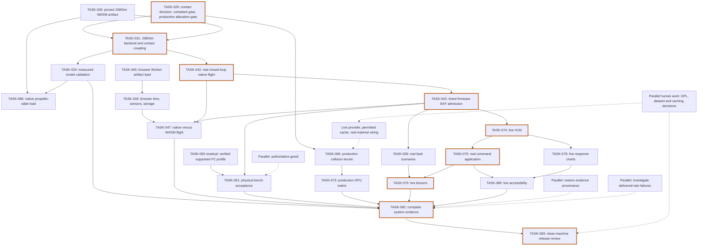

# MirageSITL: briefing on blocked and unfinished work

English source. [Russian mirror](ru/onboarding-blockers-2026-10-17.md).

> Archived developer onboarding briefing from October 17, 2026. Task statuses,
> local evidence, missing files, and line references describe the original
> snapshot below; consult the current roadmap before implementation. Saving this
> briefing does not rerun or change any acceptance gate. Repository links have
> been made portable; the analysis and its qualifications are preserved.

## 1. Executive summary

MirageSITL has substantial tested simulation libraries, browser infrastructure, and acceptance tools, but production flight integration and several physical validation gates remain open. The current evidence contains actual landing-gear, propeller, timing, and frame-time failures; these must remain separate from missing inputs. **The most valuable first unblock is TASK-029:** choose and validate a compliant landing-gear model and a production contact binding, because both flight dynamics and collision terrain depend on it.

**Snapshot:** October 17, 2026; checkout `060da5a37be9e17d22a713007c18fdb05ac0acb0`. This was a read-only inspection. No files, task statuses, thresholds, commits, or remote state were changed.

### Counts

These counts use each task’s primary `Status` field. There are **86 tasks: 65 DONE and 21 unfinished**.

| Primary roadmap status | Count |
|---|---:|
| BLOCKED_EXTERNAL | 16 |
| BLOCKED_DECISION | 2 |
| FAILED_VALIDATION | 0 |
| TODO | 2 |
| IN_PROGRESS | 1 |

**Zero tasks labelled FAILED_VALIDATION does not mean zero failures.** Five observed failure families sit inside tasks with other statuses:

| Failed validation family | Evidence |
|---|---|
| NASA landing-gear comparison | Nine drop runs fail measured deceleration and stroke checks |
| Original UIUC propeller comparison | 0 of 534 compared points pass both coefficient tolerances |
| XFOIL-based UIUC comparison | 26 of 165 compared points pass; overall comparison fails |
| Node high-rate delivery | 800/1200 Hz runs drop steps and deliver approximately 517/520 Hz |
| GPU frame cadence | Recorded demo p99 intervals exceed the 60 FPS limit; 120 FPS is not achieved |

Sources: [roadmap][roadmap], [current model report][models], [laptop verification][laptop].

### Important corrections to older blocker descriptions

- **ArduPilot WASM exists.** Two local artifact copies match the committed hashes and sizes. A recorded Node smoke test received 23 heartbeats. Browser loading and flight integration remain unfinished.
- **A native ArduPilot executable is recorded as built under WSL.** Its present bytes were not independently checked during this analysis. The missing closed-loop driver remains a blocker.
- **Emscripten 4.0.15 was installed for ArduPilot.** The earlier cloud download failure does not establish that SDK acquisition is still impossible on this laptop.
- **Real WorldCover decoding is implemented.** The latest TASK-069 entry records 17 real-tile tests. Application wiring, OpenStreetMap data, and publisher checksum verification remain open.
- **Hosted CI has historical successful runs.** The earlier runner/billing blockage was superseded. Current-commit hosted status was not queried.
- **Historical evidence needs care.** Of 113 laptop-manifest entries, 104 still match; nine have changed. Four native/contact diagnostic reports referenced by the current model report are absent locally.

Sources: [ArduPilot build evidence][r045], [revised feasibility decision][apdecision], [WorldCover evidence][r069], [CI evidence][r003], [laptop evidence manifest][manifest].

## 2. Glossary for beginners

- **SITL — Software In The Loop:** Real autopilot firmware controls a simulated aircraft. Think of the aircraft’s “brain” practising with a virtual body.
- **HITL — Hardware In The Loop:** A physical flight-controller board receives simulated sensor readings and returns control commands. This additionally tests real electronics and transport timing.
- **ArduPilot:** Autopilot software that estimates vehicle motion and commands motors or control surfaces.
- **Flight controller, or FC:** The computer board that runs autopilot firmware. A working USB connection proves communication, not flight readiness.
- **EKF — Extended Kalman Filter:** An estimator that combines imperfect sensors to estimate position, velocity, and orientation. Like checking several imperfect maps against each other, it also detects disagreement.
- **MAVLink:** A structured message protocol used for telemetry and commands. Receiving MAVLink messages does not prove that firmware supports every simulation message.
- **JSBSim:** A flight-dynamics engine that calculates aircraft motion from forces, controls, and aircraft configuration.
- **Blade Element Theory, or BET:** A method that divides a rotor blade into small sections, calculates each section’s aerodynamic force, and adds the results.
- **WASM — WebAssembly:** Compiled code that can execute in browsers and other runtimes. Running it in Node does not establish browser compatibility.
- **SharedArrayBuffer:** Memory shared between JavaScript workers. Readers and writers need an agreed ownership and synchronization protocol.
- **Zero-allocation hot path:** The frequently repeated simulation code creates no new temporary memory after initialization. This reduces interruptions from garbage collection, which reclaims unused memory.
- **Fixed timestep and Hz:** A fixed timestep advances simulation by the same simulated duration each step. At 400 Hz, each step represents 1/400 second; the computer must separately deliver those steps on time.
- **Golden fixture or oracle:** A trusted reference used to judge results. It must come from an independent calculation, measurement, or documented source.
- **GNSS jamming:** Interference that makes satellite navigation less usable. GNSS means satellite navigation systems such as GPS.
- **GNSS spoofing:** False navigation information that misleads the receiver. The simulated observation changes; the simulator’s underlying true position must remain distinguishable.
- **NUC — Non-Uniformity Correction:** A thermal-camera calibration that corrects differences between pixels. The current implementation corrects synthetic additive pixel bias.
- **AAR — After-Action Review:** Recording and replay used to understand what happened during a training session.
- **Geoid and MSL:** The geoid is a gravity-based reference surface used for mean-sea-level height. Satellite-style ellipsoid height uses a different reference, so a geoid correction is needed.
- **RTX/GPU p99 frame time:** The GPU draws the scene; RTX 4050 is one target GPU. A p99 frame interval is the value below which 99% of measured intervals fall; occasional slow frames can fail the gate despite a good average.
- **HAL — Hardware Abstraction Layer:** Code that connects firmware to clocks, storage, sensors, and communication. A browser needs suitable replacements for desktop operating-system services.
- **Closed loop:** Controller outputs change aircraft motion, which changes the next sensor inputs. Merely sending telemetry is not a closed-loop flight.
- **Polar:** A table of aerodynamic lift and drag for a blade section across operating conditions.
- **CT and CP:** Dimensionless thrust and power coefficients used to compare propellers of different sizes and speeds.
- **Lockstep:** Two components advance together only when the corresponding input/output step is available.
- **Epoch and ACK:** An epoch identifies a simulation session or reset generation. An acknowledgement, or ACK, confirms the outcome of a particular command.
- **Provenance and SHA-256:** Provenance records where evidence came from. SHA-256 identifies exact bytes; it does not prove that a declared physical experiment happened.
- **COOP/COEP:** Browser isolation headers required by this application’s shared-memory execution.
- **FPV:** First-person view from the aircraft-mounted camera.
- **LOD:** Level of detail; using simpler terrain farther away to control memory and rendering cost.
- **GPL review:** A human review of firmware distribution obligations. A successful build does not resolve that review.

## 3. Dependency map

Solid arrows show the main unfinished dependency chains. Dashed arrows show supporting work that can proceed independently. Completed prerequisites are omitted.



The highlighted chain is a practical critical path through major integration work. Release also waits on the independent model, GPU, WASM-parity, and hardware branches.

**Parallel opportunities:** prepare the JSBSim checkout, browser artifact loading, geoid data, evidence restoration, timing diagnosis, and human reviews. Native-driver development can also begin, but TASK-042 cannot be accepted before its declared dependencies pass.

## 4. One card per blocked or unfinished item

### Reading the cards

The repository defines these common gates:

- **G0:** Correctness tests, lint, types, build, and synchronized documentation.
- **G1:** Measured allocation-free hot paths over one million steps.
- **G2:** Independent numerical or protocol references, declared tolerances, and provenance.
- **G3:** Actual performance: frame intervals, delivered simulation rate, drops, and memory budgets.
- **G4:** Real hardware, provider, or dataset evidence.

The cards list applicable gates; they do not claim every task requires every gate. **S/M/L are planning estimates:** small, medium, and large engineering work. They exclude waiting for equipment, permissions, or external data.

### A. Physics model and aerodynamics

#### TASK-029 — Landing-gear contact

- **Status:** BLOCKED_DECISION. **Type:** DECISION, with observed FAILED validation.
- **What this is (plain English):** Calculate how wheels, tires, and shock absorbers slow an aircraft during landing.
- **Why it is blocked:** The current rigid sphere stops descent without realistic gear compression. All nine NASA comparisons fail measured deceleration and stroke envelopes. The shipped JavaScript/WASM contact path also lacks G1 certification. [Evidence][r029]
- **What “done” means:** G0/G1/G2; passing drop, rolling, friction, energy, penetration, and measured gear checks; exactly one integration owner.
- **How to resolve it:**
  1. Record the solver/binding and compliant-gear decision.
  2. Implement tire/strut response against the unchanged NASA measurements.
  3. Run `npx --no-install vitest run tests/contact.test.ts`.
  4. Run `node scripts/bench-contact.mjs` and `node scripts/validate-models.mjs`.
- **What you need:** A dynamics engineer, NASA fixtures, and a binding that can pass production allocation measurements.
- **Effort and risk:** **L.** Incorrect energy transfer or applying motion integration twice.
- **Can a junior do it alone?** **With help.** Fixture work is suitable; contact-model design needs specialist review.
- **Traps to avoid:** Do not equate penetration with shock-absorber stroke or use patched native results to certify the shipped binding. [Rules][rules]

#### TASK-030 — Pinned JSBSim WASM artifact

- **Status:** BLOCKED_EXTERNAL. **Type:** EXTERNAL.
- **What this is (plain English):** Produce the actual browser-executable JSBSim engine from identified source and compiler versions.
- **Why it is blocked:** No verified JSBSim WASM artifact or Worker smoke is present. The historical cloud SDK download failed; newer ArduPilot evidence shows the same SDK version is available elsewhere. Current JSBSim environment variables are unset. [Evidence][r030]
- **What “done” means:** G0/G2/G4; verified source/toolchain/license identities, real artifact, and Worker execution.
- **How to resolve it:**
  1. Supply clean JSBSim commit `570e8115a102df8f877b11e0e59b964ea483e3c0`.
  2. Configure `JSBSIM_SOURCE_DIR` and `MIRAGE_EMSDK_DIR` on a compatible Linux/WSL host using Emscripten 4.0.15.
  3. Run `node scripts/build-jsbsim.mjs`.
  4. Add/run the real artifact Worker smoke; existing artifact tests mainly check guards.
- **What you need:** Source checkout, pinned SDK, CMake, compatible host, model-data distribution review.
- **Effort and risk:** **M.** Host-path assumptions and browser packaging.
- **Can a junior do it alone?** **With help.** Reproducible setup is approachable.
- **Traps to avoid:** A native executable or an artifact-guard test does not satisfy WASM execution.

#### TASK-031 — JSBSim DynamicsBackend

- **Status:** BLOCKED_EXTERNAL. **Type:** EXTERNAL.
- **What this is (plain English):** Connect JSBSim to MirageSITL controls, movement, sensors, and ground contact.
- **Why it is blocked:** Real WASM parity, contact coupling, and production allocation evidence are missing. Historical patched native success is documented, but its report is absent locally. [Evidence][r031]
- **What “done” means:** G0/G1/G2/G4; correct units/directions, trimmed steady flight, control-response parity, contact impulses, and stable memory.
- **How to resolve it:**
  1. Complete TASK-029/030.
  2. Run `npx --no-install vitest run tests/jsbsim-backend.test.ts`.
  3. Run `node scripts/check-jsbsim-native.mjs` and its `--patched` comparison where configured.
  4. Implement/run same-source WASM parity and contact-coupling tests.
- **What you need:** Real artifacts, licensed aircraft data, a dynamics engineer, allocation instrumentation.
- **Effort and risk:** **L.** Unit/sign mistakes or integrating the body twice.
- **Can a junior do it alone?** **With help.**
- **Traps to avoid:** Adapter boundary doubles test guards; they do not validate JSBSim flight physics.

#### TASK-033 — Model validation gate

- **Status:** BLOCKED_EXTERNAL. **Type:** EXTERNAL, with observed FAILED validation.
- **What this is (plain English):** Establish whether calculations are numerically consistent and whether they resemble measured aircraft behavior.
- **Why it is blocked:** Numerical cases pass, but contact and both propeller comparisons fail. Airframe measurements and the complete production backend are missing. XFOIL improved some cases; it did not clear the overall gate. [Report][models]
- **What “done” means:** G0/G1/G2/G4; numerical tolerances, independently measured validity, and admitted production integration.
- **How to resolve it:**
  1. Fix contact through TASK-029.
  2. Investigate blade-tip losses and nonuniform/swirl inflow; expand polar coverage only with justified data.
  3. Acquire identified airframe measurements and finish backend binding.
  4. Run `npx --no-install vitest run tests/uiuc-propeller.test.ts` and `node scripts/validate-models.mjs`.
- **What you need:** Aerodynamics expertise, measured geometry/polars/airframe data, reviewed dataset rights.
- **Effort and risk:** **L.** Improving one propeller can conceal errors elsewhere.
- **Can a junior do it alone?** **No** for model acceptance; **with help** for reproducible analysis.
- **Traps to avoid:** Do not fit tolerances to results or call XFOIL output experimental measurement.

#### TASK-086 — UIUC-derived JSBSim propeller tables

- **Status:** BLOCKED_EXTERNAL. **Type:** EXTERNAL.
- **What this is (plain English):** Give JSBSim measured lookup tables for propeller thrust and power.
- **Why it is blocked:** Six generated tables exist, but native JSBSim loading and measured thrust checks have not run. Required XML details and missing propeller inertia remain unresolved. [Evidence][r086]
- **What “done” means:** G0/G2/G4; exact generation, source traceability, native loading, and static/advancing thrust within 1%.
- **How to resolve it:**
  1. Supply the pinned JSBSim source checkout.
  2. Run `python3 -I data/jsbsim/generate_uiuc_propellers.py --check`.
  3. Run `npx --no-install vitest run tests/jsbsim-propellers.test.ts`.
  4. Implement/run the missing native load and thrust acceptance case.
- **What you need:** JSBSim, UIUC provenance, measured or defensible inertia information, rights review.
- **Effort and risk:** **M.** Nominal diameter and end-of-table extrapolation can mislead.
- **Can a junior do it alone?** **With help.**
- **Traps to avoid:** XML shape/hash tests do not prove JSBSim accepts or correctly uses the tables.

#### TASK-036 residual — Absolute mean-sea-level altitude

- **Status:** Task DONE; absolute accuracy BLOCKED_EXTERNAL. **Type:** EXTERNAL.
- **What this is (plain English):** Convert satellite-reference height into height above mean sea level.
- **Why it is blocked:** No authoritative geoid grid is installed. `NO_GEOID` uses zero correction and explicitly leaves accuracy provisional. [Contract][geoid]
- **What “done” means:** G0/G2/G4; identified grid, correct interpolation, and independent height checks.
- **How to resolve it:**
  1. Select an authoritative EGM96/EGM2008 dataset with documented coverage and rights.
  2. Record its exact bytes, units, convention, and SHA-256.
  3. Load it through `GridGeoid`; check independent locations.
  4. Run `npx --no-install vitest run tests/geodesy.test.ts`.
- **What you need:** Dataset and a geodesy reviewer.
- **Effort and risk:** **M.** Wrong grid orientation, sign, or height convention.
- **Can a junior do it alone?** **With help.**
- **Traps to avoid:** A synthetic grid passing interpolation tests does not establish real absolute accuracy.

#### Production BET binding — Residual across TASK-018–028/033

- **Status:** Explicitly unfinished; no separate roadmap task status. **Type:** TODO.
- **What this is (plain English):** Make the tested rotor calculations actually drive the production aircraft.
- **Why it is blocked:** Production `bet_step` deliberately returns `AERODYNAMICS_UNAVAILABLE`; polar-to-kernel and rotor-to-body integration are incomplete. [Code][bet]
- **What “done” means:** G0/G1/G2, then G3/G4 for claimed performance and fidelity.
- **How to resolve it:**
  1. Define the versioned polar/rotor binding and failure behavior.
  2. Connect rotor forces, moments, shaft state, and body integration.
  3. Run locked native tests, `node scripts/build-wasm.mjs`, and `node scripts/validate-models.mjs`.
  4. Add production-path tests and allocation evidence.
- **What you need:** Rust/WASM and dynamics expertise; validated model inputs.
- **Effort and risk:** **L.** Test-only exports can hide missing production behavior.
- **Can a junior do it alone?** **No.**
- **Traps to avoid:** Never replace the unavailable status with a fabricated success.

### B. Autopilot and flight-controller integration

#### TASK-042 — External SITL integration harness

- **Status:** BLOCKED_EXTERNAL. **Type:** EXTERNAL.
- **What this is (plain English):** Fly the simulated aircraft using real native ArduPilot firmware.
- **Why it is blocked:** The harness exists; the production closed-loop driver and accepted flight trace do not. A native binary is documented as built, but current configured inputs are absent. [Evidence][r042]
- **What “done” means:** G0/G2/G4; actual arm, takeoff, hold, landing, nonzero control frames, and owned-process cleanup.
- **How to resolve it:**
  1. Complete declared TASK-031 integration.
  2. Verify the recorded native binary and source against the pins.
  3. Implement the JSON-physics/control driver.
  4. Configure the five source/binary/driver variables in the [runbook][runbook].
  5. Run `node scripts/run-sitl.mjs`.
- **What you need:** Linux/WSL runtime, pinned ELF executable, driver, parameters, model provenance.
- **Effort and risk:** **L.** Clock deadlock, stale sensors, or incomplete child cleanup.
- **Can a junior do it alone?** **With help.**
- **Traps to avoid:** The integration test currently validates harness behavior and constructed traces; it is not a recorded flight.

#### TASK-043 — EKF warmup and health

- **Status:** BLOCKED_EXTERNAL. **Type:** EXTERNAL.
- **What this is (plain English):** Wait until the real autopilot has enough coherent sensor history to estimate its state reliably.
- **Why it is blocked:** Diagnostic and warmup modules exist, but live firmware/backend admission has not been demonstrated. USB flags alone are insufficient. [Evidence][r043]
- **What “done” means:** G0/G2/G4; 30 simulated seconds, fresh firmware diagnostics, coherent sensor times, and measured acceleration factor.
- **How to resolve it:**
  1. Establish TASK-042 closed-loop operation.
  2. Feed real firmware messages into `EkfMonitor` and `EkfWarmup`.
  3. Run `npx --no-install vitest run tests/warmup.test.ts`.
  4. Implement/run the planned live `ekf-ready` integration gate.
- **What you need:** Firmware trace, synchronized clocks, integration engineer.
- **Effort and risk:** **M.** Accidentally mixing wall time and simulated time.
- **Can a junior do it alone?** **With help.**
- **Traps to avoid:** A timer expiring does not establish EKF health; HITL must not fast-forward.

#### TASK-045 — ArduPilot WASM build

- **Status:** IN_PROGRESS; distribution BLOCKED_DECISION. **Type:** TODO for remaining implementation; DECISION for distribution.
- **What this is (plain English):** Load the real compiled autopilot inside a browser Worker.
- **Why it is blocked:** Reproducible artifacts and Node boot evidence exist. Browser execution, persistent parameters, and GPL distribution review remain open. [Evidence][r045]
- **What “done” means:** G0/G2/G4; hash-checked real artifact loads in a Worker with checked exports and memory limits.
- **How to resolve it:**
  1. Reuse the verified local artifacts.
  2. Set `MIRAGE_ARDUPILOT_WASM_DIR`.
  3. Run `npx --no-install vitest run tests/ardupilot-wasm-build.test.ts`.
  4. Run `node scripts/smoke-ardupilot-wasm.mjs DIR`.
  5. Add browser Worker loading under COOP/COEP.
- **What you need:** Existing artifacts, browser integration engineer, GPL reviewer.
- **Effort and risk:** **M.** Node-specific glue or pthread Worker loading.
- **Can a junior do it alone?** **With help.**
- **Traps to avoid:** Node heartbeats are not browser flight. The firmware’s 2 GiB memory ceiling is separate from BET’s 64 MiB arena budget.

#### TASK-046 — ArduPilot browser HAL

- **Status:** TODO. **Type:** TODO.
- **What this is (plain English):** Connect browser-hosted firmware to simulation time, sensors, actuators, communication, and storage.
- **Why it is blocked:** Those MirageSITL connections are not implemented. The upstream WASM board already supplies important infrastructure; a complete replacement HAL should not be assumed necessary. [Decision][apdecision]
- **What “done” means:** G0/G1/G2/G4; correct timing/counts, native/WASM probe agreement, persistence, pause, and safe termination.
- **How to resolve it:**
  1. Complete browser loading in TASK-045.
  2. Connect the exported serial bridge to bounded mailboxes.
  3. Implement lockstep timing and persistent parameter recovery.
  4. Create the planned `tests/wasm-hal.test.ts`, then run `npx --no-install vitest run tests/wasm-hal.test.ts`.
- **What you need:** Firmware/HAL and browser-worker expertise.
- **Effort and risk:** **L.** Deadlocks or incompatible time ownership.
- **Can a junior do it alone?** **No.**
- **Traps to avoid:** Native sockets/files are not automatically available in browsers. The planned test file is currently absent.

#### TASK-047 — WASM/native SITL parity

- **Status:** TODO. **Type:** TODO.
- **What this is (plain English):** Prove native and browser autopilots behave sufficiently alike on identical flights.
- **Why it is blocked:** Native closed-loop flight and browser HAL integration are unfinished. [Evidence][r047]
- **What “done” means:** G0/G2/G4; arm/takeoff/land/failsafe, with position root-mean-square error ≤0.5 m and attitude error ≤2° over the 30-second reference.
- **How to resolve it:**
  1. Complete TASK-042/043/046.
  2. Match firmware, model, parameters, seeds, and event timing.
  3. Implement the planned `scripts/compare-autopilot.mjs` and integration test.
  4. Run `npx --no-install vitest run tests/integration/wasm-sitl.test.ts` after creating it.
- **What you need:** Both execution paths and an independent reference capture.
- **Effort and risk:** **L.** Apparent divergence caused by mismatched inputs.
- **Can a junior do it alone?** **With help.**
- **Traps to avoid:** The comparator and test are planned deliverables, not runnable existing gates.

#### TASK-050 residual — Supported HITL firmware profile

- **Status:** Task DONE; HITL availability BLOCKED_EXTERNAL. **Type:** EXTERNAL.
- **What this is (plain English):** Prove a specific physical board and firmware support the required simulated-sensor and actuator messages.
- **Why it is blocked:** No verified board profile exists. The pinned ArduPilot path is explicitly unsupported for the required message trio. The connected device reports HIL disabled. [Matrix][hitlmatrix]
- **What “done” means:** G0/G2/G4; verified board/build, matching identity, HIL-enabled heartbeat, and fresh actuator messages.
- **How to resolve it:**
  1. Select a supported board/firmware route; PX4 source support is documented but is not board acceptance.
  2. Record firmware/build evidence and a live profile.
  3. Run `npx --no-install vitest run tests/hitl-capabilities.test.ts tests/autopilot-state.test.ts`.
  4. Apply the capability evaluator to actual observations.
- **What you need:** Hardware owner, compatible FC, firmware specialist.
- **Effort and risk:** **M–L.** Choosing an incompatible firmware path.
- **Can a junior do it alone?** **No.**
- **Traps to avoid:** Do not forge READY or infer HITL support from USB telemetry.

#### TASK-051 — Physical HITL acceptance

- **Status:** BLOCKED_EXTERNAL. **Type:** EXTERNAL.
- **What this is (plain English):** Verify the physical controller continuously exchanges timely simulation data and disables outputs after disconnection.
- **Why it is blocked:** No accepted 60-second exchange or unplug capture exists. A controller is available, but its supported profile remains missing. [Hardware observations][hardware]
- **What “done” means:** G0/G2/G3/G4; zero loss/overflow, scheduling p99 ≤5 ms at 200 Hz or ≤2.5 ms at 400 Hz, observed disconnect shutdown.
- **How to resolve it:**
  1. Complete TASK-043/050 prerequisites.
  2. Follow the [physical bench procedure][hitlprocedure].
  3. Capture exact timestamps and original hardware evidence.
  4. Run `node scripts/bench-hitl.mjs --input PATH --sha256 HEX`.
- **What you need:** Supported FC, qualified operator, isolated bench, suitable serial bandwidth.
- **Effort and risk:** **M** after compatibility; physical-output and timing risks.
- **Can a junior do it alone?** **No.**
- **Traps to avoid:** The analyzer does not perform the experiment. USB-selected baud does not prove wire throughput.

#### TASK-059 — EKF scenario regressions

- **Status:** BLOCKED_EXTERNAL. **Type:** EXTERNAL.
- **What this is (plain English):** Observe how real firmware responds to navigation interference and motor faults.
- **Why it is blocked:** The analyzer exists, but actual firmware captures and independently frozen response envelopes are absent. [Evidence][r059]
- **What “done” means:** G0/G2/G4; no-fault control plus all five fault cases, actual diagnostics, and reviewed firmware-specific limits.
- **How to resolve it:**
  1. Complete TASK-042/043.
  2. Record control, jamming, position-step, velocity-drift, magnetic, and motor-loss cases.
  3. Independently review/freeze the parameter-specific envelopes.
  4. Run `node scripts/report-ekf.mjs --input PATH --sha256 HEX`.
- **What you need:** Flight-controls engineer, firmware/model/parameter hashes, original traces.
- **Effort and risk:** **L.** Misinterpreting unexpected estimator behavior.
- **Can a junior do it alone?** **With help.**
- **Traps to avoid:** Do not promise a particular fallback mode. Review motor-fault dynamics separately from observation-only interference.

### C. UI, training, environment, and acceptance

#### TASK-065 — Collision terrain LOD

- **Status:** BLOCKED_DECISION. **Type:** DECISION.
- **What this is (plain English):** Keep trustworthy physical ground beneath the aircraft even when visible terrain changes detail.
- **Why it is blocked:** Chunk construction and ownership work; production solver coupling, contact G1, and flight admission do not. [Contract][collision]
- **What “done” means:** G0/G1/G2/G4; matching seams, tick-boundary swaps, retained active ground, and explicit handling of missing coverage.
- **How to resolve it:**
  1. Resolve TASK-029.
  2. Connect collision chunks to the admitted solver.
  3. Bind terrain readiness to flight admission.
  4. Run `npx --no-install vitest run tests/terrain-collision.test.ts`, the browser collision test, and `node scripts/bench-terrain-scenarios.mjs 400` plus 800/1200.
- **What you need:** Contact and terrain integration engineers; licensed height data.
- **Effort and risk:** **L.** Falling through missing ground or freeing active colliders.
- **Can a junior do it alone?** **With help.**
- **Traps to avoid:** WorldCover land classes are not terrain heights; visual eviction must not remove collision ground.

#### TASK-073 — GPU acceptance, including TASK-062’s real-device budget gate

- **Status:** BLOCKED_EXTERNAL. **Type:** EXTERNAL, with observed FAILED timing.
- **What this is (plain English):** Verify the complete scene stays responsive and within memory limits on target devices.
- **Why it is blocked:** RTX demo captures exist, but the full terrain/FPV/thermal scene, scene-memory accounting, and M4 evidence are absent. Demo p99 also fails. [Evidence][laptop]
- **What “done” means:** G0/G3/G4; visible 1080p DPR1, 60-second warmup, 600-second capture, p99 ≤16.67/8.33 ms, terrain GPU ≤2 GiB and CPU cache ≤512 MiB.
- **How to resolve it:**
  1. Integrate the production feature profile and memory accounting.
  2. Diagnose presentation, scheduling, CPU, and GPU costs separately.
  3. Acquire both target-device traces.
  4. Run `node scripts/bench-render.mjs --input PATH --sha256 HEX`.
- **What you need:** RTX4050 and M4 systems, profiler, representative production scene.
- **Effort and risk:** **L.** Optimizing the wrong bottleneck.
- **Can a junior do it alone?** **With help.**
- **Traps to avoid:** Probe acquisition PASS and approximately 60 average FPS are not acceptance.

#### TASK-074 — Pilot HUD and freshness

- **Status:** BLOCKED_EXTERNAL. **Type:** EXTERNAL.
- **What this is (plain English):** Show flight information with its source and age.
- **Why it is blocked:** Demo/UI checks pass, but real autopilot health admission depends on TASK-043. [Evidence][r074]
- **What “done” means:** G0/G2/G4; correct orientation signs, genuine firmware status, explicit stale/unknown states, bounded UI update rate.
- **How to resolve it:**
  1. Complete TASK-043.
  2. Connect admitted firmware state and timestamps.
  3. Run `npx --no-install vitest run tests/hud.test.ts tests/session-v2.test.ts`.
  4. Run `npx --no-install playwright test tests/browser/hud.spec.ts` and a live stale-source check.
- **What you need:** Live backend, UI and telemetry engineers.
- **Effort and risk:** **M.** Displaying stale values as healthy.
- **Can a junior do it alone?** **With help.**
- **Traps to avoid:** Demo truth cannot manufacture a valid EKF state.

#### TASK-075 — Instructor console and hotkeys

- **Status:** BLOCKED_EXTERNAL. **Type:** EXTERNAL.
- **What this is (plain English):** Apply training changes and show whether each command actually took effect.
- **Why it is blocked:** The command ledger works; the demo intentionally rejects unsupported weather, fault, and model commands. [Code][session]
- **What “done” means:** G0/G2/G4, plus G1 for backend application; correct ACK/epoch handling and real supported effects.
- **How to resolve it:**
  1. Complete the live HUD/backend prerequisites.
  2. Bind supported commands to production components.
  3. Run `npx --no-install vitest run tests/instructor.test.ts`.
  4. Run `npx --no-install playwright test tests/browser/instructor.spec.ts` and verify actual effects.
- **What you need:** Backend owner and UI engineer.
- **Effort and risk:** **M–L.** Showing “applied” before the backend confirms it.
- **Can a junior do it alone?** **With help.**
- **Traps to avoid:** Do not turn intentional demo rejection into apparent success.

#### TASK-078 — AAR response charts

- **Status:** BLOCKED_EXTERNAL. **Type:** EXTERNAL.
- **What this is (plain English):** Align pilot inputs, actuator commands, and aircraft response so trainees can understand delays.
- **Why it is blocked:** Demo charts work; actual synchronized autopilot streams and live HUD acceptance remain open. [Evidence][r078]
- **What “done” means:** G0/G2/G4; correct timing, visible gaps, and at most 10,000 displayed points per series.
- **How to resolve it:**
  1. Complete TASK-074 and connect genuine recorded streams.
  2. Preserve each stream’s timestamps and provenance.
  3. Run `npx --no-install vitest run tests/aar-series.test.ts`.
  4. Run `npx --no-install playwright test tests/browser/aar.spec.ts` and inspect a real response capture.
- **What you need:** Production recording data and UI engineer.
- **Effort and risk:** **M.** Apparent response lag caused by clock mismatch.
- **Can a junior do it alone?** **With help.**
- **Traps to avoid:** Missing actuator data must remain missing; never interpolate recording gaps into invented observations.

#### TASK-079 — Lessons and scenario runner

- **Status:** BLOCKED_EXTERNAL. **Type:** EXTERNAL.
- **What this is (plain English):** Execute repeatable lessons and grade observed flight behavior.
- **Why it is blocked:** The runner emits deterministic event indices, but production command submission, ACK handling, healthy-autopilot orchestration, and real lesson provenance are missing. [Contract][scenario]
- **What “done” means:** G0/G1/G2/G4; exact event ticks, pause behavior, validated configuration, and trace-based outcomes.
- **How to resolve it:**
  1. Complete TASK-043/059/075.
  2. Bind active epoch and command ACKs.
  3. Replace placeholder lesson hashes with actual model/firmware identities.
  4. Run `npx --no-install vitest run tests/scenario-runner.test.ts` and `node scripts/bench-terrain-scenarios.mjs 400`, then 800/1200.
- **What you need:** Integration owner, training designer, real traces.
- **Effort and risk:** **L.** Grading a scheduled but rejected event.
- **Can a junior do it alone?** **With help.**
- **Traps to avoid:** A timer completing is not a successful lesson.

#### TASK-080 — Accessibility and permissions UX

- **Status:** BLOCKED_EXTERNAL. **Type:** EXTERNAL.
- **What this is (plain English):** Make controls usable by keyboard and assistive technology, including clear permission failures.
- **Why it is blocked:** Demo automated checks exist; live UI dependencies, manual screen-reader work, and physical-device checks remain open. [Evidence][r080]
- **What “done” means:** G0/G4; keyboard access, focus restoration, no 390px overflow, understandable announcements, no permission-prompt loop.
- **How to resolve it:**
  1. Complete TASK-075/078 live flows.
  2. Run `npx --no-install playwright test tests/browser/accessibility.spec.ts tests/browser/serial-permission.spec.ts`.
  3. Execute the runbook’s manual checklist using an identified screen reader.
  4. Record actual device-denial/disconnect behavior.
- **What you need:** Accessibility tester, screen reader, hardware operator.
- **Effort and risk:** **M.** Automated scans miss unusable interaction sequences.
- **Can a junior do it alone?** **With help.**
- **Traps to avoid:** A software-rendered test skip does not pass an unrelated real-device check.

#### TASK-082 — System acceptance matrix

- **Status:** BLOCKED_EXTERNAL. **Type:** EXTERNAL.
- **What this is (plain English):** Combine evidence to state exactly which operating modes meet all requirements.
- **Why it is blocked:** Most real mode evidence is missing; known model/performance failures remain. The current local system report is a no-input blocked report. [Validator][systemcode]
- **What “done” means:** G0–G4 per mode; every requirement has valid PASS, FAIL, BLOCKED, or NOT_RUN evidence.
- **How to resolve it:**
  1. Collect actual mode-specific reports.
  2. Resolve report-schema compatibility and provenance gaps described below.
  3. Assemble source-matching, hash-bound system evidence.
  4. Run `node scripts/validate-release.mjs --input PATH --sha256 HEX`.
- **What you need:** Integration/test owner and all underlying evidence.
- **Effort and risk:** **L**, dominated by upstream work.
- **Can a junior do it alone?** **With help** for assembly; **no** for approval of the entire system.
- **Traps to avoid:** Schema tests and manually declared PASS fields cannot certify a mode.

#### TASK-083 — Release provenance and clean-machine check

- **Status:** BLOCKED_EXTERNAL. **Type:** EXTERNAL.
- **What this is (plain English):** Demonstrate that another machine can install and start an identified, reviewed release.
- **Why it is blocked:** Clean-machine execution, dependency-license review, complete toolchain identities, and raw acceptance review remain missing. [Runbook][runbook]
- **What “done” means:** G0–G4 evidence review, reproducible inventory, installation/startup, recovery, and explicit supported-mode limits.
- **How to resolve it:**
  1. Complete TASK-082.
  2. Review licenses and artifact inventories.
  3. Perform installation/build/startup on a clean machine.
  4. Run `node scripts/release-manifest.mjs --input PATH --sha256 HEX`.
  5. Record the separate human release review.
- **What you need:** Release owner, clean host, license reviewer.
- **Effort and risk:** **M** after upstream completion.
- **Can a junior do it alone?** **With help.**
- **Traps to avoid:** The current inventory script deliberately cannot issue release PASS; even green supplied system evidence leaves review blocked.

#### Live provider and deployment — Residual TASK-061/063

- **Status:** Tasks DONE locally; live integration open. **Type:** EXTERNAL.
- **What this is (plain English):** Fetch real geographic tiles through the protected server proxy.
- **Why it is blocked:** Local fixture/proxy tests exist; live provider credentials, deployed configuration, and operational verification are not established. [Roadmap][r061]
- **What “done” means:** G0/G2/G4; attribution, authentication, quotas, secret containment, and compatible browser isolation.
- **How to resolve it:**
  1. Prepare reviewed provider and deployment configuration.
  2. Run `npx --no-install vitest run tests/tiles-provider.test.ts tests/tiles-proxy.test.ts`.
  3. Run `npx --no-install playwright test tests/browser/terrain.spec.ts`.
  4. Obtain deployment authorization, then verify real requests and failures.
- **What you need:** Deployment owner, provider account, private secret bindings.
- **Effort and risk:** **M.** Quota costs or deployment-only header problems.
- **Can a junior do it alone?** **With help.**
- **Traps to avoid:** Do not put keys in browser bundles, logs, URLs, fixtures, or chat.

#### Permitted persistent caching — Residual TASK-060/064

- **Status:** Policy/cache libraries DONE; real binding and permission open. **Type:** DECISION.
- **What this is (plain English):** Store geographic data for later reuse.
- **Why it is blocked:** No actual reviewed cacheable dataset and production R2 binding are established. Current code rejects Google persistence even if a caller supplies an evidence hash. [Policy][terrainpolicy]
- **What “done” means:** G0/G2/G4; reviewed rights, bounded storage, integrity, expiry, and deployed behavior.
- **How to resolve it:**
  1. Select owned/licensed content with documented permissions.
  2. Approve storage scope and deployment.
  3. Register dataset hashes, attribution, and reviewed policy.
  4. Run `npx --no-install vitest run tests/r2-cache.test.ts tests/terrain-policy.test.ts`.
  5. Verify the real R2 binding.
- **What you need:** Rights reviewer, storage/deployment owner, approved dataset.
- **Effort and risk:** **M.** Treating access permission as redistribution permission.
- **Can a junior do it alone?** **With help.**
- **Traps to avoid:** A Google exception requires a separately reviewed contract change; a configuration hash cannot bypass policy.

#### WebGPU visual effects — Residual TASK-067/068

- **Status:** WebGL2 implementations DONE; WebGPU variants unfinished. **Type:** TODO.
- **What this is (plain English):** Make lens distortion and analog-camera effects work with the newer rendering backend.
- **Why it is blocked:** Existing effects use WebGL-specific shaders. Passing the native WebGPU renderer lifecycle tests does not implement those effects. [Roadmap][r067]
- **What “done” means:** G0/G2, then G3/G4 for advertised target-device profiles.
- **How to resolve it:**
  1. Decide whether these effects are required in the supported WebGPU profile.
  2. Implement compatible passes with declared backend-specific tolerances.
  3. Run `npx --no-install vitest run tests/fisheye.test.ts`.
  4. Extend/run browser FPV and renderer tests on actual hardware.
- **What you need:** Graphics engineer and target GPUs.
- **Effort and risk:** **M–L.** Backend-specific sampling and color differences.
- **Can a junior do it alone?** **With help.**
- **Traps to avoid:** Do not treat base renderer success as complete feature parity.

#### TASK-069 residual — Real material-map application wiring

- **Status:** Task DONE; production wiring and OSM inputs unfinished. **Type:** TODO.
- **What this is (plain English):** Use actual land classes, roads, and buildings in the running application.
- **Why it is blocked:** Real Israel GeoTIFF decoding and coordinate tests exist. Application wiring, an OpenStreetMap extract, and publisher checksum verification remain open. [Latest evidence][r069]
- **What “done” means:** G0/G2/G4; correct coordinates/seams, provenance, bounded loading, and explicit uncovered areas.
- **How to resolve it:**
  1. Connect the existing windowed decoder and `MaterialMap` outside physics.
  2. Acquire/register an appropriately licensed OSM extract.
  3. Verify publisher checksums where available.
  4. Run `npx --no-install vitest run tests/worldcover-geotiff.test.ts tests/material-map.test.ts`.
- **What you need:** Geospatial engineer, existing tiles, OSM data, attribution review.
- **Effort and risk:** **M.** Excess memory use or incorrect coordinate alignment.
- **Can a junior do it alone?** **With help.**
- **Traps to avoid:** Israel coverage is bounded. Land classes supply neither temperature nor collision height.

#### Thermal production integration — Residual TASK-070/071/072

- **Status:** Synthetic modules DONE; production scene and measured fidelity open. **Type:** TODO, plus EXTERNAL calibration.
- **What this is (plain English):** Feed simulated surface temperatures into the actual thermal view and calibrate any claimed real-camera behavior.
- **Why it is blocked:** Independent thermal modules work, but the integrated production scene and measured instrument profile are absent. WebGPU thermal rendering is also absent. [Contract][thermal]
- **What “done” means:** G0/G2, G3 for production rendering, G4 for instrument claims.
- **How to resolve it:**
  1. Connect material/temperature fields to production scene inputs.
  2. Preserve independent sensor and simulation clocks.
  3. Run `npx --no-install vitest run tests/thermal-energy.test.ts tests/thermal-camera.test.ts tests/thermal-nuc.test.ts`.
  4. Run the browser thermal test; acquire calibration data before claiming instrument parity.
- **What you need:** Graphics/thermal engineers; calibrated instrument data for measured claims.
- **Effort and risk:** **L.** Visually convincing but physically unsupported temperatures.
- **Can a junior do it alone?** **With help.**
- **Traps to avoid:** Synthetic NUC and land-cover labels do not establish real-camera fidelity.

#### Full-rate recording and resimulation — Residual TASK-076/077

- **Status:** Recording/replay libraries DONE; production fanout/resimulator unfinished. **Type:** TODO.
- **What this is (plain English):** Record synchronized flight streams at their real rates and rerun the same configured simulation.
- **Why it is blocked:** The demo records decimated Main-thread samples. A default production resimulator and exact sensor/actuator producer wiring are absent. [Contract][aar]
- **What “done” means:** G0/G1/G2/G4; bounded recording, explicit losses, exact provenance, and independently checked resimulation.
- **How to resolve it:**
  1. Add producer-side fanout to the separate recording queue.
  2. Preserve exact tick/epoch/configuration identities.
  3. Supply a production resimulation backend.
  4. Run `npx --no-install vitest run tests/aar-recorder.test.ts tests/aar-replay.test.ts` and `node scripts/bench-aar.mjs 400`, then 800/1200.
- **What you need:** Production backend owner and recording engineer.
- **Effort and risk:** **L.** Competing consumers or mismatched co-timed samples.
- **Can a junior do it alone?** **With help.**
- **Traps to avoid:** Never attach a second consumer to the flight queues or rewrite recordings after divergence.

### D. Performance, infrastructure, and evidence

#### Delivered-rate failures — Residual TASK-011/012/014 performance gate

- **Status:** Observed FAILED validation. **Type:** FAILED.
- **What this is (plain English):** Execute simulation steps at the requested wall-clock rate.
- **Why it is blocked:** Five-second Windows Node captures deliver 516.710 Hz at 800 Hz and 519.573 Hz at 1200 Hz, dropping 1,426 and 3,415 steps. Compute is fast; approximately 16 ms wakeups exceed bounded catch-up capacity. [Raw 800 Hz report][rate800]
- **What “done” means:** G0/G1/G3; compute p99 within half a timestep, delivered rate within ±1% over required 10-second windows, zero control-run drops.
- **How to resolve it:**
  1. Profile timer wakeups separately from computation.
  2. Design a supported scheduling improvement preserving fixed timestep and overload rules.
  3. Run `node scripts/bench-physics.mjs --hz 800 --realtime-seconds 10 --out PATH`; repeat for 400/1200.
  4. Separately verify browser Worker timing.
- **What you need:** Runtime/performance engineer and quiet target machine.
- **Effort and risk:** **M–L.** Platform-specific timer behavior.
- **Can a junior do it alone?** **With help.**
- **Traps to avoid:** Allocation exit success does not pass delivered rate. Five-second captures cannot certify ten-second windows.

#### Physical radio and non-loopback transport — Residual TASK-038/040/048

- **Status:** Local transport modules DONE; external acceptance unverified. **Type:** EXTERNAL.
- **What this is (plain English):** Use real pilot controls and transport under actual deployment conditions.
- **Why it is blocked:** The hardware capture reports RC absent. Loopback WebSocket success does not cover deployed HTTPS/WSS or browser private-network restrictions. [Hardware][hardware]
- **What “done” means:** G0/G2/G3/G4 for the supported deployment path.
- **How to resolve it:**
  1. Identify/configure the real transmitter and receiver.
  2. Verify channel mapping and calibration without assuming device layout.
  3. Run `npx --no-install vitest run tests/serial-transport.test.ts`.
  4. Execute browser Serial tests and actual transport timing/disconnect checks.
  5. Validate deployed security/origin behavior if that deployment is supported.
- **What you need:** Radio hardware, operator, transport/deployment engineer.
- **Effort and risk:** **M.** Incorrect channel mapping or stale control input.
- **Can a junior do it alone?** **With help.**
- **Traps to avoid:** MAVLink USB access does not establish radio, firmware, or deployment acceptance.

#### Evidence integrity and report compatibility — Cross-cutting unfinished work

- **Status:** Observed evidence gap; no standalone roadmap status. **Type:** TODO.
- **What this is (plain English):** Ensure acceptance claims refer to the exact reports and code that produced them.
- **Why it is blocked:** Nine of 113 laptop-manifest files changed; four native diagnostic reports are absent. The model report uses lowercase schema-v4 verdicts, while the system validator expects uppercase, source-bound report envelopes. [Manifest][manifest], [validator][systemcode]
- **What “done” means:** G0/G2; traceable historical evidence, current hashes, and explicit schema-aware ingestion.
- **How to resolve it:**
  1. Preserve historical manifests; identify each changed report’s later origin.
  2. Recover missing reports or rerun their real probes in a later authorized task.
  3. Implement/test explicit report-envelope compatibility without upgrading blocked/failed results.
  4. Run `npx --no-install vitest run tests/evidence-tools.test.ts tests/integration/system-acceptance.test.ts tests/release-manifest.test.ts`.
- **What you need:** Evidence owner, original reports/captures, schema maintainer.
- **Effort and risk:** **M.** Combining incompatible revisions.
- **Can a junior do it alone?** **With help.**
- **Traps to avoid:** Do not refresh hashes merely to make an old manifest appear current.

**Hosted CI is not an additional confirmed blocker.** TASK-003 records successful hosted unit/browser/build and native runs on October 16. TASK-016–019 retain older parenthetical blockage text, which is superseded by that later evidence. Current-commit hosted execution remains **unverified in this analysis**; the owner should inspect the corresponding run and retained artifacts. [CI evidence][r003]

## 5. Decisions needed from a human

These are project decisions, not legal conclusions.

| Decision | Options and trade-offs | Recommendation | Who decides |
|---|---|---|---|
| Contact/landing gear | Adapt Rapier binding, choose another solver, or implement a suitable bounded contact path. Each still needs compliant tire/strut physics. | Select using measured gear behavior and production G1 evidence. | Dynamics lead and architecture owner |
| ArduPilot distribution | Keep artifacts local; or distribute after reviewing obligations. | Keep the present local-only designation until review completes. | Project owner and qualified license reviewer |
| Emscripten version | Retain reproducible 4.0.15; or investigate upstream 6.0.8 separately. | Finish current-pin browser evidence first; assess migration independently. | Toolchain/firmware lead |
| HITL route | Supported PX4 board/profile; or separately engineer another supported message path. | Evaluate a documented supported profile before purchasing or flashing hardware. | Firmware lead and hardware owner |
| UIUC storage/distribution | Keep raw archive local; store selected data after review; seek explicit terms. | Preserve hashed inventory and resolve rights before expanding redistribution. | Dataset owner and license reviewer |
| Persistent terrain caching | Reviewed owned/licensed data; or separately reviewed Google policy/contract change. | Use content with explicit compatible rights; keep Google persistence denied. | Provider/deployment owner and rights reviewer |
| WebGPU feature scope | Implement missing effects; or explicitly limit the supported profile. | State supported features clearly and test each advertised backend. | Product and graphics leads |
| Measured thermal claims | Continue synthetic training profile; or obtain calibrated instrument data. | Retain synthetic labels until measured acceptance exists. | Product owner and thermal specialist |
| Release scope | Wait for all modes; or define a narrower, explicitly evidenced release scope. | Decide scope explicitly; preserve every existing requirement and failed result. | Product/release owner |

## 6. Recommended order of attack

### Can do today with no extra hardware

- [ ] **Reconcile evidence and report schemas — M.** Preserve historical manifests and identify missing/current reports first.
- [ ] **Prepare TASK-029’s technical decision — M preparation, L implementation.** Compare feasible bindings and define the compliant gear increment against existing NASA data.
- [ ] **Prepare the pinned JSBSim checkout and SDK configuration — S–M.** Reuse the available compatible build environment where possible.
- [ ] **Finish browser artifact loading for TASK-045 — M.** The real local artifacts are already hash-verifiable.
- [ ] **Develop the native closed-loop driver — L.** Keep TASK-042 acceptance gated by its declared backend dependencies.
- [ ] **Investigate Node scheduling and GPU presentation separately — M.** Preserve failing captures and unchanged limits.
- [ ] **Wire existing WorldCover/thermal/recording components — M–L.** Start only within a newly authorized implementation scope.
- [ ] **Inspect hosted CI for the intended revision — S.** Do not reopen the historical billing diagnosis without current evidence.

### Needs external inputs

- [ ] **Authoritative geoid grid — M.** Obtain dataset provenance and independent height checks.
- [ ] **Measured landing-gear/model parameters — M–L.** Use measurements suited to the chosen model.
- [ ] **Expanded aerodynamic references — L.** Address insufficient polar coverage and missing airframe validity.
- [ ] **Supported FC profile and physical bench session — M–L.**
- [ ] **Production GPU traces and M4 access — M after scene completion.**
- [ ] **Live provider configuration and approved deployment — M.**
- [ ] **OSM extract and reviewed rights — M.**
- [ ] **Screen-reader session and real permission/disconnect checks — S–M.**
- [ ] **Clean-machine installation/startup and release review — M after upstream gates.**

### Needs a human decision

- [ ] **Landing-gear solver/binding approach — highest priority.**
- [ ] **GPL artifact distribution and compiler migration scope.**
- [ ] **HITL firmware/board route.**
- [ ] **UIUC archive redistribution and storage.**
- [ ] **Persistent tile caching and deployed provider policy.**
- [ ] **Supported rendering features and thermal claims.**
- [ ] **Explicit release scope.**

Decision meetings may be short; gathering defensible evidence for them may take substantially longer.

## 7. Verification checklist

**None of the following suites or probes were rerun during this analysis.** These are commands for later implementation work. Many write reports or build outputs, so they were deliberately excluded from this read-only task.

### Common checks after a fix

From the repository root:

```powershell
npm run check:docs
npm run lint
npm run typecheck
npm test
npm run build
npm run test:browser
git diff --check
```

Success requires:

- Nonzero executed test counts and no unexplained failures.
- Skipped tests remain explicitly skipped.
- Relevant English documentation and complete Russian mirrors agree.
- Existing limits and independent references remain intact.
- Browser isolation and actual Worker behavior are verified.
- Only affected gates are claimed; ordinary tests do not certify hardware or physical fidelity.

### Native and WASM checks

Run within `native/` so the pinned Rust toolchain applies:

```powershell
cargo check --workspace --locked
cargo test --workspace --locked
cargo check -p mirage-bet --target wasm32-unknown-unknown --locked
```

Then, from the root:

```powershell
node scripts/build-wasm.mjs
node scripts/validate-models.mjs
```

Success requires real scalar/SIMD execution, valid artifact identities, applicable allocation checks, and independent numerical/measured acceptance. **Cargo compilation alone is insufficient.**

### Specialized gates

| Area | Existing command | What counts as success |
|---|---|---|
| JSBSim build | `node scripts/build-jsbsim.mjs` | Pinned real artifact plus subsequent Worker smoke |
| Native JSBSim | `node scripts/check-jsbsim-native.mjs` | Actual trim/frame/allocation results for the declared build |
| Native patch experiments | `node scripts/check-contact-native.mjs --patched` and `node scripts/check-jsbsim-native.mjs --patched` | Recorded native results only |
| Patch parity | `node scripts/check-engine-patch-parity.mjs` | Matching identities and trajectory checksums; zero patched allocations |
| Production contact | `node scripts/bench-contact.mjs` | Production binding passes allocation gate |
| Model validity | `node scripts/validate-models.mjs` | Required numerical and measured results pass; inspect JSON fields |
| ArduPilot capability | `node scripts/probe-ardupilot-wasm.mjs` | Required capability evidence exists; declarations alone are insufficient |
| ArduPilot Node boot | `node scripts/smoke-ardupilot-wasm.mjs DIR` | Real admitted artifact and observed firmware messages |
| Native flight | `node scripts/run-sitl.mjs` | Actual pinned arm/takeoff/hold/land trace |
| HITL | `node scripts/bench-hitl.mjs --input PATH --sha256 HEX` | Reviewed real capture, timing/loss limits, unplug shutdown |
| EKF fault cases | `node scripts/report-ekf.mjs --input PATH --sha256 HEX` | All real cases and independently frozen envelopes pass |
| GPU acceptance | `node scripts/bench-render.mjs --input PATH --sha256 HEX` | Complete target-device production profile passes timing and memory |
| System matrix | `node scripts/validate-release.mjs --input PATH --sha256 HEX` | Every required mode gate has compatible, current observed evidence |
| Release inventory | `node scripts/release-manifest.mjs --input PATH --sha256 HEX` | Valid inventory; separate clean-machine/license review still required |

### Performance probes

```powershell
node scripts/bench-physics.mjs --hz 400 --realtime-seconds 10 --out PATH
node scripts/bench-physics.mjs --hz 800 --realtime-seconds 10 --out PATH
node scripts/bench-physics.mjs --hz 1200 --realtime-seconds 10 --out PATH

node scripts/bench-links-ew.mjs all 400
node scripts/bench-aar.mjs 400
node scripts/bench-terrain-scenarios.mjs 400
node scripts/bench-sensors.mjs all
node scripts/bench-wind.mjs
```

Repeat applicable library probes at 800 and 1200 Hz. Use distinct output paths where supported to preserve earlier captures.

For visible demo diagnosis:

```powershell
node scripts/probe-laptop.mjs --backend webgl2 --warmup 60 --seconds 600
node scripts/probe-laptop.mjs --backend webgpu --warmup 60 --seconds 600
```

These demo probes **cannot issue TASK-073 acceptance**. Inspect delivered rate, dropped steps, raw frame intervals, actual adapter, visibility, profile, and memory accounting separately.

### Exit-code traps

- Most trace analyzers: **0 = PASS, 1 = FAIL/invalid input, 2 = BLOCKED_EXTERNAL**.
- `validate-models.mjs`: **exit 2 can accompany actual failed measured validation**. Read `contactFidelityStatus`, `propellerFidelityStatus`, and overall `status`.
- The physics benchmark’s success concerns its allocation gate; delivered-rate failure can coexist.
- The laptop probe’s PASS concerns acquisition/backend/layout conditions; p99 performance can still fail.
- The release inventory deliberately remains blocked pending separate review.

Sources: [runbook][runbook], [model-validator code][modelcode], [physics benchmark][physicscode], [laptop probe][probecode].

**Coverage self-check:** all 21 tasks with unfinished primary statuses appear once as cards. TASK-036/050’s embedded blockers and the remaining production gaps under DONE tasks are also covered. Historical results, current report contents, missing evidence, and checks not executed here remain explicitly distinguished.

[roadmap]: PROJECT_ROADMAP.md
[rules]: ../CLAUDE.md "Snapshot line 160"
[r003]: PROJECT_ROADMAP.md "Snapshot line 151"
[r029]: PROJECT_ROADMAP.md "Snapshot line 440"
[r030]: PROJECT_ROADMAP.md "Snapshot line 467"
[r031]: PROJECT_ROADMAP.md "Snapshot line 482"
[r086]: PROJECT_ROADMAP.md "Snapshot line 522"
[r042]: PROJECT_ROADMAP.md "Snapshot line 666"
[r043]: PROJECT_ROADMAP.md "Snapshot line 677"
[r045]: PROJECT_ROADMAP.md "Snapshot line 700"
[r047]: PROJECT_ROADMAP.md "Snapshot line 745"
[r059]: PROJECT_ROADMAP.md "Snapshot line 882"
[r061]: PROJECT_ROADMAP.md "Snapshot line 908"
[r067]: PROJECT_ROADMAP.md "Snapshot line 969"
[r069]: PROJECT_ROADMAP.md "Snapshot line 989"
[r074]: PROJECT_ROADMAP.md "Snapshot line 1057"
[r078]: PROJECT_ROADMAP.md "Snapshot line 1105"
[r080]: PROJECT_ROADMAP.md "Snapshot line 1128"
[models]: ../test-results/validation/model-report.json
[laptop]: validation/laptop-validation-2026-10-17.md
[hardware]: validation/local-hardware-2026-10-17.md
[manifest]: ../test-results/laptop/evidence-manifest.json
[apdecision]: decisions/ardupilot-wasm.md
[geoid]: SPECS_SIMULATION_ENGINES.md "Snapshot line 1303"
[bet]: ../native/bet/src/abi.rs "Snapshot line 10"
[runbook]: operations/runbook.md
[hitlmatrix]: hardware/hitl-matrix.md
[hitlprocedure]: hardware/hitl-test-procedure.md
[collision]: SPECS_SIMULATION_ENGINES.md "Snapshot line 1734"
[session]: ../packages/physics/src/session-v2.ts "Snapshot line 158"
[scenario]: SPECS_SIMULATION_ENGINES.md "Snapshot line 1740"
[systemcode]: ../scripts/validate-release.mjs "Snapshot line 4"
[terrainpolicy]: decisions/terrain-licensing.md
[thermal]: SPECS_SIMULATION_ENGINES.md "Snapshot line 1466"
[aar]: SPECS_SIMULATION_ENGINES.md "Snapshot line 1502"
[rate800]: ../test-results/laptop/physics-800-idle.json
[modelcode]: ../scripts/validate-models.mjs "Snapshot line 361"
[physicscode]: ../scripts/bench-physics.mjs
[probecode]: ../scripts/probe-laptop.mjs "Snapshot line 113"
