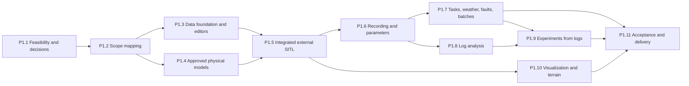

# MirageSITL: план работ фазы 1

<!-- source-sha256: d6113dc9bb15444666b4327ad989c5ac1de4be77cacb8dddb2ae8f23c85e6bc0 -->

Английский источник: [Source of truth](../PHASE1_PLAN.md). Изменения обновляют оба языка в одной задаче.

Статус: предлагаемый план, 2026-10-28. Он выведен из утверждённого
[scope проекта](PROJECT_SCOPE.md) (baseline аудита `5b4a2fc`) и инвентаризации
baseline `384e974` и неслитых веток. Он регистрирует TASK-127–TASK-191 в
[дорожной карте](PROJECT_ROADMAP.md). Регистрация ничего не реализует и не
разрешает разработку: каждая задача начинается только по явной инструкции на
разработку (раздел 4 scope, ограничение 2). Scope не утверждал сроков и оценок
трудоёмкости, поэтому в плане их нет.

## 1. Назначение и полномочия

* [PROJECT_SCOPE.md](PROJECT_SCOPE.md) определяет, что входит в фазу 1 и что
  исключено. Этот план не меняет scope; поправка требует одобрения стейкхолдера,
  зафиксированного в документе scope.
* [Дорожная карта](PROJECT_ROADMAP.md) хранит контракт каждой задачи:
  зависимости, затрагиваемые файлы, интерфейсы и DoD. Рабочий процесс агентов из
  [CLAUDE.md](CLAUDE.md) применяется к каждой задаче.
* Каждая задача называет группы требований scope, которым она служит (S01–S19).
  Эти ID не связаны с метками пакетов спринтов дорожной карты (S00a–S13c) и с
  метками пакетов фазы 1 (P1.1a и т. д.).
* Инвентаризация охватила дорожную карту, спецификации и код на `384e974`.
  Утверждения раздела 2 описывают содержимое кода, а не приёмку во время
  выполнения. Для этого плана тесты не запускались.
* Терминология: «фаза 1» здесь соответствует «первому этапу» русского текста
  scope, «эксперимент» — «испытанию», «мотор» — «двигателю», а «журнал» —
  «логу».

## 2. Текущее состояние проекта

### 2.1 Проверенные составные части для повторного использования

Каждая часть ниже прошла собственные тесты или стенд. Большинство из них ещё не
подключены к работающему приложению.

| Область | Что есть | Задачи | Используется работающим приложением |
| --- | --- | --- | --- |
| Runtime | Кольцо состояний ABI v2 в разделяемой памяти, часы 400/800/1200 Гц с политиками перегрузки, очереди SPSC датчиков и актуаторов с 16 слотами актуаторов, Control Protocol v2, рендеринг с учётом эпох | TASK-007–TASK-015, TASK-085 | Да |
| Физика роторов и корпуса | BET с полярами NeuralFoil, производственный ABI привязанных роторов, конфигурируемый `BetFlightDynamics` (4, 6 и 8 роторов сходятся к эталону 4800 Гц), нагрузки произвольной рамы, твёрдое тело RK4 | TASK-016–TASK-023, TASK-027, TASK-028, TASK-033 | Нет: только тесты и скрипты |
| Ядра силовой установки | Мотор и ESC с пределами тока, просадка батареи на общей шине, эталон соосного следа | TASK-024–TASK-026 | Нет: только тестовые экспорты |
| Контакт | Податливый контакт Rapier; collision-чанки рельефа с плоскостями на каждом тике и паузой при отсутствии земли | TASK-029, TASK-065 | Нет |
| Среда | Атмосфера МСА и порывы AR(1) с seed; геодезия WGS84, абсолютная MSL заблокирована из-за отсутствия сетки геоида | TASK-032, TASK-036 | Нет |
| Датчики | Идеальные IMU, барометр, магнитометр и воздушная скорость; планирование частот; шум с seed, блуждание смещения и задержка | TASK-034, TASK-035 | Нет |
| Нативный ArduPilot | Кодек JSON lockstep для 16 и 32 каналов; стенд замкнутого контура с живым допуском по EKF; матрица регрессий РЭБ; всё на Linux/WSL с quad X | TASK-041–TASK-043, TASK-059 | Нет: только инструменты командной строки Node |
| Браузерный ArduPilot | Сборка WASM, mailbox HAL, паритет native/browser | TASK-044–TASK-047 | Только диагностическая страница; не полётный режим фазы 1 |
| Каналы связи | Подмножество MAVLink2 (12 сообщений), калибровка RC и отображение override, автомат состояний автопилота, loopback-мост WebSocket/UDP с проверкой токена и Origin, Web Serial | TASK-037–TASK-040, TASK-048 | Частично: только телеметрия Web Serial; клиента моста нет |
| РЭБ и отказы | Подавление GNSS, скачок позиции, когерентный дрейф, магнитная аномалия, отказы моторов с частичной мощностью, реестр отказов | TASK-052–TASK-058, TASK-124–TASK-126 | Частично: только флаги РЭБ; демонстрация отклоняет motor-loss |
| Рельеф и рендеринг | Политика провайдеров, адаптер 3D Tiles с локальной фикстурой, бюджеты LOD, рендерер WebGL2/WebGPU, камера FPV, покров WorldCover для Израиля | TASK-060–TASK-062, TASK-066, TASK-067, TASK-069 | Частично: рельеф только через переменные сборки |
| Запись и UI | HUD с источником и свежестью, консоль инструктора с журналом подтверждений, регистратор AAR, воспроизведение, графики и архивы, исполнитель сценариев | TASK-074–TASK-079, TASK-081 | Да, для демонстрации |
| Инструменты доказательств | Отчёт валидации моделей, системная матрица и манифест выпуска, стенд GPU | TASK-033, TASK-073, TASK-082, TASK-083 | Неприменимо |

### 2.2 Что делает работающее приложение сегодня

* Это одна страница без навигации. Рельеф и другие настройки задаются
  переменными сборки и параметрами URL.
* Физический Worker всегда выполняет демонстрационную динамику — игрушечный
  квадрокоптер с общей тягой (`apps/web/src/physics.worker.ts`). Сессия
  отклоняет `model.load` и `weather.set`, а также отказы motor-loss, потому что
  у демонстрации нет модели отдельных моторов.
* Приложение никогда не подключается к мосту. UI для запуска ArduPilot,
  параметров, миссий и команд нет. Пауза останавливает только часы браузерного
  Worker.
* Регистратор пишет полночастотные записи по 512 байт в кольцо 32 MiB — около
  163 с при 400 Гц, — которое удаляется при закрытии. Между перезагрузками
  сохраняется только калибровка радиоаппаратуры.
* Ускорение свободного падения постоянно (9.80665 м/с²), магнитное поле — постоянный
  вектор, а рельеф только отображается и по умолчанию выключен.

### 2.3 Пробелы и ограничения, найденные в коде

* Нативный SITL запускался только на хостах Linux/WSL. Harness отклоняет
  Windows, вспомогательный модуль паритета отклоняет любой хост не на Linux, а
  проверки ELF отклоняют бинарные файлы Mach-O. Нативный SITL никогда не
  запускался на macOS.
* Harness летает на 4-моторном quad X (`FRAME_CLASS 1`, каналы 1–4,
  `--speedup 2`). Конфигураций многомоторных рам, функций выходов или scripting
  matrix в репозитории нет.
* Кадр актуаторов ABI v2 и его слоты SPSC несут ровно 16 значений
  (`MAX_ACTUATORS = 16`) — максимум фазы 1. Манифест модели и BET допускают 32
  ротора, а JSON-пакеты сервоприводов несут 16 или 32 канала.
* Мост закрывает сессию после 5 с без полезной нагрузки, что разорвало бы сессию
  на паузе.
* Кодек MAVLink поддерживает 12 ID сообщений, но не имеет сообщений списка
  параметров, команд, миссий, целевой позиции и статуса. `dialect.lock.json`
  перечисляет только 4 ID.
* Парсера DataFlash нет; журналы SITL `.BIN` только копируются в захваты.
  UAVLogViewer упоминается только в документах.
* Данных высот в репозитории нет. Скрипты загрузки и сборки FABDEM существуют, но
  их результат не закоммичен, а WorldCover — это покров, а не высоты.
* UI настройки датчиков нет, а публикуемый ток батареи всегда равен 0.

### 2.4 Неслитые, устаревшие и несогласованные элементы

* Ветка `claude/ardupilot-sitl-physics-review-ggf1tb` (9 коммитов поверх
  `27e2a6a`, не слита) содержит приращение 1 задач TASK-087–TASK-090. В ней также
  есть скрипт нативной сборки SITL с необязательным патчем ArduPilot
  `imu-noise-floor`, одобренным пользователем 2026-10-26, и регистрация
  «TASK-124 — Effect controls», которая конфликтует с TASK-124 в main. TASK-135
  переносит ветку, а решение D-10 касается патча.
* Ветка `analyze_repo_next_task` содержит процедуру проверки на Mac M4 и план
  приёмки TASK-073. Она не слита; TASK-132 решает, что из неё нужно фазе 1.
* Нативные отчёты РЭБ TASK-059 — исторический снимок, потому что TASK-125 и
  TASK-126 изменили замороженные исходники. TASK-171 обновляет их на macOS.
* CLAUDE.md и README ссылаются на `scripts/check-mavlink-capture.mjs` и
  `scripts/check-ew-capture.mjs`, которых никогда не было в репозитории. Отчёт
  TASK-047 `test-results/validation/autopilot-parity.json` игнорируется Git и не
  отслеживается. TASK-134 исправляет эти ссылки.
* HANDOVER.md описывает работу TASK-074 от 2026-10-20.

Состояние на 2026-10-28: TASK-135 слила ветку обзора физики без её регистрации
TASK-124. TASK-134 заменила ссылки на два отсутствующих скрипта реальными
командами аудита, отметила в TASK-047, что её отчёт о паритете не отслеживается,
и вывела HANDOVER.md из употребления. Ветка `analyze_repo_next_task` остаётся
неслитой: её процедура для Mac M4 предшествует утверждённому scope и опирается
на TASK-073, которая не является порогом фазы 1 (пункт A-11 в
[phase1-acceptance.md](phase1-acceptance.md)). Её этапы статических, нативных,
модульных и браузерных проверок могут стать основой чек-листов TASK-127 и
TASK-152.

## 3. Покрытие требований

«Повторное использование» перечисляет существующую работу, на которую можно
опираться после проверки её интеграции; «Не хватает» — то, что ещё не дала ни
одна задача.

| ID scope | Повторное использование | Не хватает | Задачи |
| --- | --- | --- | --- |
| S01 Платформа, язык, офлайн | Проверка возможностей, заголовки изоляции, локальные WASM-артефакты | SITL на macOS, лаунчер, установка, перечень офлайн-зависимостей, названия в Unicode в сохраняемых записях | TASK-127, TASK-131, TASK-136, TASK-137, TASK-151, TASK-152, TASK-190 |
| S02 Запуск, остановка, подключение, пауза | Harness собственных процессов, мост, JSON lockstep, живой допуск по EKF, пауза Worker | Запуск из UI, диагностика и перезапуск, ручное подключение, пауза, доходящая до ArduPilot, поддержание соединения моста | TASK-129, TASK-151–TASK-156 |
| S03 Редактор аппарата, назначение моторов | Манифест модели v1 до 32 роторов, приращение манифеста аппарата v2 (не слито), нагрузки рамы | Лучи и пары, редактор и 3D-схема, назначение выходов, тракт рамы на 16 моторов, проверка моторов | TASK-128, TASK-135, TASK-138, TASK-141, TASK-142, TASK-144, TASK-157 |
| S04 Компоненты, режимы ввода | Схема конфигурации мотора и ESC, данные UIUC, импорт стендовых данных (не слит) | Версионированные карточки, режимы расчёта, измерения с привязкой к комбинации, калибровка | TASK-139, TASK-140, TASK-145 |
| S05 Аэродинамика полёта | BET со свободным валом и осевым потоком; эталон соосной пары (только тесты); снижение только помечается | Поток при косой обдувке и снижении, вихревое кольцо, влияние земли, соосное сопряжение и сопротивление корпуса в производственном шаге | TASK-144, TASK-145; TASK-096–TASK-101 |
| S06 Пределы батареи и силовой установки | Ядра мотора, ESC и батареи (только тесты) | Производственный привод и шина, монитор пределов, UI и журналы | TASK-146; TASK-092 |
| S07 Погода, география | Атмосфера МСА, порывы AR(1), WGS84 | Погода в сессиях, спектры турбулентности, дискретные порывы, расписания, выбор местоположения, географические сила тяжести и магнитное поле, геоид | TASK-148, TASK-166, TASK-167; TASK-093, TASK-106 |
| S08 Вкладка Sensors | Ядра датчиков; каталог владения (не слит) | Схема конфигурации и UI, размещение и ориентация, измерение батареи, единственный владелец в тракте SITL | TASK-143, TASK-147; TASK-089 |
| S09 Отказы, дрейф EKF | Движок РЭБ и отказы моторов, журнал подтверждений, исполнитель сценариев, исторические нативные доказательства РЭБ | Доставка во внешний SITL, замершие и пропадающие показания, потеря связи с пилотом и наземной станцией, UI расписаний, графики оценки EKF, обновлённые доказательства | TASK-166, TASK-168–TASK-171 |
| S10 Задания, начальные условия, скорость | Отображение RC, политика часов lockstep, сценарий облёта в демонстрации | Сообщения команд, миссий и guided, библиотека заданий, маршруты, манёвры, начальные условия, ускоренные прогоны, отображение скорости | TASK-150, TASK-172–TASK-175 |
| S11 Параметры | Кадры параметров в кодеке, генерация `.parm` в harness, профиль ArduPilot (не слит) | Полный список и обратное чтение, метаданные, UI, история, наборы, экспорт | TASK-159–TASK-161 |
| S12 Сравнение, серии | Метрики достоверности (не слиты), интерфейс ресимуляции | Метрики результатов, контролируемые сравнения, последовательные серии | TASK-176, TASK-177 |
| S13 Запись | Worker регистратора, чанки IndexedDB, архивы | Запись всего прогона, выбор сигналов и частот, пределы источников, оценка объёма, сбор DataFlash | TASK-132, TASK-162–TASK-164 |
| S14 UAVLogViewer | Файлы SITL `.BIN`, копируемые в захваты | Интеграция просмотрщика, чтение и запись DataFlash, адаптер экспериментов, сравнение и выравнивание | TASK-130, TASK-178–TASK-181 |
| S15 Эксперименты по журналам | Метрики достоверности и схема захвата (не слиты) | Извлечение из журнала и дополнение, повторная симуляция, метки достоверности | TASK-133, TASK-182–TASK-184 |
| S16 Проекты, воспроизводимость | Архивы с контрольными суммами, ГПСЧ с seed | Хранилище проектов, версии, записи экспериментов, Repeat и Create variant | TASK-136, TASK-165 |
| S17 Рельеф, визуализация | Адаптер 3D Tiles, бюджеты LOD, collision-чанки, рендерер, камера FPV, WorldCover | Выбор рельефа во время работы и покрытие, данные высот, аппарат по геометрии, бортовой вид, панели траектории и телеметрии | TASK-131, TASK-185, TASK-186 |
| S18 Контакт, аварии | Контакт Rapier и плоскости рельефа | Контакт в полётных сессиях, склоны, обнаружение аварии и пауза | TASK-133, TASK-149, TASK-187; TASK-094, TASK-095 |
| S19 Приёмка | Системная матрица и инструменты выпуска, соглашения о доказательствах | Матрица фазы 1, доказательства на macOS, час с 16 моторами, приёмка установки и офлайн-работы | TASK-132, TASK-188–TASK-191 |

## 4. Положение существующих задач дорожной карты

TASK-134 зафиксировала это положение в дорожной карте 2026-10-28 строкой
**Phase 1 disposition** в каждой открытой задаче и в названных здесь задачах DONE. Отложенная задача сохраняет ID, контракт и доказательства, и её
откладывание не означает указания удалить код.

| Существующие задачи | Положение в фазе 1 | Основание |
| --- | --- | --- |
| TASK-087, TASK-088, TASK-089, TASK-090 | Нужны. TASK-135 перенесла приращение 1 каждой из них 2026-10-28; остальные приращения продолжаются. | S03, S04, S08, S15 |
| TASK-091 | Нужна для прогонов с 16 моторами в реальном времени: обзор измерил такт октокоптера около 0.70 мс при вычислительном пределе G3 0.4167 мс на 1200 Гц. | S10, S19 |
| TASK-092 | Нужна: производственная шина мотора, ESC и батареи. | S06 |
| TASK-093 | Нужна: погода и атмосфера в сессиях. | S07 |
| TASK-094 | Нужна для смещения центра масс и полного тензора инерции и как основа TASK-095. | S03, S18 |
| TASK-095 | Нужна: податливый контакт в полётных сессиях; сравнение NASA остаётся отложенным. | S18 |
| TASK-096, TASK-097, TASK-098, TASK-099, TASK-100 | Нужны: сопротивление корпуса, поляры полного диапазона, поток v2, режимы снижения и влияние земли. Их сравнения с измеренными данными следуют решению D-11. | S05 |
| TASK-101 | Нужна для соосных пар; задача также охватывает влияние на задние роторы и планер. | S05 |
| TASK-106 | Нужна для турбулентности; минимальное приращение фазы 1 — спектры Драйдена. | S07 |
| TASK-103 | Необязательна: TASK-145 может использовать табличный режим для измеренных комбинаций. | S04 |
| TASK-108 | Нужна частично: нормальная сила тяжести, главное поле WMM и сетка геоида с хешем, которые даёт TASK-148. Поля аномалий и помехи аппарата отложены. | S07 |
| TASK-115 | Нужна частично: размещение (плечо) и ориентация, которые даёт TASK-147. Температурные составляющие, калибровка по дисперсии Аллана и выпрямление вибраций отложены. | S08 |
| TASK-102, TASK-104, TASK-105, TASK-107, TASK-114, TASK-116, TASK-117, TASK-118, TASK-119, TASK-123 | Отложены: не требуются S01–S19. Зависящая от нагрузки просадка и электрические пределы берутся из TASK-092 и TASK-146; нагрев, охлаждение, старение и течения от рельефа исключены. | Раздел 2 scope |
| TASK-109–TASK-113 | Отложены: самолётные схемы, VTOL и другие классы аппаратов относятся к следующим этапам. | Раздел 2 scope |
| TASK-120, TASK-121, TASK-122 | Отложены: гибкие конструкции и следы нескольких аппаратов исключены, а термики и микропорывы не входят в настройки погоды S07. | Раздел 2 scope, S07 |
| TASK-073 | Не блокирует фазу 1: её гейт зависит от встроенных GPU, измеренных под Windows, и от видов тепловизора и FPV, которые фаза 1 исключает. Её доказательства и стенд сохраняются, а TASK-132 задаёт критерии рендеринга фазы 1. | Разделы 2 и 3 scope |
| TASK-080 | Автоматические проверки клавиатуры и axe остаются регрессиями для нового UI. Ручная проверка со скринридером не входит в S19, если её не добавит решение D-12. | S19 |
| TASK-082, TASK-083 | Их инструменты используются повторно; приёмка и поставка фазы 1 — TASK-188–TASK-191. Их строки WASM, HITL и Windows не являются гейтами фазы 1. | S19 |
| TASK-059 | Её доказательства DONE — исторический снимок прежних исходников РЭБ; TASK-171 обновляет их на macOS. | S09 |
| TASK-033, TASK-036 | Проваленные сравнения UIUC и отложенное сравнение NASA сохраняют вердикты. Гейт абсолютной MSL открывается только с сеткой геоида TASK-148. | S05, S07 |
| TASK-044–TASK-047 | ArduPilot в браузере сохраняется, но не является полётным режимом фазы 1 и не расширяется. | Раздел 2 scope |
| TASK-048–TASK-051 | Код Web Serial и HIL сохраняется. HITL, Simulation-on-Hardware и запись в реальный контроллер вне фазы 1, а TASK-051 остаётся отложенной. | Раздел 2 scope |
| TASK-063, TASK-064 | Заморожены: прокси тайлов Google и кеш R2 требуют ключей, развёртывания и одобрения нового провайдера. | S17, раздел 2 scope |
| TASK-068, TASK-070, TASK-071, TASK-072 | Заморожены: аналоговые видеоэффекты и тепловизор относятся к backlog. TASK-185 использует положение камеры TASK-067 без эффектов. | Раздел 2 scope |
| Прочие задачи DONE | Используются повторно после проверки их фактической интеграции. Их доказательства остаются как записаны и не являются приёмкой фазы 1. | Раздел 3 scope, шаг 2 |
| «TASK-124 — Effect controls» в ветке обзора физики | Заменяется TASK-166 и не сливается под этим ID. | TASK-124 в main |

Предложения второй версии в [V2_PLAN.md](V2_PLAN.md) служат только справочным
материалом. Workstream A — новый просмотрщик журналов — заменяется интеграцией
UAVLogViewer из S14. DrorPlanner (A9) и GovMap (workstream D) исключены.
Workstreams B и C питают S05 и профиль аппарата.

## 5. План выполнения

### 5.1 Порядок этапов

Этапы следуют плану выполнения scope (раздел 3, шаги 1–11). Зависимости в
дорожной карте обеспечивают этот порядок. Независимые задачи более поздних
этапов могут начаться раньше, только когда все их собственные зависимости
находятся в статусе DONE.

### 5.2 Этапы и задачи

Для каждого этапа указаны критерий выхода и задачи. Полный контракт каждой
задачи находится в дорожной карте.

#### Этап P1.1: осуществимость и решения

Выход: SITL на macOS, тракт 16 моторов, время и пауза, просмотрщик журналов, перечень офлайн-зависимостей и рельефа, решения о приёмке и достоверности зафиксированы с доказательствами или точными блокерами.

| Задача | Название | ID scope | Зависит от |
| --- | --- | --- | --- |
| TASK-127 | Нативный ArduPilot SITL на macOS с Apple Silicon | S01, S02 | 041, 042 |
| TASK-128 | Версия ArduPilot и тракт выходов для 16 моторов | S03, S19 | 041, 127 |
| TASK-129 | Владение временем внешнего SITL, синхронизированная пауза и ускорение | S02, S10 | 041, 043, 127 |
| TASK-130 | Идентичность, лицензия и осуществимость офлайн-интеграции UAVLogViewer | S14 | 081 |
| TASK-131 | Перечень офлайн-зависимостей и существующих данных рельефа | S01, S17 | 060, 069 |
| TASK-132 | Параметры приёмки фазы 1: эталонное оборудование, производительность и запись | S13, S19 | 014 |
| TASK-133 | Области применимости моделей, критерии достоверности и базовая аппроксимация контакта | S05, S06, S15, S18 | 033 |

#### Этап P1.2: сопоставление со scope

Выход: Документация согласована со scope; приращения TASK-087–TASK-090 перенесены в main.

| Задача | Название | ID scope | Зависит от |
| --- | --- | --- | --- |
| TASK-134 | Согласовать дорожную карту, спецификации и инструкции агентов с PROJECT_SCOPE.md | S01–S19 | 084 |
| TASK-135 | Перенести в main приращения TASK-087–TASK-090 из ветки обзора физики | S03, S04, S08, S15 | 124, 125, 126 |

#### Этап P1.3: основа данных и редакторы

Выход: Версионированные проекты, профили до 16 моторов, карточки компонентов, режимы расчёта, назначение выходов и настройки Sensors через UI.

| Задача | Название | ID scope | Зависит от |
| --- | --- | --- | --- |
| TASK-136 | Локальное хранилище проектов с неизменяемыми версиями | S16, S01 | 076, 081 |
| TASK-137 | Оболочка приложения фазы 1 и навигация | S01 | 005, 085, 136 |
| TASK-138 | Профиль аппарата v1 для мультироторов до восьми лучей и 16 моторов | S03 | 087, 136 |
| TASK-139 | Карточки компонентов для моторов, пропеллеров, ESC и батарей | S04 | 090, 136 |
| TASK-140 | Режимы расчёта и измеренные комбинации компонентов | S04, S15 | 133, 137, 138, 139 |
| TASK-141 | Редактор аппарата с 3D-схемой по геометрии | S03 | 015, 137, 138, 139 |
| TASK-142 | Назначение моторов на выходы и проверка совместимости рамы | S03 | 128, 138, 141 |
| TASK-143 | Вкладка Sensors: идеальные датчики или заданные ошибки | S08 | 089, 137, 138 |

#### Этап P1.4: утверждённые физические модели

Выход: Динамика по профилю с силовой установкой, батареей, аэродинамикой, датчиками, средой и базовым контактом в заявленных пределах.

| Задача | Название | ID scope | Зависит от |
| --- | --- | --- | --- |
| TASK-144 | Динамика мультиротора по профилю с числом роторов до 16 | S03, S05 | 088, 092, 138 |
| TASK-145 | Калибровка силовой установки в режиме по измерениям | S04, S05 | 140, 144 |
| TASK-146 | Пределы батареи и силовой установки: предупреждения и моделируемое ограничение | S06 | 092, 139, 144 |
| TASK-147 | Конфигурация ошибок датчиков в тракте внешнего SITL | S08 | 035, 089, 143 |
| TASK-148 | Местоположение и географическая среда | S07 | 036, 093, 131 |
| TASK-149 | Обнаружение аварии и автоматическая пауза | S18 | 095, 144 |

#### Этап P1.5: интегрированная сессия с внешним SITL

Выход: Номинальный полёт каждой конфигурации S19 через UI на macOS.

| Задача | Название | ID scope | Зависит от |
| --- | --- | --- | --- |
| TASK-150 | Набор сообщений MAVLink для функций наземной станции фазы 1 | S02, S09, S10, S11 | 037 |
| TASK-151 | Локальный лаунчер для macOS | S01, S02 | 040, 127 |
| TASK-152 | Установка на macOS и проверка предварительных условий при первом запуске | S01, S02 | 131, 151 |
| TASK-153 | Браузерная физика как JSON lockstep backend для нативного ArduPilot | S01, S02, S03 | 043, 129, 144, 150, 151 |
| TASK-154 | Запуск и остановка эксперимента, готовность и обработка отказов | S02 | 136, 142, 153 |
| TASK-155 | Ручное подключение к запущенному совместимому SITL | S02 | 129, 153 |
| TASK-156 | Синхронизированные пауза и возобновление в интегрированных сессиях | S02 | 129, 149, 153 |
| TASK-157 | Виртуальная проверка моторов по одному | S03 | 141, 142, 154 |
| TASK-158 | Приёмка номинального полёта на macOS | S01–S03 | 095, 146, 147, 152, 155, 156, 157 |

#### Этап P1.6: запись и происхождение параметров

Выход: Обратное чтение и экспорт параметров и запись всего прогона с происхождением.

| Задача | Название | ID scope | Зависит от |
| --- | --- | --- | --- |
| TASK-159 | Служба параметров ArduPilot с обратным чтением и метаданными | S11 | 150, 153 |
| TASK-160 | Вкладка Parameters: правка, история и наборы параметров | S11 | 137, 156, 159 |
| TASK-161 | Экспорт файла параметров ArduPilot | S11 | 159, 160 |
| TASK-162 | Регистратор экспериментов v2 с потоковой записью всего прогона и частотами по сигналам | S13 | 076, 136, 153 |
| TASK-163 | Вкладка Logging с оценкой объёма и контролем хранилища | S13 | 132, 137, 162 |
| TASK-164 | Сбор журналов DataFlash ArduPilot для каждого эксперимента | S13, S14 | 151, 154, 159 |
| TASK-165 | Жизненный цикл эксперимента: повтор, создание варианта, экспорт и импорт | S16 | 136, 154, 160, 162 |

#### Этап P1.7: полётные задания, погода, отказы и серии

Выход: Воспроизводимые задания, расписания погоды и отказов, дрейф EKF, скорость прогона, серии и сравнения.

| Задача | Название | ID scope | Зависит от |
| --- | --- | --- | --- |
| TASK-166 | Контракт управления воздействиями для погоды, ошибок датчиков и отказов | S07, S08, S09 | 010, 075, 079, 089, 093, 156 |
| TASK-167 | Вкладка погоды с запланированными изменениями и воспроизводимыми порывами | S07 | 106, 137, 148, 166 |
| TASK-168 | Пропадание и замирание показаний датчиков и потеря связи | S09 | 057, 147, 153, 166 |
| TASK-169 | Вкладка отказов и помех с расписаниями и результатами | S09 | 137, 166, 168 |
| TASK-170 | Сценарий дрейфа EKF с графиками истины и оценки | S09 | 055, 150, 162, 169 |
| TASK-171 | Обновить доказательства регрессий РЭБ и отказов на нативном SITL в macOS | S09 | 059, 127, 168 |
| TASK-172 | Библиотека полётных заданий с маршрутами и начальными условиями | S10 | 150, 153, 165 |
| TASK-173 | Манёвры настройки с запрошенным и фактическим откликом | S10 | 162, 172 |
| TASK-174 | Ручной полёт с пультом в интегрированных сессиях | S10 | 038, 153 |
| TASK-175 | Прогоны в реальном времени и ускоренные с видимой фактической скоростью | S10 | 132, 153, 156 |
| TASK-176 | Последовательные пользовательские серии параметров | S12 | 158, 161, 165, 172 |
| TASK-177 | Сравнение экспериментов и метрики результатов | S12 | 140, 146, 165, 173 |

#### Этап P1.8: анализ журналов в UAVLogViewer

Выход: UAVLogViewer интегрирован с журналами DataFlash и экспериментов и сравнениями.

| Задача | Название | ID scope | Зависит от |
| --- | --- | --- | --- |
| TASK-178 | Чтение и запись журналов DataFlash | S14, S15 | 004 |
| TASK-179 | Поставить закреплённый UAVLogViewer для офлайн-работы | S14 | 130, 137, 152 |
| TASK-180 | Открывать эксперименты MirageSITL в просмотрщике с контекстом | S14 | 160, 164, 165, 178, 179 |
| TASK-181 | Сравнение двух полётов и двух интервалов в просмотрщике | S14 | 180 |

#### Этап P1.9: эксперименты по журналам и достоверность

Выход: Эксперименты по журналам, повторная симуляция и доказательства достоверности по версии профиля.

| Задача | Название | ID scope | Зависит от |
| --- | --- | --- | --- |
| TASK-182 | Создание эксперимента по реальному журналу | S15 | 165, 172, 178 |
| TASK-183 | Повторная симуляция с изменёнными параметрами и сравнение с исходным полётом | S15 | 177, 181, 182 |
| TASK-184 | Оценка достоверности по версии профиля и режиму | S15 | 090, 133, 183 |

#### Этап P1.10: визуализация и существующий рельеф

Выход: Виды по геометрии, источники рельефа и контакт на реальном рельефе.

| Задача | Название | ID scope | Зависит от |
| --- | --- | --- | --- |
| TASK-185 | Модель аппарата по геометрии, виды и панели телеметрии | S17 | 067, 141, 153 |
| TASK-186 | Выбор источника рельефа, покрытие и пауза при отсутствии рельефа | S17 | 065, 131, 148, 156 |
| TASK-187 | Контакт на наклонном реальном рельефе в интегрированных сессиях | S18 | 095, 149, 186 |

#### Этап P1.11: комплексная приёмка и локальная поставка

Выход: S19 выполнен на macOS с записью PASS, FAIL, BLOCKED и NOT_RUN.

| Задача | Название | ID scope | Зависит от |
| --- | --- | --- | --- |
| TASK-188 | Инструмент матрицы приёмки фазы 1 | S19 | 132, 134, 158 |
| TASK-189 | Часовой прогон симуляции для 16 моторов с записью | S19 | 091, 162, 175, 188 |
| TASK-190 | Поставка для macOS: установка, перезапуск, офлайн-работа и восстановление | S01, S19 | 152, 179, 188 |
| TASK-191 | Отчёт о приёмке фазы 1 | S19 | 096, 098, 099, 100, 101, 106, 145, 163, 167, 170, 171, 174, 176, 177, 181, 184, 185, 187, 189, 190 |

### 5.3 Параллельные направления и критический путь

* **Интеграция автопилота:** TASK-127 → TASK-128, TASK-129 и TASK-151 →
  TASK-152 и TASK-153 (которой также нужны TASK-144 и TASK-150) →
  TASK-154–TASK-157 → TASK-158.
* **Данные и UI:** TASK-136 → TASK-137, TASK-138 и TASK-139 →
  TASK-140–TASK-143.
* **Физика:** TASK-135 → TASK-087–TASK-090 → TASK-092–TASK-095 →
  TASK-096–TASK-101 и TASK-106. TASK-091 может начаться сразу и предшествует
  TASK-097 и TASK-098. TASK-144–TASK-149 связывают модели с профилями,
  пределами, датчиками, средой и авариями.
* **Анализ:** TASK-130 → TASK-179; TASK-178 и TASK-179 → TASK-180 →
  TASK-181; TASK-178 → TASK-182 → TASK-183 → TASK-184.
* **Решения:** TASK-132 и TASK-133 выполняются рано, потому что их значениями
  владеет стейкхолдер. Последующая приёмка использует их без изменений.

По числу задач самая длинная цепочка открытых задач до отчёта о приёмке: TASK-087 → TASK-088 → TASK-094 → TASK-095 → TASK-149 → TASK-156 → TASK-160 → TASK-165 → TASK-172 → TASK-173 → TASK-177 → TASK-183 → TASK-184 → TASK-191 (14 задач; трудоёмкость не оценивалась). На практике первой идёт TASK-135, потому что TASK-087 и TASK-088 продолжаются с перенесённых ею приращений. TASK-191 прямо или транзитивно зависит от 79 открытых задач: 63 новых и 16 существующих — TASK-087–TASK-101 и TASK-106. У TASK-135 нет зависимых задач в графе.

### 5.4 Контрольные точки

| Контрольная точка | Достигнута, когда |
| --- | --- |
| M1 Осуществимость зафиксирована | TASK-127–TASK-133 находятся в статусе DONE или имеют точный статус BLOCKED, а решения D-01–D-09 приняты или эскалированы. |
| M2 Основа | TASK-134, TASK-135, TASK-087–TASK-090 и TASK-136–TASK-143 находятся в статусе DONE. |
| M3 Первый интегрированный полёт на macOS | TASK-158 проходит для каждой конфигурации S19. |
| M4 Процесс настройки | TASK-159–TASK-177 находятся в статусе DONE. |
| M5 Анализ журналов | TASK-178–TASK-184 находятся в статусе DONE. |
| M6 Приёмка фазы 1 | TASK-185–TASK-191 находятся в статусе DONE, а отчёт TASK-191 фиксирует каждый критерий S19. |

## 6. Решения и доказательства, которые ещё нужны

Раздел 3 scope перечисляет D-01–D-09. D-10–D-12 появились в ходе этой
инвентаризации. Решение принадлежит стейкхолдеру; задача фиксирует его с датой и
не придумывает значение.

| ID | Решение или доказательство | Фиксируется в | Блокирует |
| --- | --- | --- | --- |
| D-01 | Версия или версии ArduPilot и полный тракт 16 выходов; ограничение прошивки эскалируется и никогда не служит поводом сократить scope | TASK-128 | TASK-142 |
| D-02 | Способ нативного запуска на macOS; любой запасной вариант с виртуальной машиной или контейнером требует отдельного решения | TASK-127 | TASK-151 |
| D-03 | Владение временем, пауза без вызванного failsafe, доступ к параметрам во время паузы и ускорение | TASK-129 | TASK-153, TASK-155, TASK-156 |
| D-04 | Идентичность, версия, лицензия, офлайн-поставка и способ расширения UAVLogViewer | TASK-130 | TASK-179 |
| D-05 | Форматы импорта и экспорта измеренных данных и моделей, правила проверки и общая частота записи по умолчанию | TASK-132, TASK-136, TASK-139, TASK-140 | TASK-163 |
| D-06 | Модели, входы, области применимости, численные допуски, критерии достоверности и метки уверенности | TASK-133 | TASK-140, TASK-145, TASK-184 |
| D-07 | Базовая аппроксимация опор и контакта без редактирования шасси | TASK-133 | TASK-187 |
| D-08 | Эталонные Mac, версии macOS и Chrome, бюджеты реального времени и рендеринга, нагрузки записи и согласование TASK-073 | TASK-132 | TASK-163, TASK-175, TASK-188, TASK-189 |
| D-09 | Доступные подложки и данные высот и их лицензии, включая рельеф, построенный инструментами FABDEM, и офлайн-ресурсы | TASK-131 | TASK-148, TASK-186 |
| D-10 | Остаётся ли в силе одобрение от 2026-10-26 необязательного патча ArduPilot `imu-noise-floor` с учётом ограничения 5 scope | TASK-135 | Владение MirageSITL порогами шума IMU в TASK-147 |
| D-11 | Может ли интеграция фазы 1 опираться на реализованные эффекты, сравнения которых с измеренными данными из DoD TASK-097–TASK-101 остаются BLOCKED_EXTERNAL, с меткой «не проверено» | TASK-134 | TASK-191 |
| D-12 | Входит ли ручная проверка доступности из TASK-080 в приёмку фазы 1 | TASK-134 | TASK-191 |

Решения, принятые стейкхолдером 2026-10-28:

* D-05 (только в части частоты записи) и D-08: пункты A-01–A-12 в
  [phase1-acceptance.md](phase1-acceptance.md). Матрица использует X8 как
  парную конфигурацию.
* D-06 и D-07: F-01–F-09 в [phase1-fidelity.md](phase1-fidelity.md). MirageSITL
  не задаёт пределов валидации и не выносит вердиктов о достоверности;
  сравнения оценивает пользователь (поправка к scope SA-01).
* D-09: MirageSITL — некоммерческий проект, поэтому перечисленные наборы данных
  можно использовать; вопросы о лицензиях стейкхолдеру больше не задаются.
* D-10: патча `imu-noise-floor` пока нет; фаза 1 использует штатный SITL
  ArduPilot.
* D-11: фаза 1 использует реализованные эффекты, чьи сравнения с измеренными
  данными остаются BLOCKED_EXTERNAL, с пометкой «не проверено».
* D-12: ручная приёмка с экранным диктором из TASK-080 не входит в приёмку
  фазы 1; автоматические проверки клавиатуры и axe сохраняются.

## 7. Риски

| Риск | Последствие | Ранняя проверка | Ответ |
| --- | --- | --- | --- |
| Штатный ArduCopter или его SITL не может управлять 16 моторами на восьми соосных лучах | Обязательная конфигурация заблокирована | TASK-128 | Эскалировать варианты (штатная рама scripting matrix, параметр сборки, одобренный патч); никогда не сокращать scope |
| Нативная сборка SITL или harness не работает на macOS с Apple Silicon | Нет backend фазы 1 | TASK-127 | Зафиксировать точный блокер; виртуальная машина или контейнер только по решению |
| ArduPilot перестаёт обслуживать MAVLink или срабатывает failsafe, пока время lockstep заморожено; мост разрывает простаивающие сессии через 5 с | Требование паузы не выполнено | TASK-129 | Поддержание соединения в мосте; описать, какой доступ к параметрам работает на паузе |
| Шестнадцать роторов BET превышают бюджет вычислений реального времени в браузерном Worker | Прогоны в реальном времени пропускают шаги | TASK-091, TASK-144 | Частота физики для каждой конфигурации (TASK-132); ускоренные прогоны никогда не упрощают модель |
| Троттлинг браузера или видимость вкладки прерывают многочасовые прогоны | Длительный прогон проваливается | TASK-156, TASK-175 | Темп lockstep в Worker, явная политика видимости, фактическая скорость на экране |
| Записи всего прогона превышают квоту хранилища браузера | Пропуски в записи | TASK-162, TASK-163 | Оценки, предупреждения до исчерпания, явные пропуски |
| Лицензия UAVLogViewer или зависимости, работающие только онлайн, мешают офлайн-поставке | S14 заблокирован | TASK-130 | Эскалировать; никакой молчаливой замены просмотрщика |
| Измеренных данных для снижения, влияния земли, соосных пар или реальных полётов нет | Достоверность остаётся непроверенной | TASK-133 | Метки S15; решение D-11 |
| Неслитая ветка обзора физики ещё дальше расходится с main | Переделки и повторяющийся ID задачи | TASK-135 | Закрыт: TASK-135 перенесла ветку 2026-10-28 |
| MirageSITL и ArduPilot оба применяют одну ошибку датчика | Неверное поведение датчиков | TASK-089, TASK-147 | Проверка матрицы владения, владелец показан в UI |
| Лицензия данных рельефа ограничивает использование | Реальный рельеф ограничен | TASK-131 | Синтетическая площадка остаётся доступной; решение D-09 |

## 8. Правила выполнения задач фазы 1

1. Начинать задачу только по явной инструкции на разработку. Фиксировать
   IN_PROGRESS с исполнителем, baseline SHA, контрактом и падающим тестом, как
   требует раздел 4 [CLAUDE.md](CLAUDE.md).
2. Называть ID scope задачи в её доказательствах. Изменение поведения,
   добавление функции или размораживание отложенной работы требуют
   зафиксированного согласия стейкхолдера.
3. Не изменять исходники и прошивку ArduPilot. Настройка штатных рам, выходов и
   параметров допустима; необязательный патч регулирует решение D-10.
4. Доказательства приёмки фазы 1 получаются на согласованных Mac с Apple Silicon
   в Chrome. Прогоны в облачном Linux и исторические результаты Windows/WSL
   никогда их не заменяют, хотя CI продолжает запускать модульные и браузерные
   тесты на Linux.
5. Хранить истинное состояние отдельно от наблюдений датчиков и EKF, а время
   событий, версии исходников и моделей и пределы записи держать видимыми.
6. Никогда не ослаблять пределы, не переименовывать провалы, не фабриковать
   измерения и не выдавать устаревший отчёт за текущую приёмку.
7. Менять английские источники и их русские зеркала вместе и запускать
   `npm run check:docs`.
