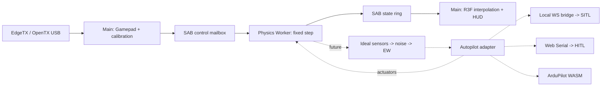

# Архитектура MirageSITL

TASK-033 теперь предоставляет офлайн-проверки равномерного/кольцевого BET и
WASM-backend с привязанными роторами из производственной сборки, использующий
конфигурируемую синтетическую геометрию и поляры NeuralFoil (основной NACA6409,
альтернативный NACA0012). `BetRotorEngine` владеет проверенными аренами поляр и
роторов; `BetFlightDynamics` объединяет свободные валы, осевой индуктивный поток,
преобразования систем координат и интегрирование твёрдого тела. Вызывающий код
подключает его через фабрику динамики `PhysicsSessionV2`. ID модели, число
роторов, RPM и флаги применимости публикуются через существующий контракт SAB.
Worker приложения по умолчанию по-прежнему выбирает DemoDynamics; интерфейс
выбора и допуск браузерного автопилота остаются отдельными задачами. Схема
model-report v8 требует актуальных численных и аллокационных доказательств,
независимо сохраняя провалы измеренной точности.

<!-- source-sha256: fdfe307dc862674739eaed6737972d2dfcb4b5b6a54c694b25b6960ec4009979 -->

Английский источник: [Source of truth](../architecture.md). Изменения спецификации обновляют оба языка в одной задаче.


Подробные зависимости и порядок исполнения определяет
[PROJECT_ROADMAP.md](PROJECT_ROADMAP.md). Capability milestones в конце
этого руководства не заменяют подробное расписание Phase 0–6.

## Реализованные границы и текущий базовый уровень

Интерактивное веб-приложение работает на ABI v2 (TASK-085) со связкой
React 19 / R3F / WebGL2 (и определяемым по возможностям WebGPU с откатом на
WebGL2, TASK-066), выделенным модульным Web Worker (`PhysicsSessionV2`),
`MultiRateClock` на 400/800/1200 Гц, атомарным транспортом состояния и команд
пилота через SAB seqlock, SPSC-очередями датчиков и актуаторов, калибровкой
каналов и режимов Gamepad (TASK-038), авиагоризонтом HUD с контролем источника
и свежести данных (TASK-074), версионированным журналом команд инструктора
(TASK-075) и отдельным ограниченным конвейером записи, просмотра и архивации
AAR (TASK-076–078, TASK-081). Активным полётным backend в браузере остаётся
демонстрационный квадрокоптер (`DemoDynamics`); демонстрационная аэродинамика
не валидирована для обучения пилотов.

Независимые нативные и WASM-модули симуляции и автопилота реализованы и
проверены отдельно от демонстрационного контура:

* **Ядра Rust BET, соосных винтов, силовой установки, твёрдого тела и шасси**
  (TASK-016–028, TASK-032) со сборками WASM `scalar`/`simd128` и аренами без
  аллокаций. Дополнительный ABI привязки соединяет поляры и состояние роторов с
  конфигурируемыми полётными сессиями; прежний ABI без привязки сохраняет
  `AERODYNAMICS_UNAVAILABLE`.
* **Высокочастотно сертифицированный контакт Rapier** (TASK-029, TASK-065):
  прямой f64 C ABI (`GroundContact`) с 0..8 неподрессоренными колёсами,
  независимыми силами стойки и шины, призматическими упорами хода, жёсткими
  ограничениями обода и плоскостями рельефа на каждый тик через контактный
  ABI v2.
* **Высокочастотно сертифицированный WASM- и контактный backend JSBSim**
  (TASK-030, TASK-031, TASK-086): закреплённая сборка JSBSim v1.2.3 WASM с
  нативными исключениями WASM, контактными импульсами после шага, холодным
  начальным состоянием в SI, паритетом траекторий native/WASM и шестью
  таблицами винтов фиксированного шага из базы UIUC, проверенными в нативном
  JSBSim v1.2.3.
* **Нативный стенд ArduCopter SITL, прогрева EKF и РЭБ** (TASK-041–043,
  TASK-059): стенд ArduCopter с владением процессами в Linux/WSL, управляющий
  моделью твёрдого тела Rust WASM через явно синтетическую схему quad X,
  допуск `LiveEkfWarmup` по lockstep JSON IMU и проверенной по CRC телеметрии
  MAVLink, а также нативные эксперименты РЭБ по GPS, компасу и отказу моторов.
* **Браузерный bootstrap ArduCopter WASM** (TASK-044, TASK-045): локальный
  проверенный Worker прошивки с запуском дочерних pthread, диагностикой
  загрузки по Serial MAVLink с проверкой CRC и хранением EEPROM в IndexedDB.

Открытые границы: измеренная достоверность роторов, планера и контакта
(TASK-033; измеренная точность сбросов NASA явно отложена пользователем),
lockstep/паритет браузерного ArduCopter WASM и решение по распространению GPL
(TASK-045–047), браузерная привязка сессии READY автопилота, HUD, консоли
инструктора и сценариев (TASK-074, TASK-075, TASK-078–080), живое сопряжение
рельефа и контакта в полётной сессии (TASK-065), аппаратный HITL с физическим
полётным контроллером (TASK-051) и проверка производительности 400–1200 Гц и
60–120 FPS на целевых устройствах M4 / RTX 4050 (TASK-073). Фиксированный шаг
`dt` не означает гарантированное исполнение в каждый интервал шага: таймеры
браузера, GC, ОС и политики фоновых вкладок не дают жёстких гарантий реального
времени.

## Директории

```text
apps/web/
  src/App.tsx                 # HUD, controls, calibration
  src/capabilities.ts         # API checks and implemented mode eligibility
  src/runtime.ts              # Gamepad/rAF, lifecycle, SAB reads
  src/FlightScene.tsx         # Position/SLERP in R3F useFrame
  src/coordinates.ts          # NED to Three.js
  src/physics.worker.ts       # Physics owner and fixed-step scheduler
  vite.config.ts              # COOP/COEP for dev and preview
packages/
  protocol/src/index.ts       # ABI v1, types, SAB readers/writers
  physics/src/index.ts        # Demo dynamics and bounded scheduler
  physics/src/model-manifest.ts # Verified configuration registry
  physics/src/model.schema.json # Strict serialized model schema
  test-support/src/           # Fixture verification and seeded streams
  input/src/index.ts          # Gamepad and channel calibration
docs/
  PROJECT_ROADMAP.md          # English task source
  SPECS_SHARED_MEMORY.md      # Implemented v1 and target v2
  SPECS_SIMULATION_ENGINES.md # Target physics and EW contracts
  architecture.md
  shared-memory.md
  ru/                        # Russian documentation mirrors
tests/
  *.test.ts                  # ABI, physics, scheduler, input
  browser/simulation.spec.ts # Real Worker/SAB, UI, mock USB
```

Пакеты рабочего пространства, сервисы и нативные крейты:

| Директория | Назначение |
| --- | --- |
| `apps/bridge` | localhost WS ↔ ArduPilot JSON/UDP и MAVLink |
| `packages/wasm-jsbsim` | pinned JSBSim/Emscripten, C ABI |
| `packages/wasm-bet` | роторы/рамы, native reference + WASM |
| `packages/sensors` | IMU/GNSS/magnetometer, шум, bias, timestamps |
| `packages/autopilot` | direct/external SITL/WASM SITL/HITL adapters |
| `packages/ew` | сценарные искажения наблюдений, hazard volumes |
| `packages/terrain` | streaming render LOD, отдельный collision LOD |
| `packages/cameras` | FPV-камера на креплении, дисторсия объектива, аналоговые видеоэффекты |
| `packages/thermal` | классы материалов поверхности (WorldCover/OSM) с происхождением; не температуры |
| `packages/aar` | recorder/replay, входы/актуаторы/truth/EKF |
| `packages/scenarios` | декларативные учебные сценарии, исполнитель по тикам и рубрики трасс |
| `services/tiles-worker` | Cloudflare proxy, квоты, разрешённый cache |
| `native` | исходники/toolchain pins и эталонные тесты WASM |

## Потоки и ответственность



Worker владеет truth, часами симуляции и интегратором. Main владеет DOM,
WebGL, Gamepad и разрешениями. Физика не читает scene graph и не ждёт
рендер. React получает сводку каждые ~150 мс; R3F читает два последних
состояния: SLERP для quaternion, linear interpolation для координат.
При несовпадении соседних tick после конкурентной публикации/reset
показывается последнее целое состояние.

High-rate данные идут через SAB; `postMessage` — только init/lifecycle/error.
Расширения потребуют отдельных типизированных sensor/actuator buffers.
Hot path физики повторно использует вход, состояние и scratch; явных
аллокаций на шаге нет. Worker имеет отдельную JS-кучу, но абсолютной
изоляции от GC/ОС обещать нельзя. WASM memory выделяется заранее;
`memory.grow`, загрузка terrain, сеть и декодирование исключаются из шага.

## Часы, перегрузка и безопасность ввода

`SteppingPolicy` Worker (на основе `MultiRateClock`) следит за дедлайнами `performance.now()`. Интегратор всегда
получает один и тот же dt. До 8 шагов за callback, затем yield event loop
для lifecycle-команд. Вложенные `setTimeout` могут ограничиваться браузером
примерно 4 мс; один callback тогда выполняет несколько физических шагов.

Если бюджет catch-up исчерпан, целые wall-clock интервалы отбрасываются,
растут `DroppedSteps/Overruns`. Время симуляции увеличивается только на
рассчитанные шаги. Большой переменный dt не подставляется. Pause/resume
переустанавливают дедлайны; reset останавливает цикл и сбрасывает модель.
Скрытие вкладки снимает arm и ставит полёт на паузу. Worker самостоятельно
отвергает input старше 250 мс, нечисловые, disconnected/disarmed команды.
Целевая тяга становится нулевой, ротор продолжает затухать по spool lag.

Для SITL нужен другой режим clock: lockstep sensor/actuator frames с
симуляционными timestamp. Для HITL часы реальные; при перегрузке сессия
останавливается/помечается недостоверной, ускорять её нельзя.

Gamepad API доступен в Window, не в обычном Worker. Опрос в rAF имеет
ненулевую задержку USB/HID/browser/display. Измерять p50/p95/p99 input age
и end-to-end latency; «нулевой input lag» недостижим. Default осей
`roll=0,pitch=1,yaw=3,throttle=2` — начальное предположение, а не стандарт
EdgeTX. UI задаёт индексы/endpoints/центр/инверсию; deadzone 3,5% для
центрированных осей. Калибровка действует только в текущем сеансе.
Переключение источника/устройства/калибровки снимает arm. При отключении
пульта другой пульт автоматически не выбирается. Arm требует газ <=5%.

## Координаты и физические backend

SI, правая NED: North/East/Down. Body FRD: Forward/Right/Down.
Quaternion `(w,x,y,z)` преобразует FRD -> NED; body rates p/q/r — рад/с,
положительный знак по правилу правой руки. Three.js:
`(x,y,z)=(east,-down,-north)` — поворот без отражения. WGS84/ECEF и
origin shifts добавляются отдельно: float64 геодезия, локальные GPU float32.

Demo — rate-controlled toy quad: коллективная тяга, first-order spool lag,
quaternion, gravity и линейное сопротивление. Semi-implicit Euler для
перемещения, `down<=0` — простое ограничение плоской земли. Напряжение
индикативно зависит от газа, а не от батарейной электрохимии. Нет
индивидуальных моторов, контактов шасси, rotor BET или авторотации.

Будущий `DynamicsBackend`:
`reset(config)`, `step(dt, actuatorFrame, atmosphere, contactInput)`,
`readTruth(preallocatedOutput)`. Автопилот возвращает актуаторы;
только физика превращает их в силы/моменты.

* **JSBSim:** его собственные уравнения движения; единицы ft/slugs и
  conventions конвертируются явно на границе C ABI.
* **BET:** относительная скорость элемента, alpha, lift/drag по полярным
  таблицам Re/Mach, интеграция сил/момента. Для авторотации нужны баланс
  аэромомента, инерция, маховые движения и induced flow, а не заданные RPM.
* **Произвольная рама:** `F=ΣR_i F_i`,
  `M=Σ(r_i×R_i F_i + R_i M_i)` в body frame. ESC, напряжение,
  rotor inertia и взаимодействие соосных дисков — отдельные состояния.
* **Rapier/Jolt:** один владелец интегрирования rigid body. BET может
  отдавать силы solver; с JSBSim нужен согласованный обмен контактными
  импульсами. Два независимых интегратора одного тела недопустимы.

## ArduPilot: границы интеграций

Режимы взаимоисключающие; состояния:
`disconnected -> initializing -> warming -> ready -> running -> fault`.

1. **Внешний SITL — первый целевой backend.** Dev bridge
   `ws://localhost:9002`; для HTTPS проверить mixed-content/Private Network
   Access и при необходимости доверенный локальный WSS. Bind loopback,
   проверка Origin/сессии, ограничения размера/частоты. JSON/UDP physics
   backend передаёт truth/sensors lockstep; MAVLink — RC, команды и
   диагностику. Одного `RC_CHANNELS_OVERRIDE` для внешней физики мало.
2. **WASM ArduPilot — feasibility-задача.** HAL, scheduler, storage,
   sockets, лицензии, clock и parity с native SITL. Компиляция в WASM
   сама по себе не доказывает работоспособность порта.
3. **HITL.** Chromium на macOS/Windows, secure context и пользовательский
   gesture для Web Serial `requestPort()`. Safari/Firefox не целевые
   HITL-браузеры. MAVLink2 parser: CRC/dialect/seq/sysid/compid и signing,
   если требуется. `HIL_SENSOR` 200–400 Гц, `HIL_GPS` 5–10 Гц,
   `HIL_ACTUATOR_CONTROLS` с корректными timestamp. Сначала проверить
   поддержку этих сообщений/HIL режима в конкретной ArduPilot build/плате:
   наличие SITL не доказывает поддержку аппаратного HIL.

Serial budget: при 8N1 полезный предел `baud/10` bytes/s, включая framing
и весь трафик. 115200 может не хватить; нужен измеренный запас и baud,
поддерживаемый FC. Выбор порта не равен проверке замкнутого контура.

Прогрев 30 секунд — simulation time в SITL lockstep, без EW, с согласованными
IMU/GNSS/mag. Готовность по EKF health/status/innovations, не по одному
таймеру. В HITL fast-forward неприменим, EKF FC живёт в реальном времени.
Разбор кадров MAVLink2 (TASK-037), `EkfMonitor`/`EkfWarmup` и нативный допуск
`LiveEkfWarmup` на закреплённом стенде ArduCopter SITL (TASK-042, TASK-043)
реализованы; привязка браузерной сессии автопилота READY и физический HITL
остаются открытыми.

## EW, terrain, камеры и AAR — следующие этапы

Truth не изменяется: `truth -> ideal sensor -> noise/bias -> EW -> adapter`.
Сенсоры имеют свои частоты, задержки, оси, единицы и seeded RNG. Ускорение
в текущем ABI инерциальное, включая gravity: для HIL accelerometer specific
force требуется отдельно вычесть g и преобразовать в body frame.

Hazard volumes ограничивают `1/r²` через конечный `r_min` и saturation;
конус учитывает направление/aperture. Нужна receiver model: мощность не
равна числу спутников. GNSS loss/spoofing воздействует только на наблюдения;
coherent drift интегрирует согласованные position/velocity, не телепортирует
truth. Mag errors применяются в sensor frame; motor fault — к конкретному
актуатору до суммирования сил. Реакция EKF/flight mode зависит от версии,
параметров и других сенсоров: нельзя обещать обход gate или заданный
failsafe без сценарного регрессионного теста.

WebGL2 — стартовый renderer; WebGPU — отдельный backend с capability
detection и visual parity tests. Metal/DX12 выбирает браузер. Ограничить
DPR, текстуры, tile LOD: RTX 4050 имеет 6 GB с запасом под browser/framebuffer,
M4 использует общую RAM. Terrain decoder не должен занимать Physics Worker.

Google Photorealistic Tiles требует billing/key/attribution и соблюдения
условий Map Tiles API. **Постоянное копирование Google tiles в R2 и
предзагрузка радиуса 10–15 км не принимаются как разрешённый default.**
Сначала проверить лицензию/правила caching; cache только в разрешённых
пределах или использовать собственные/лицензированные offline tiles.
Cloudflare proxy скрывает ключ, ограничивает origin/session/quota и
следует разрешённым TTL. COEP требует CORS/CORP для внешних tiles/WASM.

Analog FPV — postprocessing, отделённый от truth. WorldCover/OSM дают
классы поверхностей, не температуру: thermal требует emissivity, погоду,
solar heating, inertia, attenuation и calibration data. AO не вычисляет
тепло. Начать с контролируемых synthetic материалов и GPU budget.

State ring — лишь ~0,64 с для рендера, не AAR. AAR — отдельный bounded
recorder Worker/IndexedDB: input/actuator/truth/sensors/EKF + seed/config/
version/events. Потери логируются. Replay состояния отличается от
повторного расчёта; native/WASM сравниваются с численными допусками.

## Поэтапная приёмка

| Этап | Результат | Проверка |
| --- | --- | --- |
| 01 | Worker/SAB/Gamepad/demo | unit tests + настоящий браузерный Worker, полёт/pause/reset, USB mock |
| 02 | WASM physics abstraction + sensors | силы/моменты, specific force, contacts/energy, convergence 400/800/1200 Гц |
| 03 | внешний SITL lockstep | arm/takeoff/land, EKF readiness, RC, разрывы связи, pinned ArduPilot |
| 04 | BET/рамы/авторотация | thrust curves, torque balance, energy, spool/battery, экспериментальные эталоны |
| 05 | EW + AAR | seeded replay, truth/sensors separation, EKF response и mode changes |
| 06 | HITL | реальная плата/firmware, sustained serial throughput, jitter/loss/failsafe |
| 07 | terrain/FPV/thermal/WebGPU | лицензии/attribution, VRAM/LOD, целевые M4/4050 |
| Feasibility | ArduPilot WASM | parity с внешним SITL до объявления поддерживаемым |

Замеры в production на M4 и RTX 4050, видимая вкладка, после warmup:
frame time p50/p95/p99, worker step/deadline lateness, выполненные steps/s,
dropped wall time, input age, sensor jitter, GPU memory и end-to-end latency.
120 FPS — 8,33 мс/frame, 60 FPS — 16,67 мс; 1200 Гц — 0,833 мс/step
с запасом. Облачный headless smoke не подтверждает эти бюджеты.

## Контракты Phase 0: fixtures, возможности браузера и модели

TASK-004–006 добавляют границы проверки конфигурации; новый физический backend
не вводится. TASK-007 сохраняет работающий ABI v1. Тесты v1 фиксируют 32896 байт,
заголовок 64 байта, 256 состояний по 128 байт и pilot mailbox со смещения 32832.
`tests/protocol-golden.test.ts` добавляет независимый oracle: зарегистрированный
и составленный вручную fixture `tests/fixtures/abi/v1-layout.json` должен
поле за полем совпадать с таблицами байтов v1 для header, state и pilot mailbox
в SPECS_SHARED_MEMORY.md, а каждый байт буфера 32896 байт, записанный
StateWriter и ControlWriter (header, два слота ring, нетронутые слоты,
reserved words и mailbox), должен совпадать с образом, упакованным локальным
DataView. Readers v1 не используются, поэтому симметричная ошибка смещений
encoder/decoder не может пройти проверку. TASK-008 добавляет в packages/protocol
константы layout v2, codecs state и pilot, инициализацию header, проверку и
согласование v1/v2. Они сверяются с `tests/fixtures/protocol/state-v2.hex` —
golden records, упакованными Python struct по таблицам спецификации независимо
от TypeScript encoder. TASK-009 добавляет ограниченный seqlock-транспорт
раздела 4: StateWriterV2/StateReaderV2 с проверками sample_id и head и не
более чем тремя попытками чтения, PilotWriterV2/PilotReaderV2, диагностику
header и безопасную по epoch историю рендера (latestPair никогда не связывает
кадры через смену epoch, модели или пропуск tick). Стресс-тест на реальных
потоках публикует 1e6 кадров в Node worker_threads и в browser module Worker,
пока reader проверяет каждое поле; удаление повторной проверки seqlock
приводит к обнаружению разорванных кадров. TASK-010 добавляет Control
Protocol v2: `parseControlCommandV2` проверяет недоверенные команды и
возвращает нормализованные копии, `control-v2.schema.json` — эквивалентный
контракт JSON Schema 2020-12 (тест эквивалентности на Ajv покрывает более 50
случаев), а `ControlProcessorV2` реализует дедупликацию, epochs, расписание
из 128 команд, применяемых перед интегрированием каждого tick, правила
состояний жизненного цикла и атомарную смену модели через интерфейс
`ControlTargetV2` с заранее выделенным outbox. TASK-085 переводит работающее
приложение на ABI v2, сохраняя ABI v1 для регрессионных тестов.

### Проверенные манифесты fixtures и детерминированные потоки

`packages/test-support` экспортирует `./fixtures` и `./prng`. Реестр
`tests/fixtures/registry.json` задаёт пути относительно `tests/fixtures/`.
Все три эталонных payload явно синтетические: аналитические NED ballistic samples
при постоянной гравитации, конфигурация демонстрационного квадрокоптера и
составленная вручную раскладка байтов ABI v1.
Они служат воспроизводимыми программными эталонами, а не экспериментальным
подтверждением аэродинамики.

`verifyFixture(metadata, bytes)` делает снимки обоих входов до ожидания SHA-256,
проверяет строгие метаданные formatVersion 1, сравнивает 64-символьный lowercase
hash с точными байтами payload и возвращает глубоко замороженный манифест.
Изменение пробелов требует нового hash. Размер payload ограничен 16 MiB.
Каждая величина имеет разрешённую единицу и соответствующие конечные замкнутые
границы; абсолютный и относительный допуски конечны и неотрицательны. Словарь
единиц: `1`, `s`, `us`, `m`, `m/s`, `m/s^2`, `rad`, `rad/s`, `N`, `N*m`,
`kg`, `kg*m^2`, `Pa`, `K`, `V`, `A`, `rev/min`, `gauss`.

Provenance — строгий discriminated union. Синтетическим данным нужен derivation;
измеренным — datasetId, license, разбираемый acquiredAt и HTTPS referenceUrl.
Замена synthetic на measured с сохранением derivation отклоняется.
Метаданные не доказывают факт измерения: перед использованием для physics gate
нужно проверить внешний источник. Digest подтверждает целостность относительно
доверенной записи реестра, но не подлинность произвольного переданного hash.

`SeededRandom(seed, streamId)` принимает uint32, включая ноль. Версия —
`mulberry32-mix32-v1`; reset воспроизводит последовательность. Начальное состояние:
`mix32(seed ^ mix32(streamId ^ 0x9e3779b9))`, арифметика uint32. mix32 применяет
xor shifts 16/15/15 и умножения на 0x21f0aaad и 0x735a2d97.
Mulberry32 увеличивает состояние на 0x6d2b79f5. `nextUint32()` выдаёт [0, 2^32−1];
`nextFloat()` делит на 2^32, получая [0,1). Для seed 123 / stream 7 закреплён ряд
uint32: 1915834569, 2163859737, 2018986825, 2541224312, 3937151044.
Раздельные экземпляры имеют независимое изменяемое состояние; это не
криптографический генератор и не доказательство статистической независимости
или непересечения потоков. Конструктор/reset проверяют параметры вне step;
получение чисел не создаёт объектов. Назначение потоков датчикам и РЭБ задано
в контрактах датчиков и РЭБ (TASK-035, TASK-052–058).

### Допуск браузера перед запуском Worker

`apps/web/src/capabilities.ts` предоставляет `CapabilityReport` и внедряемый
`inspectCapabilities(environment?, timeoutMs?)`. Для текущего графического demo
нужны secure context, cross-origin isolation, SharedArrayBuffer, Worker и
успешное создание WebGL2 context. При отсутствии обязательных возможностей
Start отключён, Worker/сцена не создаются, показано объяснение. READY по-прежнему
требует подтверждения инициализации от настоящего Worker.
Для USB дополнительно нужен Gamepad API. Наличие пульта, калибровка каналов и
статус подключения остаются отдельными проверками ввода.

WebGPU adapter probe обрабатывает rejection, null и таймаут одну секунду,
сохраняя WebGL2. Временный WebGL2 probe освобождает context. Serial проверяется
без запроса разрешения. Наличие API отличается от допуска режима:
`hitlEligible` и `webgpuEligible` допускаются отдельно от самого наличия API.
Chromium tests подменяют доступность API и проверяют настоящий поддерживаемый
Worker/renderer; оборудование ими не валидируется.

### Допуск модели и неизменяемые ID сессии

`@mirage/physics/model-manifest` — отдельный package export. Его схема AJV 8.20.0
и асинхронный загрузчик не входят в граф импортов текущего demo Worker.
Сериализованные `ModelDescriptor`/`RotorGeometry` используют readonly JSON arrays;
это конфигурационное представление целевой геометрии, а не typed-array
WASM ABI из SPECS_SIMULATION_ENGINES. `VerifiedModel` хранит `{sha256, manifest}`
раздельно, поэтому манифест не хеширует сам себя.

`model.schema.json` использует JSON Schema draft-07, запрещает неизвестные поля
и требует schemaVersion 1, units SI, world NED, body FRD, quaternion order wxyz,
положительную конечную массу, row-major inertia из девяти значений,
modelId в [1,2^32−1], kind demo/bet/jsbsim, rotorCapacity 32 и совпадающие
rotorCount/rotors в [0,32]. Inertia должна быть точно симметричной и положительно
определённой по Cholesky; проверка не исправляет тензор. Rotor IDs и motor
channels — уникальные целые [0,31]. Число лопастей [1,16], azimuth samples
[1,64], polar IDs — uint32.

Для ротора нужны положительные radius/chords/shaft inertia/quadrature widths,
неотрицательные cutout и bearing friction, spin sign ±1, конечная геометрия и
единичный hub-to-body wxyz quaternion с допуском нормы 1e-6. Массивы radial station,
chord, twist и width имеют одинаковую длину [1,64]. Stations строго возрастают
внутри (cutout,radius); сумма widths равна radius−cutout с допуском 1e-9 м.
Это проверка структурной допустимости, а не доступности polar или точности
аэродинамики.

`ModelRegistry.register(bytes, expectedSha256)` копирует не более 1 MiB,
проверяет точные байты по доверенному SHA-256, декодирует строгий UTF-8 JSON,
валидирует и замораживает снимок, затем допускает его в реестр сессии.
Одинаковые ID/hash возвращают ту же запись; иной hash для существующего ID —
коллизия. Ошибки hash/schema/physics не меняют реестр, в том числе когда вызывающий
код изменяет исходные bytes во время hashing. `get(modelId)` возвращает
проверенную неизменяемую запись. `ControlProcessorV2` (TASK-010) координирует
атомарную смену моделей со сменой эпохи; активная сессия demo отклоняет
неподдерживаемое переключение моделей. Проверка конфигурации может выделять
память; она не должна выполняться внутри physics step.

## Строительные блоки runtime (Phase 1–2)


### Многочастотные часы (TASK-011)

`packages/physics/src/clock.ts` предоставляет `MultiRateClock` для 400/800/1200 Гц.
Шаг интегрирования всегда ровно `1/hz`; сроки вычисляются как
`origin + n*1000/hz` по целым счётчикам шагов, поэтому дрожание пробуждений
никогда не накапливается в дрейф. За одно пробуждение выполняется не более
`maxCatchUp` (8) шагов; лишнее wall-время отбрасывается и учитывается, а
`reset(nowMs)` при возобновлении отбрасывает накопившийся backlog. Часы
владеют `TickId` текущей epoch (tick 1 — первое интегрирование).
`tickToMicros` точно вычисляет MAVLink `time_usec = floor(tick*1e6/hz)`
(интервалы 833/834 мкс при 1200 Гц), а `isSampleDue`/`sampleIndexAtTick`
рационально планируют выборки IMU/GNSS. `DemoDynamics(hz)` интегрирует с
`dt = 1/hz` и `sim_time = tick/hz`. `PhysicsSessionV2` работает на 400, 800 или
1200 Гц; `FixedStepClock` оборачивает `MultiRateClock` на 400 Гц для
совместимости с v1.

### Режимы часов и перегрузка (TASK-012)

`SteppingPolicy` (`packages/physics/src/clock-policy.ts`) оборачивает один
`MultiRateClock` и применяет заданный режим при каждом неблокирующем вызове
`pump(nowMs, gate, step, report)`. **interactive** задаёт темп по wall-времени
и учитывает отброшенные интервалы. **sitl-lockstep** продвигается по времени
симуляции: tick выполняется только когда `StepGate` сообщает о готовности его
кадра актуаторов, ticks никогда не отбрасываются, за один pump выполняется не
более `maxCatchUp`, а при отсутствии кадра вызов сразу возвращается с
`waiting`, поэтому сообщения pause/dispose никогда не блокируются.
**hitl-realtime** задаёт темп по wall-времени относительно физического
полётного контроллера; догоняющие шаги в пределах `maxCatchUp` нормальны, но
любой отброшенный интервал устанавливает fault `hitl-overrun`, после чего ни
один tick не выполняется до `resetEpoch`. Заранее выделенный `PumpReport`
перезаписывается при каждом pump.

### SPSC-очереди датчиков и актуаторов (TASK-013)

`spsc-v2.ts` реализует очереди раздела 5: по одному SAB размером 131 136 байт
на направление, по одному `SpscProducer` и одному `SpscConsumer` на каждый.
Producer владеет write_counter/full_events, consumer — read_counter; счётчики
модульные uint32, и каждое общее слово использует Atomics. Полная очередь
никогда не перезаписывает непрочитанные кадры: `sitl-would-block` возвращает
`would-block`, чтобы lockstep ждал, а `hitl-fault` фиксирует fault сессии до
`resetSpscQueue`, который очищает счётчики и продвигает epoch очереди только
при остановленных обоих концах. Каждое условие заполнения увеличивает
full_events. Consumer копирует слот в scratch и освобождает его до
декодирования. `SensorFrameCodecV2` и `ActuatorFrameCodecV2` упаковывают общий
слот 128 байт и проверяют его по виду: число значений, диапазон f32, точные
целые значения fix/satellites GNSS, биты validity только для GNSS, нулевые
geo-поля вне GNSS и нормализованные актуаторы в [-1,1]. Стресс-тесты на
реальных потоках передают 1e6 кадров по порядку в Node worker_threads и в
browser Worker.

### Приложение на ABI v2 (TASK-085)

Physics Worker — тонкий адаптер вокруг `PhysicsSessionV2`
(`packages/physics/src/session-v2.ts`), поэтому логика Worker выполняется в
Node-тестах. Main создаёт SAB состояния v2 и обе SPSC-очереди и отправляет
`init-v2`; сессия владеет `StateWriterV2`, `PilotReaderV2`, consumer
актуаторов, `ControlProcessorV2`, `SteppingPolicy` и `DemoDynamics(hz)`.
На каждом tick она читает pilot mailbox, применяет защёлку arm, интегрирует и
публикует `FlightStateV2` с идеальной удельной силой `f_b = R^T(a_n - g_n)` и
истинным давлением ISA. Arm защёлкивается только по явному запросу при газе
<=5%; устаревшая epoch, ввод старше 250 ms, недопустимые значения или
изменённый `device_generation` снимают arm и блокируют повторный arm до
отзыва запроса. `GamepadAdapter.generation` меняется вместе с идентичностью
устройства, поэтому другой передатчик с тем же index никогда не наследует
arm. Main читает состояние жизненного цикла из runtime flags header, рисует с
историей `latestPair` и проверяет события Worker. В sitl-lockstep tick ждёт
кадр актуаторов autopilot ровно для этого tick и epoch. Конвейеры датчиков
(TASK-034, TASK-035, TASK-058) и транспортные модули ввода-вывода существуют
как отдельные пакеты; интерактивная сессия demo не подключает живого
потребителя автопилота.

### Инструментирование горячего пути (TASK-014)

`step-metrics.ts` записывает длительность вычислений (бины 0.1 мкс), задержку
пробуждений (бины 0.01 мс) и выполненные шаги в заранее выделенные
гистограммы с фиксированными бинами; квантили — верхние границы бинов,
ограниченные точным максимумом, и вычисляются вне горячего пути.
`scripts/bench-physics.mjs` прогоняет реальный шаг `PhysicsSessionV2` и
измеряет аллокации молодого поколения V8 в окнах из N и 2N шагов после выхода
на установившийся режим (повтор разогревочных окон, пока одно не пройдёт без
GC), по три повтора на размер, минимум по повторам без GC. V8 запускается с
`--single-threaded`: при конкурентной компиляции готовые задания
устанавливаются в основном потоке посреди окна и выделяют 0-120 KB в моменты,
зависящие от нагрузки на CPU, что на hosted runner с 2 CPU давало ложные
срабатывания. Вердикт использует приращение на шаг
`(bytes_2N - bytes_N - (empty_2N - empty_N))/N`, которое исключает
фиксированные затраты на окно; граница по целому окну
`min_k (bytes_k - empty_k)/k` и фиксированные затраты сообщаются рядом. События `gc` сопоставляются по времени, а
аллоцирующий контрольный цикл обязан обнаруживаться в том же прогоне. Первые измерения нашли реальные аллокации на
каждом шаге: вариадический `Math.hypot` и упаковку double в HeapNumber при
передаче в невстраиваемые вызовы или возврате из них, из-за чего результат
зависел от решений TurboFan по встраиванию. Теперь горячий путь передаёт время
через числовые поля (`nowMs`, методы `*Now()`), возвращает целочисленную
задержку пробуждения и проверяет значения только встроенными сравнениями
(`(x >>> 0) === x`, `|x| < F32_ROUNDING_LIMIT`). Накладные расходы таймера
сообщаются отдельно от вычислений; темп таймеров Node не является
доказательством для browser Worker. На Windows в Node прогон `bench-physics` в
реальном времени выполнил 516.7 Гц (цель 800) и 519.6 Гц (цель 1200) с
пропусками: пробуждения таймера ~16 мс × лимит догоняющих шагов 8. Вычисление
шага занимает ~1 мкс/шаг; регрессионный тест browser Worker на 800 Гц прошёл.

### Интерполяция рендера (TASK-015)

`interpolatePoseInto` (`packages/protocol/src/interpolation.ts`) записывает
принадлежащий вызывающему `RenderPoseV2` и никогда не изменяет truth. Она
интерполирует только когда `latestPair` вернул `'pair'` (соседние ticks, одна
epoch и модель) и шаг непрерывен (не более 100 м за tick, 40 км/с при 400 Гц;
больший скачок — телепортация). Позиция интерполируется линейно; ориентация —
slerp по кратчайшему пути (конечный кватернион инвертируется при
отрицательном скалярном произведении, поэтому q и -q никогда не дают полный
оборот), с нормализованным результатом и веткой нормализованного lerp для почти
равных ориентаций. `interpolationAlpha` вычисляет долю по запланированному
wall-времени кадра и частоте из header, поэтому рендер отстаёт от truth не
более чем на один физический шаг и никогда не ждёт writer. `FlightScene`
отображает позу через `nedToRenderPositionInto` и собственно вращение базиса
NED-to-render.

### Native Rust workspace (TASK-016)

`native/` — Cargo workspace со scalar crate `mirage-bet` (`native/bet`),
собираемым нативно для тестов и в `wasm32-unknown-unknown` для браузеров;
toolchain закреплён в `native/rust-toolchain.toml`. Его bootstrap kernel —
сила элемента раздела 3 `dF = 1/2 rho U^2 c dr (C_L l + C_D d)` с порогом
`U < 1e-6 m/s`; это scalar element reference, сохранённый для ABI regression.
Native rotor reference теперь получает коэффициенты из polar (TASK-019/020).
Сборка wasm32 устанавливает trapping allocator; проверенные ABI memory views —
другая узкая unsafe-граница. Нет host imports; экспортируются `memory`, `bet_abi_version` (= 1) и
`bet_bootstrap_element_force`. Release-профиль (LTO, одна единица codegen,
`panic = "abort"`, stripped) даёт побайтно одинаковый артефакт в разных
чистых target-каталогах.

### WASM-артефакты и загрузчик (TASK-017)

`scripts/build-wasm.mjs` собирает два варианта `mirage-bet`: `scalar`,
обязательный baseline, и `simd128` (`-C target-feature=+simd128`), каждый в
своём target-каталоге, и записывает `manifest.json` с версией схемы, crate,
версией ABI, прочитанной из собранного модуля, toolchain и для каждого
артефакта — именем файла, SHA-256, размером и target features.
`packages/wasm-bet/src/loader.ts` считает manifest неизвестным входом и
проверяет его точно. Он определяет SIMD128 через `WebAssembly.validate` на
минимальном модуле с v128 и загружает `simd128` только при успехе проверки,
иначе — scalar-артефакт (`fallback` сообщает о понижении). До
инстанцирования он проверяет размер и SHA-256 через Web Crypto; после —
требует отсутствия imports, ожидаемых exports и `bet_abi_version`, равного
ABI загрузчика. Затем он увеличивает линейную память до резерва (по
умолчанию и максимум 64 MiB), чтобы `memoryStable()` выявлял любой рост
после arm. Любая ошибка возвращает `ok: false` с причиной и должна
блокировать arm. Загрузка асинхронна и относится к инициализации, а не к step.

### BET C ABI и arena binding (TASK-018)

`native/bet/src/abi.rs` реализует записи раздела 4 как безопасное
пополевое чтение и запись поверх байтовых срезов; слой exports wasm32 в
`lib.rs` — единственное место, где указатели `u32` превращаются в срезы,
после проверки диапазона, выравнивания, `__heap_base` и перекрытия.
`include/bet.h` — общий источник layout. `packages/wasm-bet/src/arena.ts`
один раз кодирует конфигурацию, размещает регионы конфигурации, входа,
выхода и arena выше `__heap_base` внутри зарезервированной памяти и
выполняет шаг через один заранее созданный DataView в объекты выхода
вызывающей стороны. Production step по-прежнему возвращает `AERODYNAMICS_UNAVAILABLE`
с NaN в аэродинамических выходах до подключения kernels через версионированный
polar/config binding.

### Polar lookup (TASK-019)

`native/bet/src/polar.rs` один раз проверяет заимствованную таблицу CL/CD
по `(Mach, Re, alpha)` и интерполирует трилинейно по `(Ma, ln Re, alpha)`
без аллокаций. Запросы вне таблицы ограничиваются её границей и выставляют
`OUTSIDE_POLAR_VALIDITY`; экстраполяции нет. Native `blade::Rotor` использует lookup (TASK-020); production C ABI
binding остаётся отдельной работой.

### Эталонные atmospheric/rotor modules (TASK-032, TASK-020–023)

Atmosphere package проверяет состояние сухого воздуха и вычисляет ISA troposphere,
Sutherland viscosity, плотность и скорость звука. Wind — seeded fixed-rate
AR(1) с ограниченными инновациями, а не измеренная turbulence model. Native rotor
modules содержат нормированную quadrature, ограниченный signed axial inflow,
динамику RPM свободного вала, zero-offset harmonic hinge flapping и дискретную
передачу angular momentum. Все уравнения, границы и единицы приведены в разделе 3
SPECS_SIMULATION_ENGINES, где явно исключены aeroelastic feedback и validated VRS.

Это reference modules; UI по-прежнему использует demo dynamics. Браузерная
сессия ArduPilot, браузерная сессия JSBSim, измеренная модель автожира и
production BET engine в UI не включены.
`kernel-test-exports` собирает отдельные scalar/SIMD численные тестовые артефакты;
production artifact/ABI не меняется. Allocation tests покрывают 1e6 native kernel
steps и миллион шагов WASM dynamics со стабильной памятью. Синтетические эталоны
в tests/fixtures/rotors зарегистрированы с byte hashes, но не являются
экспериментальными измерениями. `scripts/bench-wind.mjs` записывает warmed V8
allocation windows и positive allocating control в test-results/bench/wind.json.

Проверка: npm lint/typecheck/docs/tests/build/browser, а также закреплённые
native Cargo check/test и wasm32 target check. `tests/rotor-kernels.test.ts`
собирает собственный scalar/SIMD harness с tail counts 1/3/5/63. Cloud
functional/numerical результаты не подтверждают M4/RTX frame-time budgets.

### Coaxial reference (TASK-024)

`native/bet/src/coaxial.rs` реализует проверяемую конфигурацию пары и
экспериментальный steady mixing-jet wake без аллокаций. Положительная source
thrust создаёт downstream receiver air velocity; overlap и separation задают
interception. Advected momentum, received/bypass kinetic power и mixing loss
выдаются раздельно и сохраняют принятый ideal-hover source budget. Их нельзя
добавлять как дополнительную тягу или motor power. Disabled coupling точно
совпадает с независимым случаем; положительное spreading даёт far-field independence.

Spreading angle задан явно как synthetic parameter. Модель соосная и
односторонняя; swirl, VRS, transient transport и receiver feedback исключены.
JSON-эталон зарегистрирован по SHA-256. Native и scalar/SIMD WASM tests
проверяют conservation, ограничения и 1e6 шагов без аллокаций. Формулы, единицы
и валидность описаны в engine specification. Production BET C ABI и demo не меняются.


## Контакт, силовая установка и backend JSBSim (TASK-025–035, TASK-086)

### Реализация контакта Rapier (TASK-029)

`GroundContact.initialize` проверяет сгенерированный манифест и байты прямого
f64 C ABI Rapier 0.21.0 (`node scripts/build-contact.mjs`); каждая сессия
владеет миром WASM фиксированного размера 16 MiB с 0..8 неподрессоренными
колёсами, отдельными силами стойки/шины, призматическими упорами и жёсткими
ободами. Один решатель Rapier интегрирует все тела; суммарный контактный
импульс является диагностическим и никогда не должен использоваться для
повторного интегрирования того же тела методом RK4. Полный угловой контактный
импульс дополняет линейный, поскольку несколько контактов нельзя представить
одним плечом. Подробный ABI и ограничения заданы в спецификации движков.

Патч хранения удерживает буфер кандидатов выбора шарниров между тиками.
Холодная инициализация проходит повторные контакты на всех трёх частотах;
взведённый счётчик аллокатора навсегда переводит сессию в состояние отказа при
любом выделении памяти. Адаптер не создаёт оболочек провайдера и typed-array
views на каждом шаге. `scripts/check-contact-binding.mjs` выполняет девять
миллионов нативных шагов и сравнивает native/WASM для 0/3/8 колёс на
400/800/1200 Гц. Отдельный тест WASM G1 выполняет девять миллионов шагов.
Browser Worker и Node GC проверяют реальные пути выполнения; это численные
свидетельства и проверка памяти, а не приёмка работы в реальном времени на
целевом устройстве.

Пользователь явно отложил измеренную достоверность NASA 2026-10-18. Архивные
источники и неудачное сравнение сферы сохранены через `LegacyGroundContact`,
используемый только исторической диагностикой. Завершённая область TASK-029 —
численно проверенная настраиваемая модель контакта, а не калиброванный самолёт
или реконструкция стенда NASA. Качение/торможение — пассивное кинематическое
приближение; вращение колеса, антиюз, поворот и произвольный рельеф остаются
отдельными возможностями. Условия готовности демо/автопилота не меняются.

### Выбор источников для упругого шасси (TASK-029)

Использовать дополняющие источники, не импортируя ещё один полный движок:

* **Физическое разделение:** Norman S. Currey, *Aircraft Landing Gear Design:
  Principles and Practices* (1988), главы 5–6, особенно разделы 5.7, 5.11 и
  6.3–6.9. Переданный `AircraftLandingGearDesignPrinciplesPractices.md` имеет
  SHA-256 bb8275e99f3a8962ab01d3102b2fa8fbfe29e9502209fca6e422c74046e9f6b4.
  Он объясняет запасание энергии газом, гидравлическое рассеяние и отдельную
  деформацию шины. OCR пропускает формулы и искажает числа; нельзя угадывать
  пропущенные уравнения или считать примеры самолётов калибровкой. Книга с
  авторскими правами остаётся локальной и явно исключена из Git.
* **Измеренная приёмка:** уже архивированный NASA TM X-3561 остаётся независимым
  эталоном сброса. Верхняя/ступичная массы, имитация подъёмной силы и
  гидравлические/пневматические/шинные силы описывают связанную систему.
  Одна пружина или произвольная пара коэффициентов не воспроизводит опыт.
* **Авиационная реализация:** [JSBSim v1.2.3 FGLGear.cpp](https://github.com/JSBSim-Team/jsbsim/blob/570e8115a102df8f877b11e0e59b964ea483e3c0/src/models/FGLGear.cpp)
  и заголовок задают раздельное демпфирование сжатия/отбоя, преобразования единиц,
  внешнюю реакцию земли и момент силы. Сохраняются эти соглашения; стандартная
  сосредоточенная пружина/демпфер не разделяет шину и неподрессоренную массу.
  Локальные SHA-256 cpp/header: 402ed31fdae58951c6e8d10cc408a2236f239f1e0111d711aad3ed9786d74f48 /
  3f3f053c76e10ff8f25c5fe0b068f76f01735fd02eace05ff1272b7fe0b611d0.
* **Проектирование шины:** [модели шин Chrono](https://api.chrono.projectchrono.org/wheeled_tire.html)
  поддерживают явные нелинейные кривые вертикальной нагрузки и отделяют
  нормальный контакт от качения/скольжения. [Реализация Fiala 9.0.0](https://github.com/projectchrono/chrono/blob/9.0.0/src/chrono_vehicle/wheeled_vehicle/tire/ChFialaTire.cpp)
  также запрещает притяжение к земле. Сейчас используется концепция ограниченной
  кривой; импорт полного движка или перенос дорожных параметров на авиационные
  шины не обоснован. FEA-шины добавляют сложность без приёмочных данных и
  измеренного бюджета 400–1200 Гц для этой задачи.
* **Только интеграционные ориентиры:** [ArduPilot SIM_Aircraft.cpp](https://github.com/ArduPilot/ardupilot/blob/master/libraries/SITL/SIM_Aircraft.cpp)
  ограничивает высоту/ускорение на земле и выбранные режимы движения. Это
  полезно для ожиданий SITL, но не является эталоном силы/хода. SHA-256 локального
  файла: 28755ff6f5cb5c391a99ed782bab57695f71c41c502805cf326a4f5f8466c29a.
  [Gazebo WheelSlip](https://gazebosim.org/api/sim/8/classgz_1_1sim_1_1systems_1_1WheelSlip.html)
  управляет податливостью касательного скольжения по скорости колеса и нормальной
  нагрузке; модель oleo-стойки или вертикального сброса отсутствует. Вернуться к
  нему для вращения колеса, торможения и бокового скольжения после проверки
  вертикальной податливости.

Результат — независимо написанные вычисления сил/энергии Rust в
`native/bet/src/landing_gear.rs`; внешняя runtime-зависимость и копирование
upstream-кода не добавляются. Газовая/линейная стойки и кривые шины разделены.
Ход стойки, деформация шины и проникновение в землю должны быть разными
переменными состояния владельца-решателя. Функция нагрузки контакта переводит
силы NED в body FRD и учитывает момент плеча, не интегрируя состояние. Rapier
остаётся выбранным владельцем интегрирования тела; demo и критерии готовности
не меняются. Тестовые экспорты scalar/SIMD не добавляют production ABI шасси.

### Эталонные модули силовой установки, твёрдого тела и датчиков (TASK-025–028, TASK-034–035)

Нативные эталоны мотора/батареи/рамы/RK4 и независимый body ABI v1 реализованы в
`native/bet` и `@mirage/wasm-bet`. Каждой ареной тела владеет отдельный
экземпляр WASM. Адаптер тела принимает уже суммированную нагрузку; полная
обратная связь роторов/поляр/мощности не подключена к браузерному полётному
Worker. Сенсорные эталоны (`@mirage/sensors`) принимают истинное состояние на
месте, используя целочисленные расписания и независимые потоки шума/задержки.
Проба аллокаций (`scripts/bench-sensors.mjs`) измеряет прогретый Node/V8, а не
жёсткое реальное время браузера.

### JSBSim WASM, контактный backend и таблицы винтов UIUC (TASK-030, TASK-031, TASK-086)

`packages/wasm-jsbsim` закрепляет хеши исходников и лицензии JSBSim v1.2.3 и
Emscripten 4.0.15, предоставляя C++ C ABI и адаптер системы координат SI/origin.
Команда `node scripts/build-jsbsim.mjs` собирает базовый артефакт WASM,
проверенный в Chromium Worker smoke на 400/800/1200 Гц
(`node scripts/check-jsbsim-artifact.mjs`), тогда как
`node scripts/build-jsbsim.mjs --contact` собирает высокочастотно
сертифицированный контактный артефакт с нативными исключениями WASM
(`-fwasm-exceptions`). Первый прогон реального адаптера выявил 75 событий GC на
миллион шагов из-за JS-трамплинов исключений при нулевых счётчиках C++;
нативная обработка исключений WASM устраняет этот путь аллокаций. Среда
исполнения обязана поддерживать исключения WASM; устаревшая сборка с
JS-исключениями остаётся отдельной и не допускается как high-rate certified.

Контактный backend поддерживает отдельно версионированные контактные импульсы
после шага JSBSim, явное холодное начальное состояние в SI и запрос текущей
массы/инерции. JSBSim остаётся единственным интегратором. Импульс меняет
скорость без продвижения позиции/времени; скачки историй производных сохраняют
исходный многошаговый интегратор. Повтор и внешние импульсы при активном
встроенном контакте шасси отклоняются. Внешняя стадия ограничений не должна
выполнять второй интегратор корпуса. Адаптер занимает выделенную память,
повторно использует хранилище трения, зарезервированное не более чем для 64
опор шасси, и проверяет собственные кадры, внешние буферы и стабильность кучи до
публикации истинного состояния.

Команда `node scripts/check-engine-patch-parity.mjs` проверяет, что патчи
сохранения буферов (`--patched`) в нативных Rapier и JSBSim дают ноль
вызовов/байт аллокатора на миллионе шагов при совпадении контрольных сумм
траекторий с оригиналами. Команды `node scripts/check-jsbsim-backend.mjs --native`
и `node --experimental-transform-types scripts/check-jsbsim-backend.mjs`
проверяют паритет native/WASM по одним исходникам для балансировки,
ступенчатого управления и контактных траекторий в заранее объявленных численных
допусках на локальном невключённом XML `c172x`, а `node scripts/bench-jsbsim.mjs`
отдельно измеряет JS-адаптер. Стационарные проверки на земле подтверждают
удельную силу вверх при местной тяжести. Эти результаты не лицензируют
распространение модели самолёта и не устанавливают измеренную достоверность,
тайминги целевого устройства, полный выбор погоды/модели или готовность
автопилота и полётной сессии. См. реализованные разделы
[спецификации движков](SPECS_SIMULATION_ENGINES.md).

Скрипт `data/jsbsim/generate_uiuc_propellers.py` (TASK-086) генерирует шесть
определений винтов фиксированного шага JSBSim (`C_THRUST`/`C_POWER` от
`J = V/(nD)`) и манифест `data/jsbsim/engine/uiuc-propellers.manifest.json` из
проверенной по хешам базы UIUC Propeller Database (APC Thin Electric 10x5, 10x7,
11x7, 12x6, 14x10 и DA4002 9x6.75). Команда `node scripts/check-jsbsim-propellers.mjs`
загружает все шесть таблиц через нативный JSBSim v1.2.3 `FGFDMExec::LoadModel` и
проверяет статическую, среднюю маршевую и интерполированную тягу/мощность во
всех 18/18 точках в пределах 1% от измеренных `CT`/`CP`. Поскольку JSBSim
v1.2.3 оставляет `FGPropeller::Ixx` неинициализированным без `<ixx>`, полная
полётная модель обязана задавать момент инерции ротора; лицензионное решение по
распространению производных таблиц UIUC, отличие истинных диаметров Vol 4 от
номинальных и динамика оборотов/связь с двигателем остаются отдельными задачами.

### Границы MAVLink2, моста, Serial I/O, РЭБ и политики рельефа

TASK-037/038/039/040/048/052/053/056/057/058/060 предоставляют закреплённое
подмножество MAVLink2, версионированную калибровку и режимы радио, допуск
жизненного цикла автопилота, loopback-мост WS/UDP с проверкой origin и токена,
транспорт Serial по жесту пользователя с отдельным I/O Worker декодирования,
изолированные и скомпонованные модули РЭБ/отказов моторов и политику рельефа с
отказом по умолчанию. Браузерный UI продолжает использовать демонстрационный
полётный backend; привязка браузерной сессии SITL/HITL и живая интеграция
рельефа Google не включены.

Команда `npm run start -w @mirage/bridge` требует локальный `MIRAGE_BRIDGE_TOKEN`
(64 hex-символа); необязательные `MIRAGE_BRIDGE_ORIGIN`, `MIRAGE_MAVLINK_PORT` и
`MIRAGE_PHYSICS_PORT` задают origin и UDP-узлы. Не печатать токены и не добавлять
их в URL или файлы репозитория. Это loopback ws; HTTPS/WSS/PNA требуют отдельной
интеграции. Команда `node scripts/bench-links-ew.mjs all 400` (также 800/1200)
даёт свидетельство аллокаций в Node, а не аппаратную приёмку таймингов.
Скалярные вспомогательные методы могут упаковывать числа с плавающей точкой:
в высокочастотной композиции используются typed-array входы и выходы, описанные
в спецификации движков.

### Геодезия WGS84 и геоид (TASK-036)

`@mirage/sensors/geodesy` преобразует геодезические координаты, ECEF и
фиксированную локальную систему NED во float64 через ECEF, поэтому полюса и
антимеридиан — обычные случаи. `@mirage/sensors/geoid` различает
эллипсоидальную высоту и высоту MSL и блокирует проверку абсолютной точности
MSL, пока не установлена авторитетная сетка геоида с источником, лицензией и hash.

### Lockstep ArduPilot JSON (TASK-041)

`@mirage/autopilot/external-sitl` превращает servo-кадры закреплённого
SIM_JSON ровно в один tick `sitl-lockstep` на каждый новый счётчик кадра и
кодирует строку ответа без аллокаций; мост проверяет оба направления и
отвечает на порт источника SITL, полученный на его привязанном UDP-узле.

### Потоковая передача HIL (TASK-049)

`@mirage/autopilot/hitl` планирует HIL_SENSOR/HIL_GPS по физическим часам,
задаёт `fields_updated` по фактически обновлённым группам, обеспечивает запас
последовательного канала 30% и принимает HIL_ACTUATOR_CONTROLS с проверками
повторов и пропадания в ограниченные буферы. Физический полётный контроллер
пока не задействован.

### Проверка возможностей HITL (TASK-050)

`@mirage/autopilot/hitl-capabilities` — единственный источник вердиктов HITL
READY (доказательства из исходников, проверенный профиль, живое наблюдение), а
`AutopilotSession` отклоняет `hitl` без такого вердикта. См.
[hitl-matrix.md](hitl-matrix.md).

### Шаг позиции GNSS (TASK-054)

`@mirage/ew/position-step` применяет запланированное по tick смещение NED к
наблюдениям GPS через касательную систему WGS84 и геоид, сохраняя скорость;
истинное состояние не затрагивается.

### Когерентный дрейф GNSS (TASK-055)

`@mirage/ew/velocity-drift` интегрирует ограниченное по скорости смещение
позиции/скорости на физических часах с точным кусочным разбиением и явными
политиками восстановления и применяет его только к наблюдениям GPS.

### Композиция конвейера РЭБ (TASK-058)

`@mirage/ew/engine` объединяет подавление, шаг позиции, дрейф, магнитную
аномалию и отказы моторов за ограниченным реестром отказов, применяемым на
границах tick; `@mirage/sensors/pipeline` выполняет база -> РЭБ ->
квантование. Составной путь проходит 1e6 шагов без запуска GC в Node.

### Адаптер потоковой загрузки 3D Tiles (TASK-061)

Выбран загрузчик NASA-AMMOS `3d-tiles-renderer` 0.5.3 (Apache-2.0).
`@mirage/terrain/tiles-provider` разрешает источники через политику
поставщика TASK-060: локальные лицензированные tileset загружаются, а живые
тайлы Google — BLOCKED_EXTERNAL, пока нет аутентифицированного прокси
(TASK-063) и учётных данных поставщика; API-ключи никогда не попадают в клиент.
`ecefToRenderMatrix` размещает tileset в ECEF в локальной системе рендеринга
(x восток, y вверх, z -север) с float64-матрицей из касательной системы WGS84 в
начале координат. `TileFetchTracker` обрабатывает каждый запрос тайла через
plugin-хук загрузчика `fetchData`, считает выполняющиеся запросы, прерывает их
при dispose и классифицирует ошибки (`cors-or-network`, `http`, `aborted`).
`@mirage/terrain/tiles-scene` связывает это с загрузчиком, хранит атрибуцию и
освобождает каждую загруженную модель. FlightScene загружает слой по
требованию (отдельный chunk) только при заданных `VITE_MIRAGE_TILESET_URL` и
`VITE_MIRAGE_TILES_ORIGIN` и показывает атрибуцию и классифицированные ошибки.
Тестовый tileset в `tests/fixtures/tiles` — собственные синтетические данные
CC0.

### LOD рельефа и бюджеты памяти (TASK-062)

`@mirage/terrain/lod-budget` и `@mirage/terrain/resource-cache` ограничивают
нагрузку от рельефа логикой, не зависящей от рендерера и индексируемой по
кадрам. Оценки байтов: геометрия = байты буферов атрибутов и индексов,
текстура = ширина × высота × байт на пиксель (× 4/3 с мип-уровнями).
`TerrainResourceCache` при добавлении соблюдает жёсткий предел 2 GiB оценки
GPU и 512 MiB декодированных данных CPU: новый тайл сначала вытесняет тайлы,
невидимые в текущем кадре (дольше всего невидимые, затем самые старые), а если
видимый набор не оставляет места, тайл отклоняется, освобождается и
учитывается как неудовлетворённый спрос. Каждый ресурс освобождается ровно
один раз (вытеснение, замена, отказ или `clear`). `LodBudget` умножает
целевую экранную ошибку на 1.5 (от 16 до 256 px) в каждом кадре, где спрос
превышает бюджет, и ослабляет её только после 30 подряд кадров, в которых
прогнозируемый объём при более детальной цели (байты × 1.5², число тайлов
растёт с экранной площадью) остаётся ниже 80% обоих бюджетов, поэтому при
зависании нет осцилляций. `RequestQueue` ограничивает очередь (по приоритету,
затем по возрасту; при переполнении отбрасывается или вытесняется самый низкий)
и активные загрузки. Одинаковые входы дают одинаковые цели: деградация не
зависит от настенного времени. `TilesScene` применяет бюджет к загрузчику: его
LRU-предел в байтах равен меньшему бюджету (единая оценка геометрии и текстур
загрузчика учитывается в обоих, так как three.js хранит декодированные массивы
рядом с копиями на GPU), а `errorTarget` следует `LodBudget` в каждом
отрисованном кадре.

### Аутентифицированный прокси тайлов (TASK-063)

`services/tiles-worker` — Cloudflare Worker для Google Photorealistic 3D
Tiles. Ключ поставщика существует только в секретной привязке
`GOOGLE_MAPS_API_KEY` и в URL запроса к поставщику; он никогда не попадает в
ответы, клиентские URL или события журнала. `POST /v1/session` выдаёт токен
сеанса HMAC-SHA256, привязанный к точно совпадающему разрешённому origin и со
сроком действия (по умолчанию 1 ч), с ограничением частоты по IP клиента.
`GET|HEAD /v1/3dtiles/...` требует разрешённый `Origin` и действительный
`X-Mirage-Session`, расходует квоту сеанса и пересылает только пути тайлов
Google (без обхода каталогов) только с параметром запроса Google `session`;
переданный клиентом `key` или любой другой параметр отклоняется. Квоты —
счётчики с фиксированным окном в Durable Object `TileQuota` (один объект на
ключ, поэтому обновления сериализуются между изолятами). Ответы содержат CORS
для origin, `Cross-Origin-Resource-Policy: cross-origin` (COEP), атрибуцию
политики в `X-Mirage-Attribution` и `Cache-Control: no-store`, так как живая
политика Google имеет TTL 0; прокси никогда не кэширует и не загружает заранее.
Тела ошибок поставщика никогда не пересылаются, а текстовые тела, содержащие
ключ, заменяются ответом 502. Конфигурация отказывает по умолчанию
(отсутствуют секрет, список origin или политика, либо политика не Google). На
клиенте `requestTilesSession` проверяет ответ сеанса, а
`TileFetchTracker`/`TilesScene` отправляют заголовок сеанса с каждым запросом.
Сеансы ограничивают и атрибутируют использование, но не аутентифицируют
человека. Тесты только локальные (поддельные поставщик и хранилище Durable
Object); `wrangler` не является зависимостью репозитория, а развёртывание
требует отдельного разрешения.

### Региональный кэш разрешённых наборов данных (TASK-064)

`@mirage/terrain/region-manifest` определяет `mirage.region-manifest/1`:
идентификатор набора данных, `datasetSha256` (SHA-256 канонического индекса
тайлов — строки `path sha256 bytes`, отсортированные по пути),
`cacheVersion`, политику поставщика TASK-060, `cacheable`, центр и радиус
региона (по умолчанию 10 км, максимум 15 км), ограничения по байтам и полный
индекс тайлов с SHA-256, размером и центром каждого тайла. `regionDecision`
отказывает по умолчанию: живые тайлы Google или политика без проверенного
подтверждения лицензии — BLOCKED (нет прав, для Google даже при наличии
подтверждения); отсутствие хеша набора или пустой индекс — BLOCKED (нет
данных); `cacheable: false`, права только на кэш в памяти или TTL 0 дают
NO_CACHE. Поставщик в состоянии BLOCKED ничего не отдаёт.
`services/tiles-worker/src/r2-cache.ts` реализует `RegionCache` поверх
подмножества привязки R2 с ключами
`<datasetId>/<datasetSha256[0..16]>/v<cacheVersion>/<path>`, поэтому новый
хеш набора или новая версия кэша никогда не читают устаревшие объекты. Тайл
записывается только при CACHEABLE, если он есть в индексе, находится внутри
радиуса (расстояние на касательной плоскости WGS84) и совпадает с указанными
размером и SHA-256; тайл из индекса, не прошедший проверку хеша, не отдаётся.
Объекты истекают по TTL политики (чтение истёкшего объекта удаляет его), а
ограничение региона по байтам поддерживается вытеснением самых старых
загрузок. Параллельные записи могут превысить ограничение не более чем на один
объект каждая. В `wrangler.jsonc` бакет не привязан: включение постоянного
кэширования в R2 требует явного разрешения. Тесты используют эмулятор
подмножества привязки R2 в памяти, а не Miniflare.

### Адаптер рендерера: WebGPU с откатом на WebGL2 (TASK-066)

`apps/web/src/render/renderer.ts` создаёт любой из двух бэкендов за единым
набором возможностей (`render`, `setSize`, `setPixelRatio`, `info.memory`,
`dispose`); сцены используют базовые материалы three, которые переводят оба
бэкенда. `detectBackends` сообщает доступность с причиной. Доступность WebGPU
проверяется функционально, а не только по наличию адаптера: проба
запрашивает устройство, выводит один очищенный кадр холста и ждёт завершения
без потери устройства; браузер сам выбирает нативный API (Metal, D3D12,
Vulkan). `createRenderer` выполняет весь запуск WebGPU (инициализация
рендерера, отказ от скрытого резервного WebGL-бэкенда three, освещённая
пробная сцена в области ошибок валидации и необязательная проба вызывающей
стороны) сначала на временном холсте, поскольку холст, однажды вернувший
контекст `webgpu`, уже не может вернуть `webgl2`; любая ошибка даёт
рендерер WebGL2 с `fallbackReason`. В WebGL2 `compileWithFallback` один раз
рисует каждый отдельный материал в цель рендеринга 1×1 (three проверяет
программы лениво) и заменяет материалы с ошибочными шейдерами базовым
резервным материалом, записывая журнал шейдера. `dispose(scene)` освобождает
каждую достижимую геометрию, материал и текстуру ровно один раз, затем
рендерер, и принудительно теряет контекст WebGL. `webgpu.ts` загружается по
требованию. Приложение сохраняет стандартный WebGL-рендерер R3F, если не
указан `?renderer=webgpu|webgl2`; выбранный бэкенд и причина отката доступны
на холсте как `data-render-backend` / `data-render-fallback`.

### FPV-камера и объектив «рыбий глаз» (TASK-067)

`@mirage/cameras` отделяет установленную FPV-камеру от внешней камеры.
`FpvCamera` составляет `q = B · q_bn · q_mount`, где B — базис NED→рендер,
q_bn — ориентация корпус→NED ([w, x, y, z]; q и −q эквивалентны) и
`q_mount = R_y(uptilt) · R_x(roll) · (оси камеры three → FRD)`; положение —
`B (p_ned + R_bn · offset_frd)`. `update(pose)` читает позу только для чтения
и записывает только собственную камеру three.js без выделения памяти; истина
никогда не изменяется. Объектив — модель Kannala-Brandt (OpenCV fisheye):
θ_d = θ(1 + k1θ² + k2θ⁴ + k3θ⁶ + k4θ⁸), нормированный радиус r_d = θ_d, с
квадратными пикселями, горизонтальным полем зрения по всей ширине и
необязательным смещением главной точки. `fisheyeParams` проверяет
монотонность до 90°, ограничивает угол падения 80° (один источник-пинхол;
более широким объективам нужен источник-кубическая карта, не реализован) и
выводит камеру-источник пинхол, покрывающую кадр. `shaders/fisheye.glsl`
перераспределяет выходные пиксели с фиксированным обращением Ньютона в десять
шагов; `fisheyeSourceUvInto` — его зеркало на CPU в float64, а
`projectRayToUv` — прямая модель. Модель `none` — тождественная передача.
Изменение размера сохраняет горизонтальное поле зрения.

### Аналоговые помехи FPV и «желе» rolling shutter (TASK-068)

`AnalogVideo` (`@mirage/cameras/analog`) управляет `shaders/analog.glsl`
(GLSL ES 3.00, WebGL2): аддитивный попиксельный шум, строки развёртки
`1 − I(0.5 + 0.5 cos 2πv·lines)`, разрывы отдельных строк и «желе» rolling
shutter. Строка i видеокадра k экспонируется в момент `t_k + i · lineTime` и
сдвигается на `jellyAmplitude · throttle · sin(2π f_vib t + φ)`, где
`f_vib = f_min + throttle (f_max − f_min)`. Uniform-переменные меняются только
на границах видеокадров (`k = floor(t · frameRate)`), поэтому газ
выбирается один раз за видеокадр и изображение не зависит от частоты
рендеринга. Визуальный ГСЧ — хеш без состояния lowbias32 `seed ⊕ hash(k)`,
независимый от газа, числа вызовов и любых потоков датчиков/РЭБ; шейдер
хеширует координаты пикселей тем же целочисленным хешем, поэтому одинаковые
seed, кадр и газ дают одинаковые байты на одном бэкенде (равенство между
разными GPU не заявляется). Газ только читается, никогда не записывается;
истина не затрагивается. Вся работа с пикселями выполняется на GPU;
`updateFrom` не выделяет память. Числовые uniform-переменные — экземпляры
класса `ScalarUniform`, инициализированные значением double: литералы объектов
`{ value }` разделяют один скрытый класс на весь изолят, который становится
тегированным, как только какой-либо код запишет туда не число (например,
текстуру), после чего каждая запись double выделяет память.

### Карта материалов WorldCover/OSM (TASK-069)

`@mirage/thermal/data-manifest` перечисляет каждый набор данных о материалах
(`mirage.thermal-data/1`) с поставщиком, версией, лицензией, атрибуцией,
SHA-256 локального файла, системой координат (EPSG:4326) и границами. Правила
поставщиков проверяются: ESA WorldCover требует CC-BY-4.0 и «ESA WorldCover
project» в атрибуции, OpenStreetMap — ODbL-1.0 и «OpenStreetMap contributors»,
и только поставщик `synthetic` (CC0-1.0) может и должен быть помечен как
синтетический. В модуле нет сетевого кода. `planWorldCoverTiles` перечисляет
тайлы 3°×3° (по юго-западному углу, например N45E006), нужные региону, и
отклоняет планы больше 4 тайлов, поэтому план региона не может превратиться
в массовую загрузку. `@mirage/thermal/material-map` накладывает здания OSM
(крыша по `roof:material`) поверх дорог OSM (в пределах половины номинальной
ширины для значения `highway`) поверх пикселей WorldCover (pixel-is-area, ряд 0
у северного края, пиксели 1/12000°) поверх синтетического значения по
умолчанию. Отсутствие данных и точки вне всех слоёв дают `synthetic-ground` с
`synthetic: true`. Образцы содержат только идентификатор материала,
источник, идентификатор набора данных и код WorldCover: класс поверхности —
не температура, и парсер легенды отклоняет лишние поля, например температуру.
Каждый слой должен быть зарегистрирован в манифесте, растры должны
соответствовать границам манифеста, а `attributions()` перечисляет наборы
данных, реально давшие образцы. Декодирование GeoTIFF и проверка на реальных
лицензированных тайлах, размещённых локально, пока не реализованы.


## Тепловой конвейер, HUD, консоль инструктора и AAR (TASK-070–072, TASK-074–081)

Тепловой баланс, WebGL2 LWIR-материалы и коррекция смещения шторкой — независимые библиотеки. Они не работают в физическом Worker и автоматически не превращают классы земли в измеренные температуры. Приложение летает на demo-динамике. Пилотский горизонт читает снимки при существующей частоте отчётов React примерно 150 мс. Ориентация NED использует нормализованный Hamilton wxyz, положительный правый крен и положительный тангаж вверх; линия горизонта поворачивается на отрицательный крен и опускается при положительном тангаже. Скорость/высота используют истину NED с явным обозначением demo.

`EkfMonitor` и `EkfWarmup` предоставляют независимые контракты диагностики/допуска с эталонами wire из upstream. Таймер, флаг истины или Serial-подключение не делают живой автопилот READY. Хотя нативный полёт ArduCopter SITL (TASK-042) и нативный допуск `LiveEkfWarmup` (TASK-043) проверены, привязка браузерной сессии автопилота (TASK-074, TASK-075, TASK-078) сохраняет свой интеграционный шлюз. HUD различает неизвестный, устаревший и свежий статус; устаревшие биты EKF не показываются валидными. Номера режимов — `custom_mode` автопилота с источником/возрастом, без выдуманных названий.

Консоль инструктора отправляет версионированные команды настоящему Worker. Журнал максимум 32 записи сопоставляет ID запросов, различает pending/queued/applied/rejected/cancelled, игнорирует поздний queued после applied и отменяет ожидающие команды при смене эпохи. ACK загрузки модели/сброса может продвинуть ровно одну эпоху. ID отказа редактируется; все пять типизированных видов эффектов имеют явные синтетические настройки. Погода и запрос модели/хеша используют тот же валидатор. Активное demo отклоняет эти неподдерживаемые команды; консоль показывает отказ вместо визуально имитированного применения. Сочетания P/R/F игнорируют поля ввода, select, редактируемые элементы, композицию, автоповтор и модификаторы.

Main активного demo направляет прореженные отсчёты истины/стиков в отдельный SAB записи. Worker записи владеет хронологическим кольцом и операциями IndexedDB. Дополнительных потребителей очередей датчиков/актуаторов нет. AAR использует собственные версионированные записи по 512 байт с контрольными суммами; отсутствие данных, прореживание, потери очереди/хранилища и вытеснение кольца явны. Ресимуляция — отдельный внедряемый интерфейс с проверкой хешей/seed; обычное воспроизведение не продвигает физику. Временная шкала Review выбирает эпоху и использует секунды симуляции для серий стиков/актуаторов/отклика. Импорт/экспорт исключает произвольные метаданные и секреты белым списком и проверяет размер/хеш/записи. Полная бинарная раскладка и ограничения описаны в SPECS_SIMULATION_ENGINES.md в разделе контрактов теплового конвейера/диагностики/записи.

Функциональная проверка браузера использует WebGL2/SwiftShader и настоящие Worker/SAB/IndexedDB. Производительность M4/RTX, измеренная тепловая калибровка, прогрев живого браузерного автопилота и синхронная запись полной частоты остаются отдельными шлюзами приёмки.

`PhysicsSessionV2` считывает настенное время приёма после согласованного чтения стиков, чтобы параллельная валидная публикация не выглядела датированной будущим; настоящие будущие или устаревшие входы по-прежнему снимают arm. Функциональная проверка WebGPU выполняется один раз на документ (включая активный запрос); перезагрузка повторяет её после смены драйвера. Тесты рендерера используют изолированный стенд и сравнивают диагностику в одном документе. Моторный отказ инструктора выбирает индекс канала, отключение питания либо синтетическую мгновенную потерю тяги и остаточную долю; команды смены эпохи ждут соответствующий ACK, даже если общий заголовок обновился раньше.

### Решатели теплового баланса, камера LWIR и хранилище регистратора (TASK-070–072, TASK-076–081)

Тепловая часть: `heat-balance.ts` предоставляет и `HeatSurface` (одна
поверхность, неявная трапеция, воздействие в виде температур воздуха/неба/основания),
и `ThermalField` (пакетное интегрирование Хойна без выделения памяти с
подшагами устойчивости, нормаль, тень и видимость неба на элемент;
длинноволновое излучение неба по излучательной способности Swinbank/Bolz;
конвекция 5.7 + 3.8 v). `solar.ts` предоставляет и `solarIncidence`
(склонение/часовой угол сценария), и эфемериды NOAA/Meeus (`solarPosition`,
сверены с NREL SPA) с атмосферной массой Kasten–Young, освещённостью ясного
неба по Meinel и облачностью по Kasten–Czeplak; оба решателя и обе модели
солнца перекрёстно проверяются в тестах. Камера LWIR (`thermal-camera.ts`,
`thermal-material.ts`, `shaders/thermal.glsl`) использует интеграл по полосе
методом Симпсона для настраиваемой полосы, текстуру таблицы радиации float32,
`ThermalScene` (температуры отражения и воздуха, ослабление, диапазон
отображения), палитры white-hot/black-hot/ironbow и `ThermalCameraPass`,
который выводит G-буфер температура/излучательная способность/дальность в
собственном разрешении прибора; `InstrumentProfile` разделяет синтетические
учебные и измеренные профили, и только измеренный профиль может заявлять
соответствие прибору, например CADEX. `ThermalNuc` (цикл затвора по номерам
кадров) предоставляет `nextCalibrationFrame` и `thermalStatusLabel`.
Регистратор: 512-байтная запись, передача, кольцо, Worker, воспроизведение,
ресимуляция и архив работают совместно с `ChunkStorage`, который ставит до
`maxPending` чанков в очередь за выполняющейся транзакцией IndexedDB вместо
отбрасывания чанка при каждой занятой транзакции и подсчитывает каждое
переполнение или неудачную запись.

## Валидация моделей и диагностика измеренной достоверности (TASK-033)

Команда `node scripts/validate-models.mjs` выполняет 12 численных случаев
твёрдого тела scalar/SIMD (400/800/1200 Гц относительно эталонов 4800 Гц) и
оценивает зарегистрированные сравнения с измеренными данными, завершаясь с
кодом 2, пока шлюзы экспериментальной достоверности остаются заблокированными
или проваленными.

Первая измеренная фикстура — `tests/fixtures/contact/nasa-drop.json`.
`tests/fixtures/contact/generate_nasa_drop.py` создаёт её из хешированного
архива Docling отчёта NASA TM X-3561 (Fasanella, McGehee и Pappas, 1977,
https://ntrs.nasa.gov/citations/19780003109). Она содержит сбросы на
горизонтальную поверхность при 4/5/6 ft/s:

* сбрасываемая масса 1487.783 kg;
* подъёмная сила сот 16013.6 N;
* измеренный ход амортизатора 0.05588/0.09398/0.11176 m;
* ускорение верхней массы не ниже -1.6 g.

NASA TP-2353 и NACA Report 1248 архивированы рядом, но не используются, потому
что результаты их сбросов есть только на рисунках.

`packages/physics/src/nasa-drop.ts` запускает исторический сферический контакт
`LegacyGroundContact` в этих условиях. Согласованность импульса, непроникания и
энергии проходит, тогда как измеренные границы замедления и хода не выполняются
ни на одной частоте (пики в окне 10 мс достигают -12…-19 g, а ход контакта
меньше 0.2 мм, поскольку у жёсткой сферы нет податливости шины или
амортизатора). Решение пользователя от 2026-10-18 откладывает измеренную
достоверность шасси NASA; отчёт TASK-033 v5 сохраняет это неудачное сравнение в
архиве с проверкой хеша и сообщает blocked при отсутствии активных измерений
контакта, тогда как настраиваемый C ABI `GroundContact` из TASK-029 отдельно
проходит численную приёмку и критерий аллокаций G1.

TASK-033 также включает автономную кольцевую BEM-диагностику пропеллера с
локальным осевым/угловым импульсом, явными концевыми/корневыми потерями Prandtl
и защищённым нелинейным решателем наряду со сравнением равномерного притока
(`native/bet/src/propeller.rs`) с базой UIUC Propeller Database
(`uiuc-propdb-da4002-da4022-v1`) и полярами XFOIL 6.99 SDA1075
(`sda1075-xfoil-699-v1`). Четыре объявленных варианта показывают сходимость и
итоговое покрытие поляры при неизменных измеренных допусках CT/CP. Численная
сходимость не равна измеренной достоверности: сравнения BET с XFOIL/UIUC
по-прежнему не проходят, оставляя TASK-033 в статусе `BLOCKED_EXTERNAL`.
Статья/диссертация Deters, соглашения PROPID и закреплённый обзор
airfoil-research описаны в спецификации движков. Эти диагностические результаты
не вводят новый C/SAB ABI, нестационарную полётную привязку или допуск
автопилота.

## Контакт с рельефом, сценарии, нативный SITL/РЭБ и браузерный bootstrap WASM

### Collision-чанки рельефа и топология контакта (TASK-065)

Независимый построитель столкновений создаёт сетки треугольников NED в
отдельном Worker. `CollisionChunks` владеет staged/active-копиями высот
фиксированной ёмкости независимо от визуального вытеснения и публикует их
только на допустимых границах epoch/tick. `sampleInto`/`readyFrom` —
высокочастотные интерфейсы; отсутствие покрытия всегда явно.

Опубликованные collision-чанки поступают в Rapier как плоскости земли на каждый
тик, по одной на контакт (сфера планера и каждое колесо), через контактный
ABI v2. Отвергнутые варианты:

* Вставка trimesh или heightfield Rapier для каждого чанка: при смене чанков она
  выделяет память и потребовала бы удаления коллайдеров внутри вооружённой сессии.
* Одна плоскость на весь аппарат: она неверна на переломах склона и на швах.

Неподвижные полупространства создаются при инициализации с парными группами
столкновений и в вооружённом состоянии только меняют положение, поэтому
существующий отказ аллокатора на шаге остаётся критерием G1. При отсутствии
опубликованной земли шаги приостанавливаются, а не допускают провал аппарата
сквозь неё. Каждый контакт использует плоскость треугольника под полностью
выпущенным креплением, поэтому кривизна внутри треугольника не представлена.
Подключение к полётной сессии и живой допуск рельефа остаются отдельными.

### Сценарии, инструменты приёмки и доступность (TASK-079, TASK-080, TASK-082, TASK-083)

Пакет `packages/scenarios` допускает неизменяемые шаблоны протокольных команд с
подтверждённым происхождением, опрашивает их по симуляционному тику и оценивает
полные трассы автопилота. Привязка epoch, владение ACK и реальная оркестрация
сценариев остаются на границе интеграции. Отчёты SITL, HITL, РЭБ и GPU проверяют
ограниченные наблюдения с хешами; при отсутствии реальных входов возвращается
блокировка, а свидетельства native/browser/hardware разделены. Системная матрица
сохраняет по режимам `NOT_RUN`/`FAIL`/`BLOCKED`/`PASS`. Инструменты выпуска
инвентаризуют реальные сгенерированные артефакты без публикации или выдуманной
готовности. Подробные ограничения и CLI-контракты приведены в
`SPECS_SIMULATION_ENGINES.md` и операционном руководстве.

Доступность (TASK-080) добавляет ориентиры клавиатуры и управление фокусом,
объявления статуса разрешений и контракт узкого экрана. Активный Worker/runtime
сохраняется, непроверенные возможности автопилота не включаются.

### Нативный ArduCopter SITL, прогрев EKF и эксперименты РЭБ (TASK-042, TASK-043, TASK-059)

TASK-042 предоставляет нативный полётный стенд ArduCopter с владением
процессами в Linux/WSL (`scripts/run-sitl.mjs`, `scripts/sitl/driver.mjs` и
sidecar `pymavlink` 2.4.50). Выходы моторов JSON управляют моделью твёрдого
тела Rust WASM через явно синтетическую схему quad X, пока sidecar записывает
реальное состояние здоровья прошивки, режим и высоту; скрипт
`scripts/check-sitl-capture.mjs` проверяет физику на полной частоте, исходную
телеметрию, хеши исходников и трассу v2.

TASK-043 соединяет реальный вход MAVLink нативного драйвера с `LiveEkfWarmup`,
`EkfMonitor` и `EkfWarmup` (`scripts/check-ekf-warmup.mjs`). Нативный JSON-кадр
N подтверждает закодированный отсчёт IMU в ответе N-1; время фиксации GNSS
остаётся от прошивки. Время прибытия никогда не заменяет время измерения. Общий
шлюз формирует допуск READY/РЭБ и измеренное ускорение с отзывом и независимым
воспроизведением сырых данных и захватов. Синтетические проверки отказов
помечаются отдельно от наблюдавшегося поведения прошивки. Из этого не следуют
привязка браузерной сессии, приёмка физического HITL или валидация измеренной
аэродинамики аппарата.

TASK-059 добавляет границу нативного эксперимента РЭБ: неизменный JSON физики,
наблюдения GPS из TASK-058 через `GPS_INPUT`, подтверждённые смещения
симулированных компасов и явная синтетическая потеря силы/момента ротора.
Независимое декодирование сырого потока, полное воспроизведение PWM/тела и
сопоставление с исходной телеметрией EKF предшествуют эмпирической калибровке,
заморозке порогов и отдельной валидации. Допуск браузерного автопилота и
достоверность физического полёта остаются вне этого эксперимента.

### Браузерный bootstrap ArduCopter WASM (TASK-044, TASK-045)

После отрицательной оценки реализуемости только по исходникам в TASK-044 задача
TASK-045 добавляет границу локального браузерного артефакта и bootstrap:
включаемый маршрут Vite отдаёт допущенные внешние байты выделенному Worker
прошивки, а проверенная обвязка запускает принадлежащие ему дочерние pthread.
Последовательная диагностика загрузки с верным CRC и хранение EEPROM/профиля в
IndexedDB отделены от `FlightStateV2` и состояния READY автопилота. Штатный и
внезапный перезапуск Worker с восстановлением хранилища проверены; живой
lockstep физики MirageSITL и паритет с нативным SITL остаются открытыми в
TASK-046 и TASK-047. Распространение артефакта сохраняет шлюз решения по GPL
(`BLOCKED_DECISION`).
