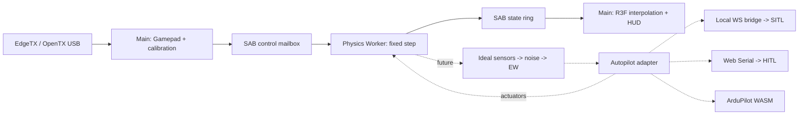

# Архитектура MirageSITL

<!-- source-sha256: f112b9cd40f9aded9c77ef80a30451aa4a149bb7e341367da5fe802a808c3da3 -->

Английский источник: [Source of truth](../architecture.md). Изменения спецификации обновляют оба языка в одной задаче.


Подробные зависимости и порядок исполнения определяет
[PROJECT_ROADMAP.md](PROJECT_ROADMAP.md). Capability milestones в конце
этого руководства не заменяют подробное расписание Phase 0–6.

## Этап 01: реализованные границы

Рабочий вертикальный срез: React 19 / R3F / WebGL, модульный Web Worker,
постоянный `dt = 1/400 s`, атомарный SAB transport, Gamepad, калибровка,
демонстрационная модель мультикоптера, визуализация и диагностика.
JSBSim/BET, ArduPilot, EW и аппаратный HITL ещё не реализованы.
Демонстрационная аэродинамика не валидирована для обучения пилотов.

400–1200 Гц и 60–120 FPS — целевые бюджеты. Фиксированный шаг не означает
гарантированное исполнение каждые 2,5 мс: таймеры, GC, ОС и фоновые вкладки
не дают hard real-time. Производительность на M4 / RTX 4050 пока не измерена.

## Директории

```text
apps/web/
  src/App.tsx                 # HUD, controls, calibration
  src/capabilities.ts         # API checks and implemented mode eligibility
  src/runtime.ts              # Gamepad/rAF, lifecycle, SAB reads
  src/FlightScene.tsx         # Position/SLERP in R3F useFrame
  src/coordinates.ts          # NED to Three.js
  src/physics.worker.ts       # Physics owner and fixed-step scheduler
  vite.config.ts              # COOP/COEP for dev and preview
packages/
  protocol/src/index.ts       # ABI v1, types, SAB readers/writers
  physics/src/index.ts        # Demo dynamics and bounded scheduler
  physics/src/model-manifest.ts # Verified configuration registry
  physics/src/model.schema.json # Strict serialized model schema
  test-support/src/           # Fixture verification and seeded streams
  input/src/index.ts          # Gamepad and channel calibration
docs/
  PROJECT_ROADMAP.md          # English task source
  SPECS_SHARED_MEMORY.md      # Implemented v1 and target v2
  SPECS_SIMULATION_ENGINES.md # Target physics and EW contracts
  architecture.md
  shared-memory.md
  ru/                        # Russian documentation mirrors
tests/
  *.test.ts                  # ABI, physics, scheduler, input
  browser/simulation.spec.ts # Real Worker/SAB, UI, mock USB
```

Следующие компоненты добавляются поэтапно; сейчас этих директорий нет:

| Директория | Назначение |
| --- | --- |
| `apps/bridge` | localhost WS ↔ ArduPilot JSON/UDP и MAVLink |
| `packages/wasm-jsbsim` | pinned JSBSim/Emscripten, C ABI |
| `packages/wasm-bet` | роторы/рамы, native reference + WASM |
| `packages/sensors` | IMU/GNSS/magnetometer, шум, bias, timestamps |
| `packages/autopilot` | direct/external SITL/WASM SITL/HITL adapters |
| `packages/ew` | сценарные искажения наблюдений, hazard volumes |
| `packages/terrain` | streaming render LOD, отдельный collision LOD |
| `packages/cameras` | FPV-камера на креплении, дисторсия объектива, аналоговые видеоэффекты |
| `packages/thermal` | классы материалов поверхности (WorldCover/OSM) с происхождением; не температуры |
| `packages/aar` | recorder/replay, входы/актуаторы/truth/EKF |
| `services/tiles-worker` | Cloudflare proxy, квоты, разрешённый cache |
| `native` | исходники/toolchain pins и эталонные тесты WASM |

## Потоки и ответственность



Worker владеет truth, часами симуляции и интегратором. Main владеет DOM,
WebGL, Gamepad и разрешениями. Физика не читает scene graph и не ждёт
рендер. React получает сводку каждые ~150 мс; R3F читает два последних
состояния: SLERP для quaternion, linear interpolation для координат.
При несовпадении соседних tick после конкурентной публикации/reset
показывается последнее целое состояние.

High-rate данные идут через SAB; `postMessage` — только init/lifecycle/error.
Расширения потребуют отдельных типизированных sensor/actuator buffers.
Hot path физики повторно использует вход, состояние и scratch; явных
аллокаций на шаге нет. Worker имеет отдельную JS-кучу, но абсолютной
изоляции от GC/ОС обещать нельзя. WASM memory выделяется заранее;
`memory.grow`, загрузка terrain, сеть и декодирование исключаются из шага.

## Часы, перегрузка и безопасность ввода

`SteppingPolicy` Worker (на основе `MultiRateClock`) следит за дедлайнами `performance.now()`. Интегратор всегда
получает один и тот же dt. До 8 шагов за callback, затем yield event loop
для lifecycle-команд. Вложенные `setTimeout` могут ограничиваться браузером
примерно 4 мс; один callback тогда выполняет несколько физических шагов.

Если бюджет catch-up исчерпан, целые wall-clock интервалы отбрасываются,
растут `DroppedSteps/Overruns`. Время симуляции увеличивается только на
рассчитанные шаги. Большой переменный dt не подставляется. Pause/resume
переустанавливают дедлайны; reset останавливает цикл и сбрасывает модель.
Скрытие вкладки снимает arm и ставит полёт на паузу. Worker самостоятельно
отвергает input старше 250 мс, нечисловые, disconnected/disarmed команды.
Целевая тяга становится нулевой, ротор продолжает затухать по spool lag.

Для SITL нужен другой режим clock: lockstep sensor/actuator frames с
симуляционными timestamp. Для HITL часы реальные; при перегрузке сессия
останавливается/помечается недостоверной, ускорять её нельзя.

Gamepad API доступен в Window, не в обычном Worker. Опрос в rAF имеет
ненулевую задержку USB/HID/browser/display. Измерять p50/p95/p99 input age
и end-to-end latency; «нулевой input lag» недостижим. Default осей
`roll=0,pitch=1,yaw=3,throttle=2` — начальное предположение, а не стандарт
EdgeTX. UI задаёт индексы/endpoints/центр/инверсию; deadzone 3,5% для
центрированных осей. Калибровка действует только в текущем сеансе.
Переключение источника/устройства/калибровки снимает arm. При отключении
пульта другой пульт автоматически не выбирается. Arm требует газ <=5%.

## Координаты и физические backend

SI, правая NED: North/East/Down. Body FRD: Forward/Right/Down.
Quaternion `(w,x,y,z)` преобразует FRD -> NED; body rates p/q/r — рад/с,
положительный знак по правилу правой руки. Three.js:
`(x,y,z)=(east,-down,-north)` — поворот без отражения. WGS84/ECEF и
origin shifts добавляются отдельно: float64 геодезия, локальные GPU float32.

Demo — rate-controlled toy quad: коллективная тяга, first-order spool lag,
quaternion, gravity и линейное сопротивление. Semi-implicit Euler для
перемещения, `down<=0` — простое ограничение плоской земли. Напряжение
индикативно зависит от газа, а не от батарейной электрохимии. Нет
индивидуальных моторов, контактов шасси, rotor BET или авторотации.

Будущий `DynamicsBackend`:
`reset(config)`, `step(dt, actuatorFrame, atmosphere, contactInput)`,
`readTruth(preallocatedOutput)`. Автопилот возвращает актуаторы;
только физика превращает их в силы/моменты.

* **JSBSim:** его собственные уравнения движения; единицы ft/slugs и
  conventions конвертируются явно на границе C ABI.
* **BET:** относительная скорость элемента, alpha, lift/drag по полярным
  таблицам Re/Mach, интеграция сил/момента. Для авторотации нужны баланс
  аэромомента, инерция, маховые движения и induced flow, а не заданные RPM.
* **Произвольная рама:** `F=ΣR_i F_i`,
  `M=Σ(r_i×R_i F_i + R_i M_i)` в body frame. ESC, напряжение,
  rotor inertia и взаимодействие соосных дисков — отдельные состояния.
* **Rapier/Jolt:** один владелец интегрирования rigid body. BET может
  отдавать силы solver; с JSBSim нужен согласованный обмен контактными
  импульсами. Два независимых интегратора одного тела недопустимы.

## ArduPilot: границы интеграций

Режимы взаимоисключающие; состояния:
`disconnected -> initializing -> warming -> ready -> running -> fault`.

1. **Внешний SITL — первый целевой backend.** Dev bridge
   `ws://localhost:9002`; для HTTPS проверить mixed-content/Private Network
   Access и при необходимости доверенный локальный WSS. Bind loopback,
   проверка Origin/сессии, ограничения размера/частоты. JSON/UDP physics
   backend передаёт truth/sensors lockstep; MAVLink — RC, команды и
   диагностику. Одного `RC_CHANNELS_OVERRIDE` для внешней физики мало.
2. **WASM ArduPilot — feasibility-задача.** HAL, scheduler, storage,
   sockets, лицензии, clock и parity с native SITL. Компиляция в WASM
   сама по себе не доказывает работоспособность порта.
3. **HITL.** Chromium на macOS/Windows, secure context и пользовательский
   gesture для Web Serial `requestPort()`. Safari/Firefox не целевые
   HITL-браузеры. MAVLink2 parser: CRC/dialect/seq/sysid/compid и signing,
   если требуется. `HIL_SENSOR` 200–400 Гц, `HIL_GPS` 5–10 Гц,
   `HIL_ACTUATOR_CONTROLS` с корректными timestamp. Сначала проверить
   поддержку этих сообщений/HIL режима в конкретной ArduPilot build/плате:
   наличие SITL не доказывает поддержку аппаратного HIL.

Serial budget: при 8N1 полезный предел `baud/10` bytes/s, включая framing
и весь трафик. 115200 может не хватить; нужен измеренный запас и baud,
поддерживаемый FC. Выбор порта не равен проверке замкнутого контура.

Прогрев 30 секунд — simulation time в SITL lockstep, без EW, с согласованными
IMU/GNSS/mag. Готовность по EKF health/status/innovations, не по одному
таймеру. В HITL fast-forward неприменим, EKF FC живёт в реальном времени.
Ни warmup, ни MAVLink пока не реализованы.

## EW, terrain, камеры и AAR — следующие этапы

Truth не изменяется: `truth -> ideal sensor -> noise/bias -> EW -> adapter`.
Сенсоры имеют свои частоты, задержки, оси, единицы и seeded RNG. Ускорение
в текущем ABI инерциальное, включая gravity: для HIL accelerometer specific
force требуется отдельно вычесть g и преобразовать в body frame.

Hazard volumes ограничивают `1/r²` через конечный `r_min` и saturation;
конус учитывает направление/aperture. Нужна receiver model: мощность не
равна числу спутников. GNSS loss/spoofing воздействует только на наблюдения;
coherent drift интегрирует согласованные position/velocity, не телепортирует
truth. Mag errors применяются в sensor frame; motor fault — к конкретному
актуатору до суммирования сил. Реакция EKF/flight mode зависит от версии,
параметров и других сенсоров: нельзя обещать обход gate или заданный
failsafe без сценарного регрессионного теста.

WebGL2 — стартовый renderer; WebGPU — отдельный backend с capability
detection и visual parity tests. Metal/DX12 выбирает браузер. Ограничить
DPR, текстуры, tile LOD: RTX 4050 имеет 6 GB с запасом под browser/framebuffer,
M4 использует общую RAM. Terrain decoder не должен занимать Physics Worker.

Google Photorealistic Tiles требует billing/key/attribution и соблюдения
условий Map Tiles API. **Постоянное копирование Google tiles в R2 и
предзагрузка радиуса 10–15 км не принимаются как разрешённый default.**
Сначала проверить лицензию/правила caching; cache только в разрешённых
пределах или использовать собственные/лицензированные offline tiles.
Cloudflare proxy скрывает ключ, ограничивает origin/session/quota и
следует разрешённым TTL. COEP требует CORS/CORP для внешних tiles/WASM.

Analog FPV — postprocessing, отделённый от truth. WorldCover/OSM дают
классы поверхностей, не температуру: thermal требует emissivity, погоду,
solar heating, inertia, attenuation и calibration data. AO не вычисляет
тепло. Начать с контролируемых synthetic материалов и GPU budget.

State ring — лишь ~0,64 с для рендера, не AAR. AAR — отдельный bounded
recorder Worker/IndexedDB: input/actuator/truth/sensors/EKF + seed/config/
version/events. Потери логируются. Replay состояния отличается от
повторного расчёта; native/WASM сравниваются с численными допусками.

## Поэтапная приёмка

| Этап | Результат | Проверка |
| --- | --- | --- |
| 01 — сейчас | Worker/SAB/Gamepad/demo | unit tests + настоящий браузерный Worker, полёт/pause/reset, USB mock |
| 02 | WASM physics abstraction + sensors | силы/моменты, specific force, contacts/energy, convergence 400/800/1200 Гц |
| 03 | внешний SITL lockstep | arm/takeoff/land, EKF readiness, RC, разрывы связи, pinned ArduPilot |
| 04 | BET/рамы/авторотация | thrust curves, torque balance, energy, spool/battery, экспериментальные эталоны |
| 05 | EW + AAR | seeded replay, truth/sensors separation, EKF response и mode changes |
| 06 | HITL | реальная плата/firmware, sustained serial throughput, jitter/loss/failsafe |
| 07 | terrain/FPV/thermal/WebGPU | лицензии/attribution, VRAM/LOD, целевые M4/4050 |
| Feasibility | ArduPilot WASM | parity с внешним SITL до объявления поддерживаемым |

Замеры в production на M4 и RTX 4050, видимая вкладка, после warmup:
frame time p50/p95/p99, worker step/deadline lateness, выполненные steps/s,
dropped wall time, input age, sensor jitter, GPU memory и end-to-end latency.
120 FPS — 8,33 мс/frame, 60 FPS — 16,67 мс; 1200 Гц — 0,833 мс/step
с запасом. Облачный headless smoke не подтверждает эти бюджеты.

## Контракты Phase 0: fixtures, возможности браузера и модели

TASK-004–006 добавляют границы проверки конфигурации; новый физический backend
не вводится. TASK-007 сохраняет работающий ABI v1. Тесты v1 фиксируют 32896 байт,
заголовок 64 байта, 256 состояний по 128 байт и pilot mailbox со смещения 32832.
`tests/protocol-golden.test.ts` добавляет независимый oracle: зарегистрированный
и составленный вручную fixture `tests/fixtures/abi/v1-layout.json` должен
поле за полем совпадать с таблицами байтов v1 для header, state и pilot mailbox
в SPECS_SHARED_MEMORY.md, а каждый байт буфера 32896 байт, записанный
StateWriter и ControlWriter (header, два слота ring, нетронутые слоты,
reserved words и mailbox), должен совпадать с образом, упакованным локальным
DataView. Readers v1 не используются, поэтому симметричная ошибка смещений
encoder/decoder не может пройти проверку. TASK-008 добавляет в packages/protocol
константы layout v2, codecs state и pilot, инициализацию header, проверку и
согласование v1/v2. Они сверяются с `tests/fixtures/protocol/state-v2.hex` —
golden records, упакованными Python struct по таблицам спецификации независимо
от TypeScript encoder. TASK-009 добавляет ограниченный seqlock-транспорт
раздела 4: StateWriterV2/StateReaderV2 с проверками sample_id и head и не
более чем тремя попытками чтения, PilotWriterV2/PilotReaderV2, диагностику
header и безопасную по epoch историю рендера (latestPair никогда не связывает
кадры через смену epoch, модели или пропуск tick). Стресс-тест на реальных
потоках публикует 1e6 кадров в Node worker_threads и в browser module Worker,
пока reader проверяет каждое поле; удаление повторной проверки seqlock
приводит к обнаружению разорванных кадров. TASK-010 добавляет Control
Protocol v2: `parseControlCommandV2` проверяет недоверенные команды и
возвращает нормализованные копии, `control-v2.schema.json` — эквивалентный
контракт JSON Schema 2020-12 (тест эквивалентности на Ajv покрывает более 50
случаев), а `ControlProcessorV2` реализует дедупликацию, epochs, расписание
из 128 команд, применяемых перед интегрированием каждого tick, правила
состояний жизненного цикла и атомарную смену модели через интерфейс
`ControlTargetV2` с заранее выделенным outbox. Работающее приложение остаётся
на v1 до TASK-085.

### Проверенные манифесты fixtures и детерминированные потоки

`packages/test-support` экспортирует `./fixtures` и `./prng`. Реестр
`tests/fixtures/registry.json` задаёт пути относительно `tests/fixtures/`.
Все три эталонных payload явно синтетические: аналитические NED ballistic samples
при постоянной гравитации, конфигурация демонстрационного квадрокоптера и
составленная вручную раскладка байтов ABI v1.
Они служат воспроизводимыми программными эталонами, а не экспериментальным
подтверждением аэродинамики.

`verifyFixture(metadata, bytes)` делает снимки обоих входов до ожидания SHA-256,
проверяет строгие метаданные formatVersion 1, сравнивает 64-символьный lowercase
hash с точными байтами payload и возвращает глубоко замороженный манифест.
Изменение пробелов требует нового hash. Размер payload ограничен 16 MiB.
Каждая величина имеет разрешённую единицу и соответствующие конечные замкнутые
границы; абсолютный и относительный допуски конечны и неотрицательны. Словарь
единиц: `1`, `s`, `us`, `m`, `m/s`, `m/s^2`, `rad`, `rad/s`, `N`, `N*m`,
`kg`, `kg*m^2`, `Pa`, `K`, `V`, `A`, `rev/min`, `gauss`.

Provenance — строгий discriminated union. Синтетическим данным нужен derivation;
измеренным — datasetId, license, разбираемый acquiredAt и HTTPS reference.
Замена synthetic на measured с сохранением derivation отклоняется.
Метаданные не доказывают факт измерения: перед использованием для physics gate
нужно проверить внешний источник. Digest подтверждает целостность относительно
доверенной записи реестра, но не подлинность произвольного переданного hash.

`SeededRandom(seed, streamId)` принимает uint32, включая ноль. Версия —
`mulberry32-mix32-v1`; reset воспроизводит последовательность. Начальное состояние:
`mix32(seed ^ mix32(streamId ^ 0x9e3779b9))`, арифметика uint32. mix32 применяет
xor shifts 16/15/15 и умножения на 0x21f0aaad и 0x735a2d97.
Mulberry32 увеличивает состояние на 0x6d2b79f5. `nextUint32()` выдаёт [0, 2^32−1];
`nextFloat()` делит на 2^32, получая [0,1). Для seed 123 / stream 7 закреплён ряд
uint32: 1915834569, 2163859737, 2018986825, 2541224312, 3937151044.
Раздельные экземпляры имеют независимое изменяемое состояние; это не
криптографический генератор и не доказательство статистической независимости
или непересечения потоков. Конструктор/reset проверяют параметры вне step;
получение чисел не создаёт объектов. Назначение потоков датчикам относится
к будущему контракту sensors/EW.

### Допуск браузера перед запуском Worker

`apps/web/src/capabilities.ts` предоставляет `CapabilityReport` и внедряемый
`inspectCapabilities(environment?, timeoutMs?)`. Для текущего графического demo
нужны secure context, cross-origin isolation, SharedArrayBuffer, Worker и
успешное создание WebGL2 context. При отсутствии обязательных возможностей
Start отключён, Worker/сцена не создаются, показано объяснение. READY по-прежнему
требует подтверждения инициализации от настоящего Worker.
Для USB дополнительно нужен Gamepad API. Наличие пульта, калибровка каналов и
статус подключения остаются отдельными проверками ввода.

WebGPU adapter probe обрабатывает rejection, null и таймаут одну секунду,
сохраняя WebGL2. Временный WebGL2 probe освобождает context. Serial проверяется
без запроса разрешения. Наличие API отличается от допуска режима:
`hitlEligible` и `webgpuEligible` остаются false, поскольку интеграции ещё нет.
Chromium tests подменяют доступность API и проверяют настоящий поддерживаемый
Worker/renderer; оборудование ими не валидируется.

### Допуск модели и неизменяемые ID сессии

`@mirage/physics/model-manifest` — отдельный package export. Его схема AJV 8.20.0
и асинхронный загрузчик не входят в граф импортов текущего demo Worker.
Сериализованные `ModelDescriptor`/`RotorGeometry` используют readonly JSON arrays;
это конфигурационное представление целевой геометрии, а не будущий typed-array
WASM ABI из SPECS_SIMULATION_ENGINES. `VerifiedModel` хранит `{sha256, manifest}`
раздельно, поэтому манифест не хеширует сам себя.

`model.schema.json` использует JSON Schema draft-07, запрещает неизвестные поля
и требует schemaVersion 1, units SI, world NED, body FRD, quaternion order wxyz,
положительную конечную массу, row-major inertia из девяти значений,
modelId в [1,2^32−1], kind demo/bet/jsbsim, rotorCapacity 32 и совпадающие
rotorCount/rotors в [0,32]. Inertia должна быть точно симметричной и положительно
определённой по Cholesky; проверка не исправляет тензор. Rotor IDs и motor
channels — уникальные целые [0,31]. Число лопастей [1,16], azimuth samples
[1,64], polar IDs — uint32.

Для ротора нужны положительные radius/chords/shaft inertia/quadrature widths,
неотрицательные cutout и bearing friction, spin sign ±1, конечная геометрия и
единичный hub-to-body wxyz quaternion с допуском нормы 1e-6. Массивы radial station,
chord, twist и width имеют одинаковую длину [1,64]. Stations строго возрастают
внутри (cutout,radius); сумма widths равна radius−cutout с допуском 1e-9 м.
Это проверка структурной допустимости, а не доступности polar или точности
аэродинамики.

`ModelRegistry.register(bytes, expectedSha256)` копирует не более 1 MiB,
проверяет точные байты по доверенному SHA-256, декодирует строгий UTF-8 JSON,
валидирует и замораживает снимок, затем допускает его в реестр сессии.
Одинаковые ID/hash возвращают ту же запись; иной hash для существующего ID —
коллизия. Ошибки hash/schema/physics не меняют реестр, в том числе когда вызывающий
код изменяет исходные bytes во время hashing. `get(modelId)` возвращает
проверенную неизменяемую запись. Переключение модели runtime появится в
TASK-010; текущий demo этим реестром не переключается. Проверка конфигурации
может выделять память; она не должна выполняться внутри physics step.

## Строительные блоки runtime (Phase 1–2)


### Многочастотные часы (TASK-011)

`packages/physics/src/clock.ts` предоставляет `MultiRateClock` для 400/800/1200 Гц.
Шаг интегрирования всегда ровно `1/hz`; сроки вычисляются как
`origin + n*1000/hz` по целым счётчикам шагов, поэтому дрожание пробуждений
никогда не накапливается в дрейф. За одно пробуждение выполняется не более
`maxCatchUp` (8) шагов; лишнее wall-время отбрасывается и учитывается, а
`reset(nowMs)` при возобновлении отбрасывает накопившийся backlog. Часы
владеют `TickId` текущей epoch (tick 1 — первое интегрирование).
`tickToMicros` точно вычисляет MAVLink `time_usec = floor(tick*1e6/hz)`
(интервалы 833/834 мкс при 1200 Гц), а `isSampleDue`/`sampleIndexAtTick`
рационально планируют выборки IMU/GNSS. `DemoDynamics(hz)` интегрирует с
`dt = 1/hz` и `sim_time = tick/hz`. Worker v1 по-прежнему работает на 400 Гц
через `FixedStepClock`, теперь являющийся `MultiRateClock` на 400 Гц.

### Режимы часов и перегрузка (TASK-012)

`SteppingPolicy` (`packages/physics/src/clock-policy.ts`) оборачивает один
`MultiRateClock` и применяет заданный режим при каждом неблокирующем вызове
`pump(nowMs, gate, step, report)`. **interactive** задаёт темп по wall-времени
и учитывает отброшенные интервалы. **sitl-lockstep** продвигается по времени
симуляции: tick выполняется только когда `StepGate` сообщает о готовности его
кадра актуаторов, ticks никогда не отбрасываются, за один pump выполняется не
более `maxCatchUp`, а при отсутствии кадра вызов сразу возвращается с
`waiting`, поэтому сообщения pause/dispose никогда не блокируются.
**hitl-realtime** задаёт темп по wall-времени относительно физического
полётного контроллера; догоняющие шаги в пределах `maxCatchUp` нормальны, но
любой отброшенный интервал устанавливает fault `hitl-overrun`, после чего ни
один tick не выполняется до `resetEpoch`. Заранее выделенный `PumpReport`
перезаписывается при каждом pump.

### SPSC-очереди датчиков и актуаторов (TASK-013)

`spsc-v2.ts` реализует очереди раздела 5: по одному SAB размером 131 136 байт
на направление, по одному `SpscProducer` и одному `SpscConsumer` на каждый.
Producer владеет write_counter/full_events, consumer — read_counter; счётчики
модульные uint32, и каждое общее слово использует Atomics. Полная очередь
никогда не перезаписывает непрочитанные кадры: `sitl-would-block` возвращает
`would-block`, чтобы lockstep ждал, а `hitl-fault` фиксирует fault сессии до
`resetSpscQueue`, который очищает счётчики и продвигает epoch очереди только
при остановленных обоих концах. Каждое условие заполнения увеличивает
full_events. Consumer копирует слот в scratch и освобождает его до
декодирования. `SensorFrameCodecV2` и `ActuatorFrameCodecV2` упаковывают общий
слот 128 байт и проверяют его по виду: число значений, диапазон f32, точные
целые значения fix/satellites GNSS, биты validity только для GNSS, нулевые
geo-поля вне GNSS и нормализованные актуаторы в [-1,1]. Стресс-тесты на
реальных потоках передают 1e6 кадров по порядку в Node worker_threads и в
browser Worker.

### Приложение на ABI v2 (TASK-085)

Physics Worker — тонкий адаптер вокруг `PhysicsSessionV2`
(`packages/physics/src/session-v2.ts`), поэтому логика Worker выполняется в
Node-тестах. Main создаёт SAB состояния v2 и обе SPSC-очереди и отправляет
`init-v2`; сессия владеет `StateWriterV2`, `PilotReaderV2`, consumer
актуаторов, `ControlProcessorV2`, `SteppingPolicy` и `DemoDynamics(hz)`.
На каждом tick она читает pilot mailbox, применяет защёлку arm, интегрирует и
публикует `FlightStateV2` с идеальной удельной силой `f_b = R^T(a_n - g_n)` и
истинным давлением ISA. Arm защёлкивается только по явному запросу при газе
<=5%; устаревшая epoch, ввод старше 250 ms, недопустимые значения или
изменённый `device_generation` снимают arm и блокируют повторный arm до
отзыва запроса. `GamepadAdapter.generation` меняется вместе с идентичностью
устройства, поэтому другой передатчик с тем же index никогда не наследует
arm. Main читает состояние жизненного цикла из runtime flags header, рисует с
историей `latestPair` и проверяет события Worker. В sitl-lockstep tick ждёт
кадр актуаторов autopilot ровно для этого tick и epoch. Кадры датчиков не
производятся, пока их не потребляет I/O Worker (TASK-034+).

### Инструментирование горячего пути (TASK-014)

`step-metrics.ts` записывает длительность вычислений (бины 0.1 мкс), задержку
пробуждений (бины 0.01 мс) и выполненные шаги в заранее выделенные
гистограммы с фиксированными бинами; квантили — верхние границы бинов,
ограниченные точным максимумом, и вычисляются вне горячего пути.
`scripts/bench-physics.mjs` прогоняет реальный шаг `PhysicsSessionV2` и
измеряет аллокации молодого поколения V8 в окнах из N и 2N шагов после выхода
на установившийся режим (повтор разогревочных окон, пока одно не пройдёт без
GC), по три повтора на размер, минимум по повторам без GC. V8 запускается с
`--single-threaded`: при конкурентной компиляции готовые задания
устанавливаются в основном потоке посреди окна и выделяют 0-120 KB в моменты,
зависящие от нагрузки на CPU, что на hosted runner с 2 CPU давало ложные
срабатывания. Вердикт использует приращение на шаг
`(bytes_2N - bytes_N - (empty_2N - empty_N))/N`, которое исключает
фиксированные затраты на окно; граница по целому окну
`min_k (bytes_k - empty_k)/k` и фиксированные затраты сообщаются рядом. События `gc` сопоставляются по времени, а
аллоцирующий контрольный цикл обязан обнаруживаться в том же прогоне. Первые измерения нашли реальные аллокации на
каждом шаге: вариадический `Math.hypot` и упаковку double в HeapNumber при
передаче в невстраиваемые вызовы или возврате из них, из-за чего результат
зависел от решений TurboFan по встраиванию. Теперь горячий путь передаёт время
через числовые поля (`nowMs`, методы `*Now()`), возвращает целочисленную
задержку пробуждения и проверяет значения только встроенными сравнениями
(`(x >>> 0) === x`, `|x| < F32_ROUNDING_LIMIT`). Накладные расходы таймера
сообщаются отдельно от вычислений; темп таймеров Node не является
доказательством для browser Worker.

### Интерполяция рендера (TASK-015)

`interpolatePoseInto` (`packages/protocol/src/interpolation.ts`) записывает
принадлежащий вызывающему `RenderPoseV2` и никогда не изменяет truth. Она
интерполирует только когда `latestPair` вернул `'pair'` (соседние ticks, одна
epoch и модель) и шаг непрерывен (не более 100 м за tick, 40 км/с при 400 Гц;
больший скачок — телепортация). Позиция интерполируется линейно; ориентация —
slerp по кратчайшему пути (конечный кватернион инвертируется при
отрицательном скалярном произведении, поэтому q и -q никогда не дают полный
оборот), с нормализованным результатом и веткой нормализованного lerp для почти
равных ориентаций. `interpolationAlpha` вычисляет долю по запланированному
wall-времени кадра и частоте из header, поэтому рендер отстаёт от truth не
более чем на один физический шаг и никогда не ждёт writer. `FlightScene`
отображает позу через `nedToRenderPositionInto` и собственно вращение базиса
NED-to-render.

### Native Rust workspace (TASK-016)

`native/` — Cargo workspace со scalar crate `mirage-bet` (`native/bet`),
собираемым нативно для тестов и в `wasm32-unknown-unknown` для браузеров;
toolchain закреплён в `native/rust-toolchain.toml`. Его bootstrap kernel —
сила элемента раздела 3 `dF = 1/2 rho U^2 c dr (C_L l + C_D d)` с порогом
`U < 1e-6 m/s`; это scalar element reference, сохранённый для ABI regression.
Native rotor reference теперь получает коэффициенты из polar (TASK-019/020).
Сборка wasm32 устанавливает trapping allocator; проверенные ABI memory views —
другая узкая unsafe-граница. Нет host imports; экспортируются `memory`, `bet_abi_version` (= 1) и
`bet_bootstrap_element_force`. Release-профиль (LTO, одна единица codegen,
`panic = "abort"`, stripped) даёт побайтно одинаковый артефакт в разных
чистых target-каталогах.

### WASM-артефакты и загрузчик (TASK-017)

`scripts/build-wasm.mjs` собирает два варианта `mirage-bet`: `scalar`,
обязательный baseline, и `simd128` (`-C target-feature=+simd128`), каждый в
своём target-каталоге, и записывает `manifest.json` с версией схемы, crate,
версией ABI, прочитанной из собранного модуля, toolchain и для каждого
артефакта — именем файла, SHA-256, размером и target features.
`packages/wasm-bet/src/loader.ts` считает manifest неизвестным входом и
проверяет его точно. Он определяет SIMD128 через `WebAssembly.validate` на
минимальном модуле с v128 и загружает `simd128` только при успехе проверки,
иначе — scalar-артефакт (`fallback` сообщает о понижении). До
инстанцирования он проверяет размер и SHA-256 через Web Crypto; после —
требует отсутствия imports, ожидаемых exports и `bet_abi_version`, равного
ABI загрузчика. Затем он увеличивает линейную память до резерва (по
умолчанию и максимум 64 MiB), чтобы `memoryStable()` выявлял любой рост
после arm. Любая ошибка возвращает `ok: false` с причиной и должна
блокировать arm. Загрузка асинхронна и относится к инициализации, а не к step.

### BET C ABI и arena binding (TASK-018)

`native/bet/src/abi.rs` реализует записи раздела 4 как безопасное
пополевое чтение и запись поверх байтовых срезов; слой exports wasm32 в
`lib.rs` — единственное место, где указатели `u32` превращаются в срезы,
после проверки диапазона, выравнивания, `__heap_base` и перекрытия.
`include/bet.h` — общий источник layout. `packages/wasm-bet/src/arena.ts`
один раз кодирует конфигурацию, размещает регионы конфигурации, входа,
выхода и arena выше `__heap_base` внутри зарезервированной памяти и
выполняет шаг через один заранее созданный DataView в объекты выхода
вызывающей стороны. Production step по-прежнему возвращает `AERODYNAMICS_UNAVAILABLE`
с NaN в аэродинамических выходах до подключения kernels через версионированный
polar/config binding.

### Polar lookup (TASK-019)

`native/bet/src/polar.rs` один раз проверяет заимствованную таблицу CL/CD
по `(Mach, Re, alpha)` и интерполирует трилинейно по `(Ma, ln Re, alpha)`
без аллокаций. Запросы вне таблицы ограничиваются её границей и выставляют
`OUTSIDE_POLAR_VALIDITY`; экстраполяции нет. Native `blade::Rotor` использует lookup (TASK-020); production C ABI
binding остаётся отдельной работой.

### Эталонные atmospheric/rotor modules (TASK-032, TASK-020–023)

Atmosphere package проверяет состояние сухого воздуха и вычисляет ISA troposphere,
Sutherland viscosity, плотность и скорость звука. Wind — seeded fixed-rate
AR(1) с ограниченными инновациями, а не измеренная turbulence model. Native rotor
modules содержат нормированную quadrature, ограниченный signed axial inflow,
динамику RPM свободного вала, zero-offset harmonic hinge flapping и дискретную
передачу angular momentum. Все уравнения, границы и единицы приведены в разделе 3
SPECS_SIMULATION_ENGINES, где явно исключены aeroelastic feedback и validated VRS.

Это reference modules; UI по-прежнему использует demo dynamics. ArduPilot,
JSBSim, измеренная модель автожира и production BET engine не включены.
`kernel-test-exports` собирает отдельные scalar/SIMD численные тестовые артефакты;
production artifact/ABI не меняется. Allocation tests покрывают 1e6 native kernel
steps и миллион шагов WASM dynamics со стабильной памятью. Синтетические эталоны
в tests/fixtures/rotors зарегистрированы с byte hashes, но не являются
экспериментальными измерениями. `scripts/bench-wind.mjs` записывает warmed V8
allocation windows и positive allocating control в test-results/bench/wind.json.

Проверка: npm lint/typecheck/docs/tests/build/browser, а также закреплённые
native Cargo check/test и wasm32 target check. `tests/rotor-kernels.test.ts`
собирает собственный scalar/SIMD harness с tail counts 1/3/5/63. Cloud
functional/numerical результаты не подтверждают M4/RTX frame-time budgets.

### Coaxial reference (TASK-024)

`native/bet/src/coaxial.rs` реализует проверяемую конфигурацию пары и
экспериментальный steady mixing-jet wake без аллокаций. Положительная source
thrust создаёт downstream receiver air velocity; overlap и separation задают
interception. Advected momentum, received/bypass kinetic power и mixing loss
выдаются раздельно и сохраняют принятый ideal-hover source budget. Их нельзя
добавлять как дополнительную тягу или motor power. Disabled coupling точно
совпадает с независимым случаем; положительное spreading даёт far-field independence.

Spreading angle задан явно как synthetic parameter. Модель соосная и
односторонняя; swirl, VRS, transient transport и receiver feedback исключены.
JSON-эталон зарегистрирован по SHA-256. Native и scalar/SIMD WASM tests
проверяют conservation, ограничения и 1e6 шагов без аллокаций. Формулы, единицы
и валидность описаны в engine specification. Production BET C ABI и demo не меняются.


## Решение по контакту и границы интеграции эталонов (TASK-025–035)

Решение: использовать Rapier 0.21.0 для контактного эталона; сохранить
BLOCKED_DECISION для production-приёмки из-за аллокаций JavaScript getter.
Эксперимент сферы/плоскости владеет позицией, скоростью и ориентацией. Суммарный
контактный импульс диагностический и не разрешает повторную интеграцию тела RK4.
Полное шасси самолёта и привязка без аллокаций ещё не реализованы.
`highRateCertified=false` запрещает заявлять прохождение приёмки.

Нативные эталоны мотора/батареи/рамы/RK4 и независимый body ABI v1 существуют.
Каждой ареной тела владеет отдельный экземпляр WASM. Адаптер тела принимает уже
суммированную нагрузку; полная обратная связь роторов/поляр/мощности не подключена
к Worker. Сенсорные эталоны принимают это истинное состояние без создания выходов,
используя целочисленные расписания и независимые потоки шума/задержки. Проба
аллокаций измеряет прогретый Node/V8, а не жёсткое реальное время браузера.

Хеши исходников/инструментов/лицензии JSBSim, C++ C ABI, адаптер SI/исходной системы
и проверки предпосылок сборки добавлены. Нативный smoke проходит; загрузка SDK
заблокирована на storage.googleapis.com. Артефакта самолёта WASM, паритета trim,
контактного обмена и сертификации высокочастотных аллокаций пока нет.
CLI валидации действительно выполняет численные случаи scalar/SIMD для тела,
но возвращает 2 при отсутствии предпосылок экспериментальной достоверности.
См. реализованные разделы [спецификации движков](SPECS_SIMULATION_ENGINES.md).


Решение повторной проверки: готовые объекты и raw-векторы Rapier убирают явное
создание обёрток; raw-шаг с фиксированной топологией сохраняет одного владельца.
G1 по-прежнему не проходит в JS-пакете и отдельно собранном нативном ядре f64
без profiler. Сохраняется BLOCKED_DECISION до сборки upstream без аллокаций или
другого движка. Полная нативная балансировка JSBSim и координатные проверки
проходят, но измеренный критерий аллокатора провален. Необязательная холодная
балансировка и handles с поколениями реализованы; доступ к SDK WASM отклонён.
Отчёт модели v2 содержит диагностику с проверкой хешей и отклоняет
неподдерживаемые эталонные манифесты. См. раздел повторной проверки
SPECS_SIMULATION_ENGINES.md.


Последний повтор: нативные прогоны Rapier/JSBSim с явным `--patched` проходят
миллион шагов с нулём вызовов/байт аллокатора и контрольными суммами траекторий,
совпадающими с оригиналами. Исходные сборки всё ещё выделяют память. Команда
`node scripts/check-engine-patch-parity.mjs` проверяет идентичность отчётов,
исходников и патчей перед сравнением. Патчи сохраняют хранилища, не меняя физику.
Точная область, команды и ограничения приведены в разделе нативных патчей
аллокаций спецификации движков. Результат не сертифицирует production-привязку
Rapier JS/WASM, сборку JSBSim WASM, контактное сопряжение и физическую
достоверность. Блокировки SDK и измеренных данных сохраняются.


TASK-037/038/039/040/048/052/053/056/057/060 добавляют закреплённое подмножество
MAVLink2, версионированную калибровку/режимы радио, допуск жизненного цикла
автопилота, loopback WS/UDP с origin/токеном, Serial по жесту пользователя
с отдельным I/O Worker декодирования, изолированные РЭБ/моторные отказы и
политику рельефа с отказом по умолчанию. Активен демо-backend; SITL/HITL,
полная композиция РЭБ и живая загрузка рельефа не включены.

Команда npm run start -w @mirage/bridge требует локальный MIRAGE_BRIDGE_TOKEN
(64 hex); MIRAGE_BRIDGE_ORIGIN, MIRAGE_MAVLINK_PORT и MIRAGE_PHYSICS_PORT
необязательно задают origin/UDP. Не печатать токены, не добавлять их в URL/
репозиторий. Это loopback ws; HTTPS/WSS/PNA требуют отдельной интеграции.
node scripts/bench-links-ew.mjs all 400 (также 800/1200) даёт Node-свидетельство
аллокаций, не аппаратную приёмку времени. Скалярные удобные методы могут
выделять boxed float: в высокочастотной композиции использовать typed-array
входы/выходы из спецификации движков.

### Геодезия WGS84 и геоид (TASK-036)

`@mirage/sensors/geodesy` преобразует геодезические координаты, ECEF и
фиксированную локальную систему NED во float64 через ECEF, поэтому полюса и
антимеридиан — обычные случаи. `@mirage/sensors/geoid` различает
эллипсоидальную высоту и высоту MSL и блокирует проверку абсолютной точности
MSL, пока не установлена авторитетная сетка геоида с источником, лицензией и hash.

### Lockstep ArduPilot JSON (TASK-041)

`@mirage/autopilot/external-sitl` превращает servo-кадры закреплённого
SIM_JSON ровно в один tick `sitl-lockstep` на каждый новый счётчик кадра и
кодирует строку ответа без аллокаций; мост проверяет оба направления и
отвечает на порт источника SITL, полученный на его привязанном UDP-узле.

### Потоковая передача HIL (TASK-049)

`@mirage/autopilot/hitl` планирует HIL_SENSOR/HIL_GPS по физическим часам,
задаёт `fields_updated` по фактически обновлённым группам, обеспечивает запас
последовательного канала 30% и принимает HIL_ACTUATOR_CONTROLS с проверками
повторов и пропадания в ограниченные буферы. Физический полётный контроллер
пока не задействован.

### Проверка возможностей HITL (TASK-050)

`@mirage/autopilot/hitl-capabilities` — единственный источник вердиктов HITL
READY (доказательства из исходников, проверенный профиль, живое наблюдение), а
`AutopilotSession` отклоняет `hitl` без такого вердикта. См.
[hitl-matrix.md](hitl-matrix.md).

### Шаг позиции GNSS (TASK-054)

`@mirage/ew/position-step` применяет запланированное по tick смещение NED к
наблюдениям GPS через касательную систему WGS84 и геоид, сохраняя скорость;
истинное состояние не затрагивается.

### Когерентный дрейф GNSS (TASK-055)

`@mirage/ew/velocity-drift` интегрирует ограниченное по скорости смещение
позиции/скорости на физических часах с точным кусочным разбиением и явными
политиками восстановления и применяет его только к наблюдениям GPS.

### Композиция конвейера РЭБ (TASK-058)

`@mirage/ew/engine` объединяет подавление, шаг позиции, дрейф, магнитную
аномалию и отказы моторов за ограниченным реестром отказов, применяемым на
границах tick; `@mirage/sensors/pipeline` выполняет база -> РЭБ ->
квантование. Составной путь проходит 1e6 шагов без запуска GC в Node.

### Адаптер потоковой загрузки 3D Tiles (TASK-061)

Выбран загрузчик NASA-AMMOS `3d-tiles-renderer` 0.5.3 (Apache-2.0).
`@mirage/terrain/tiles-provider` разрешает источники через политику
поставщика TASK-060: локальные лицензированные tileset загружаются, а живые
тайлы Google — BLOCKED_EXTERNAL, пока нет аутентифицированного прокси
(TASK-063) и учётных данных поставщика; API-ключи никогда не попадают в клиент.
`ecefToRenderMatrix` размещает tileset в ECEF в локальной системе рендеринга
(x восток, y вверх, z -север) с float64-матрицей из касательной системы WGS84 в
начале координат. `TileFetchTracker` обрабатывает каждый запрос тайла через
plugin-хук загрузчика `fetchData`, считает выполняющиеся запросы, прерывает их
при dispose и классифицирует ошибки (`cors-or-network`, `http`, `aborted`).
`@mirage/terrain/tiles-scene` связывает это с загрузчиком, хранит атрибуцию и
освобождает каждую загруженную модель. FlightScene загружает слой по
требованию (отдельный chunk) только при заданных `VITE_MIRAGE_TILESET_URL` и
`VITE_MIRAGE_TILES_ORIGIN` и показывает атрибуцию и классифицированные ошибки.
Тестовый tileset в `tests/fixtures/tiles` — собственные синтетические данные
CC0.

### LOD рельефа и бюджеты памяти (TASK-062)

`@mirage/terrain/lod-budget` и `@mirage/terrain/resource-cache` ограничивают
нагрузку от рельефа логикой, не зависящей от рендерера и индексируемой по
кадрам. Оценки байтов: геометрия = байты буферов атрибутов и индексов,
текстура = ширина × высота × байт на пиксель (× 4/3 с мип-уровнями).
`TerrainResourceCache` при добавлении соблюдает жёсткий предел 2 GiB оценки
GPU и 512 MiB декодированных данных CPU: новый тайл сначала вытесняет тайлы,
невидимые в текущем кадре (дольше всего невидимые, затем самые старые), а если
видимый набор не оставляет места, тайл отклоняется, освобождается и
учитывается как неудовлетворённый спрос. Каждый ресурс освобождается ровно
один раз (вытеснение, замена, отказ или `clear`). `LodBudget` умножает
целевую экранную ошибку на 1.5 (от 16 до 256 px) в каждом кадре, где спрос
превышает бюджет, и ослабляет её только после 30 подряд кадров, в которых
прогнозируемый объём при более детальной цели (байты × 1.5², число тайлов
растёт с экранной площадью) остаётся ниже 80% обоих бюджетов, поэтому при
зависании нет осцилляций. `RequestQueue` ограничивает очередь (по приоритету,
затем по возрасту; при переполнении отбрасывается или вытесняется самый низкий)
и активные загрузки. Одинаковые входы дают одинаковые цели: деградация не
зависит от настенного времени. `TilesScene` применяет бюджет к загрузчику: его
LRU-предел в байтах равен меньшему бюджету (единая оценка геометрии и текстур
загрузчика учитывается в обоих, так как three.js хранит декодированные массивы
рядом с копиями на GPU), а `errorTarget` следует `LodBudget` в каждом
отрисованном кадре.

### Аутентифицированный прокси тайлов (TASK-063)

`services/tiles-worker` — Cloudflare Worker для Google Photorealistic 3D
Tiles. Ключ поставщика существует только в секретной привязке
`GOOGLE_MAPS_API_KEY` и в URL запроса к поставщику; он никогда не попадает в
ответы, клиентские URL или события журнала. `POST /v1/session` выдаёт токен
сеанса HMAC-SHA256, привязанный к точно совпадающему разрешённому origin и со
сроком действия (по умолчанию 1 ч), с ограничением частоты по IP клиента.
`GET|HEAD /v1/3dtiles/...` требует разрешённый `Origin` и действительный
`X-Mirage-Session`, расходует квоту сеанса и пересылает только пути тайлов
Google (без обхода каталогов) только с параметром запроса Google `session`;
переданный клиентом `key` или любой другой параметр отклоняется. Квоты —
счётчики с фиксированным окном в Durable Object `TileQuota` (один объект на
ключ, поэтому обновления сериализуются между изолятами). Ответы содержат CORS
для origin, `Cross-Origin-Resource-Policy: cross-origin` (COEP), атрибуцию
политики в `X-Mirage-Attribution` и `Cache-Control: no-store`, так как живая
политика Google имеет TTL 0; прокси никогда не кэширует и не загружает заранее.
Тела ошибок поставщика никогда не пересылаются, а текстовые тела, содержащие
ключ, заменяются ответом 502. Конфигурация отказывает по умолчанию
(отсутствуют секрет, список origin или политика, либо политика не Google). На
клиенте `requestTilesSession` проверяет ответ сеанса, а
`TileFetchTracker`/`TilesScene` отправляют заголовок сеанса с каждым запросом.
Сеансы ограничивают и атрибутируют использование, но не аутентифицируют
человека. Тесты только локальные (поддельные поставщик и хранилище Durable
Object); `wrangler` не является зависимостью репозитория, а развёртывание
требует отдельного разрешения.

### Региональный кэш разрешённых наборов данных (TASK-064)

`@mirage/terrain/region-manifest` определяет `mirage.region-manifest/1`:
идентификатор набора данных, `datasetSha256` (SHA-256 канонического индекса
тайлов — строки `path sha256 bytes`, отсортированные по пути),
`cacheVersion`, политику поставщика TASK-060, `cacheable`, центр и радиус
региона (по умолчанию 10 км, максимум 15 км), ограничения по байтам и полный
индекс тайлов с SHA-256, размером и центром каждого тайла. `regionDecision`
отказывает по умолчанию: живые тайлы Google или политика без проверенного
подтверждения лицензии — BLOCKED (нет прав, для Google даже при наличии
подтверждения); отсутствие хеша набора или пустой индекс — BLOCKED (нет
данных); `cacheable: false`, права только на кэш в памяти или TTL 0 дают
NO_CACHE. Поставщик в состоянии BLOCKED ничего не отдаёт.
`services/tiles-worker/src/r2-cache.ts` реализует `RegionCache` поверх
подмножества привязки R2 с ключами
`<datasetId>/<datasetSha256[0..16]>/v<cacheVersion>/<path>`, поэтому новый
хеш набора или новая версия кэша никогда не читают устаревшие объекты. Тайл
записывается только при CACHEABLE, если он есть в индексе, находится внутри
радиуса (расстояние на касательной плоскости WGS84) и совпадает с указанными
размером и SHA-256; тайл из индекса, не прошедший проверку хеша, не отдаётся.
Объекты истекают по TTL политики (чтение истёкшего объекта удаляет его), а
ограничение региона по байтам поддерживается вытеснением самых старых
загрузок. Параллельные записи могут превысить ограничение не более чем на один
объект каждая. В `wrangler.jsonc` бакет не привязан: включение постоянного
кэширования в R2 требует явного разрешения. Тесты используют эмулятор
подмножества привязки R2 в памяти, а не Miniflare.

### Адаптер рендерера: WebGPU с откатом на WebGL2 (TASK-066)

`apps/web/src/render/renderer.ts` создаёт любой из двух бэкендов за единым
набором возможностей (`render`, `setSize`, `setPixelRatio`, `info.memory`,
`dispose`); сцены используют базовые материалы three, которые переводят оба
бэкенда. `detectBackends` сообщает доступность с причиной. Доступность WebGPU
проверяется функционально, а не только по наличию адаптера: проба
запрашивает устройство, выводит один очищенный кадр холста и ждёт завершения
без потери устройства; браузер сам выбирает нативный API (Metal, D3D12,
Vulkan). `createRenderer` выполняет весь запуск WebGPU (инициализация
рендерера, отказ от скрытого резервного WebGL-бэкенда three, освещённая
пробная сцена в области ошибок валидации и необязательная проба вызывающей
стороны) сначала на временном холсте, поскольку холст, однажды вернувший
контекст `webgpu`, уже не может вернуть `webgl2`; любая ошибка даёт
рендерер WebGL2 с `fallbackReason`. В WebGL2 `compileWithFallback` один раз
рисует каждый отдельный материал в цель рендеринга 1×1 (three проверяет
программы лениво) и заменяет материалы с ошибочными шейдерами базовым
резервным материалом, записывая журнал шейдера. `dispose(scene)` освобождает
каждую достижимую геометрию, материал и текстуру ровно один раз, затем
рендерер, и принудительно теряет контекст WebGL. `webgpu.ts` загружается по
требованию. Приложение сохраняет стандартный WebGL-рендерер R3F, если не
указан `?renderer=webgpu|webgl2`; выбранный бэкенд и причина отката доступны
на холсте как `data-render-backend` / `data-render-fallback`.

### FPV-камера и объектив «рыбий глаз» (TASK-067)

`@mirage/cameras` отделяет установленную FPV-камеру от внешней камеры.
`FpvCamera` составляет `q = B · q_bn · q_mount`, где B — базис NED→рендер,
q_bn — ориентация корпус→NED ([w, x, y, z]; q и −q эквивалентны) и
`q_mount = R_y(uptilt) · R_x(roll) · (оси камеры three → FRD)`; положение —
`B (p_ned + R_bn · offset_frd)`. `update(pose)` читает позу только для чтения
и записывает только собственную камеру three.js без выделения памяти; истина
никогда не изменяется. Объектив — модель Kannala-Brandt (OpenCV fisheye):
θ_d = θ(1 + k1θ² + k2θ⁴ + k3θ⁶ + k4θ⁸), нормированный радиус r_d = θ_d, с
квадратными пикселями, горизонтальным полем зрения по всей ширине и
необязательным смещением главной точки. `fisheyeParams` проверяет
монотонность до 90°, ограничивает угол падения 80° (один источник-пинхол;
более широким объективам нужен источник-кубическая карта, не реализован) и
выводит камеру-источник пинхол, покрывающую кадр. `shaders/fisheye.glsl`
перераспределяет выходные пиксели с фиксированным обращением Ньютона в десять
шагов; `fisheyeSourceUvInto` — его зеркало на CPU в float64, а
`projectRayToUv` — прямая модель. Модель `none` — тождественная передача.
Изменение размера сохраняет горизонтальное поле зрения.

### Аналоговые помехи FPV и «желе» rolling shutter (TASK-068)

`AnalogVideo` (`@mirage/cameras/analog`) управляет `shaders/analog.glsl`
(GLSL ES 3.00, WebGL2): аддитивный попиксельный шум, строки развёртки
`1 − I(0.5 + 0.5 cos 2πv·lines)`, разрывы отдельных строк и «желе» rolling
shutter. Строка i видеокадра k экспонируется в момент `t_k + i · lineTime` и
сдвигается на `jellyAmplitude · throttle · sin(2π f_vib t + φ)`, где
`f_vib = f_min + throttle (f_max − f_min)`. Uniform-переменные меняются только
на границах видеокадров (`k = floor(t · frameRate)`), поэтому газ
выбирается один раз за видеокадр и изображение не зависит от частоты
рендеринга. Визуальный ГСЧ — хеш без состояния lowbias32 `seed ⊕ hash(k)`,
независимый от газа, числа вызовов и любых потоков датчиков/РЭБ; шейдер
хеширует координаты пикселей тем же целочисленным хешем, поэтому одинаковые
seed, кадр и газ дают одинаковые байты на одном бэкенде (равенство между
разными GPU не заявляется). Газ только читается, никогда не записывается;
истина не затрагивается. Вся работа с пикселями выполняется на GPU;
`updateFrom` не выделяет память. Числовые uniform-переменные — экземпляры
класса `ScalarUniform`, инициализированные значением double: литералы объектов
`{ value }` разделяют один скрытый класс на весь изолят, который становится
тегированным, как только какой-либо код запишет туда не число (например,
текстуру), после чего каждая запись double выделяет память.

### Карта материалов WorldCover/OSM (TASK-069)

`@mirage/thermal/data-manifest` перечисляет каждый набор данных о материалах
(`mirage.thermal-data/1`) с поставщиком, версией, лицензией, атрибуцией,
SHA-256 локального файла, системой координат (EPSG:4326) и границами. Правила
поставщиков проверяются: ESA WorldCover требует CC-BY-4.0 и «ESA WorldCover
project» в атрибуции, OpenStreetMap — ODbL-1.0 и «OpenStreetMap contributors»,
и только поставщик `synthetic` (CC0-1.0) может и должен быть помечен как
синтетический. В модуле нет сетевого кода. `planWorldCoverTiles` перечисляет
тайлы 3°×3° (по юго-западному углу, например N45E006), нужные региону, и
отклоняет планы больше 4 тайлов, поэтому план региона не может превратиться
в массовую загрузку. `@mirage/thermal/material-map` накладывает здания OSM
(крыша по `roof:material`) поверх дорог OSM (в пределах половины номинальной
ширины для значения `highway`) поверх пикселей WorldCover (pixel-is-area, ряд 0
у северного края, пиксели 1/12000°) поверх синтетического значения по
умолчанию. Отсутствие данных и точки вне всех слоёв дают `synthetic-ground` с
`synthetic: true`. Образцы содержат только идентификатор материала,
источник, идентификатор набора данных и код WorldCover: класс поверхности —
не температура, и парсер легенды отклоняет лишние поля, например температуру.
Каждый слой должен быть зарегистрирован в манифесте, растры должны
соответствовать границам манифеста, а `attributions()` перечисляет наборы
данных, реально давшие образцы. Декодирование GeoTIFF и проверка на реальных
лицензированных тайлах, размещённых локально, пока не реализованы.

### Тепловое состояние поверхности (TASK-070)

`@mirage/thermal/solar` вычисляет положение солнца (уравнения NOAA/Meeus,
сверенные с эталонным случаем NREL SPA), атмосферную массу Kasten–Young,
прямую нормальную освещённость ясного неба по Meinel (S0 = 1361 W/m²,
поправка на эксцентриситет по Spencer), рассеянную = 0.1 · DNI, облачный
множитель Kasten–Czeplak `1 − 0.75 N^3.4` и излучательную способность неба
по Swinbank/Bolz. `@mirage/thermal/heat-balance` интегрирует один слой на
элемент поверхности на CPU, вне любого шейдера:

`C dT/dt = α(DNI·max(0, n·s)(1 − shadow) + DHI·V) + ε(V·ε_sky + 1 − V)σT_air⁴ − εσT⁴ − h(T − T_air) − G(T − T_deep)`

где h = 5.7 + 3.8 v (McAdams), а V — коэффициент видимости неба. Ambient
occlusion входит только как V в эти радиационные члены (закрытая часть неба
заменяется окружением при температуре воздуха); он никогда не заменяет
решатель теплопереноса. `ThermalField.stepFrom` использует интегрирование
Хойна с автоматическими подшагами ниже линеаризованного предела
устойчивости, накапливает чистую энергию на элемент (J/m²) и не выделяет
память. Температура воздуха может браться из состояния атмосферы TASK-032.
`TYPICAL_SURFACE_PROPS` задаёт типичные некалиброванные поглощательную
способность, излучательную способность, поверхностную теплоёмкость и
проводимость к глубинному слою для идентификаторов материалов TASK-069;
проверка по измеренным температурам поверхности остаётся открытой.

### Рендерер тепловизора (TASK-071)

`@mirage/thermal/thermal-camera` отображает температуру поверхности в
уровень на экране: радиация в полосе `L(T) = ∫ B_λ(T) dλ` (Планк, составная
формула Симпсона по полосе профиля), кажущаяся радиация
`L_app = τ(d)[ε L(T_s) + (1 − ε) L(T_refl)] + (1 − τ(d)) L(T_air)` с
пропусканием по Бугеру–Ламберту `τ = exp(−k d)` и уровень
`(L_app − L(T_min)) / (L(T_max) − L(T_min))`, ограниченный [0, 1]. Палитры:
white-hot, black-hot и ironbow (чёрный → фиолетовый → красный → оранжевый →
жёлтый → белый, яркость не убывает). CPU строит таблицу радиации float32 с
шагом 1 K (150–405 K); `shaders/thermal.glsl` (GLSL ES 3.00) вычисляет ту же
цепочку для каждого пикселя по G-буферу (температура, излучательная
способность, расстояние) с необязательным хеш-шумом ±NETD, а
`ThermalCameraPass` выводит её в цель рендеринга с собственным разрешением
прибора. `InstrumentProfile` (разрешение, полоса, NETD, источник калибровки)
— либо синтетический учебный профиль, либо измеренный с названием прибора и
SHA-256 калибровочных данных; только измеренный профиль может заявлять
соответствие прибору, например CADEX, а поставляемый профиль
`synthetic-lwir-640` этого не делает.

### Затвор тепловизора и NUC (TASK-072)

`@mirage/thermal/nuc` моделирует коррекцию неоднородности
микроболометра по времени кадров датчика. Состояния: idle (кадров ещё
нет), open, closed (затвор успокаивается `settleS`) и calibrating
(усреднение `calibrationFrames` кадров однородного поля затвора на уровне
`shutterLevel`), затем снова open со смещением = mean(raw) − shutterLevel,
вычитаемым из всех последующих кадров. Закрытия следуют фиксированной
сетке (первый кадр + k·intervalS), поэтому частота не сдвигается на длину
цикла; `stateAt`/`shutterClosedFor` сообщают модели камеры, видит ли кадр
затвор. Конфигурация отклоняется, если цикл может прервать изображение
дольше `maxInterruptionS` при `minFrameRateHz`. Пока затвор в поле зрения,
выводится последний открытый кадр с пометкой frozen; временные метки вывода
— времена кадров датчика, а кадры с неувеличивающимся временем отклоняются
и подсчитываются. Контроллер не имеет доступа к физике, истине или данным
AAR. `thermal-status` выводит метку HUD (NO SIGNAL, LIVE, NUC) и время с
последней и до следующей калибровки.
