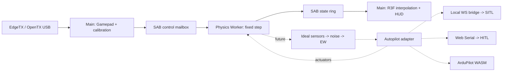

# Архитектура MirageSITL

<!-- source-sha256: eda090670f99143c92f1e885af48254ed1fbbebcd1c4ddd42fbc3cead98ce6f6 -->

Английский источник: [Source of truth](../architecture.md). Изменения спецификации обновляют оба языка в одной задаче.


Подробные зависимости и порядок исполнения определяет
[PROJECT_ROADMAP.md](PROJECT_ROADMAP.md). Capability milestones в конце
этого руководства не заменяют подробное расписание Phase 0–6.

## Этап 01: реализованные границы

Рабочий вертикальный срез: React 19 / R3F / WebGL, модульный Web Worker,
постоянный `dt = 1/400 s`, атомарный SAB transport, Gamepad, калибровка,
демонстрационная модель мультикоптера, визуализация и диагностика.
JSBSim/BET, ArduPilot, EW и аппаратный HITL ещё не реализованы.
Демонстрационная аэродинамика не валидирована для обучения пилотов.

400–1200 Гц и 60–120 FPS — целевые бюджеты. Фиксированный шаг не означает
гарантированное исполнение каждые 2,5 мс: таймеры, GC, ОС и фоновые вкладки
не дают hard real-time. Производительность на M4 / RTX 4050 пока не измерена.

## Директории

```text
apps/web/
  src/App.tsx                 # HUD, controls, calibration
  src/runtime.ts              # Gamepad/rAF, lifecycle, SAB reads
  src/FlightScene.tsx         # Position/SLERP in R3F useFrame
  src/coordinates.ts          # NED to Three.js
  src/physics.worker.ts       # Physics owner and fixed-step scheduler
  vite.config.ts              # COOP/COEP for dev and preview
packages/
  protocol/src/index.ts       # ABI v1, types, SAB readers/writers
  physics/src/index.ts        # Demo dynamics and bounded scheduler
  input/src/index.ts          # Gamepad and channel calibration
docs/
  PROJECT_ROADMAP.md          # English task source
  SPECS_SHARED_MEMORY.md      # Implemented v1 and target v2
  SPECS_SIMULATION_ENGINES.md # Target physics and EW contracts
  architecture.md
  shared-memory.md
  ru/                        # Russian documentation mirrors
tests/
  *.test.ts                  # ABI, physics, scheduler, input
  browser/simulation.spec.ts # Real Worker/SAB, UI, mock USB
```

Следующие компоненты добавляются поэтапно; сейчас этих директорий нет:

| Директория | Назначение |
| --- | --- |
| `apps/bridge` | localhost WS ↔ ArduPilot JSON/UDP и MAVLink |
| `packages/wasm-jsbsim` | pinned JSBSim/Emscripten, C ABI |
| `packages/wasm-bet` | роторы/рамы, native reference + WASM |
| `packages/sensors` | IMU/GNSS/magnetometer, шум, bias, timestamps |
| `packages/autopilot` | direct/external SITL/WASM SITL/HITL adapters |
| `packages/ew` | сценарные искажения наблюдений, hazard volumes |
| `packages/terrain` | streaming render LOD, отдельный collision LOD |
| `packages/aar` | recorder/replay, входы/актуаторы/truth/EKF |
| `services/tiles-worker` | Cloudflare proxy, квоты, разрешённый cache |
| `native` | исходники/toolchain pins и эталонные тесты WASM |

## Потоки и ответственность



Worker владеет truth, часами симуляции и интегратором. Main владеет DOM,
WebGL, Gamepad и разрешениями. Физика не читает scene graph и не ждёт
рендер. React получает сводку каждые ~150 мс; R3F читает два последних
состояния: SLERP для quaternion, linear interpolation для координат.
При несовпадении соседних tick после конкурентной публикации/reset
показывается последнее целое состояние.

High-rate данные идут через SAB; `postMessage` — только init/lifecycle/error.
Расширения потребуют отдельных типизированных sensor/actuator buffers.
Hot path физики повторно использует вход, состояние и scratch; явных
аллокаций на шаге нет. Worker имеет отдельную JS-кучу, но абсолютной
изоляции от GC/ОС обещать нельзя. WASM memory выделяется заранее;
`memory.grow`, загрузка terrain, сеть и декодирование исключаются из шага.

## Часы, перегрузка и безопасность ввода

`FixedStepClock` следит за дедлайнами `performance.now()`. Интегратор всегда
получает один и тот же dt. До 8 шагов за callback, затем yield event loop
для lifecycle-команд. Вложенные `setTimeout` могут ограничиваться браузером
примерно 4 мс; один callback тогда выполняет несколько физических шагов.

Если бюджет catch-up исчерпан, целые wall-clock интервалы отбрасываются,
растут `DroppedSteps/Overruns`. Время симуляции увеличивается только на
рассчитанные шаги. Большой переменный dt не подставляется. Pause/resume
переустанавливают дедлайны; reset останавливает цикл и сбрасывает модель.
Скрытие вкладки снимает arm и ставит полёт на паузу. Worker самостоятельно
отвергает input старше 250 мс, нечисловые, disconnected/disarmed команды.
Целевая тяга становится нулевой, ротор продолжает затухать по spool lag.

Для SITL нужен другой режим clock: lockstep sensor/actuator frames с
симуляционными timestamp. Для HITL часы реальные; при перегрузке сессия
останавливается/помечается недостоверной, ускорять её нельзя.

Gamepad API доступен в Window, не в обычном Worker. Опрос в rAF имеет
ненулевую задержку USB/HID/browser/display. Измерять p50/p95/p99 input age
и end-to-end latency; «нулевой input lag» недостижим. Default осей
`roll=0,pitch=1,yaw=3,throttle=2` — начальное предположение, а не стандарт
EdgeTX. UI задаёт индексы/endpoints/центр/инверсию; deadzone 3,5% для
центрированных осей. Калибровка действует только в текущем сеансе.
Переключение источника/устройства/калибровки снимает arm. При отключении
пульта другой пульт автоматически не выбирается. Arm требует газ <=5%.

## Координаты и физические backend

SI, правая NED: North/East/Down. Body FRD: Forward/Right/Down.
Quaternion `(w,x,y,z)` преобразует FRD -> NED; body rates p/q/r — рад/с,
положительный знак по правилу правой руки. Three.js:
`(x,y,z)=(east,-down,-north)` — поворот без отражения. WGS84/ECEF и
origin shifts добавляются отдельно: float64 геодезия, локальные GPU float32.

Demo — rate-controlled toy quad: коллективная тяга, first-order spool lag,
quaternion, gravity и линейное сопротивление. Semi-implicit Euler для
перемещения, `down<=0` — простое ограничение плоской земли. Напряжение
индикативно зависит от газа, а не от батарейной электрохимии. Нет
индивидуальных моторов, контактов шасси, rotor BET или авторотации.

Будущий `DynamicsBackend`:
`reset(config)`, `step(dt, actuatorFrame, atmosphere, contactInput)`,
`readTruth(preallocatedOutput)`. Автопилот возвращает актуаторы;
только физика превращает их в силы/моменты.

* **JSBSim:** его собственные уравнения движения; единицы ft/slugs и
  conventions конвертируются явно на границе C ABI.
* **BET:** относительная скорость элемента, alpha, lift/drag по полярным
  таблицам Re/Mach, интеграция сил/момента. Для авторотации нужны баланс
  аэромомента, инерция, маховые движения и induced flow, а не заданные RPM.
* **Произвольная рама:** `F=ΣR_i F_i`,
  `M=Σ(r_i×R_i F_i + R_i M_i)` в body frame. ESC, напряжение,
  rotor inertia и взаимодействие соосных дисков — отдельные состояния.
* **Rapier/Jolt:** один владелец интегрирования rigid body. BET может
  отдавать силы solver; с JSBSim нужен согласованный обмен контактными
  импульсами. Два независимых интегратора одного тела недопустимы.

## ArduPilot: границы интеграций

Режимы взаимоисключающие; состояния:
`disconnected -> initializing -> warming -> ready -> running -> fault`.

1. **Внешний SITL — первый целевой backend.** Dev bridge
   `ws://localhost:9002`; для HTTPS проверить mixed-content/Private Network
   Access и при необходимости доверенный локальный WSS. Bind loopback,
   проверка Origin/сессии, ограничения размера/частоты. JSON/UDP physics
   backend передаёт truth/sensors lockstep; MAVLink — RC, команды и
   диагностику. Одного `RC_CHANNELS_OVERRIDE` для внешней физики мало.
2. **WASM ArduPilot — feasibility-задача.** HAL, scheduler, storage,
   sockets, лицензии, clock и parity с native SITL. Компиляция в WASM
   сама по себе не доказывает работоспособность порта.
3. **HITL.** Chromium на macOS/Windows, secure context и пользовательский
   gesture для Web Serial `requestPort()`. Safari/Firefox не целевые
   HITL-браузеры. MAVLink2 parser: CRC/dialect/seq/sysid/compid и signing,
   если требуется. `HIL_SENSOR` 200–400 Гц, `HIL_GPS` 5–10 Гц,
   `HIL_ACTUATOR_CONTROLS` с корректными timestamp. Сначала проверить
   поддержку этих сообщений/HIL режима в конкретной ArduPilot build/плате:
   наличие SITL не доказывает поддержку аппаратного HIL.

Serial budget: при 8N1 полезный предел `baud/10` bytes/s, включая framing
и весь трафик. 115200 может не хватить; нужен измеренный запас и baud,
поддерживаемый FC. Выбор порта не равен проверке замкнутого контура.

Прогрев 30 секунд — simulation time в SITL lockstep, без EW, с согласованными
IMU/GNSS/mag. Готовность по EKF health/status/innovations, не по одному
таймеру. В HITL fast-forward неприменим, EKF FC живёт в реальном времени.
Ни warmup, ни MAVLink пока не реализованы.

## EW, terrain, камеры и AAR — следующие этапы

Truth не изменяется: `truth -> ideal sensor -> noise/bias -> EW -> adapter`.
Сенсоры имеют свои частоты, задержки, оси, единицы и seeded RNG. Ускорение
в текущем ABI инерциальное, включая gravity: для HIL accelerometer specific
force требуется отдельно вычесть g и преобразовать в body frame.

Hazard volumes ограничивают `1/r²` через конечный `r_min` и saturation;
конус учитывает направление/aperture. Нужна receiver model: мощность не
равна числу спутников. GNSS loss/spoofing воздействует только на наблюдения;
coherent drift интегрирует согласованные position/velocity, не телепортирует
truth. Mag errors применяются в sensor frame; motor fault — к конкретному
актуатору до суммирования сил. Реакция EKF/flight mode зависит от версии,
параметров и других сенсоров: нельзя обещать обход gate или заданный
failsafe без сценарного регрессионного теста.

WebGL2 — стартовый renderer; WebGPU — отдельный backend с capability
detection и visual parity tests. Metal/DX12 выбирает браузер. Ограничить
DPR, текстуры, tile LOD: RTX 4050 имеет 6 GB с запасом под browser/framebuffer,
M4 использует общую RAM. Terrain decoder не должен занимать Physics Worker.

Google Photorealistic Tiles требует billing/key/attribution и соблюдения
условий Map Tiles API. **Постоянное копирование Google tiles в R2 и
предзагрузка радиуса 10–15 км не принимаются как разрешённый default.**
Сначала проверить лицензию/правила caching; cache только в разрешённых
пределах или использовать собственные/лицензированные offline tiles.
Cloudflare proxy скрывает ключ, ограничивает origin/session/quota и
следует разрешённым TTL. COEP требует CORS/CORP для внешних tiles/WASM.

Analog FPV — postprocessing, отделённый от truth. WorldCover/OSM дают
классы поверхностей, не температуру: thermal требует emissivity, погоду,
solar heating, inertia, attenuation и calibration data. AO не вычисляет
тепло. Начать с контролируемых synthetic материалов и GPU budget.

State ring — лишь ~0,64 с для рендера, не AAR. AAR — отдельный bounded
recorder Worker/IndexedDB: input/actuator/truth/sensors/EKF + seed/config/
version/events. Потери логируются. Replay состояния отличается от
повторного расчёта; native/WASM сравниваются с численными допусками.

## Поэтапная приёмка

| Этап | Результат | Проверка |
| --- | --- | --- |
| 01 — сейчас | Worker/SAB/Gamepad/demo | unit tests + настоящий браузерный Worker, полёт/pause/reset, USB mock |
| 02 | WASM physics abstraction + sensors | силы/моменты, specific force, contacts/energy, convergence 400/800/1200 Гц |
| 03 | внешний SITL lockstep | arm/takeoff/land, EKF readiness, RC, разрывы связи, pinned ArduPilot |
| 04 | BET/рамы/авторотация | thrust curves, torque balance, energy, spool/battery, экспериментальные эталоны |
| 05 | EW + AAR | seeded replay, truth/sensors separation, EKF response и mode changes |
| 06 | HITL | реальная плата/firmware, sustained serial throughput, jitter/loss/failsafe |
| 07 | terrain/FPV/thermal/WebGPU | лицензии/attribution, VRAM/LOD, целевые M4/4050 |
| Feasibility | ArduPilot WASM | parity с внешним SITL до объявления поддерживаемым |

Замеры в production на M4 и RTX 4050, видимая вкладка, после warmup:
frame time p50/p95/p99, worker step/deadline lateness, выполненные steps/s,
dropped wall time, input age, sensor jitter, GPU memory и end-to-end latency.
120 FPS — 8,33 мс/frame, 60 FPS — 16,67 мс; 1200 Гц — 0,833 мс/step
с запасом. Облачный headless smoke не подтверждает эти бюджеты.
