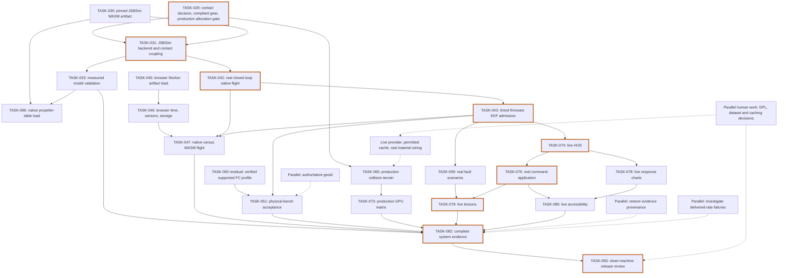

# MirageSITL: руководство по блокирующим факторам и незавершённым работам
<!-- source-sha256: 8209c84ea97a34b73b97179195b351153b66795de758223d8e3f512e589d2891 -->

Английский источник: [Source of truth](../onboarding-blockers-2026-10-17.md).

> Архивное вводное руководство для разработчиков от 17 октября 2026 года.
> Статусы задач, локальные результаты, отсутствующие файлы и ссылки на строки
> относятся к исходному снимку ниже. Перед реализацией сверяйтесь с актуальной
> дорожной картой. Сохранение руководства не запускает проверки приёмки и не
> меняет их результаты. Ссылки на репозиторий сделаны переносимыми; содержание
> анализа и все оговорки сохранены.

## 1. Краткое описание

В MirageSITL уже есть значительный объём проверенных библиотек симуляции,
браузерной инфраструктуры и инструментов приёмки, но интеграция полноценного
полёта и ряд проверок физической достоверности остаются незавершёнными.
Имеющиеся результаты содержат реальные провалы проверок шасси, воздушных винтов,
своевременности шагов и интервалов кадров; их необходимо отличать от отсутствующих
входных данных. **Самая полезная первая разблокировка — TASK-029:** выбрать и
проверить модель упругого шасси и производственную привязку контактного решателя,
поскольку от них зависят и динамика полёта, и столкновения с рельефом.

**Снимок:** 17 октября 2026 года; checkout
`060da5a37be9e17d22a713007c18fdb05ac0acb0`. Исходный анализ был только чтением.
Файлы, статусы задач, пороги, коммиты и удалённое состояние тогда не менялись.

### Количество

Подсчёт использует основное поле `Status` каждой задачи. Всего **86 задач:
65 DONE и 21 незавершённая**.

| Основной статус в дорожной карте | Количество |
|---|---:|
| BLOCKED_EXTERNAL | 16 |
| BLOCKED_DECISION | 2 |
| FAILED_VALIDATION | 0 |
| TODO | 2 |
| IN_PROGRESS | 1 |

**Отсутствие задач со статусом FAILED_VALIDATION не означает отсутствия провалов.**
Пять групп наблюдаемых провалов находятся внутри задач с другими статусами:

| Группа проваленных проверок | Результаты |
|---|---|
| Сравнение шасси с NASA | Девять испытаний падением не проходят измеренные ограничения по замедлению и ходу |
| Исходное сравнение винтов UIUC | 0 из 534 сравниваемых точек проходят оба допуска коэффициентов |
| Сравнение UIUC с XFOIL | Проходят 26 из 165 сравниваемых точек; сравнение в целом не проходит |
| Выдача шагов высокой частоты в Node | Прогоны 800/1200 Hz теряют шаги и обеспечивают примерно 517/520 Hz |
| Частота кадров GPU | Записанные p99 интервалов демо превышают предел 60 FPS; 120 FPS не достигнуты |

Источники: [дорожная карта][roadmap], [текущий отчёт моделей][models],
[проверка ноутбука][laptop].

### Важные уточнения к прежним описаниям блокировок

- **ArduPilot WASM уже существует.** Две локальные копии артефактов совпадают с
  зафиксированными хешами и размерами. Записанный smoke-тест в Node получил
  23 heartbeat. Загрузка в браузере и интеграция полёта остаются незавершёнными.
- **Сборка нативного исполняемого файла ArduPilot под WSL документирована.**
  Его текущие байты не проверялись независимо в этом анализе. Отсутствующий
  драйвер замкнутого контура остаётся блокировкой.
- **Emscripten 4.0.15 установлен для ArduPilot.** Прежний сбой облачного
  скачивания не доказывает, что получить SDK на этом ноутбуке всё ещё невозможно.
- **Декодирование настоящих WorldCover реализовано.** Последняя запись TASK-069
  содержит 17 проверок реальных тайлов. Подключение к приложению, данные
  OpenStreetMap и проверка контрольных сумм издателя остаются открытыми.
- **Для hosted CI есть успешные исторические прогоны.** Прежняя блокировка
  runner/биллинга устранена последующими результатами. Hosted-статус текущего
  коммита не запрашивался.
- **Исторические результаты требуют осторожности.** Из 113 записей манифеста
  ноутбука 104 всё ещё совпадают, а девять изменились. Четыре диагностических
  отчёта native/contact, на которые ссылается текущий отчёт моделей, локально
  отсутствуют.

Источники: [результаты сборки ArduPilot][r045], [пересмотренное решение о
реализуемости][apdecision], [WorldCover][r069], [CI][r003],
[манифест результатов ноутбука][manifest].

## 2. Словарь для начинающих

- **SITL — Software In The Loop:** настоящая прошивка автопилота управляет
  виртуальным летательным аппаратом. Представьте, что «мозг» аппарата тренируется
  с виртуальным телом.
- **HITL — Hardware In The Loop:** физическая плата полётного контроллера получает
  виртуальные показания датчиков и возвращает команды управления. Дополнительно
  проверяются настоящая электроника и своевременность передачи данных.
- **ArduPilot:** программный автопилот, оценивающий движение аппарата и выдающий
  команды двигателям или управляющим поверхностям.
- **Полётный контроллер, FC:** вычислительная плата с прошивкой автопилота.
  Работающий USB подтверждает связь, но не готовность к полёту.
- **EKF — Extended Kalman Filter:** расширенный фильтр Калмана объединяет
  неточные датчики для оценки положения, скорости и ориентации. Как при сверке
  нескольких неточных карт, он также обнаруживает расхождения.
- **MAVLink:** структурированный протокол сообщений телеметрии и команд.
  Получение MAVLink не доказывает поддержку всех сообщений симуляции прошивкой.
- **JSBSim:** движок динамики полёта, вычисляющий движение по силам, управлению и
  конфигурации аппарата.
- **Blade Element Theory, BET — теория элемента лопасти:** лопасть разбивается на
  небольшие участки; силы на них вычисляются отдельно и суммируются.
- **WASM — WebAssembly:** скомпилированный код для браузеров и других сред.
  Выполнение в Node не доказывает совместимость с браузером.
- **SharedArrayBuffer:** память, общая для нескольких JavaScript Worker.
  Читателям и писателям нужен согласованный протокол владения и синхронизации.
- **Горячий путь без аллокаций:** часто повторяемый код симуляции после
  инициализации не создаёт новую временную память. Это уменьшает прерывания
  сборщиком мусора, освобождающим неиспользуемую память.
- **Фиксированный шаг и Hz:** каждый шаг продвигает модель на одинаковое
  виртуальное время. При 400 Hz это 1/400 секунды; отдельно требуется выдавать
  эти шаги вовремя по реальным часам.
- **Эталонная фикстура или оракул:** доверенный образец для оценки результата.
  Его получают независимым расчётом, измерением или из документированного
  источника.
- **Подавление GNSS:** помеха, ухудшающая спутниковую навигацию. GNSS обозначает
  спутниковые навигационные системы, например GPS.
- **Спуфинг GNSS:** ложная навигационная информация, вводящая приёмник в
  заблуждение. Искажается наблюдение, а истинное положение внутри симулятора
  должно оставаться отдельно различимым.
- **NUC — Non-Uniformity Correction:** калибровка тепловизора, исправляющая
  различия пикселей. Текущая реализация исправляет синтетическое аддитивное
  смещение каждого пикселя.
- **AAR — After-Action Review:** запись и воспроизведение для разбора учебного
  полёта.
- **Геоид и MSL:** геоид — связанная с гравитацией отсчётная поверхность для
  высоты над средним уровнем моря. Эллипсоидальная спутниковая высота имеет
  другой отсчёт, поэтому требуется геоидальная поправка.
- **RTX/GPU p99 интервала кадров:** GPU рисует сцену; RTX 4050 — один из целевых
  GPU. p99 — интервал, не превышаемый 99% измерений. Редкие медленные кадры могут
  провалить проверку даже при хорошем среднем FPS.
- **HAL — Hardware Abstraction Layer:** код, связывающий прошивку с часами,
  хранилищем, датчиками и каналами связи. Браузеру нужны подходящие замены
  сервисам настольной ОС.
- **Замкнутый контур:** выходы контроллера меняют движение, а движение меняет
  следующие входы датчиков. Простая передача телеметрии не является полётом в
  замкнутом контуре.
- **Поляра:** таблица подъёмной силы и сопротивления профиля лопасти в разных
  условиях работы.
- **CT и CP:** безразмерные коэффициенты тяги и мощности для сравнения винтов
  разных размеров и скоростей вращения.
- **Lockstep:** компоненты продвигаются согласованно только после получения
  соответствующего шага входов/выходов.
- **Epoch и ACK:** epoch идентифицирует сеанс или поколение сброса симуляции.
  ACK — подтверждение результата конкретной команды.
- **Происхождение и SHA-256:** происхождение описывает источник результатов.
  SHA-256 идентифицирует точные байты, но не доказывает факт физического опыта.
- **COOP/COEP:** заголовки изоляции браузера, необходимые приложению для общей
  памяти.
- **FPV:** вид от первого лица с камеры на аппарате.
- **LOD:** уровень детализации; более простой дальний рельеф уменьшает затраты
  памяти и отрисовки.
- **Проверка GPL:** человеческая проверка обязательств при распространении
  прошивки. Успешная сборка её не заменяет.

## 3. Карта зависимостей

Сплошные стрелки показывают основные незавершённые цепочки зависимостей.
Пунктир — вспомогательную работу, которую можно выполнять независимо.
Завершённые предпосылки опущены. Метки узлов оставлены на английском, чтобы
диаграмма точно совпадала с исходным техническим блоком.



Выделенная цепочка — практический критический путь через основные интеграционные
работы. Релиз также ожидает независимые ветви моделей, GPU, эквивалентности WASM
и оборудования.

**Что можно делать параллельно:** готовить checkout JSBSim, загрузку артефакта в
браузере, данные геоида, восстановление результатов, диагностику расписания и
человеческие решения. Разработку нативного драйвера также можно начать, но
TASK-042 нельзя принять до прохождения её объявленных зависимостей.

## 4. Карточки блокировок и незавершённых работ

### Как читать карточки

Репозиторий определяет общие проверки:

- **G0:** корректность тестов, lint, типы, сборка и синхронизация документации.
- **G1:** измеренное отсутствие аллокаций в горячем пути на миллионе шагов.
- **G2:** независимые численные или протокольные эталоны, заданные допуски и
  происхождение.
- **G3:** фактическая производительность: интервалы кадров, реальная частота
  шагов, потери и бюджеты памяти.
- **G4:** реальные результаты оборудования, провайдера или набора данных.

Карточки перечисляют применимые проверки; не каждой задаче нужны все пять.
**S/M/L — оценки для планирования:** небольшая, средняя и большая инженерная
работа. Время ожидания оборудования, разрешений и внешних данных не включено.

### A. Физические модели и аэродинамика

#### TASK-029 — Контакт посадочного шасси

- **Статус:** BLOCKED_DECISION. **Тип:** DECISION с наблюдаемым FAILED проверки.
- **Что это простыми словами:** расчёт того, как колёса, шины и амортизаторы
  замедляют аппарат при посадке.
- **Почему заблокировано:** жёсткая сфера останавливает снижение без реалистичного
  сжатия шасси. Все девять сравнений NASA проваливают измеренные ограничения по
  замедлению и ходу. Поставляемый путь JavaScript/WASM также не сертифицирован
  по G1. [Результаты][r029]
- **Что означает готовность:** G0/G1/G2; проходят проверки падения, качения,
  трения, энергии, проникновения и измеренного шасси; интегрированием владеет
  ровно один компонент.
- **Как устранить:**
  1. Записать решение о решателе/привязке и упругом шасси.
  2. Реализовать отклик шины/стойки по неизменённым измерениям NASA.
  3. Выполнить `npx --no-install vitest run tests/contact.test.ts`.
  4. Выполнить `node scripts/bench-contact.mjs` и
     `node scripts/validate-models.mjs`.
- **Что нужно:** инженер динамики, фикстуры NASA и привязка, способная пройти
  производственные измерения аллокаций.
- **Объём и риск:** **L.** Неправильная передача энергии или двойное интегрирование.
- **Может ли junior сделать один?** **С помощью.** Работа с фикстурами подходит
  начинающему; модель контакта требует специалиста.
- **Ловушки:** проникновение не равно ходу амортизатора. Исправленная нативная
  сборка не сертифицирует поставляемую привязку. [Правила][rules]

#### TASK-030 — Закреплённый WASM-артефакт JSBSim

- **Статус:** BLOCKED_EXTERNAL. **Тип:** EXTERNAL.
- **Что это простыми словами:** настоящий браузерный движок JSBSim из точно
  известных версий исходников и компилятора.
- **Почему заблокировано:** нет проверенного WASM-артефакта JSBSim и smoke-теста
  в Worker. Историческое скачивание SDK в облаке не удалось; новые результаты
  ArduPilot показывают доступность той же версии SDK в другой среде. Текущие
  переменные окружения JSBSim не заданы. [Результаты][r030]
- **Что означает готовность:** G0/G2/G4; проверенные идентификаторы исходников,
  инструментов и лицензий, реальный артефакт и выполнение в Worker.
- **Как устранить:**
  1. Предоставить чистый JSBSim commit
     `570e8115a102df8f877b11e0e59b964ea483e3c0`.
  2. Задать `JSBSIM_SOURCE_DIR` и `MIRAGE_EMSDK_DIR` на совместимом Linux/WSL с
     Emscripten 4.0.15.
  3. Выполнить `node scripts/build-jsbsim.mjs`.
  4. Добавить и выполнить настоящий smoke-тест артефакта в Worker; существующие
     тесты артефакта в основном проверяют защитные условия.
- **Что нужно:** checkout исходников, закреплённый SDK, CMake, совместимая среда,
  проверка прав распространения данных модели.
- **Объём и риск:** **M.** Предположения о путях ОС и браузерная упаковка.
- **Может ли junior сделать один?** **С помощью.** Воспроизводимая настройка
  посильна начинающему.
- **Ловушки:** нативный файл и тест защитных условий не заменяют выполнение WASM.

#### TASK-031 — DynamicsBackend JSBSim

- **Статус:** BLOCKED_EXTERNAL. **Тип:** EXTERNAL.
- **Что это простыми словами:** подключение JSBSim к управлению, движению,
  датчикам и контакту с землёй MirageSITL.
- **Почему заблокировано:** отсутствуют реальная эквивалентность WASM,
  сопряжение контакта и производственные результаты аллокаций. Исторический успех
  исправленной нативной версии документирован, но отчёт локально отсутствует.
  [Результаты][r031]
- **Что означает готовность:** G0/G1/G2/G4; правильные единицы и направления,
  установившийся сбалансированный полёт, эквивалентный отклик управления,
  контактные импульсы и стабильная память.
- **Как устранить:**
  1. Завершить TASK-029/030.
  2. Выполнить `npx --no-install vitest run tests/jsbsim-backend.test.ts`.
  3. Выполнить `node scripts/check-jsbsim-native.mjs` и сравнение с `--patched`
     в настроенной среде.
  4. Реализовать и выполнить проверки WASM из тех же исходников и сопряжения
     контакта.
- **Что нужно:** настоящие артефакты, разрешённые данные аппарата, инженер динамики,
  измерение аллокаций.
- **Объём и риск:** **L.** Ошибки единиц/знаков или двойное интегрирование тела.
- **Может ли junior сделать один?** **С помощью.**
- **Ловушки:** подставные граничные модули проверяют защиту адаптера, а не физику
  JSBSim.

#### TASK-033 — Проверка достоверности моделей

- **Статус:** BLOCKED_EXTERNAL. **Тип:** EXTERNAL с наблюдаемым FAILED проверки.
- **Что это простыми словами:** установить численную согласованность расчётов и
  соответствие измеренному поведению аппарата.
- **Почему заблокировано:** численные случаи проходят, но контакт и оба сравнения
  винтов провалены. Нет измерений аппарата и полного производственного backend.
  XFOIL улучшил некоторые случаи, но не закрыл общую проверку. [Отчёт][models]
- **Что означает готовность:** G0/G1/G2/G4; численные допуски, независимо измеренная
  достоверность и допущенная производственная интеграция.
- **Как устранить:**
  1. Исправить контакт через TASK-029.
  2. Исследовать концевые потери лопастей, неравномерный и закрученный поток;
     расширять поляры только обоснованными данными.
  3. Получить идентифицированные измерения аппарата и завершить привязку backend.
  4. Выполнить `npx --no-install vitest run tests/uiuc-propeller.test.ts` и
     `node scripts/validate-models.mjs`.
- **Что нужно:** специалист по аэродинамике, измеренные геометрия/поляры/данные
  аппарата, проверенные права на наборы данных.
- **Объём и риск:** **L.** Улучшение одного винта может скрыть ошибки других.
- **Может ли junior сделать один?** **Нет** для приёмки модели; **с помощью** для
  воспроизводимого анализа.
- **Ловушки:** не подгонять допуски под результат и не называть выход XFOIL
  экспериментальным измерением.

#### TASK-086 — Таблицы винтов JSBSim из UIUC

- **Статус:** BLOCKED_EXTERNAL. **Тип:** EXTERNAL.
- **Что это простыми словами:** передать JSBSim измеренные таблицы тяги и мощности
  винтов.
- **Почему заблокировано:** шесть таблиц сформированы, но загрузка нативным JSBSim
  и сравнение измеренной тяги не выполнены. Не решены требования к XML и
  отсутствующий момент инерции винта. [Результаты][r086]
- **Что означает готовность:** G0/G2/G4; точная генерация, прослеживаемость источников,
  нативная загрузка и статическая/поступательная тяга в пределах 1%.
- **Как устранить:**
  1. Предоставить закреплённый checkout JSBSim.
  2. Выполнить `python3 -I data/jsbsim/generate_uiuc_propellers.py --check`.
  3. Выполнить `npx --no-install vitest run tests/jsbsim-propellers.test.ts`.
  4. Реализовать и выполнить отсутствующий нативный тест загрузки и тяги.
- **Что нужно:** JSBSim, происхождение UIUC, измеренная или обоснованная инерция,
  проверка прав.
- **Объём и риск:** **M.** Номинальный диаметр и поведение за концом таблицы могут
  вводить в заблуждение.
- **Может ли junior сделать один?** **С помощью.**
- **Ловушки:** форма XML и хеши не доказывают, что JSBSim принимает и правильно
  использует таблицы.

#### Остаток TASK-036 — Абсолютная высота над средним уровнем моря

- **Статус:** задача DONE; абсолютная точность BLOCKED_EXTERNAL. **Тип:** EXTERNAL.
- **Что это простыми словами:** преобразование спутниковой высоты в высоту над
  средним уровнем моря.
- **Почему заблокировано:** нет авторитетной сетки геоида. `NO_GEOID` использует
  нулевую поправку и явно оставляет точность предварительной. [Контракт][geoid]
- **Что означает готовность:** G0/G2/G4; идентифицированная сетка, корректная
  интерполяция и независимые проверки высоты.
- **Как устранить:**
  1. Выбрать авторитетный EGM96/EGM2008 с документированными покрытием и правами.
  2. Записать точные байты, единицы, соглашения и SHA-256.
  3. Загрузить через `GridGeoid`; проверить независимые координаты.
  4. Выполнить `npx --no-install vitest run tests/geodesy.test.ts`.
- **Что нужно:** набор данных и специалист по геодезии для проверки.
- **Объём и риск:** **M.** Ошибки ориентации сетки, знака или определения высоты.
- **Может ли junior сделать один?** **С помощью.**
- **Ловушки:** синтетическая сетка проверяет интерполяцию, но не реальную
  абсолютную точность.

#### Производственная привязка BET — Остаток TASK-018–028/033

- **Статус:** явно не завершена; отдельного статуса задачи нет. **Тип:** TODO.
- **Что это простыми словами:** заставить проверенные расчёты ротора действительно
  двигать производственную модель аппарата.
- **Почему заблокировано:** производственный `bet_step` намеренно возвращает
  `AERODYNAMICS_UNAVAILABLE`; интеграция поляр с ядром и роторов с телом неполна.
  [Код][bet]
- **Что означает готовность:** G0/G1/G2, затем G3/G4 для заявленной скорости и
  достоверности.
- **Как устранить:**
  1. Определить версионированную привязку поляр/ротора и обработку отказов.
  2. Соединить силы, моменты, состояние вала и интегрирование тела.
  3. Выполнить закреплённые нативные тесты, `node scripts/build-wasm.mjs` и
     `node scripts/validate-models.mjs`.
  4. Добавить проверки производственного пути и измерения аллокаций.
- **Что нужно:** специалисты Rust/WASM и динамики; проверенные входы модели.
- **Объём и риск:** **L.** Тестовые экспорты могут скрыть отсутствие рабочего пути.
- **Может ли junior сделать один?** **Нет.**
- **Ловушки:** нельзя заменять статус недоступности выдуманным успехом.

### B. Автопилот и интеграция полётного контроллера

#### TASK-042 — Стенд внешней интеграции SITL

- **Статус:** BLOCKED_EXTERNAL. **Тип:** EXTERNAL.
- **Что это простыми словами:** полёт виртуального аппарата под управлением
  настоящей нативной прошивки ArduPilot.
- **Почему заблокировано:** стенд есть, но производственного драйвера замкнутого
  контура и принятой записи полёта нет. Нативная сборка документирована, однако
  текущие настроенные входы отсутствуют. [Результаты][r042]
- **Что означает готовность:** G0/G2/G4; фактическое включение управления, взлёт,
  удержание, посадка, ненулевые управляющие кадры и очистка только своих процессов.
- **Как устранить:**
  1. Завершить заявленную интеграцию TASK-031.
  2. Сверить записанную нативную сборку и исходники с закреплёнными значениями.
  3. Реализовать драйвер физического JSON-обмена и управления.
  4. Задать пять переменных исходников/бинарного файла/драйвера из [runbook][runbook].
  5. Выполнить `node scripts/run-sitl.mjs`.
- **Что нужно:** Linux/WSL, закреплённый ELF, драйвер, параметры, происхождение модели.
- **Объём и риск:** **L.** Взаимная блокировка часов, устаревшие датчики, неполное
  завершение дочерних процессов.
- **Может ли junior сделать один?** **С помощью.**
- **Ловушки:** текущий интеграционный тест проверяет стенд и сконструированные
  трассы; это не записанный полёт.

#### TASK-043 — Прогрев и здоровье EKF

- **Статус:** BLOCKED_EXTERNAL. **Тип:** EXTERNAL.
- **Что это простыми словами:** дождаться достаточной согласованной истории
  датчиков, чтобы настоящий автопилот надёжно оценивал своё состояние.
- **Почему заблокировано:** модули диагностики и прогрева есть, но живой допуск
  прошивки/backend не продемонстрирован. Одних USB-флагов недостаточно.
  [Результаты][r043]
- **Что означает готовность:** G0/G2/G4; 30 виртуальных секунд, свежая диагностика
  прошивки, согласованные времена датчиков и измеренный коэффициент ускорения.
- **Как устранить:**
  1. Получить работающий замкнутый контур TASK-042.
  2. Подавать настоящие сообщения прошивки в `EkfMonitor` и `EkfWarmup`.
  3. Выполнить `npx --no-install vitest run tests/warmup.test.ts`.
  4. Реализовать и выполнить запланированную живую интеграционную проверку
     `ekf-ready`.
- **Что нужно:** трасса прошивки, синхронизированные часы, инженер интеграции.
- **Объём и риск:** **M.** Смешение реального и виртуального времени.
- **Может ли junior сделать один?** **С помощью.**
- **Ловушки:** истечение таймера не означает здоровье EKF; HITL нельзя ускорять.

#### TASK-045 — Сборка ArduPilot WASM

- **Статус:** IN_PROGRESS; распространение BLOCKED_DECISION.
  **Тип:** TODO для оставшейся реализации; DECISION для распространения.
- **Что это простыми словами:** загрузить настоящий скомпилированный автопилот
  в браузерный Worker.
- **Почему заблокировано:** воспроизводимые артефакты и запуск в Node есть.
  Браузерное выполнение, постоянные параметры и проверка распространения GPL
  остаются открытыми. [Результаты][r045]
- **Что означает готовность:** G0/G2/G4; настоящий артефакт с проверенными хешами
  загружается в Worker с проверкой экспортов и пределов памяти.
- **Как устранить:**
  1. Повторно использовать проверенные локальные артефакты.
  2. Задать `MIRAGE_ARDUPILOT_WASM_DIR`.
  3. Выполнить `npx --no-install vitest run tests/ardupilot-wasm-build.test.ts`.
  4. Выполнить `node scripts/smoke-ardupilot-wasm.mjs DIR`.
  5. Добавить загрузку в браузерном Worker под COOP/COEP.
- **Что нужно:** имеющиеся артефакты, инженер браузерной интеграции, проверяющий GPL.
- **Объём и риск:** **M.** Node-специфичный glue-код или загрузка pthread Worker.
- **Может ли junior сделать один?** **С помощью.**
- **Ловушки:** heartbeat в Node не равен браузерному полёту. Предел 2 GiB памяти
  прошивки отличается от бюджета арены BET 64 MiB.

#### TASK-046 — Браузерный HAL ArduPilot

- **Статус:** TODO. **Тип:** TODO.
- **Что это простыми словами:** соединить браузерную прошивку с виртуальным
  временем, датчиками, исполнительными выходами, связью и хранилищем.
- **Почему заблокировано:** эти связи с MirageSITL не реализованы. Upstream-плата
  WASM уже предоставляет важную инфраструктуру; нельзя заранее считать, что
  весь HAL нужно переписать. [Решение][apdecision]
- **Что означает готовность:** G0/G1/G2/G4; правильные времена/числа сообщений,
  согласие нативных и WASM-проб, сохранение параметров, пауза и завершение.
- **Как устранить:**
  1. Завершить браузерную загрузку TASK-045.
  2. Соединить экспортированный serial-мост с ограниченными mailbox.
  3. Реализовать lockstep и восстановление постоянных параметров.
  4. Создать запланированный `tests/wasm-hal.test.ts`, затем выполнить
     `npx --no-install vitest run tests/wasm-hal.test.ts`.
- **Что нужно:** специалисты по прошивке/HAL и браузерным Worker.
- **Объём и риск:** **L.** Взаимная блокировка или несовместимое владение временем.
- **Может ли junior сделать один?** **Нет.**
- **Ловушки:** нативные сокеты/файлы не появляются в браузере автоматически.
  Запланированного тестового файла сейчас нет.

#### TASK-047 — Эквивалентность WASM и нативного SITL

- **Статус:** TODO. **Тип:** TODO.
- **Что это простыми словами:** доказать достаточно близкое поведение нативного и
  браузерного автопилотов на одинаковых полётах.
- **Почему заблокировано:** нативный замкнутый полёт и браузерный HAL не завершены.
  [Результаты][r047]
- **Что означает готовность:** G0/G2/G4; включение управления/взлёт/посадка/аварийный
  режим, среднеквадратичная ошибка положения ≤0.5 m и ориентации ≤2° на эталоне
  длительностью 30 секунд.
- **Как устранить:**
  1. Завершить TASK-042/043/046.
  2. Согласовать прошивку, модель, параметры, seed и время событий.
  3. Реализовать запланированные `scripts/compare-autopilot.mjs` и
     интеграционный тест.
  4. После создания выполнить
     `npx --no-install vitest run tests/integration/wasm-sitl.test.ts`.
- **Что нужно:** оба рабочих пути и независимая эталонная запись.
- **Объём и риск:** **L.** Кажущееся расхождение из-за разных входов.
- **Может ли junior сделать один?** **С помощью.**
- **Ловушки:** компаратор и тест — запланированные результаты, а не существующие
  исполняемые проверки.

#### Остаток TASK-050 — Поддерживаемый профиль прошивки HITL

- **Статус:** задача DONE; доступность HITL BLOCKED_EXTERNAL. **Тип:** EXTERNAL.
- **Что это простыми словами:** доказать, что конкретная плата и прошивка
  поддерживают нужные сообщения виртуальных датчиков и исполнительных выходов.
- **Почему заблокировано:** нет проверенного профиля платы. Закреплённый путь
  ArduPilot явно не поддерживает требуемую тройку сообщений. Подключённое
  устройство сообщает выключенный HIL. [Матрица][hitlmatrix]
- **Что означает готовность:** G0/G2/G4; проверенные плата/сборка, совпадающая
  идентичность, HIL-флаг heartbeat и свежие сообщения выходов.
- **Как устранить:**
  1. Выбрать поддерживаемую плату/прошивку; поддержка исходниками PX4
     документирована, но не означает приёмку платы.
  2. Записать результаты прошивки/сборки и живой профиль.
  3. Выполнить `npx --no-install vitest run tests/hitl-capabilities.test.ts tests/autopilot-state.test.ts`.
  4. Применить оценку возможностей к настоящим наблюдениям.
- **Что нужно:** владелец оборудования, совместимый FC, специалист по прошивке.
- **Объём и риск:** **M–L.** Выбор несовместимого пути прошивки.
- **Может ли junior сделать один?** **Нет.**
- **Ловушки:** не подделывать READY и не выводить поддержку HITL из USB-телеметрии.

#### TASK-051 — Физическая приёмка HITL

- **Статус:** BLOCKED_EXTERNAL. **Тип:** EXTERNAL.
- **Что это простыми словами:** проверить непрерывный своевременный обмен с
  физическим контроллером и отключение выходов после разрыва связи.
- **Почему заблокировано:** нет принятого 60-секундного обмена и записи отключения.
  Контроллер есть, но поддерживаемого профиля по-прежнему нет. [Наблюдения][hardware]
- **Что означает готовность:** G0/G2/G3/G4; нулевые потери/переполнение, p99
  опоздания ≤5 ms при 200 Hz или ≤2.5 ms при 400 Hz, наблюдаемое отключение выходов.
- **Как устранить:**
  1. Выполнить предпосылки TASK-043/050.
  2. Следовать [процедуре физического стенда][hitlprocedure].
  3. Записать точные временные отметки и исходные аппаратные результаты.
  4. Выполнить `node scripts/bench-hitl.mjs --input PATH --sha256 HEX`.
- **Что нужно:** поддерживаемый FC, квалифицированный оператор, изолированный
  стенд, достаточная пропускная способность serial.
- **Объём и риск:** **M** после решения совместимости; риски физических выходов
  и своевременности.
- **Может ли junior сделать один?** **Нет.**
- **Ловушки:** анализатор не проводит опыт. Выбранный USB baud не доказывает
  физическую скорость линии.

#### TASK-059 — Регрессионные сценарии EKF

- **Статус:** BLOCKED_EXTERNAL. **Тип:** EXTERNAL.
- **Что это простыми словами:** наблюдать отклик настоящей прошивки на
  навигационные помехи и отказы двигателей.
- **Почему заблокировано:** анализатор есть, но настоящих записей прошивки и
  независимо зафиксированных диапазонов отклика нет. [Результаты][r059]
- **Что означает готовность:** G0/G2/G4; контроль без отказа и все пять случаев
  отказов, настоящая диагностика, проверенные ограничения конкретной прошивки.
- **Как устранить:**
  1. Завершить TASK-042/043.
  2. Записать control, jamming, position-step, velocity-drift, magnetic и
     motor-loss.
  3. Независимо проверить и зафиксировать диапазоны для конкретных параметров.
  4. Выполнить `node scripts/report-ekf.mjs --input PATH --sha256 HEX`.
- **Что нужно:** инженер управления полётом, хеши прошивки/модели/параметров,
  исходные трассы.
- **Объём и риск:** **L.** Неверное толкование неожиданного поведения оценивателя.
- **Может ли junior сделать один?** **С помощью.**
- **Ловушки:** не обещать конкретный аварийный режим. Динамику отказа двигателя
  проверять отдельно от помех, меняющих только наблюдения.

### C. Интерфейс, обучение, окружение и приёмка

#### TASK-065 — LOD рельефа столкновений

- **Статус:** BLOCKED_DECISION. **Тип:** DECISION.
- **Что это простыми словами:** сохранять надёжную физическую землю под аппаратом
  при смене детализации видимого рельефа.
- **Почему заблокировано:** построение и владение чанками работают;
  производственное сопряжение решателя, G1 контакта и допуск полёта — нет.
  [Контракт][collision]
- **Что означает готовность:** G0/G1/G2/G4; совпадающие швы, замена на границах
  тиков, сохранение активной земли и явная обработка отсутствующего покрытия.
- **Как устранить:**
  1. Разрешить TASK-029.
  2. Соединить чанки столкновений с допущенным решателем.
  3. Привязать готовность земли к допуску полёта.
  4. Выполнить `npx --no-install vitest run tests/terrain-collision.test.ts`,
     браузерный тест столкновений и
     `node scripts/bench-terrain-scenarios.mjs 400`, затем 800/1200.
- **Что нужно:** инженеры контакта и рельефа; разрешённые данные высот.
- **Объём и риск:** **L.** Проваливание через отсутствующую землю или освобождение
  активных коллайдеров.
- **Может ли junior сделать один?** **С помощью.**
- **Ловушки:** классы WorldCover — не высоты. Удаление визуальных ресурсов не
  должно удалять физическую землю.

#### TASK-073 — Приёмка GPU, включая проверку реального бюджета TASK-062

- **Статус:** BLOCKED_EXTERNAL. **Тип:** EXTERNAL с наблюдаемым FAILED времени.
- **Что это простыми словами:** проверить отзывчивость полной сцены и память на
  целевых устройствах.
- **Почему заблокировано:** RTX-записи демо есть, но нет полной сцены
  terrain/FPV/thermal, учёта памяти сцены и результатов M4. p99 демо также не
  проходит. [Результаты][laptop]
- **Что означает готовность:** G0/G3/G4; видимый 1080p DPR1, прогрев 60 секунд,
  запись 600 секунд, p99 ≤16.67/8.33 ms, рельеф GPU ≤2 GiB, CPU-кеш ≤512 MiB.
- **Как устранить:**
  1. Интегрировать производственный профиль и учёт памяти.
  2. Раздельно диагностировать показ кадров, расписание, CPU и GPU.
  3. Получить записи обоих целевых устройств.
  4. Выполнить `node scripts/bench-render.mjs --input PATH --sha256 HEX`.
- **Что нужно:** RTX4050 и M4, профилировщик, представительная производственная
  сцена.
- **Объём и риск:** **L.** Оптимизация неверного узкого места.
- **Может ли junior сделать один?** **С помощью.**
- **Ловушки:** PASS сбора пробы и примерно 60 среднего FPS не являются приёмкой.

#### TASK-074 — HUD пилота и свежесть данных

- **Статус:** BLOCKED_EXTERNAL. **Тип:** EXTERNAL.
- **Что это простыми словами:** показывать полётные данные с источником и возрастом.
- **Почему заблокировано:** проверки демо/UI проходят, но живой допуск здоровья
  автопилота зависит от TASK-043. [Результаты][r074]
- **Что означает готовность:** G0/G2/G4; правильные знаки ориентации, настоящие
  статусы прошивки, явные состояния устаревания/неизвестности, ограниченная
  частота UI.
- **Как устранить:**
  1. Завершить TASK-043.
  2. Подключить допущенные состояния прошивки и временные отметки.
  3. Выполнить `npx --no-install vitest run tests/hud.test.ts tests/session-v2.test.ts`.
  4. Выполнить `npx --no-install playwright test tests/browser/hud.spec.ts`
     и живую проверку устаревшего источника.
- **Что нужно:** живой backend, инженеры UI и телеметрии.
- **Объём и риск:** **M.** Отображение устаревших значений как здоровых.
- **Может ли junior сделать один?** **С помощью.**
- **Ловушки:** истина демо не может создавать достоверный статус EKF.

#### TASK-075 — Консоль инструктора и горячие клавиши

- **Статус:** BLOCKED_EXTERNAL. **Тип:** EXTERNAL.
- **Что это простыми словами:** применять учебные изменения и показывать, вступила
  ли каждая команда в силу.
- **Почему заблокировано:** журнал команд работает; демо намеренно отклоняет
  неподдерживаемые weather, fault и model команды. [Код][session]
- **Что означает готовность:** G0/G2/G4 плюс G1 применения backend; корректные
  ACK/epoch и настоящие поддерживаемые эффекты.
- **Как устранить:**
  1. Завершить предпосылки живого HUD/backend.
  2. Связать поддерживаемые команды с производственными компонентами.
  3. Выполнить `npx --no-install vitest run tests/instructor.test.ts`.
  4. Выполнить `npx --no-install playwright test tests/browser/instructor.spec.ts`
     и проверить реальные эффекты.
- **Что нужно:** владелец backend и инженер UI.
- **Объём и риск:** **M–L.** Показ «применено» до подтверждения backend.
- **Может ли junior сделать один?** **С помощью.**
- **Ловушки:** нельзя превращать намеренный отказ демо в видимость успеха.

#### TASK-078 — Графики отклика AAR

- **Статус:** BLOCKED_EXTERNAL. **Тип:** EXTERNAL.
- **Что это простыми словами:** совместить действия пилота, команды выходов и
  движение аппарата для понимания задержек.
- **Почему заблокировано:** графики демо работают; настоящие синхронизированные
  потоки автопилота и приёмка живого HUD остаются открытыми. [Результаты][r078]
- **Что означает готовность:** G0/G2/G4; правильное время, видимые пробелы,
  максимум 10,000 отображаемых точек на ряд.
- **Как устранить:**
  1. Завершить TASK-074 и подключить реальные записанные потоки.
  2. Сохранить время и происхождение каждого потока.
  3. Выполнить `npx --no-install vitest run tests/aar-series.test.ts`.
  4. Выполнить `npx --no-install playwright test tests/browser/aar.spec.ts`
     и изучить реальный отклик.
- **Что нужно:** производственные записи и инженер UI.
- **Объём и риск:** **M.** Кажущаяся задержка из-за несогласованных часов.
- **Может ли junior сделать один?** **С помощью.**
- **Ловушки:** отсутствующие выходы должны оставаться отсутствующими; нельзя
  интерполировать пробелы в вымышленные наблюдения.

#### TASK-079 — Уроки и исполнитель сценариев

- **Статус:** BLOCKED_EXTERNAL. **Тип:** EXTERNAL.
- **Что это простыми словами:** выполнять воспроизводимые уроки и оценивать
  наблюдаемое поведение аппарата.
- **Почему заблокировано:** исполнитель выдаёт детерминированные индексы событий,
  но нет производственной отправки команд, обработки ACK, оркестрации здорового
  автопилота и настоящего происхождения уроков. [Контракт][scenario]
- **Что означает готовность:** G0/G1/G2/G4; точные тики событий, правильная пауза,
  проверенная конфигурация и результат по трассам.
- **Как устранить:**
  1. Завершить TASK-043/059/075.
  2. Привязать активный epoch и ACK команд.
  3. Заменить фиктивные хеши урока фактическими идентификаторами модели/прошивки.
  4. Выполнить `npx --no-install vitest run tests/scenario-runner.test.ts` и
     `node scripts/bench-terrain-scenarios.mjs 400`, затем 800/1200.
- **Что нужно:** владелец интеграции, разработчик обучения, реальные трассы.
- **Объём и риск:** **L.** Оценка запланированного, но отклонённого события.
- **Может ли junior сделать один?** **С помощью.**
- **Ловушки:** истечение таймера не означает успешный урок.

#### TASK-080 — Доступность и интерфейс разрешений

- **Статус:** BLOCKED_EXTERNAL. **Тип:** EXTERNAL.
- **Что это простыми словами:** сделать управление доступным с клавиатуры и
  вспомогательных технологий, включая понятные отказы разрешений.
- **Почему заблокировано:** автоматические проверки демо есть; живые зависимости,
  ручная проверка экранным диктором и физическим устройством не закрыты.
  [Результаты][r080]
- **Что означает готовность:** G0/G4; клавиатура, возврат фокуса, отсутствие
  переполнения на 390px, понятные объявления, отсутствие цикла запросов разрешения.
- **Как устранить:**
  1. Завершить живые потоки TASK-075/078.
  2. Выполнить `npx --no-install playwright test tests/browser/accessibility.spec.ts tests/browser/serial-permission.spec.ts`.
  3. Пройти ручной список runbook с идентифицированным экранным диктором.
  4. Записать поведение реального устройства при отказе/отключении.
- **Что нужно:** тестировщик доступности, экранный диктор, оператор оборудования.
- **Объём и риск:** **M.** Автоматический скан не замечает неудобные цепочки действий.
- **Может ли junior сделать один?** **С помощью.**
- **Ловушки:** пропуск теста программного рендерера не закрывает проверку реального
  устройства.

#### TASK-082 — Матрица системной приёмки

- **Статус:** BLOCKED_EXTERNAL. **Тип:** EXTERNAL.
- **Что это простыми словами:** собрать результаты и точно указать, какие режимы
  отвечают всем требованиям.
- **Почему заблокировано:** большинства реальных результатов нет; провалы моделей
  и производительности остаются. Текущий локальный системный отчёт заблокирован
  из-за отсутствия входа. [Валидатор][systemcode]
- **Что означает готовность:** G0–G4 для каждого режима; у каждого требования есть
  достоверный PASS, FAIL, BLOCKED или NOT_RUN.
- **Как устранить:**
  1. Собрать реальные отчёты каждого режима.
  2. Устранить несовместимость схем и пробелы происхождения, описанные ниже.
  3. Подготовить системные результаты с согласованными исходниками и хешами.
  4. Выполнить `node scripts/validate-release.mjs --input PATH --sha256 HEX`.
- **Что нужно:** владелец интеграции/тестирования и все первичные результаты.
- **Объём и риск:** **L**, в основном из-за предшествующих работ.
- **Может ли junior сделать один?** **С помощью** для сборки результатов; **нет**
  для одобрения всей системы.
- **Ловушки:** тест схемы и вручную записанный PASS не сертифицируют режим.

#### TASK-083 — Происхождение релиза и чистая машина

- **Статус:** BLOCKED_EXTERNAL. **Тип:** EXTERNAL.
- **Что это простыми словами:** показать, что другая машина установит и запустит
  точно идентифицированный и проверенный релиз.
- **Почему заблокировано:** нет чистой установки, проверки лицензий зависимостей,
  полных идентификаторов инструментов и просмотра исходных результатов приёмки.
  [Runbook][runbook]
- **Что означает готовность:** просмотр G0–G4, воспроизводимая опись, установка и
  запуск, восстановление и явные границы поддерживаемых режимов.
- **Как устранить:**
  1. Завершить TASK-082.
  2. Проверить лицензии и описи артефактов.
  3. Установить, собрать и запустить на чистой машине.
  4. Выполнить `node scripts/release-manifest.mjs --input PATH --sha256 HEX`.
  5. Записать отдельную человеческую проверку релиза.
- **Что нужно:** владелец релиза, чистая машина, проверяющий лицензии.
- **Объём и риск:** **M** после завершения зависимостей.
- **Может ли junior сделать один?** **С помощью.**
- **Ловушки:** текущий скрипт описи намеренно не выдаёт релизный PASS; даже
  переданный зелёный системный отчёт оставляет проверку заблокированной.

#### Живой провайдер и развёртывание — Остаток TASK-061/063

- **Статус:** задачи локально DONE; живая интеграция открыта. **Тип:** EXTERNAL.
- **Что это простыми словами:** получать настоящие географические тайлы через
  защищённый серверный прокси.
- **Почему заблокировано:** локальные фикстуры/прокси проверены; реальные учётные
  данные, развёрнутая конфигурация и операционная проверка не подтверждены.
  [Дорожная карта][r061]
- **Что означает готовность:** G0/G2/G4; атрибуция, аутентификация, квоты, защита
  секретов и совместимая изоляция браузера.
- **Как устранить:**
  1. Подготовить проверенную конфигурацию провайдера и развёртывания.
  2. Выполнить `npx --no-install vitest run tests/tiles-provider.test.ts tests/tiles-proxy.test.ts`.
  3. Выполнить `npx --no-install playwright test tests/browser/terrain.spec.ts`.
  4. Получить разрешение на развёртывание, затем проверить реальные запросы и
     отказы.
- **Что нужно:** владелец развёртывания, аккаунт провайдера, приватные secret binding.
- **Объём и риск:** **M.** Стоимость квот или проблемы заголовков только в deployment.
- **Может ли junior сделать один?** **С помощью.**
- **Ловушки:** нельзя помещать ключи в браузерную сборку, логи, URL, фикстуры или чат.

#### Разрешённое постоянное кеширование — Остаток TASK-060/064

- **Статус:** библиотеки политики/кеша DONE; реальная привязка и разрешение открыты.
  **Тип:** DECISION.
- **Что это простыми словами:** хранить географические данные для повторного
  использования.
- **Почему заблокировано:** нет зарегистрированного реального набора с проверенными
  правами кеширования и производственной привязки R2. Код отклоняет постоянное
  хранение Google даже при переданном хеше подтверждения. [Политика][terrainpolicy]
- **Что означает готовность:** G0/G2/G4; проверенные права, ограниченное хранилище,
  целостность, истечение срока и развёрнутое поведение.
- **Как устранить:**
  1. Выбрать собственный/лицензированный контент с документированными правами.
  2. Одобрить область хранения и развёртывание.
  3. Зарегистрировать хеши набора, атрибуцию и проверенную политику.
  4. Выполнить `npx --no-install vitest run tests/r2-cache.test.ts tests/terrain-policy.test.ts`.
  5. Проверить настоящую привязку R2.
- **Что нужно:** проверяющий права, владелец хранения/развёртывания, одобренные данные.
- **Объём и риск:** **M.** Ошибочное приравнивание доступа к праву распространения.
- **Может ли junior сделать один?** **С помощью.**
- **Ловушки:** исключение Google требует отдельно проверенного изменения контракта;
  хеш конфигурации не обходит политику.

#### Визуальные эффекты WebGPU — Остаток TASK-067/068

- **Статус:** WebGL2 DONE; варианты WebGPU не завершены. **Тип:** TODO.
- **Что это простыми словами:** обеспечить искажение объектива и эффекты аналоговой
  камеры на новом backend отрисовки.
- **Почему заблокировано:** текущие эффекты используют WebGL-шейдеры. Успешные
  нативные проверки жизненного цикла WebGPU эти эффекты не реализуют.
  [Дорожная карта][r067]
- **Что означает готовность:** G0/G2, затем G3/G4 для заявленных целевых профилей.
- **Как устранить:**
  1. Решить, обязательны ли эффекты в поддерживаемом профиле WebGPU.
  2. Реализовать совместимые проходы с заданными допусками каждого backend.
  3. Выполнить `npx --no-install vitest run tests/fisheye.test.ts`.
  4. Расширить и выполнить браузерные FPV/renderer-тесты на настоящем оборудовании.
- **Что нужно:** инженер графики и целевые GPU.
- **Объём и риск:** **M–L.** Различия выборки и цвета между backend.
- **Может ли junior сделать один?** **С помощью.**
- **Ловушки:** успех базового renderer не означает полного совпадения функций.

#### Остаток TASK-069 — Подключение реальной карты материалов к приложению

- **Статус:** задача DONE; производственное подключение и входы OSM не завершены.
  **Тип:** TODO.
- **Что это простыми словами:** использовать настоящие классы земли, дороги и
  здания в работающем приложении.
- **Почему заблокировано:** декодирование Israel GeoTIFF и координатные тесты есть.
  Подключение к приложению, выгрузка OpenStreetMap и проверка контрольных сумм
  издателя остаются открытыми. [Последние результаты][r069]
- **Что означает готовность:** G0/G2/G4; правильные координаты/швы, происхождение,
  ограниченная загрузка и явное отсутствие покрытия.
- **Как устранить:**
  1. Подключить существующий оконный decoder и `MaterialMap` вне физики.
  2. Получить и зарегистрировать OSM extract с подходящей лицензией.
  3. Проверить контрольные суммы издателя, если они доступны.
  4. Выполнить `npx --no-install vitest run tests/worldcover-geotiff.test.ts tests/material-map.test.ts`.
- **Что нужно:** геопространственный инженер, имеющиеся тайлы, данные OSM,
  проверка атрибуции.
- **Объём и риск:** **M.** Лишняя память или неверное совмещение координат.
- **Может ли junior сделать один?** **С помощью.**
- **Ловушки:** покрытие Израиля ограничено. Классы земли не дают температуру и
  высоту для столкновений.

#### Производственная тепловая интеграция — Остаток TASK-070/071/072

- **Статус:** синтетические модули DONE; производственная сцена и измеренная
  достоверность открыты. **Тип:** TODO плюс EXTERNAL калибровки.
- **Что это простыми словами:** подавать температуры поверхностей в настоящий
  тепловой вид и калибровать заявленное поведение реальной камеры.
- **Почему заблокировано:** независимые модули работают, но нет интегрированной
  производственной сцены и измеренного профиля прибора. Тепловой проход WebGPU
  также отсутствует. [Контракт][thermal]
- **Что означает готовность:** G0/G2, G3 производственной отрисовки, G4 приборных
  заявлений.
- **Как устранить:**
  1. Соединить поля материалов/температур со входами производственной сцены.
  2. Сохранить независимые часы датчика и симуляции.
  3. Выполнить `npx --no-install vitest run tests/thermal-energy.test.ts tests/thermal-camera.test.ts tests/thermal-nuc.test.ts`.
  4. Выполнить браузерный thermal-тест; до заявления соответствия прибору получить
     калибровочные данные.
- **Что нужно:** инженеры графики/теплофизики; калиброванные приборные данные для
  измеренных заявлений.
- **Объём и риск:** **L.** Убедительная картинка с физически необоснованной
  температурой.
- **Может ли junior сделать один?** **С помощью.**
- **Ловушки:** синтетическая NUC и классы земли не доказывают достоверность камеры.

#### Полночастотная запись и повторная симуляция — Остаток TASK-076/077

- **Статус:** библиотеки записи/воспроизведения DONE; производственный fanout и
  повторный симулятор не завершены. **Тип:** TODO.
- **Что это простыми словами:** записывать синхронизированные потоки на их
  настоящих частотах и повторять ту же конфигурированную симуляцию.
- **Почему заблокировано:** демо пишет прореженные Main-thread samples. Нет
  стандартного производственного повторного симулятора и точного подключения
  производителей датчиков/выходов. [Контракт][aar]
- **Что означает готовность:** G0/G1/G2/G4; ограниченная запись, явные потери,
  точное происхождение и независимо проверенное повторное моделирование.
- **Как устранить:**
  1. Добавить fanout у производителя в отдельную очередь записи.
  2. Сохранить точные идентификаторы tick/epoch/конфигурации.
  3. Предоставить производственный backend повторной симуляции.
  4. Выполнить `npx --no-install vitest run tests/aar-recorder.test.ts tests/aar-replay.test.ts`
     и `node scripts/bench-aar.mjs 400`, затем 800/1200.
- **Что нужно:** владелец производственного backend и инженер записи.
- **Объём и риск:** **L.** Конкурирующие потребители или несовпадение одновременных
  наблюдений.
- **Может ли junior сделать один?** **С помощью.**
- **Ловушки:** нельзя подключать второго потребителя к полётной очереди или
  переписывать запись после расхождения.

### D. Производительность, инфраструктура и результаты

#### Провалы фактической частоты — Остаток производственной проверки TASK-011/012/014

- **Статус:** наблюдаемый FAILED проверки. **Тип:** FAILED.
- **Что это простыми словами:** выполнять шаги с требуемой частотой по реальным
  часам.
- **Почему заблокировано:** пятисекундные записи Windows Node дают 516.710 Hz
  вместо 800 Hz и 519.573 Hz вместо 1200 Hz, теряя 1,426 и 3,415 шагов.
  Вычисление быстрое, но пробуждения около 16 ms превышают ограниченную
  возможность догонять часы. [Исходный отчёт 800 Hz][rate800]
- **Что означает готовность:** G0/G1/G3; p99 вычисления не больше половины шага,
  частота в пределах ±1% за требуемые 10-секундные окна, нулевые потери контроля.
- **Как устранить:**
  1. Профилировать пробуждения таймера отдельно от расчётов.
  2. Разработать поддерживаемое улучшение расписания с сохранением фиксированного
     шага и правил перегрузки.
  3. Выполнить `node scripts/bench-physics.mjs --hz 800 --realtime-seconds 10 --out PATH`;
     повторить для 400/1200.
  4. Отдельно проверить браузерный Worker.
- **Что нужно:** инженер runtime/производительности и свободная целевая машина.
- **Объём и риск:** **M–L.** Зависимость таймеров от платформы.
- **Может ли junior сделать один?** **С помощью.**
- **Ловушки:** успешный allocation-exit не означает нужную частоту. Пять секунд
  не сертифицируют десятисекундные окна.

#### Физическое радио и транспорт вне loopback — Остаток TASK-038/040/048

- **Статус:** локальные модули DONE; внешняя приёмка не проверена. **Тип:** EXTERNAL.
- **Что это простыми словами:** использовать реальные органы управления и
  транспорт в настоящих условиях развёртывания.
- **Почему заблокировано:** аппаратная запись сообщает отсутствие RC. Успех
  loopback WebSocket не покрывает HTTPS/WSS и ограничения браузерной частной
  сети в развёртывании. [Оборудование][hardware]
- **Что означает готовность:** G0/G2/G3/G4 для поддерживаемого пути развёртывания.
- **Как устранить:**
  1. Определить и настроить реальный передатчик/приёмник.
  2. Проверить каналы и калибровку без предположений о раскладке устройства.
  3. Выполнить `npx --no-install vitest run tests/serial-transport.test.ts`.
  4. Выполнить браузерные Serial-тесты и реальные проверки времени/отключения.
  5. Проверить безопасность/origin в deployment, если этот вариант поддерживается.
- **Что нужно:** радиооборудование, оператор, инженер транспорта/развёртывания.
- **Объём и риск:** **M.** Неверное соответствие каналов или устаревшее управление.
- **Может ли junior сделать один?** **С помощью.**
- **Ловушки:** MAVLink по USB не доказывает приёмку радио, прошивки и deployment.

#### Целостность результатов и совместимость отчётов — Сквозная незавершённая работа

- **Статус:** наблюдаемый пробел результатов; отдельного статуса задачи нет.
  **Тип:** TODO.
- **Что это простыми словами:** убедиться, что утверждения приёмки относятся к
  точным отчётам и коду, которые их произвели.
- **Почему заблокировано:** девять из 113 файлов манифеста ноутбука изменились;
  четыре native-отчёта отсутствуют. Модель использует строчные verdict schema-v4,
  а системный валидатор ждёт прописные verdict в оболочках с привязкой исходников.
  [Манифест][manifest], [валидатор][systemcode]
- **Что означает готовность:** G0/G2; прослеживаемые исторические результаты,
  актуальные хеши и явное чтение с учётом схем.
- **Как устранить:**
  1. Сохранить исторические манифесты; определить позднее происхождение каждого
     изменённого отчёта.
  2. Восстановить отсутствующие отчёты или повторить настоящие пробы в будущей
     разрешённой задаче.
  3. Реализовать и проверить совместимость оболочек без повышения blocked/failed
     до успешных результатов.
  4. Выполнить `npx --no-install vitest run tests/evidence-tools.test.ts tests/integration/system-acceptance.test.ts tests/release-manifest.test.ts`.
- **Что нужно:** владелец результатов, исходные отчёты/записи, сопровождающий схемы.
- **Объём и риск:** **M.** Объединение несовместимых ревизий.
- **Может ли junior сделать один?** **С помощью.**
- **Ловушки:** не обновлять хеши лишь для того, чтобы старый манифест выглядел
  актуальным.

**Hosted CI не является дополнительной подтверждённой блокировкой.** TASK-003
содержит успешные hosted unit/browser/build и native-прогоны от 16 октября.
Старые оговорки блокировки в TASK-016–019 перекрыты последующими результатами.
Hosted-выполнение текущего коммита **не проверялось в этом анализе**; владельцу
следует посмотреть соответствующий прогон и сохранённые артефакты.
[Результаты CI][r003]

## 5. Решения, требуемые от человека

Это проектные решения, а не юридические заключения.

| Решение | Варианты и компромиссы | Рекомендация | Кто решает |
|---|---|---|---|
| Контакт/шасси | Адаптировать Rapier binding, выбрать другой решатель или сделать подходящий ограниченный путь. Во всех случаях нужны упругие шина/стойка. | Выбирать по измеренному поведению шасси и производственному G1. | Руководитель динамики и владелец архитектуры |
| Распространение ArduPilot | Оставить артефакты локально или распространять после проверки обязательств. | Сохранить local-only до завершения проверки. | Владелец проекта и квалифицированный проверяющий лицензии |
| Версия Emscripten | Оставить воспроизводимую 4.0.15 или отдельно изучить upstream 6.0.8. | Сначала закончить браузерные результаты текущей версии; миграцию оценивать отдельно. | Руководитель инструментов/прошивки |
| Путь HITL | Поддерживаемая плата/профиль PX4 или отдельная разработка другого поддерживаемого пути сообщений. | Проверить документированный профиль до покупки или перепрошивки. | Руководитель прошивки и владелец оборудования |
| Хранение/распространение UIUC | Оставить сырой архив локально; хранить выбранные данные после проверки; запросить явные условия. | Сохранить хешированную опись и решить права до расширения распространения. | Владелец данных и проверяющий лицензии |
| Постоянный кеш рельефа | Проверенные собственные/лицензированные данные или отдельно проверенное изменение политики/контракта Google. | Использовать явно совместимые права; сохранить запрет постоянного Google-кеша. | Владелец провайдера/deployment и проверяющий права |
| Объём функций WebGPU | Реализовать отсутствующие эффекты или явно ограничить поддерживаемый профиль. | Ясно указать функции и проверить каждый заявленный backend. | Руководители продукта и графики |
| Заявления об измеренной тепловой достоверности | Оставить синтетическое обучение или получить калиброванные данные прибора. | Сохранять synthetic до измеренной приёмки. | Владелец продукта и специалист теплофизики |
| Объём релиза | Ждать все режимы или явно определить более узкий релиз с подтверждёнными результатами. | Решить объём явно; сохранить существующие требования и провалы. | Владелец продукта/релиза |

## 6. Рекомендуемый порядок действий

### Можно делать сегодня без дополнительного оборудования

- [ ] **Согласовать результаты и схемы отчётов — M.** Сохранить исторические
  манифесты и сначала определить отсутствующие/текущие отчёты.
- [ ] **Подготовить техническое решение TASK-029 — M подготовка, L реализация.**
  Сравнить подходящие binding и определить упругое шасси по имеющимся данным NASA.
- [ ] **Подготовить закреплённый JSBSim и конфигурацию SDK — S–M.** По возможности
  использовать имеющуюся совместимую среду сборки.
- [ ] **Закончить браузерную загрузку TASK-045 — M.** Настоящие локальные артефакты
  уже проверяются по хешам.
- [ ] **Разработать драйвер нативного замкнутого контура — L.** Приёмка TASK-042
  остаётся закрыта до прохождения объявленных backend-зависимостей.
- [ ] **Раздельно исследовать расписание Node и показ кадров GPU — M.** Сохранить
  неудачные записи и неизменные пределы.
- [ ] **Подключить существующие WorldCover/thermal/recording компоненты — M–L.**
  Начинать только в новой разрешённой области реализации.
- [ ] **Посмотреть hosted CI нужной ревизии — S.** Не возвращать исторический
  диагноз биллинга без текущих результатов.

### Нужны внешние входы

- [ ] **Авторитетная сетка геоида — M.** Происхождение и независимые проверки высот.
- [ ] **Измеренные параметры шасси/модели — M–L.** Измерения должны подходить модели.
- [ ] **Расширенные аэродинамические эталоны — L.** Устранить недостаточное покрытие
  поляр и отсутствие достоверности аппарата.
- [ ] **Поддерживаемый профиль FC и физический стенд — M–L.**
- [ ] **Производственные GPU-трассы и доступ к M4 — M после завершения сцены.**
- [ ] **Живая конфигурация провайдера и одобренное развёртывание — M.**
- [ ] **OSM extract и проверенные права — M.**
- [ ] **Экранный диктор и реальные проверки разрешений/отключений — S–M.**
- [ ] **Чистая установка/запуск и проверка релиза — M после предшествующих проверок.**

### Требуется человеческое решение

- [ ] **Подход к решателю/привязке шасси — высший приоритет.**
- [ ] **Распространение GPL и область миграции компилятора.**
- [ ] **Выбор прошивки/платы HITL.**
- [ ] **Хранение и распространение архива UIUC.**
- [ ] **Постоянный кеш тайлов и политика развёрнутого провайдера.**
- [ ] **Поддерживаемые функции отрисовки и тепловые заявления.**
- [ ] **Явно определённый объём релиза.**

Совещание по решению может быть коротким; сбор обоснованных результатов для него
может занять существенно больше времени.

## 7. Проверочный список

**Ни одна из следующих тестовых серий или проб не запускалась повторно в исходном
анализе.** Это команды для будущей реализации. Многие пишут отчёты или сборочные
файлы, поэтому намеренно не выполнялись в задаче только чтения.

### Общие проверки после исправления

Из корня репозитория:

```powershell
npm run check:docs
npm run lint
npm run typecheck
npm test
npm run build
npm run test:browser
git diff --check
```

Успех требует:

- Ненулевого числа выполненных тестов без необъяснённых провалов.
- Явного сохранения skipped для пропущенных тестов.
- Соответствия английской документации полным русским зеркалам.
- Сохранения пределов и независимых эталонов.
- Проверки изоляции браузера и настоящего поведения Worker.
- Заявлений только о затронутых проверках; обычные тесты не сертифицируют
  оборудование или физическую достоверность.

### Нативные и WASM-проверки

Выполнять внутри `native/`, чтобы применялась закреплённая версия Rust:

```powershell
cargo check --workspace --locked
cargo test --workspace --locked
cargo check -p mirage-bet --target wasm32-unknown-unknown --locked
```

Затем из корня:

```powershell
node scripts/build-wasm.mjs
node scripts/validate-models.mjs
```

Успех требует настоящего scalar/SIMD-выполнения, правильных идентификаторов
артефактов, применимых allocation-проверок и независимой численной/измеренной
приёмки. **Одной компиляции Cargo недостаточно.**

### Специализированные проверки

| Область | Существующая команда | Что считается успехом |
|---|---|---|
| Сборка JSBSim | `node scripts/build-jsbsim.mjs` | Закреплённый настоящий артефакт и последующий smoke в Worker |
| Нативный JSBSim | `node scripts/check-jsbsim-native.mjs` | Фактические trim/frame/allocation-результаты объявленной сборки |
| Нативные эксперименты с patch | `node scripts/check-contact-native.mjs --patched` и `node scripts/check-jsbsim-native.mjs --patched` | Только записанные нативные результаты |
| Эквивалентность patch | `node scripts/check-engine-patch-parity.mjs` | Совпадение идентификаторов и контрольных сумм траектории; нулевые аллокации patch |
| Производственный контакт | `node scripts/bench-contact.mjs` | Производственный binding проходит allocation-gate |
| Достоверность моделей | `node scripts/validate-models.mjs` | Проходят требуемые численные и измеренные результаты; читать поля JSON |
| Возможности ArduPilot | `node scripts/probe-ardupilot-wasm.mjs` | Есть необходимые результаты; одних деклараций недостаточно |
| Запуск ArduPilot Node | `node scripts/smoke-ardupilot-wasm.mjs DIR` | Настоящий допущенный артефакт и наблюдаемые сообщения прошивки |
| Нативный полёт | `node scripts/run-sitl.mjs` | Реальная закреплённая трасса arm/takeoff/hold/land |
| HITL | `node scripts/bench-hitl.mjs --input PATH --sha256 HEX` | Проверенная реальная запись, пределы времени/потерь, отключение выходов |
| Отказы EKF | `node scripts/report-ekf.mjs --input PATH --sha256 HEX` | Все реальные случаи и независимо зафиксированные диапазоны проходят |
| Приёмка GPU | `node scripts/bench-render.mjs --input PATH --sha256 HEX` | Полный производственный профиль целевого устройства проходит время и память |
| Системная матрица | `node scripts/validate-release.mjs --input PATH --sha256 HEX` | У каждой обязательной проверки режима есть совместимые текущие наблюдения |
| Опись релиза | `node scripts/release-manifest.mjs --input PATH --sha256 HEX` | Правильная опись; отдельная проверка чистой машины/лицензий всё равно требуется |

### Пробы производительности

```powershell
node scripts/bench-physics.mjs --hz 400 --realtime-seconds 10 --out PATH
node scripts/bench-physics.mjs --hz 800 --realtime-seconds 10 --out PATH
node scripts/bench-physics.mjs --hz 1200 --realtime-seconds 10 --out PATH

node scripts/bench-links-ew.mjs all 400
node scripts/bench-aar.mjs 400
node scripts/bench-terrain-scenarios.mjs 400
node scripts/bench-sensors.mjs all
node scripts/bench-wind.mjs
```

Повторить применимые библиотечные пробы на 800 и 1200 Hz. Где поддерживается,
использовать разные пути вывода, чтобы сохранить прежние записи.

Для диагностики видимого демо:

```powershell
node scripts/probe-laptop.mjs --backend webgl2 --warmup 60 --seconds 600
node scripts/probe-laptop.mjs --backend webgpu --warmup 60 --seconds 600
```

Эти демо-пробы **не могут выдать приёмку TASK-073**. Отдельно изучать фактическую
частоту, потери шагов, сырые интервалы кадров, настоящий адаптер, видимость,
профиль и учёт памяти.

### Ловушки кодов возврата

- Большинство анализаторов трасс: **0 = PASS, 1 = FAIL/неправильный вход,
  2 = BLOCKED_EXTERNAL**.
- `validate-models.mjs`: **exit 2 может сопровождать реальный провал измеренной
  проверки**. Читать `contactFidelityStatus`, `propellerFidelityStatus` и общий
  `status`.
- Успех physics benchmark относится к allocation-gate; фактическая частота при
  этом может провалиться.
- PASS пробы ноутбука относится к условиям сбора/backend/layout; p99 всё ещё может
  не пройти.
- Опись релиза намеренно остаётся blocked до отдельной проверки.

Источники: [runbook][runbook], [код валидатора моделей][modelcode],
[physics benchmark][physicscode], [проба ноутбука][probecode].

**Самопроверка покрытия:** все 21 задачи с незавершёнными основными статусами
представлены карточками по одному разу. Включены встроенные блокировки
TASK-036/050 и остальные производственные пробелы задач DONE. Исторические
результаты, текущие отчёты, отсутствующие результаты и не выполненные здесь
проверки явно различаются.

[roadmap]: ../PROJECT_ROADMAP.md
[rules]: ../../CLAUDE.md "Snapshot line 160"
[r003]: ../PROJECT_ROADMAP.md "Snapshot line 151"
[r029]: ../PROJECT_ROADMAP.md "Snapshot line 440"
[r030]: ../PROJECT_ROADMAP.md "Snapshot line 467"
[r031]: ../PROJECT_ROADMAP.md "Snapshot line 482"
[r086]: ../PROJECT_ROADMAP.md "Snapshot line 522"
[r042]: ../PROJECT_ROADMAP.md "Snapshot line 666"
[r043]: ../PROJECT_ROADMAP.md "Snapshot line 677"
[r045]: ../PROJECT_ROADMAP.md "Snapshot line 700"
[r047]: ../PROJECT_ROADMAP.md "Snapshot line 745"
[r059]: ../PROJECT_ROADMAP.md "Snapshot line 882"
[r061]: ../PROJECT_ROADMAP.md "Snapshot line 908"
[r067]: ../PROJECT_ROADMAP.md "Snapshot line 969"
[r069]: ../PROJECT_ROADMAP.md "Snapshot line 989"
[r074]: ../PROJECT_ROADMAP.md "Snapshot line 1057"
[r078]: ../PROJECT_ROADMAP.md "Snapshot line 1105"
[r080]: ../PROJECT_ROADMAP.md "Snapshot line 1128"
[models]: ../../test-results/validation/model-report.json
[laptop]: ../validation/laptop-validation-2026-10-17.md
[hardware]: ../validation/local-hardware-2026-10-17.md
[manifest]: ../../test-results/laptop/evidence-manifest.json
[apdecision]: ../decisions/ardupilot-wasm.md
[geoid]: ../SPECS_SIMULATION_ENGINES.md "Snapshot line 1303"
[bet]: ../../native/bet/src/abi.rs "Snapshot line 10"
[runbook]: ../operations/runbook.md
[hitlmatrix]: ../hardware/hitl-matrix.md
[hitlprocedure]: ../hardware/hitl-test-procedure.md
[collision]: ../SPECS_SIMULATION_ENGINES.md "Snapshot line 1734"
[session]: ../../packages/physics/src/session-v2.ts "Snapshot line 158"
[scenario]: ../SPECS_SIMULATION_ENGINES.md "Snapshot line 1740"
[systemcode]: ../../scripts/validate-release.mjs "Snapshot line 4"
[terrainpolicy]: ../decisions/terrain-licensing.md
[thermal]: ../SPECS_SIMULATION_ENGINES.md "Snapshot line 1466"
[aar]: ../SPECS_SIMULATION_ENGINES.md "Snapshot line 1502"
[rate800]: ../../test-results/laptop/physics-800-idle.json
[modelcode]: ../../scripts/validate-models.mjs "Snapshot line 361"
[physicscode]: ../../scripts/bench-physics.mjs
[probecode]: ../../scripts/probe-laptop.mjs "Snapshot line 113"
